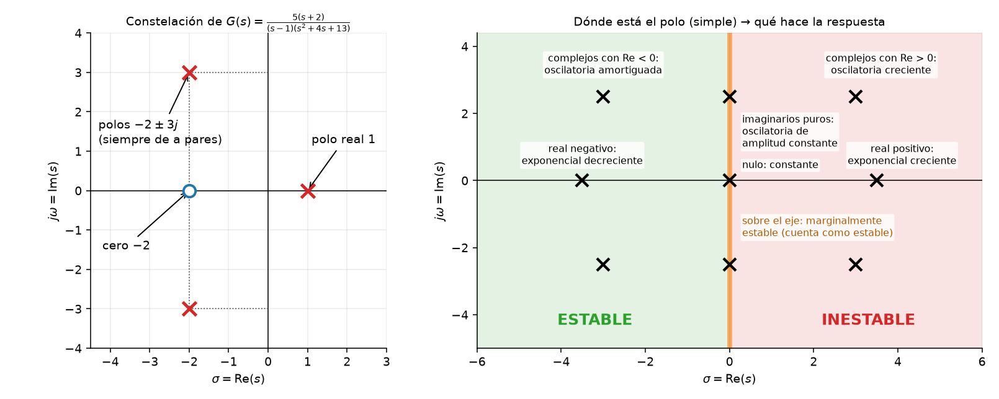
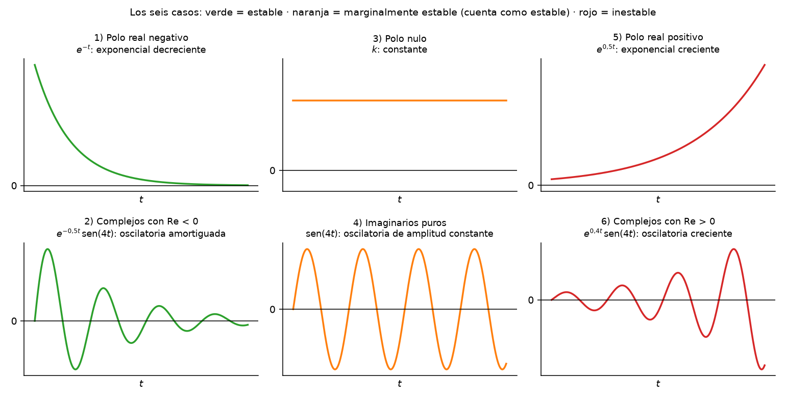
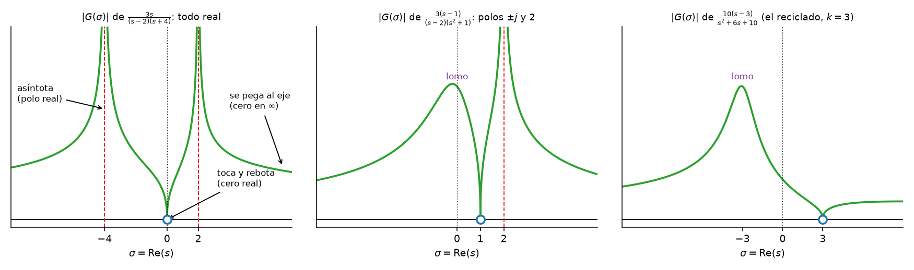
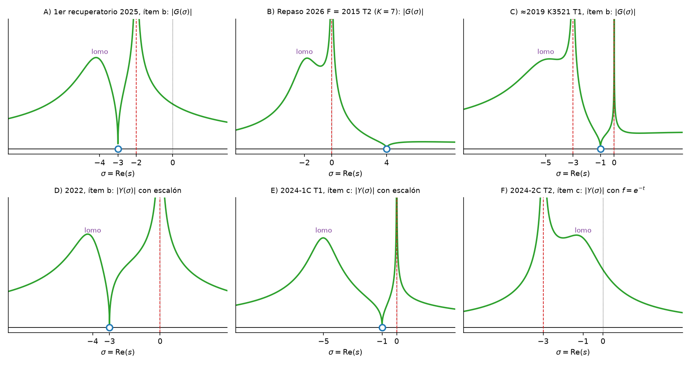
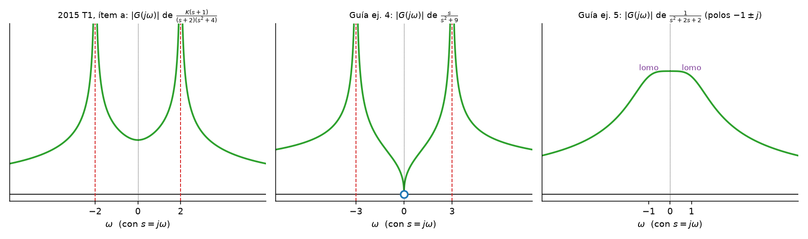
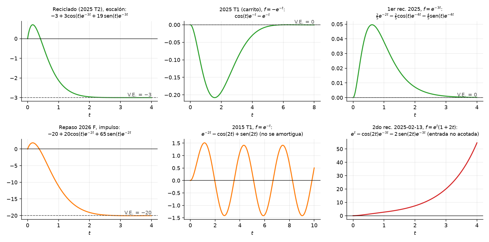
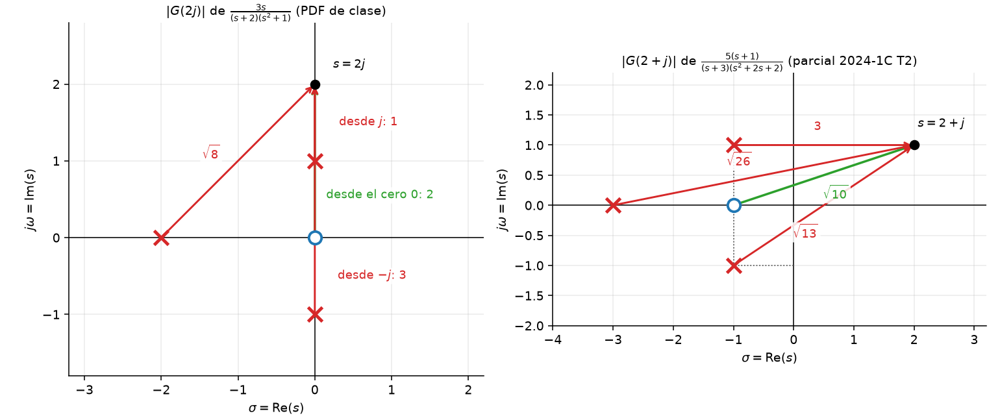

# Sistemas estables y función de transferencia desde cero

> Fuentes: `fuentes/clases/Sistemas Estables/Clase - Funcion de transferencia.pdf` (PDF de clase, 11 p.), `Clase - Sistemas estables.pdf` (8 p.) y `Clase - Ejercicio 6g y 6h de la guia.pdf` (4 p.); `Teorico catedra 1.5 - Funcion de transferencia.pdf` (12 p.) y `Teorico catedra 1.6 - Sistemas estables.pdf` (17 p.); `Sistemas Estables.pdf` (OneNote de la práctica, manuscrito del profesor, 13 p.); transcripts `13-video-teorica-sistemas-estables.json` (teórica), `11-video-practica-sistemas-estables.json` (práctica) y la parte de sistemas de `10-video-repaso-primer-parcial.json` (repaso grabado); `examenes/INDICE.md` (el ejercicio de sistemas de las 16 hojas, 2015 → 2025) y `examenes/resueltos/RESOLUCIONES-2025.md` (Ej3 de las 3 hojas 2025); `repaso/practica-repaso-2026.md` (E, F y G); `fuentes/Guia-ejercicios-parte-1-senales-y-sistemas.pdf` (págs. 45–58: ej. 1 a 21 con sus respuestas) y `fuentes/AYUDAMEMORIA-OFICIAL.pdf` (págs. 1–2). Todos los números verificados con Python (sympy). Generado 2026-11-25.
>
> **Cómo usarla:** leé de arriba abajo, sin saltear. Los **Ejemplos guiados** están resueltos a la vista: rehacé cada cuenta en papel. Los **Tu turno** se hacen en papel y **sin mirar**; la corrección está plegada (el enunciado va en texto plano en el título desplegable, porque ahí no se renderizan fórmulas, y se repite en limpio adentro). Las notas **En clase** son lo que dijo el profesor en los videos, con el minuto real del transcript (`teórica [mm:ss]` = video 13, `práctica [mm:ss]` = video 11, `repaso [mm:ss]` = video 10). Tiempo total: ≈ 7 h con pausas.
>
> **Qué es de la cátedra y qué es mío:** definiciones, criterios, recetas y ejemplos salen de las fuentes. Son agregados míos (para que se entienda) las explicaciones "en criollo", las cuentas intermedias que las fuentes saltean ("no nos vamos a meter en el desarrollo de estas fracciones simples"), los gráficos, el control $y(0)$ con el teorema del valor inicial y las resoluciones de los parciales anteriores a 2025, que no tienen hoja oficial transcripta (dicen "resuelto para esta guía"). El **Checkpoint** es un ejercicio armado con el formato de 2025, no una hoja real.

---

> **🧭 Ruta corta (si vas contra reloj)** — núcleo ≈ 3 h 30
>
> - **Leyenda de los "tu turno":** 🔴 parcial 2025 (formato vigente) y repaso 2026: obligatorios · 🟠 parciales 2015–2024: hacé los que puedas, son la mejor práctica · ⚪ guía de ejercicios, OneNote y teórico: opcionales. Lo plegado como **"⚪ Se toma poco"** se puede saltear.
> - **Leé, en este orden** (de lo más tomado a lo menos tomado): §0–§2 (10 min) → **§5** hallar $K$ (ejemplo guiado 5) → **§7** respuesta temporal (ejemplos guiados 9 y 10) → **§3–§4** polos, ceros y los seis casos → **§6** corte por el eje real (§6.2 y la figura) → **§8** tipo de respuesta y valor estable → **§9** $G(s)$ desde la ecuación diferencial → "Resumen en una página".
> - **Salteá:** §10 si no llegás (2 de 16 hojas), §11 (plegada) y, del §6, el corte por el eje imaginario.
> - **"Tu turno" obligatorios (🔴):** 3.A · 5.A · 6.A, 6.B · 7.A, 7.B · 9.A, 9.B. Y el **Ejemplo guiado 5 + 9 + 11** a ciegas: es el ejercicio que salió tres veces textual.
> - **Si sobra una hora (🟠):** 5.B, 5.C, 7.C y 8.A (el ejercicio 2024-1C T1 completo).
> - **Para sumar puntos alcanza con…** el ítem a) sale siempre con la misma receta (factorizar, simplificar, mirar los polos, y si hay $K$ pedir que el numerador se anule en el polo malo): es 1 punto mecánico. La respuesta temporal es otro punto y es "solo" fracciones simples con un cuadrático (§7). Son ítems encadenados: **si el ítem a) sale mal, arrastra a los demás**. Controlalo dos veces.
> - Del ayudamemoria vas a usar: derivada, integral, primera traslación, valor inicial, valor final, la tabla y la definición de cero y polo (§2).

## 0. Qué te toman: el Ej3 vale 2 o 3 puntos

El Ej3 del 1er parcial es **siempre** sistemas estables. Te dan una función de transferencia $G(s)$ (o la ecuación diferencial de un sistema físico) y 2 o 3 ítems de **1 punto cada uno**. El ejercicio de sistemas aparece en **las 16 hojas** del dataset (2015 → 2025).

| Ítem | Qué te piden | Hojas | Frecuencia | Sección |
|---|---|---|---|---|
| **Hallar $K$ para que sea estable** | $G(s)$ trae un parámetro en el numerador (a veces dos); elegirlo para que el sistema sea estable | 2015 T2, ≈2015 T1 y T2 (multiple choice), ≈2019 T2, 2022, 2024-1C T2, 2024-2C T1 y T2, 2024-2C rec, 2025-02-13, **2025 T2** | **11/16** | §5 |
| Polos, ceros, constelación, ¿es estable? | Factorizar, simplificar, listar, dibujar y clasificar | 2015 T1, ≈2019 T1, 2024-1C T1, **2025 rec** | 4/16 (más todas las de arriba, donde es el paso previo) | §3, §4 |
| **Respuesta temporal** | $y(t)$ para una entrada dada: escalón (6 hojas), impulso (3), exponencial u otra (5) | todas menos las dos de multiple choice; **2025 T1, T2 y rec** | **14/16** | §7 |
| Corte por el eje real | Dibujar a mano $\lvert G(\sigma)\rvert$ (3 hojas) o $\lvert Y(\sigma)\rvert$ (3 hojas). Cualitativo | 2015 T2, ≈2019 T1, 2022, 2024-1C T1, 2024-2C T2, **2025 rec** | 6/16 | §6 |
| Corte por el eje imaginario ("respuesta en frecuencia") | Ídem sobre $s=j\omega$ | 2015 T1 | 1/16 | §6.4 |
| Tipo de respuesta y valor estable | "Oscilatoria amortiguada", "exponencial decreciente"… y a qué valor tiende $y(t)$ | ≈2019 T2, 2024-1C T1, 2024-2C T1, **2025 T2** | 4/16 | §8 |
| $G(s)$ desde la ecuación diferencial | Sistema físico que parte del reposo (carrito con resorte; circuito RLC en el repaso 2026) | **2025 T1** | 1/16 (+ repaso 2026) | §9 |
| Módulo en un punto (método gráfico) | Hallar $K$ con un dato $\lvert G(j)\rvert$, o un verdadero/falso sobre $\lvert G(a+bj)\rvert$ | 2015 T1, 2024-1C T2 | 2/16 | §10 |

"≈2015" y "≈2019" son las hojas sin fecha del índice (`sin-fecha-2` y `sin-fecha K3521`). "rec" = recuperatorio.

**El reciclado.** Este ejercicio salió **tres veces textual** (≈2019 T2, 2024-2C T1 y 2025 T2):

$$
G(s)=\frac{10\,(s^2-4s+k)}{s^3+5s^2+4s-10}
$$

con los ítems a) hallar $K$ para que sea estable, b) respuesta al escalón, c) tipo de respuesta y valor estable. Es el hilo de esta guía: lo vas a ver resuelto por partes en los ejemplos guiados 5, 9 y 11. Y la familia "$G(s)$ con un polo positivo a cancelar y un factor $s^2+8s+17$" apareció en otras 4 hojas.

**Lectura rápida:** el ejercicio tipo es **(a) dejar estable el sistema o listar polos y ceros + (b) un corte o la respuesta temporal + (c) la respuesta temporal o su tipo**. Si dominás §5 y §7, tenés 2 de los 3 puntos.

> **En clase:** "acá tomamos todo lo mismo y los mismos ejercicios y los mismos tipos de ejercicios, de hecho hay muchos ejercicios, honestamente, se reciclan, se les cambian dos numeritos" (repaso [1:06:12]).
>
> **En clase:** graficar la constelación de polos y ceros y hallar el módulo en un punto "se toma bastante, es como el típico primer punto de un ejercicio de sistemas estables" (teórica [1:05:05]). Y el ejercicio 1 de la guía (constelación) "es muy fácil, pero a veces es la parte A de un ejercicio un poquito más largo" (práctica [00:31]).

## 1. La idea en criollo

Un **sistema** es una caja: le entra una señal $f(t)$ (una fuerza, una corriente) y sale otra, $y(t)$ (una posición, una tensión). En el tiempo la relación entre las dos es una ecuación diferencial. **En Laplace es una multiplicación**:

$$
Y(s)=G(s)\cdot F(s)\qquad\Longleftrightarrow\qquad G(s)=\frac{Y(s)}{F(s)}
$$

$G(s)$ es la **función de transferencia**: un cociente de polinomios en $s$ con coeficientes reales, con el grado de abajo mayor que el de arriba. Factorizada se ve así:

$$
G(s)=k\,\frac{(s-z_1)(s-z_2)\cdots}{(s-p_1)(s-p_2)\cdots}
$$

Los $z_i$ son los **ceros**, los $p_j$ son los **polos** y $k$ es una constante que **siempre está** (si no la ves, vale 1).

¿Por qué importan tanto los polos? Porque para hallar $y(t)$ se antitransforma $Y(s)$ por fracciones simples, y **cada polo $p$ deja un término $e^{pt}$ en la respuesta**:

- Polo con **parte real negativa** → $e^{pt}$ se apaga con el tiempo. Todo bien.
- Polo con **parte real positiva** → $e^{pt}$ explota. El sistema es **inestable**.
- Polos complejos $a\pm bj$ → aparecen $e^{at}\cos(bt)$ y $e^{at}\operatorname{sen}(bt)$: oscila, y la parte real $a$ decide si la oscilación se apaga o crece.

**Estable = ningún polo a la derecha del eje imaginario.** Todo el Ej3 es: **factorizar, simplificar, mirar dónde quedaron los polos y antitransformar $Y=G\cdot F$.**

Vocabulario de los enunciados:

- **Impulso** $\delta(t)$: $F(s)=1$, así que $Y=G$. A esa salida se la llama **respuesta natural** (o propia) del sistema.
- **Escalón unitario** $E(t)$ (a veces escrito $1(t)$ o $u(t)$): $F(s)=\dfrac1s$.
- **Constelación** (o diagrama, o configuración) de polos y ceros: el plano $s$ con una **×** en cada polo y un **○** en cada cero.
- **Valor estable:** el número al que tiende $y(t)$ cuando $t\to\infty$.
- **Singularidades:** polos y ceros, todos juntos.

> **En clase:** la segunda parte de la unidad (estabilidad y análisis de polos) "le vamos a dar muchísima más pelota al tema de los polos que al tema de los ceros" (teórica [48:18]).

## 2. Qué tenés en el ayudamemoria y qué va de memoria

En el parcial solo podés tener el **ayudamemoria oficial** y la tabla de integrales. De sistemas, las págs. 1 y 2 traen esto.

**Está en el ayudamemoria** (no lo memorices, pero sabé dónde está):

- Transformada de la derivada: $\mathcal L[f'(t)]=sF(s)-f(0)$. Solo la primera: la segunda la armás vos (§9).
- Transformada de la integral: $\mathcal L\left[\int_0^t f(u)\,du\right]=\dfrac{F(s)}{s}$ (para el circuito RLC).
- **Primera propiedad de traslación:** $\mathcal L[e^{at}f(t)]=F(s-a)$. Es la que convierte $\dfrac{s+3}{(s+3)^2+1}$ en $e^{-3t}\cos t$.
- **Teorema del valor final:** $\lim_{t\to\infty}f(t)=\lim_{s\to0}s\,F(s)$. Y el del **valor inicial:** $\lim_{t\to0}f(t)=\lim_{s\to\infty}s\,F(s)$.
- La tabla: $1\to\frac1s$, $t\to\frac1{s^2}$, $t^n\to\frac{n!}{s^{n+1}}$, $e^{at}\to\frac1{s-a}$, $\operatorname{sen}(at)\to\frac{a}{s^2+a^2}$, $\cos(at)\to\frac{s}{s^2+a^2}$, $\delta(t)\to1$.
- La definición de cero y polo: $z$ es cero si $\lim_{s\to z}G(s)=0$; $p$ es polo si $\lim_{s\to p}G(s)=\infty$.

**No está, va de memoria** (es todo lo marcado con 🧠 en la guía):

- 🧠 $Y=G\cdot F$ y $G=\dfrac{Y}{F}$. Impulso → $F=1$; escalón → $F=\dfrac1s$.
- 🧠 **Simplificar primero.** Una raíz común arriba y abajo no es ni cero ni polo.
- 🧠 Polos complejos siempre **de a pares conjugados**; siempre hay una $k$; cero en el infinito.
- 🧠 La tabla **polo → término de $y(t)$ → nombre de la respuesta → estable o no** (§4).
- 🧠 Para hallar $K$: el numerador se tiene que anular en el polo de parte real positiva.
- 🧠 Los hitos del corte: asíntota en polo real, toca y rebota en cero real, lomo en la parte real de los polos complejos, se pega al eje en los extremos (§6).
- 🧠 Fracciones simples con un cuadrático: tapar, igualar coeficientes, completar cuadrados, "prestar" (§7).
- 🧠 Las dos antitransformadas armadas con la traslación:

$$
\frac{s+a}{(s+a)^2+b^2}\ \longrightarrow\ e^{-at}\cos(bt)\qquad\qquad \frac{b}{(s+a)^2+b^2}\ \longrightarrow\ e^{-at}\operatorname{sen}(bt)
$$

- 🧠 Reposo ⇒ $y(0)=0$ y $y'(0)=0$; $\mathcal L[y'']=s^2Y-s\,y(0)-y'(0)$.
- 🧠 Módulo por vectores: $\lvert G(s_0)\rvert=k\cdot\dfrac{\text{producto de distancias de los ceros a }s_0}{\text{producto de distancias de los polos a }s_0}$ (§10).

> **En clase:** la hoja de ayuda "se puede llevar […] está sola", sin apuntes propios aparte (repaso [02:40]). Y sobre las cuentas auxiliares: las raíces de una cuadrática con coeficientes reales "te las dan todas las calculadoras, estos cálculos simples no me interesan" (repaso [14:19]). El planteo sí hay que escribirlo.

---

## 3. Polos, ceros y constelación (el paso previo de todo ítem a)

### 3.1 Lo que hay que saber

- **Ceros:** valores donde $G\to0$. **Polos:** valores donde $G\to\infty$. En la práctica: raíces del numerador y raíces del denominador, **después de simplificar**.
- 🧠 **Una raíz común arriba y abajo no es ni cero ni polo**: el factor se cancela y ahí $G$ no tiende ni a $0$ ni a $\infty$ (no cumple la definición del ayudamemoria).
- 🧠 **Siempre hay una $k$**: el cociente de los coeficientes principales del numerador y el denominador. Si no se ve, vale 1.
- 🧠 **Cero en el infinito:** como el grado de abajo es mayor, $\lim_{s\to\infty}G(s)=0$: el infinito cumple la definición de cero. Se anota $z=\infty$ en la lista y no se dibuja.
- 🧠 Los coeficientes son reales, así que **si un polo (o un cero) es complejo, su conjugado también lo es**.

### 3.2 Receta

1. **Factorizá** numerador y denominador completos: factor común $s$, resolvente (o calculadora) para los cuadráticos, Ruffini para los cúbicos.
2. **Tachá** los factores comunes.
3. **Listá** ceros (con $z=\infty$) y polos de la versión simplificada.
4. **Dibujá** el plano $s$: eje horizontal $\sigma=\mathrm{Re}(s)$, eje vertical $j\omega=\mathrm{Im}(s)$, **×** en los polos, **○** en los ceros.

**Truco para los cúbicos (del profesor):** factorizá primero el polinomio fácil (el cuadrático) y **probá sus raíces en el cúbico**; casi seguro una lo anula. Recién cuando verificaste que da $0$ hacés Ruffini con esa raíz.

**Qué hay que dejar escrito** (así está en la hoja oficial del recuperatorio 2025): la factorización con el factor tachado, la $G(s)$ simplificada, la lista "Ceros: $z_0=\ldots$, $z_1=\infty$. Polos: $p_1=\ldots$", el diagrama con × y ○, y la conclusión ("Sistema estable").

> **En clase:** "creo que en casi todos los ejercicios siempre hay algo que se simplifica, algún factor que sería entre comillas cero y polo […] y que no forma parte de la $G(s)$ final" (teórica [08:29]). En la práctica lo repite: ustedes podrían "haberse visto tentados a decir: uno es cero porque anula el numerador, también es polo porque anula el denominador, pero en realidad no es ninguno de los dos porque se cancela" (práctica [04:17]).
>
> **En clase:** la constante "si ustedes no la ven, entre comillas, es porque es un 1, pero siempre está" (teórica [05:53]). El cero en el infinito: "no es súper grave olvidárselo, pero si pedimos cuáles son los polos y los ceros, está bueno que lo pongan" (teórica [12:12]).
>
> **En clase:** ¿Ruffini cuando sospechás que un número es raíz? "Cuando sospechás no, cuando ya sabés: […] reemplazo todas las $s$ por menos 1, si me da 0, listo, es raíz, ahí arranco Ruffini" (práctica [07:25]).

### Ejemplo guiado 1: constelación de $G(s)=\dfrac{5(s+2)}{(s-1)(s^2+4s+13)}$ (PDF de clase)

**Paso 1.** Ya viene casi factorizada. El cuadrático $s^2+4s+13$ tiene discriminante $16-52<0$: raíces complejas.

$$
s=\frac{-4\pm\sqrt{16-52}}{2}=\frac{-4\pm6j}{2}=-2\pm3j
$$

**Paso 2.** No hay factores comunes: no se simplifica nada.

**Paso 3.** Polos: $p_1=1$, $p_2=-2+3j$, $p_3=-2-3j$. Ceros: $z_1=-2$, $z_2=\infty$. Constante: $k=5$.

**Paso 4.** La constelación es el panel izquierdo de la figura. El panel derecho es el mapa que vas a aprender en §4.

### Ejemplo guiado 2: la raíz que no es ni cero ni polo (PDF de clase)

$$
G(s)=\frac{3\,(s-1)\,s}{(s-2)(s^3+s)}
$$

**Paso 1.** Abajo hay factor común $s$: $s^3+s=s\,(s^2+1)$.

**Paso 2.** La $s$ está arriba y abajo: se tacha.

$$
G(s)=\frac{3\,(s-1)\,s}{(s-2)\,s\,(s^2+1)}=\frac{3\,(s-1)}{(s-2)(s^2+1)}
$$

El $0$ **no es ni cero ni polo**: $\lim_{s\to0}G(s)=\dfrac{3\cdot(-1)}{(-2)\cdot1}=\dfrac32$, que no es $0$ ni $\infty$.

**Paso 3.** Ceros: $z_1=1$, $z_2=\infty$. Polos: $p_1=2$, $p_2=j$, $p_3=-j$.

### Tu turno 3

🔴 <strong>3.A (1er recuperatorio 2025, ítem a)</strong> — Dada G(s) = 2(s² + 2s − 3) / [(s − 1)(s + 2)(s² + 8s + 17)], indicar los polos y ceros de G(s) y si representa un sistema estable o no.

**Enunciado en limpio:**

$$
G(s)=\frac{2\,(s^2+2s-3)}{(s-1)(s+2)(s^2+8s+17)}
$$

<strong>Resolución</strong>

**Paso 1.** Numerador: $s^2+2s-3$ tiene raíces $1$ y $-3$, o sea $(s+3)(s-1)$.

**Paso 2.** El $(s-1)$ se cancela con el del denominador:

$$
G(s)=\frac{2\,(s+3)}{(s+2)(s^2+8s+17)}
$$

**Paso 3.** $s^2+8s+17=(s+4)^2+1$: raíces $-4\pm j$.

- Ceros: $z_0=-3$, $z_1=\infty$.
- Polos: $p_1=-2$, $p_2=-4+j$, $p_3=-4-j$.

**Paso 4.** Constelación: ○ en $-3$; × en $-2$, en $-4+j$ y en $-4-j$. Todos los polos tienen parte real negativa: **sistema estable** (criterio de §4).

Coincide con la hoja oficial. Ojo: el $1$ **no** es polo. Si no simplificabas, decías "polo en 1, inestable" y perdías el punto.

🟠 <strong>3.B (parcial 2024-1C, Tema 1, ítem a)</strong> — Dada G(s) = k(s² − s − 2) / [(s − 2)(s² + 10s + 26)], hallar la constelación de polos y ceros de G(s).

**Enunciado en limpio:**

$$
G(s)=\frac{k\,(s^2-s-2)}{(s-2)(s^2+10s+26)}
$$

<strong>Resolución (resuelto para esta guía)</strong>

$s^2-s-2=(s-2)(s+1)$: el $(s-2)$ se cancela.

$$
G(s)=\frac{k\,(s+1)}{s^2+10s+26},\qquad s^2+10s+26=(s+5)^2+1
$$

Ceros: $-1$ e $\infty$. Polos: $-5\pm j$. Constelación: ○ en $-1$, × en $-5+j$ y $-5-j$. El $2$ no es ni cero ni polo. (El resto del ejercicio está en 6.E y 8.A.)

🟠 <strong>3.C (parcial ≈2019, K3521, Tema 1, ítem a)</strong> — Dada G(s) = [41(s³ + s²) + 87s + 87] / [s(s + 3)(s² + 10s + 29)], indicar si el sistema es estable. Justificar.

**Enunciado en limpio:**

$$
G(s)=\frac{41\,(s^3+s^2)+87s+87}{s\,(s+3)(s^2+10s+29)}
$$

<strong>Resolución (resuelto para esta guía)</strong>

**Numerador.** Factor común por grupos: $41s^2(s+1)+87(s+1)=(s+1)(41s^2+87)$. Raíces: $-1$ y $\pm j\sqrt{87/41}\approx\pm1{,}46j$.

**Denominador.** $s^2+10s+29=(s+5)^2+4$: raíces $-5\pm2j$. Polos: $0$, $-3$, $-5\pm2j$.

**¿Se cancela algo?** Ninguna raíz del numerador ($-1$, $\pm1{,}46j$) es raíz del denominador. Esta vez **no se simplifica nada** (pasa poco, pero pasa).

**Conclusión.** Ningún polo tiene parte real positiva. El polo en $0$ es simple: el sistema es **marginalmente estable, que cuenta como estable** (§4). Justificación: "todos los polos tienen parte real negativa o nula, y el de parte real nula es simple".

⚪ <strong>3.D (guía ej. 1; a y e están en el OneNote)</strong> — Representar la constelación de: a) s/(s² + 2s + 2) · b) s(s − 3)/(s² + 8s + 25) · d) (s + 2)/[(s + 4)(s² + 6s + 18)] · e) (s² − s)/[(s² + 5s + 6)(s − 1)] · f) s/(s + 2)².

<strong>Resolución</strong>

**a)** Ceros $0$, $\infty$. Polos $-1\pm j$. El profesor anota al costado: "$k=1$, siempre hay una $k$".

**b)** Ceros $0$ y $3$ (no hay cero en el infinito: los grados son iguales). Polos $-4\pm3j$.

**d)** Ceros $-2$, $\infty$. Polos $-4$ y $-3\pm3j$.

**e)** $s^2-s=s\,(s-1)$ y el $(s-1)$ se cancela: $G(s)=\dfrac{s}{(s+2)(s+3)}$. Ceros $0$, $\infty$. Polos $-2$ y $-3$. El $1$ no es nada.

**f)** Ceros $0$, $\infty$. Polo $-2$ **doble**.

Coinciden con las respuestas de la guía.

---

## 4. Estabilidad: los seis casos 🧠

### 4.1 La definición

El PDF de clase define: un sistema es **estable** si cuando $t\to\infty$ la respuesta $y(t)$ tiende a un valor $k$ (el **valor estable**) **o bien permanece acotada**. El teórico lo dice con la definición "BIBO": un sistema inicialmente en reposo es estable si **para cualquier entrada acotada** da una salida acotada. Por eso la estabilidad se decide mirando **solo los polos de $G(s)$**, sin importar la entrada.

### 4.2 La tabla

Sale de antitransformar la fracción simple que deja cada tipo de polo (PDF de clase, teórica y OneNote). Vale para **polos simples**, que son los únicos que aparecen en los ejercicios.

| Dónde está el polo | Fracción simple | Qué aporta a $y(t)$ | Nombre de la respuesta | ¿Estable? |
|---|---|---|---|---|
| Real negativo, $-a$ | $\dfrac{A}{s+a}$ | $A\,e^{-at}$ | exponencial decreciente | estable |
| Complejos con parte real negativa, $-a\pm bj$ | $\dfrac{Bs+C}{(s+a)^2+b^2}$ | $e^{-at}\cos(bt)$ y $e^{-at}\operatorname{sen}(bt)$ | **oscilatoria amortiguada** | estable |
| En el origen | $\dfrac{A}{s}$ | la constante $A$ | constante (corre la respuesta: da el valor estable) | marginalmente estable **= estable** |
| Imaginarios puros, $\pm bj$ | $\dfrac{Bs+C}{s^2+b^2}$ | $\cos(bt)$ y $\operatorname{sen}(bt)$ | oscilatoria de amplitud constante (u "oscilatoria pura") | marginalmente estable **= estable** |
| Real positivo, $a>0$ | $\dfrac{A}{s-a}$ | $A\,e^{at}$ | exponencial creciente | **inestable** |
| Complejos con parte real positiva | $\dfrac{Bs+C}{(s-a)^2+b^2}$ | $e^{at}\cos(bt)$ y $e^{at}\operatorname{sen}(bt)$ | oscilatoria de amplitud creciente | **inestable** |

### 4.3 Las reglas que salen de la tabla

- **Condición necesaria y suficiente** (PDF de clase): el sistema es estable ⇔ **todos los polos tienen parte real negativa o nula**. Gráficamente: todos a la izquierda del eje vertical, o sobre él.
- **Un solo polo a la derecha alcanza para que sea inestable.**
- **Marginalmente (o críticamente) estable**: hay polos simples **sobre** el eje imaginario (en $0$ o en $\pm bj$) y ninguno a la derecha. La respuesta ya no tiende a $0$, pero no se va a infinito. **Se clasifica como estable**; si querés, aclarás "marginalmente".
- **Solo importan los polos.** Un cero a la derecha (como el $3$ del reciclado) no cambia nada.
- Atajo para un cuadrático $as^2+bs+c$ con raíces complejas: su parte real es $-\dfrac{b}{2a}$. Si $a$ y $b$ tienen el mismo signo, los polos están a la izquierda; si $b=0$, sobre el eje.
- **Truco si no te acordás el nombre de la respuesta:** planteá las fracciones simples **sin resolverlas** y mirá qué antitransformada da cada término.

**Qué hay que dejar escrito:** los polos, dónde está cada uno ("parte real negativa", "sobre el eje", "semiplano derecho") y la conclusión. Con una línea alcanza: "todos los polos tienen parte real negativa ⇒ estable".

> **En clase:** "por más que ustedes tengan 52.000 polos del lado izquierdo, si ya hay uno del lado derecho me va a hacer que mi sistema sea inestable" (teórica [1:38:14]). Sobre el polo nulo: "sigue siendo estable, eso es importante" (teórica [1:28:41]).
>
> **En clase:** una consulta de la práctica: si en un final te ponen "el sistema es estable / inestable" para redondear y tenés polos sobre el eje, "clasifica como estable […] si querés aclarar que es marginalmente estable, vale, pero entre estable e inestable, esto es estable porque no se va al infinito" (práctica [1:36:48]–[1:37:18]).
>
> **En clase:** "los ceros no cortan ni pinchan, yo los pongo por costumbre" (práctica [45:27]). Y el truco: "hago el planteo de fracciones simples sin resolverlo, no me importa cuál es $A$ y cuál es $B$" (práctica [45:57]).

### Ejemplo guiado 3: tipo de respuesta y estabilidad de $G(s)=\dfrac{s^2+3s+2}{s^3-2s^2-3s}$ (guía ej. 8, OneNote)

**Paso 1 — factorizar.** Numerador: $(s+1)(s+2)$. Pruebo sus raíces abajo: $s=-1$ da $-1-2+3=0$ ✓. Ruffini con $-1$:

$$
\begin{array}{c|cccc} & 1 & -2 & -3 & 0\\ -1 & & -1 & 3 & 0\\ \hline & 1 & -3 & 0 & \boxed{0}\end{array}
$$

$$
G(s)=\frac{(s+1)(s+2)}{(s+1)(s^2-3s)}=\frac{s+2}{s\,(s-3)}
$$

**Paso 2 — listar.** Cero: $-2$ (y $\infty$). Polos: $0$ y $3$.

**Paso 3 — clasificar.** El polo en $3$ es real positivo: **sistema inestable**. Tipo de respuesta, sin resolver nada:

$$
\frac{s+2}{s\,(s-3)}=\frac{A}{s}+\frac{B}{s-3}\ \longrightarrow\ A+B\,e^{3t}
$$

**Respuesta exponencial creciente** (coincide con la guía: "no es estable pues tiene un polo en el semiplano derecho: $p=3$").

### Ejemplo guiado 4: un sistema marginalmente estable (guía ej. 10a, OneNote)

$$
G(s)=\frac{3s^2-6s-24}{s^3-3s^2-4s}=\frac{3\,(s-4)(s+2)}{s\,(s-4)(s+1)}=\frac{3\,(s+2)}{s\,(s+1)}
$$

Cero: $-2$ (y $\infty$). Polos: $0$ y $-1$. Nada a la derecha, y el polo en $0$ es simple: **marginalmente estable** (la guía responde directamente "es un sistema estable"). Tipo: $\dfrac{A}{s}+\dfrac{B}{s+1}\to A+B\,e^{-t}$, que el profesor anota como "respuesta exponencial decreciente **desplazada**"; esa $A$ es el valor estable.

### Tu turno 4

🟠 <strong>4.A (parcial 2015, Tema 1, ítem a, primera parte)</strong> — Dada G(s) = K(s² − 2s − 3) / [(s − 3)(s + 2)(s² + 4)], indicar si el sistema es estable.

**Enunciado en limpio:**

$$
G(s)=\frac{K\,(s^2-2s-3)}{(s-3)(s+2)(s^2+4)}
$$

<strong>Resolución (resuelto para esta guía)</strong>

$s^2-2s-3=(s-3)(s+1)$: se cancela el $(s-3)$.

$$
G(s)=\frac{K\,(s+1)}{(s+2)(s^2+4)}
$$

Cero: $-1$ (y $\infty$). Polos: $-2$ y $\pm2j$. No hay polos a la derecha; los de $\pm2j$ están **sobre** el eje imaginario y son simples: **marginalmente estable ⇒ estable**. La respuesta natural tiene una parte que oscila sin amortiguarse ($\cos 2t$, $\operatorname{sen}2t$).

Si no simplificabas, veías un "polo en 3" y contestabas inestable. (El resto de la hoja: 6.G, 10.B y 7.H.)

⚪ <strong>4.B (teórico 1.6, "analiza el tipo de estabilidad")</strong> — a) 3(s² + 4s + 5)/(s³ + 5s² + 4s − 10) · b) (s² + 2s − 3)/(s³ + 5s² + 4s − 10) · c) 8(s + 2)²/[s(s² + 6s + 18)] · d) (−s² + s + 1)/[(s + 3)(s² − 4s + 5)].

<strong>Resolución (el teórico no trae las respuestas; resuelto para esta guía)</strong>

El denominador de a) y b) es el del reciclado: $s^3+5s^2+4s-10=(s-1)(s^2+6s+10)$, polos $1$ y $-3\pm j$.

**a)** El numerador tiene raíces $-2\pm j$: no cancela el polo $1$. **Inestable.**

**b)** $s^2+2s-3=(s+3)(s-1)$: cancela el $(s-1)$. Queda $\dfrac{s+3}{s^2+6s+10}$, polos $-3\pm j$: **estable** (asintóticamente: todos con parte real estrictamente negativa).

**c)** Polos $0$ y $-3\pm3j$; no se cancela nada. **Marginalmente estable.**

**d)** $s^2-4s+5$ tiene raíces $2\pm j$, parte real positiva, y el numerador (raíces $\frac{1\pm\sqrt5}{2}$) no las cancela. **Inestable.**

⚪ <strong>4.C (guía ej. 21, ítems 3, 5 y 7: multiple choice tomados en finales)</strong> — 3) G = (s² − 4s)/(s³ − 4s² + 9s − 36): la respuesta al escalón es ¿oscilatoria amortiguada / oscilatoria de amplitud constante / exponencial decreciente / ninguna? · 5) G = (s² − 4s − 5)/(s³ − 3s² − 25s + 75) es ¿marginalmente estable / inestable / estable amortiguado / ninguna? · 7) G = (s² − 7s + 10)/(s³ − 4s² − 5s): la respuesta al impulso es ¿inestable / oscilatoria amortiguada / oscilatoria pura / ninguna?

<strong>Resolución</strong>

**3)** Pruebo las raíces del numerador ($0$ y $4$) abajo: $64-64+36-36=0$ ✓. $s^3-4s^2+9s-36=(s-4)(s^2+9)$, así que $G=\dfrac{s}{s^2+9}$. Con escalón: $Y=\dfrac{G}{s}=\dfrac{1}{s^2+9}\to\frac13\operatorname{sen}(3t)$. **b) oscilatoria de amplitud constante.**

**5)** $G=\dfrac{(s+1)(s-5)}{(s-5)(s-3)(s+5)}=\dfrac{s+1}{(s-3)(s+5)}$: polo en $3$. **b) inestable.**

**7)** $G=\dfrac{(s-2)(s-5)}{s\,(s-5)(s+1)}=\dfrac{s-2}{s\,(s+1)}\to A+B\,e^{-t}$ (da $-2+3e^{-t}$): es estable y no oscila. **d) ninguna de las anteriores.**

Coinciden con las respuestas de la guía (b, b, d).

---

## 5. Hallar $K$ para que el sistema sea estable (11/16: el ítem a más tomado)

### 5.1 La idea

Si el denominador tiene un polo "malo" $p$ (parte real positiva), la única forma de sacárselo de encima es que **el numerador también se anule en $p$**: así el factor $(s-p)$ queda arriba y abajo y se cancela. Y un factor cancelado no es polo (§3).

### 5.2 Receta 🧠

1. **Factorizá el denominador.** Si es cúbico, buscá una raíz probando los divisores del término independiente ($\pm1,\pm2,\pm5,\ldots$): reemplazás y, **si da 0, recién ahí** hacés Ruffini. El cuadrático que queda: resolvente, completar cuadrados o calculadora.
2. **Identificá el polo malo** $p$: el de parte real positiva. Un polo en $0$ **no** es malo (marginalmente estable).
3. **Pedí $N(p)=0$:** reemplazá $s=p$ en el numerador, igualá a cero y despejá $K$.
4. **Reemplazá $K$,** factorizá el numerador (Ruffini con $p$, que ya sabés que es raíz) y **cancelá**.
5. **Escribí la $G$ simplificada** y confirmá que los polos que quedan tienen parte real $\le0$. Si $K$ también aparece en el denominador, revisá qué pasó ahí con ese valor (ejemplo guiado 6).

**Qué hay que dejar escrito** (hoja oficial de 2025 T2): el Ruffini del denominador, la frase "**hay que eliminar el polo en $s=1$**" (o sea: decir cuál es el polo inestable y por qué), la ecuación $N(1)=0$ y el valor de $k$ recuadrado. La $G$ simplificada la necesitás para todos los ítems que siguen.

> **En clase:** elegir $K$ para que el numerador cancele el polo del semiplano derecho "es una idea básica, pero que aparece en un montón de ejercicios de sistemas estables" (repaso [1:24:42]).

### Ejemplo guiado 5: el reciclado, ítem a (parcial 2025 Tema 2 = 2024-2C T1 = ≈2019 T2)

> Hallar $K$ para que $G(s)=\dfrac{10\,(s^2-4s+k)}{s^3+5s^2+4s-10}$ sea estable.

**Paso 1 — una raíz del denominador.** Divisores de $-10$: $\pm1,\pm2,\pm5,\pm10$. Pruebo $s=1$: $1+5+4-10=0$ ✓. Ruffini con $1$:

$$
\begin{array}{c|cccc} & 1 & 5 & 4 & -10\\ 1 & & 1 & 6 & 10\\ \hline & 1 & 6 & 10 & \boxed{0}\end{array}
$$

$$
s^3+5s^2+4s-10=(s-1)(s^2+6s+10)
$$

**Paso 2 — clasificar los polos.** $s^2+6s+10=(s+3)^2+1$: raíces $-3\pm j$, parte real negativa, no molestan. El polo $s=1$ es **real positivo**: es el malo. Hay que eliminar el polo en $s=1$.

**Paso 3 — el numerador se anula en $s=1$:**

$$
1^2-4\cdot1+k=0\quad\Longrightarrow\quad \boxed{k=3}
$$

**Paso 4 — reemplazar y cancelar.** $s^2-4s+3$ con Ruffini en $1$: $1\ \ {-4}\ \ 3\ \to\ 1\ \ {-3}\ \mid 0$, o sea $(s-1)(s-3)$.

$$
G(s)=\frac{10\,(s-1)(s-3)}{(s-1)(s^2+6s+10)}=\frac{10\,(s-3)}{s^2+6s+10}
$$

**Paso 5 — confirmar.** Polos: $-3\pm j$ ⇒ estable. Ceros: $3$ e $\infty$. ¿Y el cero en $3$, que está a la derecha? No importa: los ceros no cuentan.

### Ejemplo guiado 6: cuando $k$ también está en el denominador (teórico 1.6, ejercicio resuelto 5)

> Hallar el o los $k\in\mathbb R$ para que sea estable $G(s)=\dfrac{3s^2-ks}{(s^2+ks+10)(s^2-4)}$.

**Paso 1.** $s^2-4=(s-2)(s+2)$: hay un polo en $2$, que no debería estar.

**Paso 2.** Que $s=2$ sea raíz del numerador: $3\cdot4-k\cdot2=0\Rightarrow\boxed{k=6}$.

**Paso 3 — no olvidarse del otro factor.** Con $k=6$: $s^2+6s+10=0\Rightarrow s=-3\pm j$. Parte real negativa: no hay problema.

**Paso 4.** $3s^2-6s=3s\,(s-2)$, se cancela $(s-2)$: $G(s)=\dfrac{3s}{(s+2)(s^2+6s+10)}$. Polos $-2$, $-3\pm j$: estable.

### Variantes que ya aparecieron

- **Polo en el origen además del malo** (5.A): solo se cancela el malo; el de $0$ deja el sistema marginalmente estable, que es estable.
- **El polo malo escondido** en un cuadrático sin factorizar (5.C) o en un cúbico (5.E).
- **Dos parámetros** (5.D): uno se elige para cancelar, el otro se acota para que su polo quede a la izquierda.
- **Multiple choice "no existe $k$" / "solo $k\le0$"** (5.F): mismo razonamiento.
- **$k$ por un dato de valor** y no por estabilidad ("hallar $k$ para que $G(0)=2$", 8.A) o **por un dato de módulo** (§10).

### Tu turno 5

🔴 <strong>5.A (repaso 2026, ejercicio F = parcial 2015 Tema 2, ítem a; también es el ej. 8 del repaso grabado)</strong> — Dada G(s) = 25(s² − Ks + 12) / [(s² + 4s + 5)(s² − 3s)], hallar K ∈ ℝ sabiendo que el sistema es estable. Indicar polos y ceros.

**Enunciado en limpio:**

$$
G(s)=\frac{25\,(s^2-Ks+12)}{(s^2+4s+5)(s^2-3s)}
$$

<strong>Resolución</strong>

**Paso 1.** $s^2-3s=s\,(s-3)$ y $s^2+4s+5=(s+2)^2+1$:

- $-2\pm j$: parte real negativa, no molestan.
- $0$: polo en el origen. El profesor lo recuadra: "**Marg. estable, es estable**".
- $3$: real positivo. Es el que hay que cancelar.

**Paso 2.** $\left[s^2-Ks+12\right]_{s=3}=0\Rightarrow 9-3K+12=0\Rightarrow\boxed{K=7}$.

**Paso 3.** Ruffini de $s^2-7s+12$ con $3$: $1\ \ {-7}\ \ 12\ \to\ 1\ \ {-4}\ \mid 0$, o sea $(s-3)(s-4)$.

$$
G(s)=\frac{25\,(s-4)}{s\,(s^2+4s+5)}
$$

Ceros: $z_1=4$, $z_2=\infty$. Polos: $p_{1,2}=-2\pm j$, $p_3=0$. Marginalmente estable ⇒ estable. (El corte está en 6.B y la respuesta al impulso en 7.B.)

> **En clase:** los polos $-2\pm j$, "como están en el semiplano izquierdo, del lado izquierdo del eje $y$, no me molestan a la estabilidad" (repaso [1:22:35]); el del origen contribuye "a que sea marginalmente estable, pero no me joden, no me hacen que sea inestable" (repaso [1:23:06]).

🟠 <strong>5.B (parcial 2022-10-11, ítem a)</strong> — Dada G(s) = 17(s² + s − k) / [(s − 2)(s² + 8s + 17)], hallar k para que sea estable.

**Enunciado en limpio:**

$$
G(s)=\frac{17\,(s^2+s-k)}{(s-2)(s^2+8s+17)}
$$

<strong>Resolución (resuelto para esta guía)</strong>

$s^2+8s+17=(s+4)^2+1$, polos $-4\pm j$: bien. El malo es $s=2$.

$$
2^2+2-k=0\quad\Longrightarrow\quad\boxed{k=6}
$$

$s^2+s-6=(s-2)(s+3)$; se cancela $(s-2)$:

$$
G(s)=\frac{17\,(s+3)}{s^2+8s+17}
$$

Polos $-4\pm j$, ceros $-3$ e $\infty$: estable. (Sigue en 6.D y 7.C.)

🟠 <strong>5.C (parciales 2024-1C Tema 2 y 2024-2C Tema 2, ítem a: textual en las dos hojas)</strong> — Dada G(s) = 5(s² − ks − 2) / [(s² + s − 6)(s² + 2s + 2)], hallar k, si existe, para que el sistema sea estable.

**Enunciado en limpio:**

$$
G(s)=\frac{5\,(s^2-ks-2)}{(s^2+s-6)(s^2+2s+2)}
$$

<strong>Resolución (k = 1 según el índice; desarrollo resuelto para esta guía)</strong>

$s^2+s-6=(s+3)(s-2)$ y $s^2+2s+2=(s+1)^2+1$, polos $-1\pm j$. El malo es $s=2$.

$$
4-2k-2=0\quad\Longrightarrow\quad\boxed{k=1}
$$

$s^2-s-2=(s-2)(s+1)$; se cancela $(s-2)$:

$$
G(s)=\frac{5\,(s+1)}{(s+3)(s^2+2s+2)}
$$

Polos: $-3$, $-1\pm j$. Ceros: $-1$, $\infty$. Estable. **Guardá esta $G$:** la usás en 7.D, 7.E, 6.F y 10.A.

🟠 <strong>5.D (1er recuperatorio 2024-2C, ítem a)</strong> — Dada G(s) = 34(s³ − 3s² − as) / [(s − 5)(s + b)(s² + 8s + 17)], indicar todos los valores de a, b ∈ ℝ para los que el sistema es estable. Justificar.

**Enunciado en limpio:**

$$
G(s)=\frac{34\,(s^3-3s^2-as)}{(s-5)(s+b)(s^2+8s+17)}
$$

<strong>Resolución (resuelto para esta guía)</strong>

**El parámetro $a$.** El polo $s=5$ es malo. El numerador es $s\,(s^2-3s-a)$ y tiene que anularse en $5$:

$$
5\,(25-15-a)=0\quad\Longrightarrow\quad\boxed{a=10}
$$

Con $a=10$: $s^2-3s-10=(s-5)(s+2)$, y se cancela $(s-5)$:

$$
G(s)=\frac{34\,s\,(s+2)}{(s+b)(s^2+8s+17)}
$$

**El parámetro $b$.** Queda el polo $-b$ (los otros, $-4\pm j$, están bien). Para que no esté a la derecha: $-b\le0$, o sea $\boxed{b\ge0}$.

- $b=0$: el polo en $0$ se cancela con el cero en $0$ (y aunque no se cancelara, sería marginalmente estable).
- $b<0$: el polo $-b$ es positivo y ningún cero del numerador ($0$ y $-2$) lo cancela: inestable.

**Respuesta:** $a=10$ y $b\ge0$. (El ítem b está en 7.F.)

🟠 <strong>5.E (2do recuperatorio 2025-02-13, primera parte)</strong> — G(s) = 20(s² − ks + 4) / [(s³ + 7s² + 19s + 13)(s − 4)] es la transferencia de un sistema estable. Hallar k y la G(s) simplificada.

**Enunciado en limpio:**

$$
G(s)=\frac{20\,(s^2-ks+4)}{(s^3+7s^2+19s+13)(s-4)}
$$

<strong>Resolución (resuelto para esta guía)</strong>

**El cúbico.** Pruebo $s=-1$: $-1+7-19+13=0$ ✓. Ruffini con $-1$: $1\ \ 7\ \ 19\ \ 13\ \to\ 1\ \ 6\ \ 13\ \mid 0$.

$$
s^3+7s^2+19s+13=(s+1)(s^2+6s+13),\qquad s^2+6s+13=(s+3)^2+4\ \Rightarrow\ s=-3\pm2j
$$

Esos tres polos están a la izquierda. El malo es $s=4$.

$$
16-4k+4=0\quad\Longrightarrow\quad\boxed{k=5}
$$

$s^2-5s+4=(s-4)(s-1)$; se cancela $(s-4)$:

$$
G(s)=\frac{20\,(s-1)}{(s+1)(s^2+6s+13)}
$$

Polos $-1$, $-3\pm2j$: estable. (La respuesta que pide la hoja está en 7.I.)

🟠 <strong>5.F (dos multiple choice de las hojas ≈2015)</strong> — a) Para que G(s) = (s² − ks + 12)/[(s² + 8s + 25)(s − 2)] sea estable: k = 0 / k = 8 / cualquier k / no existe k. · b) Los k ∈ ℝ para que G(s) = (s³ − 3s² − 4s)/[(s − 4)(s − k)(s² + 8s + 17)] sea estable son: ∀k / solo k ≥ 0 / solo k ≤ 0 / no existen / ninguna.

<strong>Resolución (respuestas del índice; justificación resuelta para esta guía)</strong>

**a) $k=8$.** $s^2+8s+25$ tiene raíces $-4\pm3j$ (bien). El malo es $s=2$: $4-2k+12=0\Rightarrow k=8$.

**b) Solo $k\le0$.** El numerador es $s\,(s-4)(s+1)$: cancela el polo malo $4$. Queda el polo $k$, que tiene que ser $\le0$. Con $k=0$ se cancela con el cero en $0$; con $k<0$ está a la izquierda (si $k=-1$ también se cancela). Con $k>0$ hay un polo a la derecha; incluso con $k=4$, porque el denominador tendría $(s-4)^2$ y el numerador cancela uno solo.

⚪ <strong>5.G (guía ej. 21, ítems 10 y 11: tomados en finales)</strong> — 10) G = (s² − 5s + K)/(s⁴ − s³ − 11s² − s − 12): K para que sea estable: 4 / 8 / 0 / ninguno. · 11) Si G = (s² + s − 20)/(s³ + ks² − 3s − 52) es la transferencia de un sistema estable, k vale: −2 / 0 / 2 / ninguno.

<strong>Resolución</strong>

**10)** Pruebo $s=4$ abajo: $256-64-176-4-12=0$ ✓, y $s=-3$: $81+27-99+3-12=0$ ✓. Queda $s^4-s^3-11s^2-s-12=(s-4)(s+3)(s^2+1)$. Polo malo: $4$. $16-20+K=0\Rightarrow K=4$. Con eso el numerador es $(s-4)(s-1)$ y $G=\dfrac{s-1}{(s+3)(s^2+1)}$: polos $-3$ y $\pm j$, marginalmente estable. **a) $k=4$.**

**11)** Acá el parámetro está **abajo**. El numerador es $(s-4)(s+5)$: el único polo positivo que puede cancelar es $4$. Pido que $4$ sea raíz del denominador: $64+16k-12-52=0\Rightarrow k=0$. Entonces $s^3-3s-52=(s-4)(s^2+4s+13)$ y $G=\dfrac{s+5}{s^2+4s+13}$, polos $-2\pm3j$: estable. **b) $k=0$.**

Coinciden con las respuestas de la guía (a, b).

---

## 6. Corte de $\lvert G(s)\rvert$ por el eje real (6/16) y por el eje imaginario (1/16)

### 6.1 La idea

$G(s)$ toma un complejo y devuelve un complejo: harían falta 4 dimensiones para graficarla. Por eso se grafica su **módulo**, $\lvert G(s)\rvert$, que es una **superficie** sobre el plano $s$: en cada **polo** sube a infinito (un "volcán"), en cada **cero** toca el piso (un "pozo") y lejos de todo se aplasta contra el piso (por el cero en el infinito). Nunca es negativa.

A mano no se dibuja la superficie: se dibuja **lo que se ve al cortarla con un plano vertical**.

- **Corte por el eje real:** el plano $\mathrm{Im}(s)=0$. Queda el gráfico de $\lvert G(\sigma)\rvert$ con $\sigma$ real.
- **Corte por el eje imaginario** (o "respuesta en frecuencia", o "graficar $\lvert G(j\omega)\rvert$"): el plano $\mathrm{Re}(s)=0$.

### 6.2 Receta del corte por el eje real 🧠

1. Partí de la $G$ **simplificada**. Marcá en el eje $\sigma$:
   - cada **polo real** → **asíntota vertical** (el plano pasa justo por la boca del volcán);
   - cada **cero real** → la curva **toca el eje y rebota** (nunca lo cruza: es un módulo);
   - cada **par de polos complejos** $a\pm bj$ → un **lomo** ("montañita", máximo suave) centrado en su **parte real** $a$: el plano pasa entre los dos volcanes sin embocarle a ninguno;
   - los **ceros complejos no se ven**: no se marcan.
2. **Extremos:** por el cero en el infinito, la curva se pega al eje a izquierda y a derecha.
3. Uní los hitos con una curva siempre positiva.
4. Si piden el corte de $\lvert Y(s)\rvert$, primero armá $Y=G\cdot F$ **y simplificá**. Con escalón, $F=\frac1s$ **agrega un polo en $0$**: una asíntota vertical más.

(Los cortes de esta guía están hechos con la escala vertical comprimida para que entren todos los hitos. Los tuyos, a mano alzada.)

**Qué hay que dejar escrito:** el gráfico con los ejes rotulados ($\sigma=\mathrm{Re}(s)$ y $\lvert G(s)\rvert$), los valores marcados en el eje y, como hace la hoja oficial, un rótulo en el lomo: "polos complejos conjugados". No hace falta justificar con palabras ni calcular alturas.

> **En clase:** "no me importa que esta asíntota sea más ancha […], no me importa la altura donde esto se va achatando, yo quiero básicamente que me marquen los hitos que tiene el gráfico: asíntotas verticales, horizontales en el infinito, raíces, ceros, donde toca el eje" (teórica [27:12]). Y nunca van a pedir "que hagan un gráfico en 3D a mano" (teórica [16:37]).
>
> **En clase:** el lomo va en la parte real del par: "para que no se queden que siempre tiene que ser con parte real cero: si hubieran sido menos 2, la montañita esta marcadita hubiera estado en el menos 2" (teórica [46:44]). Los ceros complejos: "no hay que marcarlo de ninguna manera" (teórica [48:18]).
>
> **En clase:** ¿hay que explicar por qué va cada cosa? "No, no, con el gráfico alcanza. Si tienen ustedes alguna duda de algo […] ahí sí mejor escribir" (repaso [1:33:03]). El cero en el infinito: "está copado si lo ponen, pero si se lo olvidan no es un error muy grave" (repaso [1:25:44]).

### Ejemplo guiado 7: todo real, los dos cortes (PDF de clase)

$$
G(s)=\frac{3s}{(s-2)(s+4)}
$$

Ceros: $0$ e $\infty$. Polos: $2$ y $-4$. Todos reales.

**Corte por el eje real** (panel izquierdo de la figura de arriba). Asíntotas verticales en $-4$ y en $2$; toca el eje en $0$; se pega al eje en los extremos. Recorrido: viene pegada al eje desde la izquierda, sube a infinito en $-4$, baja, toca en $0$, sube a la asíntota de $2$ y vuelve a pegarse al eje.

**Corte por el eje imaginario.** Ahora el dominio son los imaginarios puros. ¿Qué polos y ceros caen ahí? $2$ y $-4$ no. El $0$ **sí**: es un "comodín", cuenta como real y como imaginario puro. Entonces: toca el eje en $\omega=0$, no hay asíntotas, y se pega al eje en los extremos. La expresión exacta (no hace falta) confirma que no hay asíntotas:

$$
\lvert G(j\omega)\rvert=\frac{3\lvert\omega\rvert}{\sqrt{4+\omega^2}\,\sqrt{16+\omega^2}}
$$

### Ejemplo guiado 8: con polos complejos (PDF de clase y el reciclado)

**PDF de clase.** $G(s)=\dfrac{3\,(s-1)}{(s-2)(s^2+1)}$ (la del ejemplo guiado 2). Reales: cero en $1$ y polo en $2$ ⇒ toca en $1$, asíntota en $2$. Los polos $\pm j$ tienen parte real $0$ ⇒ **lomo en las cercanías de $0$**. Es el panel del medio. En el corte por el eje imaginario pasa al revés: los polos $\pm j$ **sí** están en el dominio (asíntotas en $\omega=\pm1$) y el cero $1$ y el polo $2$ no se ven.

**El reciclado**, con $k=3$: $G(s)=\dfrac{10\,(s-3)}{(s+3)^2+1}$. No hay polos reales (ninguna asíntota vertical); **lomo en $\sigma=-3$**; **toca el eje en $\sigma=3$**; se pega al eje en los extremos. Es el panel derecho. (Dibujo hecho para esta guía aplicando la receta.)

### 6.3 El corte al revés: leer polos y ceros desde el gráfico

A veces te dan el corte y tenés que reconstruir $G(s)$: asíntota en $\sigma_0$ ⇒ polo real $\sigma_0$; toca el eje en $\sigma_0$ ⇒ cero real; lomo en $\sigma_0$ ⇒ polos $\sigma_0\pm bj$ con $b$ a determinar. No apareció en las 16 hojas, pero sí en el repaso grabado: está en §11.

> **En clase:** hay ejercicios donde "ustedes tienen que reconstruir la función de transferencia a partir de ese gráfico; entonces, la verdad es que los gráficos van a estar exagerados" (teórica [45:08]).

### 6.4 El corte por el eje imaginario

Misma receta, mirando qué polos y ceros son **imaginarios puros** (más el $0$, que es comodín): polos $\pm bj$ ⇒ asíntotas en $\omega=\pm b$; cero en $0$ ⇒ toca el eje; polos complejos con parte real distinta de cero ⇒ a lo sumo dos lomos suaves cerca de $\omega=\pm b$. El gráfico es simétrico respecto de $\omega=0$.

> **En clase:** los cortes que pueden pedir son dos, "o el real […] o el imaginario" (práctica [18:59]), y "siempre se piden en el cero" (práctica [33:07]). "En general los cortes por el eje imaginario son menos interesantes que el corte por el eje real, o por lo menos en lo que respecta a los ejercicios que hacemos acá" (teórica [50:52]).
>
> **En clase:** si en el corte imaginario dibujan las dos montañitas de un par de polos complejos "no estaría mal"; la que importa es la del polo en el cero (repaso [1:31:30]).

### Tu turno 6

Corregí cada dibujo con la figura que está al final de esta sección (cortes A a F).

🔴 <strong>6.A (1er recuperatorio 2025, ítem b)</strong> — Graficar un corte por el eje real de |G(s)| para G(s) = 2(s + 3) / [(s + 2)(s² + 8s + 17)] (la de 3.A, ya simplificada).

<strong>Resolución</strong>

Polo real $-2$ ⇒ asíntota vertical en $\sigma=-2$. Cero real $-3$ ⇒ toca el eje en $\sigma=-3$. Polos $-4\pm j$ ⇒ lomo en $\sigma=-4$. Cero en el infinito ⇒ decae hacia los dos extremos.

Es exactamente lo que muestra la hoja oficial: tiende a $\infty$ en $-2$, se anula en $-3$, tiene un lomo finito centrado en $-4$ (rotulado "polos complejos conjugados") y decae hacia $\pm\infty$. Corte **A** de la figura.

🔴 <strong>6.B (repaso 2026, ejercicio F = parcial 2015 Tema 2, ítem a, segunda parte)</strong> — Con K = 7, graficar aproximadamente el corte de |G(s)| por el eje real para G(s) = 25(s − 4) / [s(s² + 4s + 5)].

<strong>Resolución</strong>

Polo real $0$ ⇒ asíntota vertical sobre el eje vertical. Cero real $4$ ⇒ toca el eje en $\sigma=4$. Polos $-2\pm j$ ⇒ lomo en $\sigma=-2$. Se pega al eje en los extremos. Corte **B**.

> **En clase:** mostrándolo en GeoGebra: en el $4$ "no se llega a ver muy bien porque lo hace en una escala muy bajita, pero rebota en el 4 y sigue asintóticamente a la derecha" (repaso [1:28:22]).

🟠 <strong>6.C (parcial ≈2019, K3521, Tema 1, ítem b)</strong> — Graficar aproximadamente el corte de |G(s)| por el eje real para la G de 3.C: G(s) = (s + 1)(41s² + 87) / [s(s + 3)(s² + 10s + 29)].

<strong>Resolución (resuelto para esta guía)</strong>

Polos reales $-3$ y $0$ ⇒ dos asíntotas verticales. Cero real $-1$ ⇒ toca el eje entre las dos. Polos $-5\pm2j$ ⇒ lomo en $\sigma=-5$. Los ceros $\pm1{,}46j$ son complejos: **no se marcan**. Se pega al eje en los extremos (grado 3 arriba, 4 abajo). Corte **C**.

🟠 <strong>6.D (parcial 2022-10-11, ítem b)</strong> — Con k = 6 y entrada escalón unitario, dibujar un corte por el eje real de Y(s). (G(s) = 17(s + 3)/(s² + 8s + 17), de 5.B.)

<strong>Resolución (resuelto para esta guía)</strong>

Primero la salida:

$$
Y(s)=G(s)\cdot\frac1s=\frac{17\,(s+3)}{s\,(s^2+8s+17)}
$$

**Asíntota vertical en $0$** (el polo que agregó el escalón), toca el eje en $-3$, lomo en $-4$, pegada al eje en los extremos. Corte **D**.

🟠 <strong>6.E (parcial 2024-1C, Tema 1, ítem c)</strong> — Con k = 52 (sale de G(0) = 2, ver 8.A) y entrada escalón unitario, dibujar un corte por el eje real de Y(s). (G(s) = k(s + 1)/(s² + 10s + 26), de 3.B.)

<strong>Resolución (resuelto para esta guía)</strong>

$$
Y(s)=\frac{52\,(s+1)}{s\,(s^2+10s+26)}
$$

Asíntota vertical en $0$, toca el eje en $-1$, lomo en $-5$, pegada al eje en los extremos. Corte **E**. (El valor de $k$ no cambia la forma del corte: solo la altura.)

🟠 <strong>6.F (parcial 2024-2C, Tema 2, ítem c)</strong> — Con k = 1 y entrada f(t) = e⁻ᵗ, hallar el corte por el eje real de |Y(s)|. (G(s) = 5(s + 1)/[(s + 3)(s² + 2s + 2)], de 5.C.)

<strong>Resolución (resuelto para esta guía)</strong>

$F(s)=\dfrac{1}{s+1}$ **cancela el cero** en $-1$:

$$
Y(s)=\frac{5}{(s+3)(s^2+2s+2)}
$$

Ya no hay ceros finitos: la curva **no toca el eje en ningún lado**. Asíntota vertical en $-3$, lomo en $-1$ (polos $-1\pm j$), pegada al eje en los extremos. Corte **F**. Si graficabas sin simplificar, ponías un cero en $-1$ que no existe.

🟠 <strong>6.G (parcial 2015, Tema 1, ítem a, segunda parte)</strong> — Dibujar en forma aproximada la respuesta en frecuencia (corte por el eje imaginario) de G(s) = K(s + 1)/[(s + 2)(s² + 4)].

<strong>Resolución (resuelto para esta guía)</strong>

Dominio: $s=j\omega$. Polos imaginarios puros: $\pm2j$ ⇒ **asíntotas verticales en $\omega=\pm2$**. El polo $-2$ y el cero $-1$ son reales y distintos de cero: no se ven. No hay ceros imaginarios puros: la curva **no toca el eje**. Se pega al eje en los extremos. En $\omega=0$ vale $\lvert G(0)\rvert=\frac{K}{8}$, un valor finito entre las dos asíntotas. Es el panel izquierdo de la figura de abajo.

⚪ <strong>6.H (guía ej. 3c, 4 y 5; OneNote y práctica)</strong> — 3c) corte por el eje real de K(s + 1)/[(s − 3)(s + 5)] · 4) hallar k ∈ ℝ sabiendo que 3j es polo de s(s + 2)/(s³ + 2s² + 9s + k) y graficar |G(jω)| · 5) hallar k ∈ ℝ sabiendo que s = 3 no es cero de (s − 3)/(s³ − s² − 4s + k) y graficar |G(jω)|.

<strong>Resolución</strong>

**3c)** Asíntotas en $-5$ y en $3$, toca en $-1$, se pega al eje en los extremos (igual que el ejemplo guiado 7 con otros números).

**4)** Si $3j$ es polo, anula el denominador: $(3j)^3+2(3j)^2+9\cdot3j+k=-27j-18+27j+k=0\Rightarrow k=18$. Ruffini con $-2$: $s^3+2s^2+9s+18=(s+2)(s^2+9)$, y el $(s+2)$ se cancela: $G(s)=\dfrac{s}{s^2+9}$. Ceros $0$, $\infty$; polos $\pm3j$. Corte imaginario: asíntotas en $\omega=\pm3$ y toca el eje en $0$ (el comodín). Panel del medio.

**5)** Para que $3$ **no** sea cero tiene que cancelarse: $3$ raíz del denominador, $27-9-12+k=0\Rightarrow k=-6$. $s^3-s^2-4s-6=(s-3)(s^2+2s+2)$ y $G(s)=\dfrac{1}{s^2+2s+2}$, polos $-1\pm j$, sin ceros finitos. Corte imaginario: ninguna asíntota (los polos no están sobre el eje), no toca el eje; dos lomos suaves cerca de $\omega=\pm1$, como dibuja la guía. Panel derecho.

Coinciden con las respuestas de la guía ($k=18$; $k=-6$).

> **En clase:** en el ejercicio 5 los polos tienen parte real $-1$; si hicieras el corte con $\mathrm{Re}(s)=-1$, "que no te lo pide nadie", ahí sí embocarías a los volcanes (práctica [33:07]).

Los seis cortes por el eje real de los parciales (6.A a 6.F):

Y los tres cortes por el eje imaginario (6.G y 6.H):

---

## 7. Respuesta temporal: $Y=G\cdot F$ (14/16)

Es el ítem que más se repite y el que más tiempo lleva. Es mecánico: siempre los mismos pasos.

### 7.1 Las entradas 🧠

| Entrada $f(t)$ | $F(s)$ | Qué pasa |
|---|---|---|
| Impulso $\delta(t)$ | $1$ | $Y=G$ (respuesta natural) |
| Escalón unitario $E(t)$ | $\dfrac1s$ | aparece un polo en $0$: un término $\dfrac{A}{s}$ |
| $e^{-at}$ | $\dfrac1{s+a}$ | suele **cancelar un cero** de $G$ |
| $-e^{-t}$ | $-\dfrac1{s+1}$ | ídem, con el signo |
| $t$ (rampa) | $\dfrac1{s^2}$ | suele cancelar una $s$ del numerador |

> **En clase:** "es algo que suele pasar, aunque no siempre: la entrada está pensada para seguir simplificando cosas" (teórica [1:12:28]).

### 7.2 Recordatorio mínimo de fracciones simples (el detalle está en la guía 02)

En casi todos los Ej3 el denominador de $Y$ tiene **un polo real y un cuadrático sin raíces reales**. Los cuatro gestos:

1. **Forma:** $\dfrac{A}{s-p}$ por cada polo real y $\dfrac{Bs+C}{\text{cuadrático}}$ por el par complejo.
2. **$A$ tapando** ("el truquito"): tapás el factor $(s-p)$ y evaluás todo lo demás en $s=p$.
3. **$B$ y $C$ igualando coeficientes:** sacás denominador común e igualás los "cuadráticos", los "lineales" y los "independientes" de los numeradores.
4. **Completar cuadrados y prestar:** $s^2+6s+10=(s+3)^2+1$; después partís el numerador para que aparezca **exactamente** $s+3$: $Bs+C=B\,(s+3)+(C-3B)$. El primer pedazo da coseno; el segundo, seno. Si el número suelto del denominador es $b^2\ne1$, el seno necesita una $b$ arriba: la agregás y dividís por $b$.

> **En clase:** "técnica que tengan, sepan cómo se resuelve, porque sí o sí va a haber alguna fracción simple en alguno de los ejercicios" (repaso [1:04:04]). En estos ejercicios el profesor ni las desarrolla: "ya saben que lo pueden hacer con fracciones simples" (teórica [1:13:00]). Vos sí tenés que mostrarlas.

### 7.3 Receta 🧠

1. Partí de la $G$ **simplificada** (con el $K$ ya hallado).
2. Transformá la entrada: $F(s)$.
3. $Y(s)=G(s)\cdot F(s)$. **Cancelá** lo que se cancele.
4. Fracciones simples (los cuatro gestos de arriba).
5. Antitransformá con la tabla y la primera traslación.
6. **Control (agregado mío, con el teorema del valor inicial del ayudamemoria):** $y(0)=\lim_{s\to\infty}s\,Y(s)$. Si el grado de abajo de $Y$ supera en 2 o más al de arriba, da $0$: reemplazá $t=0$ en tu respuesta ($e^0=1$, $\cos0=1$, $\operatorname{sen}0=0$) y tiene que dar $0$. Si la diferencia de grados es 1, da el cociente de los coeficientes principales.

**Qué hay que dejar escrito** (hojas oficiales 2025): $F(s)$, el producto $Y=G\cdot F$ ya simplificado, el planteo de fracciones simples, cómo sale cada constante (la del polo real "tapando"; las otras con "cuadráticos: …, lineales: …"), la $Y(s)$ con el cuadrado completado y el numerador partido, y la $y(t)$ final **recuadrada**.

### Ejemplo guiado 9: el reciclado, ítem b (parcial 2025 Tema 2): respuesta al escalón

> Con $k=3$, hallar la respuesta temporal a una entrada escalón unitario $E(t)$.

**Paso 1 — $G$ simplificada** (del ejemplo guiado 5): $G(s)=\dfrac{10\,(s-3)}{s^2+6s+10}$.

**Paso 2 — entrada.** Escalón: $F(s)=\dfrac1s$.

**Paso 3 — salida.** No se cancela nada:

$$
Y(s)=\frac{10\,(s-3)}{s\,(s^2+6s+10)}=\frac{A}{s}+\frac{Bs+C}{s^2+6s+10}
$$

**Paso 4 — constantes.** $A$ tapando la $s$ y evaluando en $0$:

$$
A=\frac{10\,(0-3)}{0+0+10}=-3
$$

Identidad de numeradores:

$$
-3\,(s^2+6s+10)+(Bs+C)\,s=10s-30
$$

- Cuadráticos: $-3+B=0\Rightarrow B=3$.
- Lineales: $-18+C=10\Rightarrow C=28$.
- Independientes (control): $-30=-30$ ✓.

**Paso 5 — completar cuadrados y prestar.** $s^2+6s+10=(s+3)^2+1$ y $3s+28=3\,(s+3)+19$ (el $28$ le presta $9$ al $3s$ y se queda con $19$).

$$
Y(s)=-\frac3s+3\cdot\frac{s+3}{(s+3)^2+1}+19\cdot\frac{1}{(s+3)^2+1}
$$

**Paso 6 — antitransformar:**

$$
\boxed{\,y(t)=-3+3\cos(t)\,e^{-3t}+19\operatorname{sen}(t)\,e^{-3t}\,}
$$

Es exactamente la respuesta oficial. **Control:** $y(0)=-3+3+0=0$ ✓.

### Ejemplo guiado 10: la entrada cancela un cero (guía ej. 9, PDF de clase y teórica)

> $G(s)=\dfrac{s^2+2s}{s^3-2s^2-3s}$. Escribir la salida para la entrada $f(t)=e^{-2t}$.

**Paso 1 — simplificar.** Factor común $s$ arriba y abajo:

$$
G(s)=\frac{s\,(s+2)}{s\,(s^2-2s-3)}=\frac{s+2}{(s+1)(s-3)}
$$

Ceros: $-2$, $\infty$. Polos: $-1$ y $3$.

**Paso 2 y 3.** $F(s)=\dfrac1{s+2}$, que **cancela el cero** en $-2$:

$$
Y(s)=\frac{1}{s+2}\cdot\frac{s+2}{(s+1)(s-3)}=\frac{1}{(s+1)(s-3)}=\frac{A}{s+1}+\frac{B}{s-3}
$$

**Paso 4 — tapando** (polos reales y distintos: "el caso más fácil"): $A=\dfrac{1}{-1-3}=-\dfrac14$, $B=\dfrac{1}{3+1}=\dfrac14$.

$$
y(t)=-\frac14\,e^{-t}+\frac14\,e^{3t}
$$

Como hay $e^{3t}$, $y(t)\to\infty$: el sistema es **inestable**. De este ejemplo sale la definición de estabilidad del PDF de clase.

### Tu turno 7

🔴 <strong>7.A (1er recuperatorio 2025, ítem c = repaso 2026, ejercicio G)</strong> — Para G(s) = 2(s² + 2s − 3) / [(s − 1)(s + 2)(s² + 8s + 17)], hallar la respuesta y(t) sabiendo que la entrada es f(t) = e⁻³ᵗ.

<strong>Resolución</strong>

**Paso 1.** De 3.A: $G(s)=\dfrac{2\,(s+3)}{(s+2)(s^2+8s+17)}$.

**Paso 2 y 3.** $F(s)=\dfrac1{s+3}$; el cero en $-3$ se cancela con la entrada:

$$
Y(s)=\frac{2}{(s+2)(s^2+8s+17)}=\frac{A}{s+2}+\frac{Bs+C}{s^2+8s+17}
$$

**Paso 4.** Tapando: $A=\dfrac{2}{4-16+17}=\dfrac25$. Identidad:

$$
\frac25\,(s^2+8s+17)+(Bs+C)(s+2)=2
$$

- Cuadráticos: $\frac25+B=0\Rightarrow B=-\frac25$.
- Independientes: $\frac25\cdot17+2C=2\Rightarrow C=1-\frac{17}{5}=-\frac{12}{5}$.

**Paso 5.** $s^2+8s+17=(s+4)^2+1$; prestar: $-\frac25s-\frac{12}5=-\frac25\,(s+4)+\frac85-\frac{12}5=-\frac25\,(s+4)-\frac45$.

$$
Y(s)=\frac25\cdot\frac{1}{s+2}-\frac25\cdot\frac{s+4}{(s+4)^2+1}-\frac45\cdot\frac{1}{(s+4)^2+1}
$$

$$
\boxed{\,y(t)=\frac25\,e^{-2t}-\frac25\cos(t)\,e^{-4t}-\frac45\operatorname{sen}(t)\,e^{-4t}\,}
$$

Coincide con la hoja oficial. Control: $y(0)=\frac25-\frac25=0$ ✓.

🔴 <strong>7.B (repaso 2026, ejercicio F b = parcial 2015 Tema 2, ítem b)</strong> — Con K = 7, hallar la respuesta del sistema G(s) = 25(s − 4)/[s(s² + 4s + 5)] a una entrada impulso unitario.

<strong>Resolución</strong>

Impulso: $F=1$, $Y=G$.

$$
Y(s)=\frac{25\,(s-4)}{s\,(s^2+4s+5)}=\frac{A}{s}+\frac{Bs+C}{s^2+4s+5},\qquad A=\frac{-100}{5}=-20
$$

Identidad $-20\,(s^2+4s+5)+Bs^2+Cs=25s-100$: cuadráticos $-20+B=0\Rightarrow B=20$; lineales $-80+C=25\Rightarrow C=105$.

$s^2+4s+5=(s+2)^2+1$; prestar: $20s+105=20\,(s+2)+65$ (el $105$ presta $40$).

$$
Y(s)=-\frac{20}{s}+\frac{20\,(s+2)}{(s+2)^2+1}+\frac{65}{(s+2)^2+1}
$$

$$
\boxed{\,y(t)=-20+20\cos(t)\,e^{-2t}+65\operatorname{sen}(t)\,e^{-2t}\,}
$$

Control: $y(0)=-20+20=0$ ✓. Es la resolución del OneNote del repaso.

> **En clase:** el primer término "será menos 20 […] y el segundo será 20 veces el coseno de $t$ por $e^{-2t}$, y el tercero será 65 por el seno de $t$" (repaso [1:37:12]).

🟠 <strong>7.C (parcial 2022-10-11, ítem c)</strong> — Con k = 6 y entrada escalón unitario, hallar y(t). (Y(s) = 17(s + 3)/[s(s² + 8s + 17)], de 6.D.)

<strong>Resolución (resuelto para esta guía)</strong>

$$
Y(s)=\frac{A}{s}+\frac{Bs+C}{s^2+8s+17},\qquad A=\frac{17\cdot3}{17}=3
$$

Identidad $3\,(s^2+8s+17)+(Bs+C)\,s=17s+51$: cuadráticos $B=-3$; lineales $24+C=17\Rightarrow C=-7$.

$(s+4)^2+1$; prestar: $-3s-7=-3\,(s+4)+5$.

$$
\boxed{\,y(t)=3-3\cos(t)\,e^{-4t}+5\operatorname{sen}(t)\,e^{-4t}\,}
$$

Control: $y(0)=3-3=0$ ✓. Oscilatoria amortiguada, valor estable $3$.

🟠 <strong>7.D (parcial 2024-1C, Tema 2, ítem b)</strong> — Con k = 1, hallar la respuesta temporal de G(s) = 5(s + 1)/[(s + 3)(s² + 2s + 2)] a la entrada f(t) = δ(t).

<strong>Resolución (resuelto para esta guía)</strong>

Impulso: $Y=G$.

$$
Y(s)=\frac{5\,(s+1)}{(s+3)(s^2+2s+2)}=\frac{A}{s+3}+\frac{Bs+C}{s^2+2s+2},\qquad A=\frac{5\,(-2)}{9-6+2}=-2
$$

Identidad $-2\,(s^2+2s+2)+(Bs+C)(s+3)=5s+5$: cuadráticos $-2+B=0\Rightarrow B=2$; independientes $-4+3C=5\Rightarrow C=3$ (control, lineales: $-4+3B+C=5$ ✓).

$(s+1)^2+1$; prestar: $2s+3=2\,(s+1)+1$.

$$
\boxed{\,y(t)=-2\,e^{-3t}+2\cos(t)\,e^{-t}+\operatorname{sen}(t)\,e^{-t}\,}
$$

Control: $y(0)=-2+2=0$ ✓.

🟠 <strong>7.E (parcial 2024-2C, Tema 2, ítem b)</strong> — Misma G (k = 1). Hallar la respuesta temporal a la entrada f(t) = e⁻ᵗ.

<strong>Resolución (la Y(s) coincide con la de la hoja de respuestas oficial; desarrollo resuelto para esta guía)</strong>

$F(s)=\dfrac1{s+1}$ cancela el cero en $-1$:

$$
Y(s)=\frac{5}{(s+3)(s^2+2s+2)}=\frac{A}{s+3}+\frac{Bs+C}{s^2+2s+2},\qquad A=\frac{5}{9-6+2}=1
$$

Identidad $(s^2+2s+2)+(Bs+C)(s+3)=5$: cuadráticos $1+B=0\Rightarrow B=-1$; independientes $2+3C=5\Rightarrow C=1$.

Prestar: $-s+1=-(s+1)+2$.

$$
\boxed{\,y(t)=e^{-3t}-\cos(t)\,e^{-t}+2\operatorname{sen}(t)\,e^{-t}\,}
$$

Control: $y(0)=1-1=0$ ✓.

🟠 <strong>7.F (1er recuperatorio 2024-2C, ítem b)</strong> — Con a = 10 y b = 0, hallar la respuesta temporal al escalón E(t) de G(s) = 34(s³ − 3s² − as)/[(s − 5)(s + b)(s² + 8s + 17)].

<strong>Resolución (resuelto para esta guía)</strong>

De 5.D, con $b=0$ se cancela también la $s$: $G(s)=\dfrac{34\,(s+2)}{s^2+8s+17}$.

$$
Y(s)=\frac{34\,(s+2)}{s\,(s^2+8s+17)}=\frac{A}{s}+\frac{Bs+C}{s^2+8s+17},\qquad A=\frac{68}{17}=4
$$

Identidad $4\,(s^2+8s+17)+(Bs+C)\,s=34s+68$: cuadráticos $B=-4$; lineales $32+C=34\Rightarrow C=2$.

Prestar: $-4s+2=-4\,(s+4)+18$.

$$
\boxed{\,y(t)=4-4\cos(t)\,e^{-4t}+18\operatorname{sen}(t)\,e^{-4t}\,}
$$

Control: $y(0)=4-4=0$ ✓. Oscilatoria amortiguada, valor estable $4$.

🟠 <strong>7.G (parcial ≈2019, K3521, Tema 1, ítem c)</strong> — Hallar la respuesta de G(s) = (s + 1)(41s² + 87)/[s(s + 3)(s² + 10s + 29)] a la entrada impulso δ(t).

<strong>Resolución (resuelto para esta guía; es la cuenta más larga de las 16 hojas)</strong>

$Y=G$. Dos polos reales y un cuadrático:

$$
Y(s)=\frac{A}{s}+\frac{B}{s+3}+\frac{Cs+D}{s^2+10s+29}
$$

Tapando: $A=\dfrac{1\cdot87}{3\cdot29}=1$ y $B=\dfrac{(-2)(41\cdot9+87)}{(-3)(9-30+29)}=\dfrac{-912}{-24}=38$.

Identidad $A\,(s+3)(s^2+10s+29)+B\,s\,(s^2+10s+29)+(Cs+D)\,s\,(s+3)=41s^3+41s^2+87s+87$:

- Cúbicos: $A+B+C=41\Rightarrow C=2$.
- Cuadráticos: $13A+10B+3C+D=41\Rightarrow 13+380+6+D=41\Rightarrow D=-358$.

$s^2+10s+29=(s+5)^2+4$, o sea $b=2$. Prestar: $2s-358=2\,(s+5)-368$, y el seno necesita un $2$ arriba: $-368=-184\cdot2$.

$$
Y(s)=\frac1s+\frac{38}{s+3}+2\cdot\frac{s+5}{(s+5)^2+4}-184\cdot\frac{2}{(s+5)^2+4}
$$

$$
\boxed{\,y(t)=1+38\,e^{-3t}+2\cos(2t)\,e^{-5t}-184\operatorname{sen}(2t)\,e^{-5t}\,}
$$

Control: acá la diferencia de grados es 1, así que $y(0)=\lim_{s\to\infty}sY(s)=41$, y en efecto $1+38+2=41$ ✓. Valor estable $1$.

🟠 <strong>7.H (parcial 2015, Tema 1, ítem c)</strong> — Con K = 8, hallar la respuesta y(t) de G(s) = K(s + 1)/[(s + 2)(s² + 4)] a la entrada f(t) = e⁻ᵗ (t &gt; 0).

<strong>Resolución (resuelto para esta guía)</strong>

$F(s)=\dfrac{1}{s+1}$ cancela el cero en $-1$:

$$
Y(s)=\frac{8}{(s+2)(s^2+4)}=\frac{A}{s+2}+\frac{Bs+C}{s^2+4},\qquad A=\frac{8}{4+4}=1
$$

Identidad $(s^2+4)+(Bs+C)(s+2)=8$: cuadráticos $1+B=0\Rightarrow B=-1$; independientes $4+2C=8\Rightarrow C=2$.

Acá no hay nada que completar ni prestar: $s^2+4$ ya es $s^2+2^2$.

$$
Y(s)=\frac{1}{s+2}-\frac{s}{s^2+4}+\frac{2}{s^2+4}
$$

$$
\boxed{\,y(t)=e^{-2t}-\cos(2t)+\operatorname{sen}(2t)\,}
$$

Control: $y(0)=1-1=0$ ✓. El $e^{-2t}$ se apaga y queda oscilando para siempre con amplitud constante: es lo que hacen los polos $\pm2j$ de un sistema marginalmente estable.

🟠 <strong>7.I (2do recuperatorio 2025-02-13)</strong> — Con k = 5, hallar la respuesta de G(s) = 20(s − 1)/[(s + 1)(s² + 6s + 13)] (de 5.E) a la entrada e(t) = eᵗ(1 + 2t).

<strong>Resolución (resuelto para esta guía)</strong>

**La entrada.** $e^t+2t\,e^t$. Con la tabla y la primera traslación ($t\to\frac1{s^2}$, corrido en $1$):

$$
F(s)=\frac{1}{s-1}+\frac{2}{(s-1)^2}=\frac{s-1+2}{(s-1)^2}=\frac{s+1}{(s-1)^2}
$$

**La salida.** Se cancela el $(s+1)$ y un $(s-1)$:

$$
Y(s)=\frac{20\,(s-1)}{(s+1)(s^2+6s+13)}\cdot\frac{s+1}{(s-1)^2}=\frac{20}{(s-1)(s^2+6s+13)}=\frac{A}{s-1}+\frac{Bs+C}{s^2+6s+13}
$$

$A=\dfrac{20}{1+6+13}=1$. Identidad $(s^2+6s+13)+(Bs+C)(s-1)=20$: cuadráticos $B=-1$; independientes $13-C=20\Rightarrow C=-7$.

$(s+3)^2+4$, $b=2$. Prestar: $-s-7=-(s+3)-4=-(s+3)-2\cdot2$.

$$
\boxed{\,y(t)=e^{t}-\cos(2t)\,e^{-3t}-2\operatorname{sen}(2t)\,e^{-3t}\,}
$$

Control: $y(0)=1-1=0$ ✓. Ojo con la interpretación: $y(t)$ crece sin límite y **el sistema igual es estable**. La que no está acotada es la entrada ($e^t$), y la definición de estabilidad habla de entradas acotadas (§4.1).

⚪ <strong>7.J (guía ej. 11, 12 y 10c; teórico 1.6, ejercicios resueltos 2c y 3b)</strong> — 11) respuesta al impulso de (s² − 4s − 5)/(s³ − 3s² − 25s + 75) · 12) respuesta al escalón de 2(s² − 5s − 6)/(s³ − 6s² + 4s − 24) · 10c) respuesta de 3(s + 2)/[s(s + 1)] a v(t) = e⁻ᵗ · T2c) respuesta de (s + 2)/(s² + 6s + 18) a t·e⁻²ᵗ · T3b) respuesta de 3s(s + 2)/[(s + 2)(s² + 6s + 10)] a la rampa t.

<strong>Resolución</strong>

**11)** (PDF de clase) $G=\dfrac{(s+1)(s-5)}{(s-3)(s+5)(s-5)}=\dfrac{s+1}{(s-3)(s+5)}$. Inestable (polo en $3$). $Y=G$; tapando: $A=\frac{4}{8}=\frac12$, $B=\frac{-4}{-8}=\frac12$.

$$
y(t)=\frac12\,e^{3t}+\frac12\,e^{-5t}
$$

**12)** $G=\dfrac{2\,(s-6)(s+1)}{(s-6)(s^2+4)}=\dfrac{2\,(s+1)}{s^2+4}$: polos $\pm2j$, estable (marginal). $Y=\dfrac{2s+2}{s\,(s^2+4)}=\dfrac{A}{s}+\dfrac{Bs+C}{s^2+4}$ con $A=\frac12$, $B=-\frac12$, $C=2$.

$$
y(t)=\frac12-\frac12\cos(2t)+\operatorname{sen}(2t)
$$

**10c)** (OneNote) $Y=\dfrac{3\,(s+2)}{s\,(s+1)^2}=\dfrac{A}{s}+\dfrac{B}{(s+1)^2}+\dfrac{C}{s+1}$ con $A=6$, $B=-3$, $C=-6$. Es el único caso con **polo doble** de la práctica (lo genera la entrada):

$$
y(t)=6-3\,t\,e^{-t}-6\,e^{-t}
$$

Valor estable $6$.

**T2c)** $F=\dfrac{1}{(s+2)^2}$ cancela el cero: $Y=\dfrac{1}{(s^2+6s+18)(s+2)}$. $C=\frac{1}{10}$, $A=-\frac1{10}$, $B=-\frac4{10}$; $-0{,}1s-0{,}4=-0{,}1\,(s+3)-0{,}1$ y $b=3$.

$$
y(t)=-\frac1{10}\cos(3t)\,e^{-3t}-\frac1{30}\operatorname{sen}(3t)\,e^{-3t}+\frac1{10}\,e^{-2t}
$$

⚠ El teórico escribe $-0{,}1\operatorname{sen}(3t)\,e^{-3t}$: le falta dividir por $b=3$ (el numerador que queda es $0{,}1$ y el seno necesita un $3$).

**T3b)** $G=\dfrac{3s}{s^2+6s+10}$, $F=\dfrac1{s^2}$: $Y=\dfrac{3}{s\,(s^2+6s+10)}$, $A=\frac3{10}$, $B=-\frac3{10}$, $C=-\frac{18}{10}$; $-0{,}3s-1{,}8=-0{,}3\,(s+3)-0{,}9$.

$$
y(t)=0{,}3-0{,}3\cos(t)\,e^{-3t}-0{,}9\operatorname{sen}(t)\,e^{-3t}
$$

⚠ El teórico da $0{,}3+0{,}3\cos(t)\,e^{-3t}-2{,}7\operatorname{sen}(t)\,e^{-3t}$: tiene mal el signo del coseno y el préstamo ($-1{,}8+0{,}9=-0{,}9$, no $-2{,}7$). Se ve con el control: su versión da $y(0)=0{,}6$ y tiene que dar $0$.

Las respuestas 10c, 11 y 12 coinciden con las de la guía.

Seis respuestas de parcial, graficadas (para que veas qué significa cada nombre de §8; la del carrito de 2025 se resuelve en 9.A):

---

## 8. Tipo de respuesta y valor estable (4/16, siempre pegado a la respuesta temporal)

### 8.1 Tipo de respuesta 🧠

Se lee de los términos de $y(t)$, o directamente de los polos de $Y(s)$ con la tabla de §4:

- $\cos$ / $\operatorname{sen}$ multiplicados por una exponencial decreciente → **oscilatoria amortiguada**.
- Solo exponenciales decrecientes → **exponencial decreciente** (la guía también dice "amortiguado exponencial").
- $\cos$ / $\operatorname{sen}$ sin exponencial → **oscilatoria de amplitud constante** ("oscilatoria pura").
- Algo con exponente positivo → **creciente** (exponencial u oscilatoria): inestable.
- Si además hay una constante sumada, la respuesta está **desplazada** esa cantidad (la guía: "oscilatoria amortiguada más constante").

**Tipo ≠ estabilidad.** Si el enunciado dice "indicar el tipo de respuesta (no confundir con estabilidad)", contestá con el **nombre**, no con "estable".

### 8.2 Valor estable 🧠

Es el valor al que tiende $y(t)$ cuando $t\to\infty$. Tres formas, que dan lo mismo:

1. Mirando $y(t)$: todo lo que tiene $e^{-at}$ se va a $0$; queda la constante.
2. **Teorema del valor final** (está en el ayudamemoria): $\text{V.E.}=\lim_{t\to\infty}y(t)=\lim_{s\to0}s\,Y(s)$.
3. Es la $A$ del término $\dfrac{A}{s}$, que sale tapando. Con entrada escalón, eso es $G(0)$.

Si $Y$ no tiene polo en $0$ (impulso con una $G$ sin polo en $0$, entrada exponencial), el valor estable es $0$. Si la respuesta oscila sin amortiguarse o crece, **no hay** valor estable (el teorema del valor final no se puede usar: pide que el límite exista).

**Qué hay que dejar escrito** (hoja oficial 2025 T2): "Rta. oscilatoria amortiguada" con el porqué (polos complejos conjugados con parte real negativa: $-3\pm j$) y el valor estable con su cuenta o señalando el término constante.

> **En clase:** decir el tipo de respuesta "es algo muy típico que se pida" (teórica [1:50:15]). En el repaso: "respuesta oscilatoria por el coseno o por el seno, amortiguada porque tiene una $e$ a la exponente negativo […] y además está desplazada […]; sobre todo lo importante que me diga es oscilatoria amortiguada" (repaso [1:47:54]–[1:48:24]). ¿Y el valor estable "se sacaría con el límite"? "Sí" (repaso [1:48:24]).

### Ejemplo guiado 11: el reciclado, ítem c (parcial 2025 Tema 2)

> Indicar el tipo de respuesta (no confundir con estabilidad) y el valor estable.

$$
y(t)=-3+3\cos(t)\,e^{-3t}+19\operatorname{sen}(t)\,e^{-3t}
$$

- **Tipo:** polos complejos conjugados con parte real negativa ($-3\pm j$): **oscilatoria amortiguada** (respuesta oficial).
- **Valor estable:** los términos con $e^{-3t}$ se van a $0$; queda **$-3$**. Por el teorema del valor final: $\lim_{s\to0}s\cdot\dfrac{10\,(s-3)}{s\,(s^2+6s+10)}=\dfrac{-30}{10}=-3$ ✓. Y es $G(0)$.

Está graficada en el primer panel de la figura de §7: sube un poco, baja y se plancha en $-3$.

### Ejemplo guiado 12: elegir la transferencia por el tipo y el valor estable (guía ej. 20a, OneNote y práctica)

> ¿Cuál corresponde a un sistema cuya respuesta al impulso $\delta(t)$ es **oscilatoria amortiguada con valor estable 2**?

$$
G_1(s)=\frac{6}{s^2+9},\qquad G_2(s)=\frac{2}{s^2+6s+10},\qquad G_3(s)=\frac{6s+20}{s^3+6s^2+10s}
$$

El profesor anota dos caminos: (1) hacer todas las antitransformadas y ver cuál cumple; (2) **teorema del valor final y análisis de polos**. Usa el segundo. Con impulso, $Y_i=G_i$.

- **$G_1$:** polos $\pm3j$, parte real $0$ ⇒ da $2\operatorname{sen}(3t)$: **no** es amortiguada. Afuera.
- **$G_2$:** $(s+3)^2+1$ ⇒ da $2\operatorname{sen}(t)\,e^{-3t}$: oscilatoria amortiguada ✓.
- **$G_3$:** $s\,\big[(s+3)^2+1\big]$ ⇒ $\dfrac{A}{s}+\dfrac{Bs+C}{s^2+6s+10}$: una constante más algo oscilatorio amortiguado ✓.

Las dos últimas cumplen $-\dfrac{b}{2a}<0$. Decide el valor final:

$$
G_2:\ \lim_{s\to0}\frac{2s}{s^2+6s+10}=0\ne2\qquad\qquad G_3:\ \lim_{s\to0}\frac{s\,(6s+20)}{s\,(s^2+6s+10)}=\frac{20}{10}=2\ \checkmark
$$

**Respuesta: $G_3$.** Comprobación (no hace falta): $G_3=\dfrac2s-\dfrac{2\,(s+3)}{(s+3)^2+1}\Rightarrow y(t)=2-2\cos(t)\,e^{-3t}$, como dice la guía.

> **En clase:** las dos formas valen, "porque el enunciado no te obliga a usar una cosa o la otra; simplemente esto [antitransformar] lo hace más largo" (práctica [1:34:11]). La $A$ del polo en $0$ "la pueden sacar con el truquito" y es el valor estable (práctica [1:32:35]).

### Tu turno 8

🟠 <strong>8.A (parcial 2024-1C, Tema 1, ítems b y d)</strong> — Para G(s) = k(s² − s − 2)/[(s − 2)(s² + 10s + 26)]: b) hallar k para que G(0) = 2. d) Con entrada escalón unitario E(t), hallar y(t) y clasificarla (oscilatoria o exponencial, amortiguada o creciente); hallar, si existe, el valor estable.

<strong>Resolución (resuelto para esta guía)</strong>

De 3.B: $G(s)=\dfrac{k\,(s+1)}{s^2+10s+26}$.

**b)** $G(0)=\dfrac{k}{26}=2\Rightarrow\boxed{k=52}$. (Se evalúa en la simplificada; en la original da lo mismo: $\frac{k\,(-2)}{(-2)(26)}$.)

**d)** $Y(s)=\dfrac{52\,(s+1)}{s\,(s^2+10s+26)}=\dfrac{A}{s}+\dfrac{Bs+C}{s^2+10s+26}$, con $A=\dfrac{52}{26}=2$.

Identidad $2\,(s^2+10s+26)+(Bs+C)\,s=52s+52$: cuadráticos $B=-2$; lineales $20+C=52\Rightarrow C=32$.

$(s+5)^2+1$; prestar: $-2s+32=-2\,(s+5)+42$.

$$
\boxed{\,y(t)=2-2\cos(t)\,e^{-5t}+42\operatorname{sen}(t)\,e^{-5t}\,}
$$

Control: $y(0)=2-2=0$ ✓. **Oscilatoria amortiguada** (polos $-5\pm j$). **Valor estable $2$**, que coincide con $G(0)=2$, como tiene que pasar con un escalón.

⚪ <strong>8.B (guía ej. 21, ítems 2, 6, 8 y 13: tomados en finales)</strong> — 2) La respuesta a E(t) es oscilatoria no amortiguada con valor medio 2; G puede ser: (2s² + 3s + 18)/(s² + 9) / 2/(s³ + 9s) / 6s/(s² + 9) / 2/(s² + 9). · 6) La respuesta a E(t) es oscilatoria pura con valor medio no nulo; G puede ser: s/(s² + 6s + 13) / 1/(s² + 4s + 5) / s/(s² + 9) / 3/(s² + 4). · 8) La respuesta al impulso de (s + 1)/(s² + Ks + 5) tiene factor de amortiguamiento α = 2: K = 0 / 2 / 4 / no existe. · 13) La respuesta de (2s + 1)/(s² − 4s + 3) a f(t) = t.

<strong>Resolución</strong>

En 2 y 6 la entrada es un escalón: $Y=\dfrac{G}{s}$. Busco un término $\dfrac{A}{s}$ (el valor medio) y polos imaginarios puros (oscila sin amortiguar).

**2) a.** $Y=\dfrac{2s^2+3s+18}{s\,(s^2+9)}=\dfrac2s+\dfrac{3}{s^2+9}\to2+\operatorname{sen}(3t)$ ✓. (La b tiene polo doble en $0$: crece. La c da $2\operatorname{sen}3t$, valor medio $0$. La d da $\frac29-\frac29\cos3t$, valor medio $\frac29$.)

**6) d.** $Y=\dfrac{3}{s\,(s^2+4)}\to\frac34-\frac34\cos(2t)$ ✓. (La c da $\frac13\operatorname{sen}3t$: valor medio nulo. La a y la b son amortiguadas.)

**8) c.** El factor de amortiguamiento es la parte real de los polos en positivo (§11): $\dfrac{K}{2}=2\Rightarrow K=4$. Con $K=4$: $s^2+4s+5$, polos $-2\pm j$ ✓.

**13) a.** $Y=\dfrac{2s+1}{s^2\,(s-1)(s-3)}\Rightarrow y(t)=\dfrac{10}{9}+\dfrac13\,t+\dfrac{7}{18}\,e^{3t}-\dfrac32\,e^{t}$ (verificado con Python).

Coinciden con las respuestas de la guía (a, d, c, a).

---

## 9. $G(s)$ desde la ecuación diferencial: sistemas físicos (2025 T1 y repaso 2026)

### 9.1 La idea

El sistema físico más usado es el **mecánico de traslación** del teórico: un carrito de masa $M$, atado a la pared con un resorte de constante $K$, con un amortiguador (o rozamiento) $B$, empujado por una fuerza $f(t)$. La segunda ley de Newton da

$$
f(t)-K\,y(t)-B\,y'(t)=M\,y''(t)
$$

($K\,y$ es la fuerza del resorte, proporcional al desplazamiento; $B\,y'$ es la del amortiguador, proporcional a la velocidad). **La ecuación viene dada en el enunciado.** Lo único que tenés que saber es que "parte del reposo" significa posición y velocidad iniciales nulas.

Aplicando Laplace con esas condiciones (teórico):

$$
M s^2\,Y(s)+B s\,Y(s)+K\,Y(s)=F(s)\quad\Longrightarrow\quad G(s)=\frac{Y(s)}{F(s)}=\frac{1}{Ms^2+Bs+K}
$$

### 9.2 Receta 🧠

1. **Identificá** entrada (la fuerza $f$, la corriente $i$) y salida (la posición $y$, la tensión $v$).
2. **Reposo** ⇒ $y(0)=0$ (posición) e $y'(0)=0$ (velocidad). Escribilo.
3. **Laplace miembro a miembro.** La segunda derivada sale de aplicar dos veces la fórmula del ayudamemoria:

$$
\mathcal L[y'']=s\,\mathcal L[y']-y'(0)=s\big(sY-y(0)\big)-y'(0)=s^2Y-s\,y(0)-y'(0)
$$

Con reposo se tacha todo lo que tiene $y(0)$ o $y'(0)$: $\mathcal L[y']=sY$ y $\mathcal L[y'']=s^2Y$. Una integral pasa a $\mathcal L\left[\int_0^t v\right]=\dfrac{V}{s}$.
4. **Factor común $Y$** y despejá $G=\dfrac{Y}{F}$.
5. Si piden la respuesta, seguís con la receta de §7.

**Qué hay que dejar escrito** (hoja oficial 2025 T1): quién es la entrada y quién la salida; "reposo ⇒ $y(0)=0$, $y'(0)=0$"; la ecuación transformada **con** los términos de condiciones iniciales y esos términos tachados; $F=Y\,(\ldots)$ y $G(s)=\dfrac{Y(s)}{F(s)}$ despejada.

> **En clase:** "no es necesario saber física […], con saber que cuando estás en reposo no te estás moviendo alcanza, es todo el conocimiento físico que necesitás; la ecuación diferencial va a venir dada" (práctica [1:02:43]). "$y(0)$ se refiere a la posición inicial y $y'(0)$ a la velocidad inicial, que como parto del reposo son las dos nulas" (práctica [1:05:48]).
>
> **En clase:** las transformadas de las derivadas: "tienen todo en la tablita de fórmulas, en la ayuda memoria" (práctica [1:05:16]). Y sobre este tipo de ejercicio: "estos ejercicios son importantes, esto sí es un ejercicio de parcial o de final" (práctica [1:07:52]).

### Ejemplo guiado 13: el carrito (guía ej. 19, OneNote y práctica)

> $F(t)-K\,y(t)-B\,y'(t)=M\,y''(t)$ con $M=1$, $B=5$, $K=4$. a) Hallar la respuesta a un escalón unitario sabiendo que parte del reposo. b) ¿Qué valor debería tener $B$ para que el movimiento no sea amortiguado? Justificar.

**a) Paso 1 y 2.** Entrada: la fuerza (escalón, $F(s)=\frac1s$). Salida: la posición $y$. Reposo: $y(0)=0$, $y'(0)=0$.

**Paso 3 — miembro a miembro:**

$$
\frac1s-4\,Y-5\big(sY-y(0)\big)=1\cdot\big(s^2Y-s\,y(0)-y'(0)\big)\quad\Longrightarrow\quad Y\,(s^2+5s+4)=\frac1s
$$

**Paso 4.** Acá $G(s)=\dfrac{1}{s^2+5s+4}=\dfrac{1}{(s+1)(s+4)}$ y

$$
Y(s)=\frac{1}{s\,(s+1)(s+4)}=\frac{A}{s}+\frac{B}{s+1}+\frac{C}{s+4}
$$

**Paso 5 — todo tapando** (polos reales y distintos): $A=\dfrac{1}{1\cdot4}=\dfrac14$, $B=\dfrac{1}{(-1)(3)}=-\dfrac13$, $C=\dfrac{1}{(-4)(-3)}=\dfrac1{12}$.

$$
\boxed{\,y(t)=\frac14-\frac13\,e^{-t}+\frac1{12}\,e^{-4t}\,}
$$

Control: $\frac14-\frac13+\frac1{12}=0$ ✓. Exponencial decreciente desplazada, valor estable $\frac14$: el carrito se corre un cuarto de metro y se queda ahí.

**b)** $B$ es el coeficiente de $s$ del denominador $s^2+Bs+4$, y la parte real de los polos es $-\dfrac{B}{2}$: "el signo de $b$ determina de qué lado del eje se ubican los polos". $B$ no puede ser negativo porque es un coeficiente de rozamiento. Con $\boxed{B=0}$ queda $s^2+4$, polos $\pm2j$ sobre el eje: senos y cosenos sin exponencial, **respuesta oscilatoria de amplitud constante**. Con escalón: $Y=\dfrac{1}{s\,(s^2+4)}\to\dfrac14-\dfrac14\cos(2t)$.

> **En clase:** la justificación física alcanza: "rozar contra el piso te frena; si esa constante es cero, no hay nada que te frene, rebotás para atrás y para adelante infinitamente: con eso está bien justificado" (práctica [1:10:33]).

### Tu turno 9

🔴 <strong>9.A (parcial 2025, Tema 1, ítems a y b)</strong> — Ecuación del sistema mecánico de traslación: f(t) − K·y(t) − B·y'(t) = M·y''(t), con M = 1, B = 2, K = 2. a) Hallar la función de transferencia G(s) sabiendo que y(0) = 0 y parte del reposo. b) Hallar la respuesta del sistema si la entrada es f(t) = −e⁻ᵗ.

<strong>Resolución</strong>

**a)** Entrada $f$, salida $y$. Reposo ⇒ $y(0)=0$ e $y'(0)=0$.

$$
F-2Y-2\big(sY-y(0)\big)=s^2Y-s\,y(0)-y'(0)
$$

Se tachan las condiciones iniciales:

$$
F=Y\,(s^2+2s+2)\quad\Longrightarrow\quad \boxed{\,G(s)=\frac{1}{s^2+2s+2}\,}
$$

(Polos $-1\pm j$: estable, oscilatoria amortiguada.)

**b)** $F(s)=-\dfrac1{s+1}$:

$$
Y(s)=\frac{-1}{(s^2+2s+2)(s+1)}=\frac{As+B}{s^2+2s+2}+\frac{C}{s+1}
$$

(La hoja usa $A,B$ para el cuadrático y $C$ para el polo real.) Tapando: $C=\dfrac{-1}{1-2+2}=-1$. Identidad $(As+B)(s+1)-(s^2+2s+2)=-1$: cuadráticos $A-1=0\Rightarrow A=1$; independientes $B-2=-1\Rightarrow B=1$.

$s+1$ ya es justo lo que necesita $(s+1)^2+1$: no hay que prestar.

$$
Y(s)=\frac{s+1}{(s+1)^2+1}-\frac1{s+1}
$$

$$
\boxed{\,y(t)=\cos(t)\,e^{-t}-e^{-t}\,}
$$

Coincide con la hoja oficial. Control: $y(0)=1-1=0$ ✓.

🔴 <strong>9.B (repaso 2026, ejercicio E = guía ej. 18)</strong> — Circuito RLC en paralelo: i(t) = v(t)/R + (1/L)·∫₀ᵗ v(u) du + C·dv/dt, con R = 6, L = 5, C = 1/30 y v(0) = 0. Hallar v(t) si la entrada es un impulso de corriente, i(t) = δ(t). Indicar si el sistema es estable y el tipo de respuesta.

**Enunciado en limpio:**

$$
i(t)=\frac{v(t)}{R}+\frac1L\int_0^t v(u)\,du+C\,\frac{dv(t)}{dt}
$$

<strong>Resolución</strong>

**Paso 1 — miembro a miembro.** $\mathcal L[\delta]=1$, la integral pasa a $\dfrac{V}{s}$ y la derivada a $sV-v(0)=sV$:

$$
1=\frac{V}{6}+\frac{V}{5s}+\frac{s\,V}{30}=V\cdot\frac{5s+6+s^2}{30s}
$$

**Paso 2 — despejar y factorizar:**

$$
V(s)=\frac{30s}{s^2+5s+6}=\frac{30s}{(s+2)(s+3)}=\frac{A}{s+2}+\frac{B}{s+3}
$$

Tapando: $A=\dfrac{30\,(-2)}{1}=-60$, $B=\dfrac{30\,(-3)}{-1}=90$.

$$
\boxed{\,v(t)=-60\,e^{-2t}+90\,e^{-3t}\,}
$$

**Clasificación.** Polos reales negativos ($-2$ y $-3$): **estable**, respuesta **exponencial decreciente**, valor estable $0$. Coincide con la respuesta de la guía.

Control: acá el grado de abajo supera al de arriba en 1 solo, así que $v(0^+)=\lim_{s\to\infty}sV(s)=30$, y en efecto $-60+90=30$ ✓. (Que no dé $0$ no contradice $v(0)=0$: el impulso de corriente carga el capacitor de golpe.)

⚪ <strong>9.C (guía ej. 14 y 15; son los "casos" del teórico 1.6)</strong> — Sistema masa-resorte-amortiguador que parte del reposo, G(s) = 1/(Ms² + Bs + K). Hallar y(t) e interpretar: c) M = 1, B = 2, K = 10, f = δ(t) · d) ídem con f = E(t) · e) M = 1, B = 0, K = 9, f = δ(t) · f) M = 1, B = 5, K = 6, f = δ(t) · 15c) B = 0, M = 1, K = 9, f = E(t).

<strong>Resolución</strong>

**c)** $Y=\dfrac{1}{s^2+2s+10}=\dfrac13\cdot\dfrac{3}{(s+1)^2+9}\Rightarrow y(t)=\dfrac13\operatorname{sen}(3t)\,e^{-t}$. Oscilatoria amortiguada.

**d)** $Y=\dfrac{1}{s\,(s^2+2s+10)}$, $A=\frac1{10}$, $B=-\frac1{10}$, $C=-\frac2{10}$; $-\frac1{10}s-\frac2{10}=-\frac1{10}(s+1)-\frac1{10}$:

$$
y(t)=\frac1{10}-\frac1{10}\,e^{-t}\left[\cos(3t)+\frac13\operatorname{sen}(3t)\right]
$$

Oscilatoria amortiguada más constante; valor estable $\frac1{10}$. ⚠ La guía imprime $e^{-2t}$ en esta respuesta: es una errata, el exponente es $-t$ (los polos son $-1\pm3j$, igual que en el ítem c, donde sí pone $e^{-t}$).

**e)** $Y=\dfrac{1}{s^2+9}\Rightarrow y(t)=\dfrac13\operatorname{sen}(3t)$. Oscilatoria pura: sin amortiguador el carrito oscila para siempre.

**f)** $Y=\dfrac{1}{(s+2)(s+3)}\Rightarrow y(t)=e^{-2t}-e^{-3t}$. Exponencial decreciente ("amortiguado exponencial").

**15c)** $Y=\dfrac{1}{s\,(s^2+9)}\Rightarrow x(t)=\dfrac19-\dfrac19\cos(3t)$.

**Los casos del teórico** (que deja los renglones en blanco; resuelto para esta guía): caso 1, $M=1$, $B=4$, $K=5$, impulso: $x(t)=\operatorname{sen}(t)\,e^{-2t}$, oscilatoria amortiguada, valor estable $0$. Caso 2, ídem con escalón: $x(t)=\frac15-\frac15\cos(t)\,e^{-2t}-\frac25\operatorname{sen}(t)\,e^{-2t}$, valor estable $\frac15$. Los casos 3 y 4 son los ítems e) y f).

---

## 10. Módulo (y argumento) de $G$ en un punto: el método gráfico (2/16)

### 10.1 Las tres formas

Para hallar $\lvert G(s_0)\rvert$ en un punto $s_0=a+bj$, el PDF de clase da tres caminos. Con $G(s)=\dfrac{3s}{(s+2)(s^2+1)}$ y $s_0=2j$:

**Analítica** (reemplazar, operar con complejos y al final tomar el módulo; es la larga):

$$
G(2j)=\frac{6j}{(2j+2)(-3)}=\frac{j}{-1-j}=-\frac12-\frac12\,j\quad\Longrightarrow\quad\lvert G(2j)\rvert=\sqrt{\frac14+\frac14}=\frac{1}{\sqrt2}
$$

**Con módulos** (el módulo de un producto o cociente es el producto o cociente de los módulos):

$$
\lvert G(2j)\rvert=\frac{3\,\lvert2j\rvert}{\lvert2j+2\rvert\cdot\lvert(2j)^2+1\rvert}=\frac{6}{\sqrt8\cdot3}=\frac{1}{\sqrt2}
$$

**Gráfica** 🧠:

$$
\lvert G(s_0)\rvert=k\cdot\frac{\prod\ \text{módulos de los vectores que van de cada cero a }s_0}{\prod\ \text{módulos de los vectores que van de cada polo a }s_0}
$$

### 10.2 Receta del método gráfico

1. Dejá $G$ **simplificada y factorizada**, con la constante $k$ afuera.
2. Dibujá la constelación y marcá el punto $s_0$.
3. Trazá un vector desde **cada cero** y desde **cada polo** (finitos) hasta $s_0$. El cero en el infinito no cuenta.
4. Medí cada vector con Pitágoras: $\sqrt{(\text{diferencia de partes reales})^2+(\text{diferencia de partes imaginarias})^2}$.
5. Armá el cociente **sin olvidarte de $k$**. Un cero doble aporta su distancia al cuadrado.

Para el ejemplo: desde el cero $0$ hasta $2j$ hay $2$; desde el polo $-2$, $\sqrt{4+4}=\sqrt8$; desde $j$, $1$; desde $-j$, $3$.

$$
\lvert G(2j)\rvert=\frac{3\cdot2}{2\sqrt2\cdot1\cdot3}=\frac{1}{\sqrt2}
$$

**Si lo que piden es $k$** a partir de un dato $\lvert G(s_0)\rvert=\ldots$: se calcula todo lo demás, se iguala y se despeja. Si dice $k\in\mathbb R^+$, te quedás con el valor positivo.

**El argumento** (se toma menos): mismo dibujo, pero con los **ángulos** de los vectores medidos desde el semieje real positivo, y con sumas y restas en lugar de productos y cocientes:

$$
\operatorname{Arg}\big(G(s_0)\big)=\sum\ \text{argumentos desde los ceros}-\sum\ \text{argumentos desde los polos}
$$

En el ejemplo: $\dfrac\pi2-\left(\dfrac\pi4+\dfrac\pi2+\dfrac\pi2\right)=-\dfrac{3\pi}{4}$, que es lo mismo que $\dfrac{5\pi}{4}$. La $k$ (si es positiva) no cambia el argumento.

**Qué hay que dejar escrito:** la constelación con el punto y los vectores, el módulo de cada vector y la fórmula armada. Si el enunciado dice "por el método gráfico", no vale resolverlo solo analíticamente.

> **En clase:** "pueden usar a discreción cualquiera, salvo que el ejercicio les diga por el método gráfico" (teórica [1:01:20]). El argumento, "si me lo quieren dejar negativo o positivo, salvo que se aclare, lo mismo" (teórica [1:05:05]); "les puede aparecer tanto módulo como argumento" (práctica [50:36]).
>
> **En clase:** la $k$ va en la fórmula: "si no vemos a la $k$ es porque vale 1 […], pero si de repente es un 2, el resultado ahí sí te cambia" (práctica [10:00]). Un alumno en el repaso: "hacía todo bien, me olvidaba esa constante y me daba cualquier cosa" (repaso [1:51:29]). En cambio la constante "sí te cambia el módulo, pero no te cambia el argumento" (práctica [51:40]).

### Tu turno 10

🟠 <strong>10.A (parcial 2024-1C, Tema 2, ítem c)</strong> — Para G(s) = 5(s + 1)/[(s + 3)(s² + 2s + 2)] (k = 1, de 5.C), decir si es verdadera o falsa: |G(2 + j)| = 5√5/39. Usar el método gráfico.

<strong>Resolución (resuelto para esta guía)</strong>

Cero: $-1$. Polos: $-3$, $-1+j$, $-1-j$. Constante $k=5$. Punto: $s_0=2+j$. Es el panel derecho de la figura.

- Desde el cero $-1$: diferencia $3+j$, módulo $\sqrt{9+1}=\sqrt{10}$.
- Desde el polo $-3$: diferencia $5+j$, módulo $\sqrt{26}$.
- Desde el polo $-1+j$: diferencia $3$, módulo $3$.
- Desde el polo $-1-j$: diferencia $3+2j$, módulo $\sqrt{13}$.

$$
\lvert G(2+j)\rvert=\frac{5\sqrt{10}}{\sqrt{26}\cdot3\cdot\sqrt{13}}=\frac{5\sqrt{10}}{3\cdot13\sqrt2}=\frac{5\sqrt5}{39}
$$

(porque $\sqrt{26}\cdot\sqrt{13}=\sqrt{338}=13\sqrt2$ y $\sqrt{10}/\sqrt2=\sqrt5$). **Verdadero.**

Ojo: se usa la $G$ **con $k=1$ y simplificada**. Con la $G$ sin simplificar aparecerían dos vectores desde $2$ (uno arriba y otro abajo) que se cancelan: da lo mismo, pero es más cuenta.

🟠 <strong>10.B (parcial 2015, Tema 1, ítem b)</strong> — Para G(s) = K(s + 1)/[(s + 2)(s² + 4)] (de 4.A), hallar K ∈ ℝ sabiendo que |G(j)| = √(2/5).

<strong>Resolución (resuelto para esta guía)</strong>

Punto $s_0=j$. Vectores:

- Desde el cero $-1$: $1+j$, módulo $\sqrt2$.
- Desde el polo $-2$: $2+j$, módulo $\sqrt5$.
- Desde el polo $2j$: $-j$, módulo $1$.
- Desde el polo $-2j$: $3j$, módulo $3$.

$$
\lvert G(j)\rvert=\frac{\lvert K\rvert\sqrt2}{\sqrt5\cdot1\cdot3}=\sqrt{\frac25}=\frac{\sqrt2}{\sqrt5}\quad\Longrightarrow\quad\lvert K\rvert=3
$$

Con el módulo solo se determina $\lvert K\rvert$: $K=3$ (o $K=-3$ si no se pide positivo). Con módulos directos da igual: $\lvert j+1\rvert=\sqrt2$, $\lvert j+2\rvert=\sqrt5$, $\lvert j^2+4\rvert=3$.

⚪ <strong>10.C (guía ej. 2 y 10b; OneNote y práctica)</strong> — 2) G(s) = k(s² − 4s − 5)/(s³ − 7s² + 17s + 25): hallar k ∈ ℝ⁺ tal que |G(j)| = √(13/5) e indicar polos y ceros. · 10b) Módulo y fase de G(−1 + j) para G(s) = 3(s + 2)/[s(s + 1)], por el método gráfico.

<strong>Resolución</strong>

**2)** Numerador: $(s+1)(s-5)$. Pruebo $-1$ abajo: $-1-7-17+25=0$ ✓. Ruffini con $-1$: $1\ \ {-7}\ \ 17\ \ 25\ \to\ 1\ \ {-8}\ \ 25\ \mid 0$.

$$
G(s)=\frac{k\,(s+1)(s-5)}{(s+1)(s^2-8s+25)}=\frac{k\,(s-5)}{s^2-8s+25},\qquad s=\frac{8\pm\sqrt{64-100}}{2}=4\pm3j
$$

Cero $5$ (y $\infty$); polos $4\pm3j$. Vectores hasta $j$: desde $5$, $\sqrt{25+1}=\sqrt{26}$; desde $4+3j$, $\lvert-4-2j\rvert=\sqrt{20}$; desde $4-3j$, $\lvert-4+4j\rvert=\sqrt{32}$.

$$
\frac{k\sqrt{26}}{\sqrt{32}\cdot\sqrt{20}}=\sqrt{\frac{13}{5}}\quad\Longrightarrow\quad k=\sqrt{\frac{13\cdot640}{5\cdot26}}=\sqrt{64}=8
$$

(Y de paso: los polos tienen parte real $+4$, el sistema es inestable.)

**10b)** Cero $-2$; polos $-1$ y $0$; $k=3$. Hasta $-1+j$: desde $-2$, $1+j$ (módulo $\sqrt2$, ángulo $\frac\pi4$); desde $-1$, $j$ (módulo $1$, ángulo $\frac\pi2$); desde $0$, $-1+j$ (módulo $\sqrt2$, ángulo $\frac{3\pi}{4}$).

$$
\lvert G(-1+j)\rvert=\frac{3\sqrt2}{1\cdot\sqrt2}=3,\qquad \operatorname{Arg}=\frac\pi4-\left(\frac\pi2+\frac{3\pi}{4}\right)=-\pi
$$

Control analítico: $G(-1+j)=\dfrac{3\,(1+j)}{(-1+j)\,j}=\dfrac{3\,(1+j)}{-1-j}=-3$ ✓ (módulo $3$, argumento $\pi$ o $-\pi$).

Coinciden con las respuestas de la guía ($k=8$; $3$ y $-\pi$).

⚪ <strong>10.D (teórico 1.5, ejercicios resueltos 1b y 3b; guía ej. 20b y 21, ítems 4 y 12)</strong> — T1b) G(s) = k(s² − 4s − 5)/(s³ + 5s² + 4s − 10): k ∈ ℝ⁺ tal que |G(−1 + j)| = √37/10. · T3b) G(s) = k(s + 2)²/[s(s² + 6s + 18)]: k ∈ ℝ⁺ tal que |G(2j)| = 6/√85. · 20b) G(s) = k·2/(s² + 6s + 10): k ∈ ℝ⁺ tal que |G(2j)| = √5. · 21.4) G(s) = k(s² − s − 2)/(s³ − 4s² + 9s − 10): k tal que |G(j)| = √10. · 21.12) |G(2j)| para G(s) = s/[(s + 1)(s² + 2)].

<strong>Resolución</strong>

**T1b)** El denominador es el del reciclado: $(s-1)(s^2+6s+10)$; el numerador es $(s+1)(s-5)$ y no se cancela nada. Ceros $-1$ y $5$; polos $1$ y $-3\pm j$. Vectores hasta $-1+j$: desde $-1$, $1$; desde $5$, $\sqrt{36+1}=\sqrt{37}$; desde $1$, $\sqrt5$; desde $-3+j$, $2$; desde $-3-j$, $\sqrt8$.

$$
\lvert G(-1+j)\rvert=\frac{k\cdot1\cdot\sqrt{37}}{\sqrt5\cdot2\cdot\sqrt8}=\frac{k\sqrt{37}}{2\sqrt{40}}=\frac{\sqrt{37}}{10}\quad\Longrightarrow\quad k=\frac{2\sqrt{40}}{10}=\frac{2\sqrt{10}}{5}\approx1{,}265
$$

⚠ El teórico arma bien el cociente pero concluye "$k=4$". Con el dato impreso ($\frac{\sqrt{37}}{10}$) da $k\approx1{,}265$; $k=4$ sale si el dato fuera $\frac{\sqrt{37}}{\sqrt{10}}$. Es una errata del apunte (del dato o de la respuesta).

**T3b)** Cero doble $-2$; polos $0$ y $-3\pm3j$. Hasta $2j$: desde $-2$, $\sqrt8$ (**dos veces**: $8$); desde $0$, $2$; desde $-3+3j$, $\lvert3-j\rvert=\sqrt{10}$; desde $-3-3j$, $\lvert3+5j\rvert=\sqrt{34}$.

$$
\frac{8k}{2\sqrt{10}\sqrt{34}}=\frac{8k}{4\sqrt{85}}=\frac{2k}{\sqrt{85}}=\frac{6}{\sqrt{85}}\quad\Longrightarrow\quad k=3
$$

**20b)** $\lvert G_2(2j)\rvert=\dfrac{2}{\lvert-4+12j+10\rvert}=\dfrac{2}{\sqrt{36+144}}=\dfrac{2}{6\sqrt5}=\dfrac{1}{3\sqrt5}$. Entonces $\dfrac{k}{3\sqrt5}=\sqrt5\Rightarrow k=15$.

**21.4)** Numerador $(s-2)(s+1)$; $s=2$ anula el denominador ($8-16+18-10=0$): $G=\dfrac{k\,(s+1)}{s^2-2s+5}$. $\lvert G(j)\rvert=\dfrac{k\sqrt2}{\lvert4-2j\rvert}=\dfrac{k\sqrt2}{\sqrt{20}}=\dfrac{k}{\sqrt{10}}=\sqrt{10}\Rightarrow k=10$. **c.**

**21.12)** $\lvert G(2j)\rvert=\dfrac{2}{\lvert2j+1\rvert\cdot\lvert-4+2\rvert}=\dfrac{2}{\sqrt5\cdot2}=\dfrac{1}{\sqrt5}$. **b.**

T3b, 20b, 21.4 y 21.12 coinciden con las respuestas de las fuentes.

---

⚪ <strong>Se toma poco — abrí solo si te sobra tiempo:</strong> §11. Armar G(s) desde datos o desde el corte, G(s) desde la salida, factor de amortiguamiento y polos múltiples

## 11. Lo que se toma poco

Nada de esto apareció en las 16 hojas de parcial. Sí en la práctica, en el repaso grabado y en finales. Leelo una vez.

### 11.1 Construir una $G(s)$ a partir de datos

**Receta** (PDF de clase "Ejercicio 6g y 6h" y OneNote):

1. Escribí $G(s)=k\cdot\dfrac{\prod(s-z_i)}{\prod(s-p_j)}$ **con la $k$**.
2. "Coeficientes reales" ⇒ cada polo o cero complejo viene con su conjugado, aunque no lo digan.
3. Un par $a\pm bj$ se arma directo como cuadrático: $\big(s-(a+bj)\big)\big(s-(a-bj)\big)=s^2-2as+a^2+b^2$.
4. Un cero o polo doble va al cuadrado.
5. Si te dan el **corte por el eje real**: asíntota ⇒ polo real; toca el eje ⇒ cero real; lomo en $a$ ⇒ polos $a\pm bj$ con $b$ **incógnita**.
6. Las incógnitas ($k$, $b$) salen de los datos numéricos: $G(0)$, $G(1)$, $\lvert G(j)\rvert$…

> **En clase:** al armar transferencias a partir de datos "muchas veces se olvidan de esta constante" (teórica [05:53]).

⚪ <strong>11.A (guía ej. 6g; PDF de clase, OneNote y teórica)</strong> — Construir una G(s) con coeficientes reales, sabiendo que tiene un polo simple en −4 + j, un polo simple en −1, un cero doble en −2 y |G(j)| = √(5/2).

<strong>Resolución</strong>

Coeficientes reales ⇒ también es polo $-4-j$. El par da $s^2+8s+17$.

$$
G(s)=\frac{k\,(s+2)^2}{(s+1)(s^2+8s+17)}
$$

Vectores hasta $j$: desde el cero $-2$, $\sqrt5$ (doble: $5$); desde $-1$, $\sqrt2$; desde $-4+j$, $4$; desde $-4-j$, $\sqrt{16+4}=2\sqrt5$.

$$
\lvert G(j)\rvert=\frac{k\cdot5}{\sqrt2\cdot4\cdot2\sqrt5}=\frac{\sqrt5}{\sqrt2}\quad\Longrightarrow\quad\frac{k}{8}=1\quad\Longrightarrow\quad k=8
$$

$$
G(s)=\frac{8\,(s+2)^2}{(s+1)(s^2+8s+17)}
$$

El PDF de clase sigue con el corte por el eje real: asíntota en $-1$, toca el eje en $-2$ (que el cero sea doble no cambia el dibujo) y un máximo en las cercanías de $-4$. En la consulta final de la teórica: es estable (polos $-1$ y $-4\pm j$) y oscilatorio amortiguado.

⚪ <strong>11.B (guía ej. 6h y 6i; PDF de clase y OneNote)</strong> — 6h) G(0) = 3/5, G(1) = 1 y el corte por el eje real tiene una asíntota en −2, toca el eje en −1 y tiene un lomo en 1. · 6i) G(0) = 3, G(1) = 5 y el corte tiene una asíntota en −1, toca el eje en −3 y tiene un lomo en 2.

<strong>Resolución</strong>

**6h)** Polo real $-2$, cero $-1$, polos $1\pm bj$:

$$
G(s)=\frac{k\,(s+1)}{(s+2)(s^2-2s+1+b^2)}
$$

$G(0)=\dfrac{k}{2\,(1+b^2)}=\dfrac35$ y $G(1)=\dfrac{2k}{3\,b^2}=1$. De la segunda, $k=\frac32b^2$; en la primera: $5\cdot\frac32b^2=6\,(1+b^2)\Rightarrow b^2=4$, $k=6$.

$$
G(s)=\frac{6\,(s+1)}{(s+2)(s^2-2s+5)}
$$

(Polos $1\pm2j$ a la derecha: es inestable, como remarca el profesor en la teórica.)

**6i)** Polo real $-1$, cero $-3$, polos $2\pm bj$:

$$
G(s)=\frac{k\,(s+3)}{(s+1)(s^2-4s+4+b^2)}
$$

$G(0)=\dfrac{3k}{4+b^2}=3\Rightarrow k=4+b^2$. $G(1)=\dfrac{4k}{2\,(1+b^2)}=5\Rightarrow4\,(4+b^2)=10\,(1+b^2)\Rightarrow6b^2=6\Rightarrow b=\pm1$, $k=5$.

$$
G(s)=\frac{5\,(s+3)}{(s+1)(s^2-4s+5)}
$$

Coinciden con las respuestas de la guía.

⚪ <strong>11.C (repaso grabado, ejercicio 9)</strong> — El corte de |G(s)| por el eje real se pega al eje en los extremos, tiene un lomo en −2, toca el eje en 0 y tiene una asíntota en 1. a) Escribir G(s) sabiendo que tiene únicamente 3 polos (cuya distancia al eje real es entera y no mayor a 1), un cero finito y simple, y |G(1 + j)| = 2. b) Hallar la respuesta a la entrada x(t) = (1/√26)(1 − t), t &gt; 0.

<strong>Resolución</strong>

**a)** Cero $0$; polo real $1$; polos $-2\pm bj$. "Distancia al eje real entera y no mayor a 1" ⇒ $b=1$. El par da $s^2+4s+5$:

$$
G(s)=\frac{K\,s}{(s-1)(s^2+4s+5)}
$$

Vectores hasta $1+j$: desde el cero $0$, $\sqrt2$; desde el polo $1$, $1$; desde $-2+j$, $3$; desde $-2-j$, $\sqrt{9+4}=\sqrt{13}$.

$$
\frac{K\sqrt2}{3\cdot\sqrt{13}\cdot1}=2\quad\Longrightarrow\quad K=\frac{6\sqrt{13}}{\sqrt2}=3\sqrt{26}
$$

**b)** $X(s)=\dfrac{1}{\sqrt{26}}\left(\dfrac1s-\dfrac1{s^2}\right)=\dfrac{1}{\sqrt{26}}\cdot\dfrac{s-1}{s^2}$. Al multiplicar se cancelan $\sqrt{26}$, el $(s-1)$ y una $s$:

$$
Y(s)=\frac{3}{s\,(s^2+4s+5)}=\frac{A}{s}+\frac{Bs+C}{s^2+4s+5},\qquad A=\frac35,\quad B=-\frac35,\quad C=-\frac{12}{5}
$$

Prestar: $-\frac35s-\frac{12}5=-\frac35\,(s+2)-\frac65$.

$$
y(t)=\frac35-\frac35\cos(t)\,e^{-2t}-\frac65\operatorname{sen}(t)\,e^{-2t}
$$

Oscilatoria amortiguada desplazada, valor estable $\frac35$. (La entrada cancela el polo inestable: por eso la respuesta no explota aunque $G$ tenga un polo en $1$.)

> **En clase:** $K=3\sqrt{26}$, "número feo, pero da eso" (repaso [1:43:14]). El préstamo: "este doce quintos me puede prestar seis quintos y quedarse otros seis quintos" (repaso [1:46:20]).

### 11.2 $G(s)$ a partir de la salida

Si te dan $y(t)$ y la entrada, es un despeje: $G(s)=\dfrac{Y(s)}{F(s)}$. Con escalón, $G(s)=s\cdot Y(s)$.

⚪ <strong>11.D (guía ej. 13 y 7; OneNote y práctica)</strong> — 13) y(t) = 5 − 5e⁻²ᵗcos(3t) es la respuesta de un sistema a un escalón E(t): indicar G(s), la constelación y el corte por el eje real. · 7) G(s) = L[e⁻³ᵗ·sen(at)]: hallar a ∈ ℝ⁺ tal que uno de los polos sea −3 + j, y el otro polo.

<strong>Resolución</strong>

**13)** Transformo la salida y llevo a una sola fracción:

$$
Y(s)=\frac5s-\frac{5\,(s+2)}{(s+2)^2+9}=\frac{5\,(s^2+4s+13)-5s^2-10s}{s\,(s^2+4s+13)}=\frac{10s+65}{s\,(s^2+4s+13)}
$$

$$
G(s)=\frac{Y(s)}{1/s}=\frac{10s+65}{s^2+4s+13}
$$

Cero $-6{,}5$ (y $\infty$); polos $-2\pm3j$. Corte: toca el eje en $-6{,}5$, lomo en $-2$, sin asíntotas verticales, pegada al eje en los extremos.

**7)** $G(s)=\dfrac{a}{(s+3)^2+a^2}$. Si $-3+j$ es polo: $(-3+j+3)^2+a^2=0\Rightarrow a^2-1=0\Rightarrow a=1$. El otro polo es el conjugado, $-3-j$.

Coinciden con las respuestas de la guía.

> **En clase:** el 13 es "un poquito más raro, en el sentido que no es algo que se suele pedir mucho, es como una vueltita de tuerca" (práctica [55:26]).

### 11.3 Teoría suelta

- **Factor de amortiguamiento $\alpha$:** en una respuesta oscilatoria amortiguada $M\operatorname{sen}(\omega t)\,e^{-\alpha t}$, es el número que acompaña a $-t$ en el exponente, **dado en positivo** (la parte real de los polos cambiada de signo). En $4\operatorname{sen}(3t)\,e^{-2t}$, $\alpha=2$. Aparece en el ítem 8 del ej. 21 de la guía (8.B).
- **Polos múltiples:** agregan una $t$ multiplicando. A la izquierda del eje no cambia nada ($t\,e^{-at}\to0$: sigue estable). **Sobre el eje sí:** un polo doble en $0$ da $k\,t$ y un par doble $\pm bj$ da $t\operatorname{sen}(bt)$, que no están acotados ⇒ inestable. Por eso el teórico dice "parte real negativa, **o nula si son simples**".
- **Nombres del teórico:** *asintóticamente* (o absolutamente) estable = todos los polos con parte real estrictamente negativa; *marginalmente* (o críticamente) estable = además hay polos simples sobre el eje imaginario; inestable = al menos un polo con parte real positiva.
- **Sistema lineal:** vale el principio de superposición (la respuesta a una suma de entradas es la suma de las respuestas). Es lo que usaste en 7.I al transformar $e^t+2t\,e^t$ término a término.
- **Entradas acotadas:** la estabilidad se define para entradas acotadas (constantes, senos, cosenos, exponenciales decrecientes). Con una entrada que crece, la salida crece aunque el sistema sea estable (7.I).

> **En clase:** el factor de amortiguamiento: "en el último final, o el anteúltimo que fui, me enteré de esto […]; prefiero que ustedes tengan toda la información posible por si les aparece" (teórica [1:26:06]). Los polos múltiples: "no le damos importancia, yo los mencionaba en mi apunte teórico, pero no le damos bola" (práctica [1:22:29]).
>
> **En clase:** "si vos a tu función de transferencia ya le metés […] una entrada que ya no es acotada, una exponencial creciente por ejemplo, entonces el sistema se te va a ir a cualquier lado" (teórica [1:53:18]).

⚪ <strong>11.E (guía ej. 21, ítems 1 y 9: tomados en finales)</strong> — 1) Un corte por el eje real con una asíntota en −2, que toca el eje en 0 y tiene un lomo en 2 puede corresponder a: s/(s² + 4s + 5) / s/(s + 2) / 5s/(s² − 4) / 3s/[(s + 2)(s² − 4s + 5)]. · 9) Uno de los polos de G(s) = (s + 1)/(s³ + Ks² + 13s) es −3 + 2j: K = 0 / 3 / 6 / ninguno.

<strong>Resolución</strong>

**1) d.** Hace falta cero en $0$, polo real en $-2$ y un par de polos con parte real $2$: $s^2-4s+5$ tiene raíces $2\pm j$ ✓. (La a no tiene polo real; la b no tiene lomo; la c tendría otra asíntota en $2$.)

**9) c.** $s^3+Ks^2+13s=s\,(s^2+Ks+13)$. Si $-3\pm2j$ son raíces del cuadrático, es $(s+3)^2+4=s^2+6s+13$: $K=6$.

Coinciden con las respuestas de la guía (d, c).

---

## Resumen en una página

**Lo básico.** $Y=G\cdot F$. Impulso: $F=1$ (respuesta natural). Escalón: $F=\frac1s$. $e^{-at}$: $F=\frac{1}{s+a}$.

**Ítem a — polos, ceros, estabilidad.** Factorizar arriba y abajo (probar las raíces del cuadrático en el cúbico; Ruffini recién cuando dio $0$) → **tachar lo común** (no es ni cero ni polo) → listar ceros (con $\infty$) y polos (complejos de a pares) → constelación con × y ○ → **estable ⇔ ningún polo con parte real positiva**. Polos simples sobre el eje (en $0$ o $\pm bj$): marginalmente estable, que cuenta como estable. Los ceros no importan.

**Ítem a — hallar $K$.** Polo malo $p$ (parte real positiva) → pedir $N(p)=0$ → despejar $K$ → reemplazar, factorizar, cancelar → **escribir la $G$ simplificada** y chequear los polos que quedan. Frase: "hay que eliminar el polo en $s=p$".

**Corte por el eje real.** Polo real ⇒ asíntota vertical. Cero real ⇒ toca y rebota. Par complejo $a\pm bj$ ⇒ lomo en $\sigma=a$. Ceros complejos ⇒ nada. Extremos pegados al eje. $\lvert Y\rvert$ con escalón ⇒ un polo más en $0$; con una exponencial que cancela un cero ⇒ ese cero desaparece. Corte imaginario: lo mismo con los polos y ceros imaginarios puros; el $0$ es comodín.

**Respuesta temporal.** $G$ simplificada → $F$ → $Y=G\cdot F$ (cancelar) → fracciones simples: $A$ tapando, $B$ y $C$ con "cuadráticos" y "lineales" → completar cuadrados → prestar → antitransformar:

$$
\frac{s+a}{(s+a)^2+b^2}\to e^{-at}\cos(bt)\qquad\frac{b}{(s+a)^2+b^2}\to e^{-at}\operatorname{sen}(bt)
$$

Control: $y(0)=\lim_{s\to\infty}sY(s)$ (casi siempre $0$).

**Tipo de respuesta.** Real negativo: exponencial decreciente · complejos con parte real negativa: **oscilatoria amortiguada** · en $0$: constante (desplaza) · $\pm bj$: oscilatoria de amplitud constante · parte real positiva: creciente. **Valor estable** $=\lim_{s\to0}sY(s)$ = la $A$ de $\frac As$ = $G(0)$ con escalón.

**Sistema físico.** Reposo ⇒ $y(0)=y'(0)=0$; $\mathcal L[y']=sY$, $\mathcal L[y'']=s^2Y$, $\mathcal L[\int_0^t y]=\frac Ys$. Carrito: $G(s)=\dfrac{1}{Ms^2+Bs+K}$; sin amortiguar ⇔ $B=0$.

**Módulo en un punto.** $\lvert G(s_0)\rvert=k\cdot\dfrac{\prod\text{distancias desde los ceros}}{\prod\text{distancias desde los polos}}$. Argumento: suma de ángulos desde los ceros menos suma desde los polos. La $k$ entra en el módulo, no en el argumento.

## Errores típicos

1. **No simplificar.** Ver un "polo en 1" que se cancelaba y contestar "inestable" (3.A), o dibujar un cero que la entrada canceló (6.F).
2. **Decir que la raíz cancelada es cero y polo a la vez.** No es ninguna de las dos cosas.
3. **Ruffini con un número que no verificaste** que sea raíz.
4. **Olvidar el conjugado** de un polo complejo, o el cero en el infinito cuando piden "polos y ceros".
5. **Decir "inestable" por un polo en $0$ o en $\pm bj$.** Es marginalmente estable, que es estable. Y no intentar cancelar el polo en $0$ con $K$.
6. **Mirar los ceros para decidir la estabilidad** (el cero en $3$ del reciclado no molesta).
7. **Error de signo al evaluar $N(p)$**, o no reescribir la $G$ simplificada: es la que se usa en todos los ítems siguientes, así que el error se arrastra.
8. **Con $K$ también en el denominador,** no revisar qué polos quedaron con ese valor (ejemplo guiado 6).
9. **Poner el lomo en $0$** en vez de en la parte real de los polos; dibujar la curva **cruzando** el eje en un cero; poner asíntotas en polos complejos.
10. **Graficar $\lvert G\rvert$ cuando pedían $\lvert Y\rvert$:** falta el polo en $0$ del escalón.
11. **Olvidarse de multiplicar por $F(s)$**, o usar $F=1$ para un escalón.
12. **No prestar:** antitransformar $\frac{3s+28}{(s+3)^2+1}$ "a ojo". Tiene que aparecer exactamente $s+3$ arriba.
13. **El signo de la traslación:** $(s+3)^2$ da $e^{-3t}$, no $e^{3t}$.
14. **Olvidar el $\frac1b$** cuando el denominador es $(s+a)^2+b^2$ con $b\ne1$ (7.G, 7.I, Checkpoint). Le pasa hasta al teórico.
15. **Contestar "estable" cuando piden el tipo de respuesta,** o decir "oscilatoria" sin "amortiguada".
16. **Dar un valor estable cuando la respuesta oscila sin amortiguarse o crece.**
17. **No tachar las condiciones iniciales** (o tacharlas sin escribir que es por el reposo); dar $Y$ cuando piden $G$.
18. **Olvidar la $k$ en el método gráfico,** o contar una sola vez un cero doble.

## Checkpoint (≈ 35 min, con reloj)

Ejercicio **armado para esta guía** con el formato de 2025 (tres ítems de 1 punto) y la familia de los parciales: un polo positivo a cancelar y un cuadrático con raíces complejas. No es una hoja real. Solo ayudamemoria y calculadora.

🔴 <strong>Ejercicio 3 (3 puntos)</strong> — Dada G(s) = 26(s² + s − k) / [(s − 3)(s² + 4s + 13)]: a) Hallar k para que el sistema sea estable; indicar polos y ceros. b) Sabiendo que la entrada es un escalón unitario E(t), graficar un corte por el eje real de |Y(s)|. c) Hallar la respuesta temporal y(t), indicar el tipo de respuesta y el valor estable.

**Enunciado en limpio:**

$$
G(s)=\frac{26\,(s^2+s-k)}{(s-3)(s^2+4s+13)}
$$

<strong>Resolución y puntaje</strong>

**a) (1 punto)** $s^2+4s+13=(s+2)^2+9$: polos $-2\pm3j$, parte real negativa. El polo $s=3$ es real positivo: hay que eliminarlo.

$$
9+3-k=0\quad\Longrightarrow\quad\boxed{k=12}
$$

$s^2+s-12=(s-3)(s+4)$; se cancela $(s-3)$:

$$
G(s)=\frac{26\,(s+4)}{s^2+4s+13}
$$

Ceros: $-4$, $\infty$. Polos: $-2\pm3j$. Estable. *Puntaje: 0,5 por identificar el polo inestable y plantear $N(3)=0$; 0,25 por $k$; 0,25 por la $G$ simplificada con polos y ceros.*

**b) (1 punto)**

$$
Y(s)=\frac{26\,(s+4)}{s\,(s^2+4s+13)}
$$

Asíntota vertical en $\sigma=0$ (el polo del escalón), toca el eje en $\sigma=-4$, lomo en $\sigma=-2$ ("polos complejos conjugados"), pegada al eje en los extremos. De izquierda a derecha: sale del eje, baja a tocar en $-4$, sube al lomo de $-2$, sigue subiendo a la asíntota de $0$ y del otro lado baja y se pega al eje. *Puntaje: 0,25 por cada hito (asíntota en 0, cero en −4, lomo en −2, extremos). Si graficaste $\lvert G\rvert$ en lugar de $\lvert Y\rvert$, la mitad.*

**c) (1 punto)** $Y(s)=\dfrac{A}{s}+\dfrac{Bs+C}{s^2+4s+13}$, con $A=\dfrac{26\cdot4}{13}=8$.

Identidad $8\,(s^2+4s+13)+(Bs+C)\,s=26s+104$: cuadráticos $8+B=0\Rightarrow B=-8$; lineales $32+C=26\Rightarrow C=-6$; independientes $104=104$ ✓.

Prestar: $-8s-6=-8\,(s+2)+10$. Y como $b=3$, el seno necesita un $3$ arriba: $10=\dfrac{10}{3}\cdot3$.

$$
Y(s)=\frac8s-8\cdot\frac{s+2}{(s+2)^2+9}+\frac{10}{3}\cdot\frac{3}{(s+2)^2+9}
$$

$$
\boxed{\,y(t)=8-8\cos(3t)\,e^{-2t}+\frac{10}{3}\operatorname{sen}(3t)\,e^{-2t}\,}
$$

Control: $y(0)=8-8=0$ ✓. **Oscilatoria amortiguada** (polos $-2\pm3j$). **Valor estable $8$** ($=\lim_{s\to0}sY(s)=\frac{104}{13}=G(0)$). *Puntaje: 0,25 por el planteo y $A$; 0,25 por $B$ y $C$; 0,25 por completar cuadrados, prestar y el $\frac13$; 0,25 por tipo y valor estable.*

Si algo no salió, volvé a la sección que corresponde (§5, §6, §7 u §8) y rehacé ese paso.

Si te sobra tiempo, rehacé de corrido una hoja real del formato vigente: el **Tema 2 de 2025** (el reciclado) está en los ejemplos guiados 5, 9 y 11; el **Tema 1 de 2025** en 9.A; el **1er recuperatorio 2025** en 3.A, 6.A y 7.A. Y de las anteriores: **2022** en 5.B, 6.D y 7.C; **2024-1C T1** en 3.B, 6.E y 8.A; **2024-1C T2** en 5.C, 7.D y 10.A; **2015 T1** en 4.A, 6.G, 10.B y 7.H.

---

*Guía generada el 2026-11-25. Fuentes: PDF de clase "Función de transferencia", "Sistemas estables" y "Ejercicio 6g y 6h de la guía"; teóricos de cátedra 1.5 y 1.6; OneNote de la práctica de sistemas estables; transcripciones de la teórica (video 13), de la práctica (video 11) y de la parte de sistemas del repaso grabado (video 10); el ejercicio de sistemas de las 16 hojas de `examenes/INDICE.md` con las resoluciones oficiales 2025 (`RESOLUCIONES-2025.md`); ejercicios E, F y G del repaso 2026; guía de ejercicios parte 1 (función de transferencia y sistemas estables, ej. 1 a 21) y ayudamemoria oficial págs. 1–2. Erratas de las fuentes marcadas con ⚠ (teórico 1.5 ej. 1b; teórico 1.6 ej. 2c y 3b; guía ej. 14d). Figuras: `apuntes/img/03-figuras.py`.*
