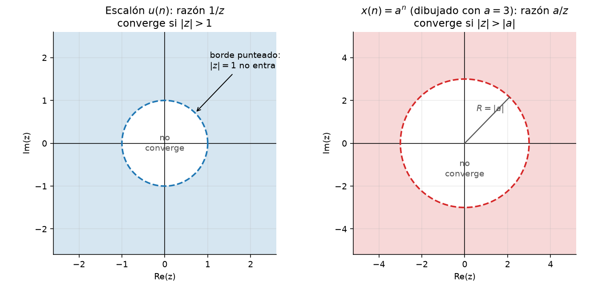
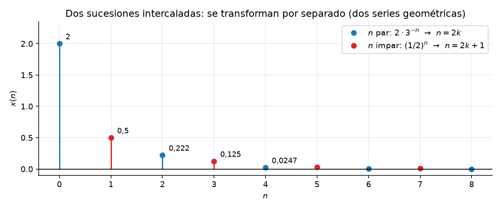
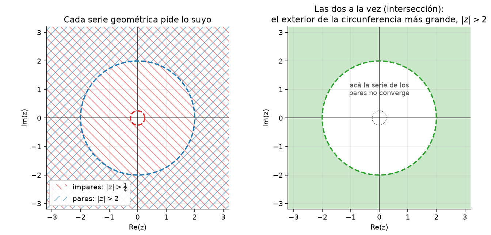
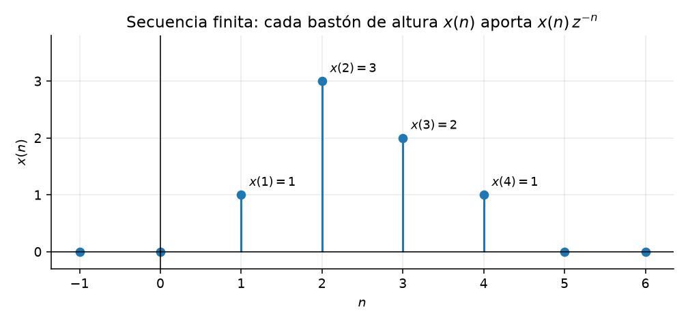
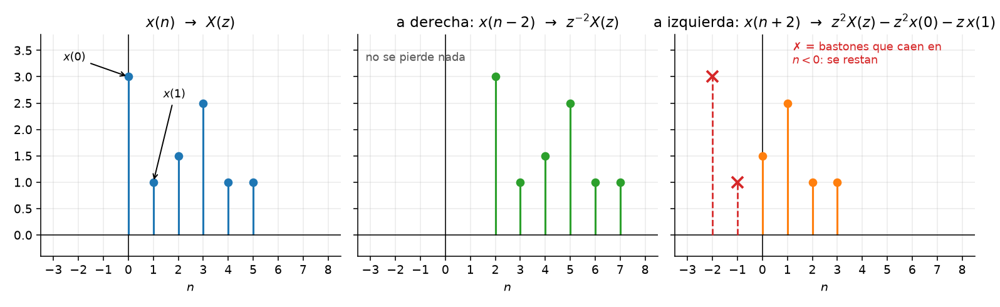

# Transformada Z desde cero

> Fuentes: `fuentes/clases/Transformada Z/Clase - Transformada Z.pdf` (PDF de clase, 18 p.), `Clase - Tabla sintetica de Transformada Z.pdf`, `Teorico catedra 1.7 - Transformada Z.pdf` (teórico de cátedra, 26 p.), `Transformada Z.pdf` (OneNote de la práctica, manuscrito del profesor, 5 p. con contenido), transcript `12-video-teorica-transformada-z.json` (teórica, 1 h 30), la parte de Z del repaso (`repaso/practica-repaso-2026.md`, ejercicios H e I, y transcript `10-video-repaso-primer-parcial.json` desde [1:52:37]), `examenes/INDICE.md` (el ejercicio de Z de las 16 hojas) y `examenes/resueltos/RESOLUCIONES-2025.md` (Ej4 de las 3 hojas 2025), `fuentes/Guia-ejercicios-parte-1-senales-y-sistemas.pdf` (págs. 59–64: ej. 1 a 9 de Z con sus respuestas) y `fuentes/AYUDAMEMORIA-OFICIAL.pdf` (págs. 2–3). Todos los números verificados con Python (sympy; las ecuaciones en diferencias, además, iterando la recurrencia). Generado 2026-11-25.
>
> **Cómo usarla:** leé de arriba abajo, sin saltear. Los **Ejemplos guiados** están resueltos a la vista: leelos con lápiz y rehacé cada cuenta. Los **Tu turno** se hacen en papel y **sin mirar**, con el ayudamemoria al lado (es lo único que vas a tener en el examen); la corrección está plegada (el enunciado va en texto plano en el título desplegable, porque ahí no se renderizan fórmulas). Las notas **En clase** son lo que dijo el profesor en los videos, con el minuto real del transcript (`teórica [mm:ss]` = video 12, `repaso [h:mm:ss]` = video 10). La práctica de Z no tiene video (está en Drive con la descarga bloqueada): se cubre con su OneNote. Tiempo total: ≈ 5 h con pausas.
>
> **Qué es de la cátedra y qué es mío:** métodos, fórmulas, criterios y ejemplos salen de las fuentes. Son agregados míos (para que se entienda) las explicaciones "en criollo", las cuentas intermedias que las fuentes saltean, los gráficos, la tablita de radios de §4.3 para chequearte, los controles con el valor inicial y las resoluciones de los ítems de examen que no tienen resolución oficial transcripta (todas las que no son de 2025: están marcadas como "resuelto para esta guía"). El **Checkpoint** es un ejercicio con formato de parcial armado con ejercicios de la guía, no una hoja real.

---

> **🧭 Ruta corta (si vas contra reloj)** — núcleo ≈ 2 h 30 · para el recuperatorio del 2026-12-01
>
> - **Leyenda de los "tu turno":** 🔴 ítem de examen real (obligatorio; primero los de 2025, que son el formato vigente) · 🟠 repaso (el de tu curso de 2026 y el grabado) · ⚪ extra (guía, clase, teórico: opcional). Lo plegado como **"⚪ Se toma poco"** se puede saltear.
> - **Leé, en este orden** (de lo más tomado a lo menos tomado): §0–§2 (10 min) → **§3** la serie geométrica → **§4** sucesión por paridad y región de convergencia (ejemplos guiados 3 y 4) → **§5** suma de una serie numérica → **§6** secuencia finita → **§8** antitransformar con "una z afuera" → **§9** ecuación en diferencias de 1er orden (ejemplos guiados 10 y 11) → §10 (2º orden) → "Resumen en una página".
> - **Salteá:** de §7 alcanza con el recuadro de fórmulas y la figura; §11 (plegada) y, si no llegás, el Checkpoint.
> - **"Tu turno" obligatorios (🔴), las tres hojas de 2025 completas:** 4.A, 5.A (Tema 1) · 5.B, 9.A (Tema 2) · 4.B, 6.A (1er recuperatorio). Después: 4.C, 4.D, 5.C, 9.B, 10.A.
> - **Repaso (🟠):** 4.G y 10.C (repaso 2026 de tu curso), 4.H y el ejemplo guiado 11 (repaso grabado).
> - **Para el 6 alcanza con…** el ítem de paridad con su región de convergencia (§4), la suma de una serie con la tabla (§5) y la secuencia finita (§6). Son mecánicos y cada uno vale 1 punto. La ecuación en diferencias (§9) es el que más cuentas tiene, pero trae verificación incluida: sabés si está bien antes de entregar.
> - La tabla y las propiedades de Z **están en el ayudamemoria** (págs. 2–3). Lo que NO está y hay que saber: la serie geométrica, $e^{a/z}$ y el truco de dejar una $z$ afuera (§2).

## 0. Qué te toman: el Ej4 (2 ítems de 1 punto)

El Ej4 del primer parcial es **siempre** transformada Z (en el formato viejo de 5 ejercicios era el Ej4 o el Ej5). En las tres hojas de 2025 tiene **dos ítems de 1 punto cada uno**. Hay Z en **16 de 16** hojas del `INDICE.md`.

| Ítem | Qué te piden | Hojas | Frecuencia | Sección |
|---|---|---|---|---|
| **Sucesión por paridad → $X(z)$ y región de convergencia** | $x(n)$ vale una cosa si $n$ es par y otra si es impar. Hallar la transformada y la región de convergencia (o un V/F sobre la región) | 2025 T1 a, 2025 R1 a (V/F, la **misma** sucesión), 2024-2C T1 a y T2 a, 2025-02-13, s/f K3521 T1 | **6/16** (2 de las 3 hojas 2025) | §4 |
| **Suma de una serie numérica "mediante Z"** | $\sum x(n)\,c^{-n}$: es una transformada de tabla evaluada en $z=c$ | 2025 T1 b, 2025 T2 a, 2024-2C T1 b y T2 b | **4/16** (2 de 3 en 2025) | §5 |
| **Ecuación en diferencias de 1er orden**, con verificación | $x(n+1)+c\,x(n)=g(n)$, $x(0)$ dato. "Verificar con $x(2)$" | 2025 T2 b (reciclado de s/f K3521 T2), 2024-2C R1, 2015 T1, 2015 T2 | **5/16** (1 de 3 en 2025) | §9 |
| **Secuencia finita del gráfico** | Leer los bastones y escribir la suma finita | 2025 R1 b, s/f (≈2015) T2 (el **mismo** gráfico) | **2/16** (1 de 3 en 2025) | §6 |
| Ecuación en diferencias de 2º orden | Igual, con $x(n+2)$ y dos datos | 2022, 2024-1C T1 (el mismo), 2024-1C T2 | 3/16 (0 en 2025) + repaso 2026 | §10 |
| Antitransformada suelta | Fracciones simples con una $z$ afuera | s/f (≈2015) T1 | 1/16 | §8 |

T1/T2 = Tema 1/2 · R1 = 1er recuperatorio · s/f = sin fecha.

**Lectura rápida:** el Ej4 vigente es **dos de estos cuatro**: paridad con región de convergencia, suma de una serie, ecuación en diferencias de primer orden, secuencia finita. La cátedra recicla: la sucesión $(-2)^n$ / $4^{-n}$ cayó en el parcial y, como verdadero/falso, en el recuperatorio del mismo cuatrimestre; la ecuación de 2025 T2 es textual de un parcial viejo y es el ej. 6e de la guía.

> **En clase:** sobre el ítem de paridad: "esto es algo que se toma bastante, se toma mucho, tanto en finales como en parciales, una expresión para los pares, una expresión distinta para los impares, y operar. Y la verdad es que es bastante mecánico todo, porque siempre es lo mismo" (teórica [43:22]).
>
> **En clase:** el repaso grabado arranca Z con "un par de ejercicios típicos de transformada Z": una ecuación en diferencias de primer orden con verificación y una región de convergencia (repaso [1:52:37] y [1:58:58]).

## 1. La idea en criollo

En Laplace transformabas una función de tiempo continuo $f(t)$. Acá la señal es **discreta**: una lista de números $x(0),\ x(1),\ x(2),\ \dots$, un valor por cada $n=0,1,2,\dots$ (una **sucesión**). En los ejercicios $x(n)$ y $a_n$ son lo mismo.

La transformada Z cuelga cada número de la lista de una potencia de $\frac1z$:

$$
\mathcal{Z}\left[x(n)\right]=\sum_{n=0}^{\infty}x(n)\,z^{-n}=x(0)+\frac{x(1)}{z}+\frac{x(2)}{z^{2}}+\frac{x(3)}{z^{3}}+\dots=X(z)
$$

Es "la Laplace de lo discreto": la integral pasa a ser una sumatoria, $f(t)$ pasa a ser $x(n)$ y $e^{-st}$ pasa a ser $z^{-n}$. La $z$ es un número **complejo**, como la $s$.

Tres ideas que ordenan todo el tema:

1. Como es una suma **infinita**, no converge para cualquier $z$: converge si $\lvert z\rvert$ es suficientemente grande. Ese conjunto de valores de $z$ es la **región de convergencia**. Siempre queda de la forma $\lvert z\rvert>R$: el exterior de una circunferencia de radio $R$ centrada en el origen.
2. Para calcular casi cualquier transformada "por definición" hay **una sola herramienta: la serie geométrica** (§3).
3. Así como Laplace resolvía ecuaciones diferenciales, Z resuelve **ecuaciones en diferencias** (recurrencias como $x(n+1)=3x(n)+2$). El papel de la derivada lo hace el **desplazamiento a izquierda** $x(n+1)$.

Las señales con nombre (PDF de clase, págs. 2–4):

| Señal | Definición | Lista de valores |
|---|---|---|
| Impulso unitario $\delta(n)$ | $1$ si $n=0$, $0$ si $n>0$ | $1,\ 0,\ 0,\ 0,\dots$ |
| Escalón unitario $u(n)$ | $1$ para todo $n\ge0$ | $1,\ 1,\ 1,\ 1,\dots$ |
| Rampa unitaria | $x(n)=n$ | $0,\ 1,\ 2,\ 3,\dots$ |
| Exponencial | $x(n)=a^{n}$ | $1,\ a,\ a^{2},\ a^{3},\dots$ |

El escalón es "la función constante 1": cuando en una ecuación aparece un número suelto, por ejemplo un $7$, se lee $7\,u(n)$.

> **En clase:** "este tema no debería ser una enorme complicación en el sentido de que es muy parecido a lo que ya vimos en transformada de Laplace, pero aplicado a dominios discretos" (teórica [00:00]).
>
> **En clase:** los gráficos de $a^n$ según el valor de $a$ (creciente, decreciente, alternada): "esto la verdad es que no le asigno demasiada importancia" (teórica [10:31]).

## 2. Qué tenés en el ayudamemoria y qué va de memoria

En el examen solo podés tener el **ayudamemoria oficial** (y la tabla de integrales), sin anotaciones propias. Lo de Z está al final de la pág. 2 y en la pág. 3.

> **En clase:** a la pregunta de si se puede llevar algo más que la "hoja de ayuda para el primer parcial": "se puede llevar […] está sola" (repaso [02:40]); "y tablas integrales, eso también" (repaso [03:11]).

**✅ Está en el ayudamemoria** (no lo memorices: aprendé a encontrarlo y a leerlo):

- La definición $\mathcal{Z}[x(n)]=\sum_{n=0}^{\infty}x(n)\,z^{-n}$.
- Desplazamiento a derecha: $\mathcal{Z}[x(n-a)]=z^{-a}X(z)$.
- Desplazamiento a izquierda, escrito con la $z$ de factor común:

$$
\mathcal{Z}\left[x(n+1)\right]=z\left(X(z)-x(0)\right),\qquad\mathcal{Z}\left[x(n+2)\right]=z^{2}\left(X(z)-x(0)-x(1)\,z^{-1}\right)
$$

- Multiplicación por $a^{n}$, multiplicación por $n$ ($\mathcal{Z}[n\,x(n)]=-z\,\frac{dX(z)}{dz}$), teoremas del valor inicial y del valor final, convolución.
- **La tabla**, con la columna $R$ del radio (la región es $\lvert z\rvert>R$):

| $x(n)$ | $X(z)$ | $R$ |
|---|---|---|
| $\delta(n)$ | $1$ | $0$ |
| $u(n)=1$ | $\dfrac{z}{z-1}$ | $1$ |
| $n$ | $\dfrac{z}{(z-1)^{2}}$ | $1$ |
| $n^{2}$ | $\dfrac{z(z+1)}{(z-1)^{3}}$ | $1$ |
| $a^{n}$ | $\dfrac{z}{z-a}$ | $\lvert a\rvert$ |
| $n\,a^{n}$ | $\dfrac{a\,z}{(z-a)^{2}}$ | $\lvert a\rvert$ |
| $\cos(an)$ | $\dfrac{z\,(z-\cos a)}{z^{2}-2z\cos a+1}$ | $1$ |
| $\operatorname{sen}(an)$ | $\dfrac{z\operatorname{sen}a}{z^{2}-2z\cos a+1}$ | $1$ |
| $e^{-an}$ | $\dfrac{z}{z-e^{-a}}$ | $e^{-a}$ |

**🧠 NO está y va de memoria:**

- 🧠 **Serie geométrica:** $\displaystyle\sum_{k=0}^{\infty}r^{k}=\frac{1}{1-r}$, **solo si** $\lvert r\rvert<1$.
- 🧠 **Región de convergencia:** cada serie pide $\lvert\text{razón}\rvert<1$; la región total es la **intersección**, o sea el exterior de la circunferencia **más grande**.
- 🧠 Separar pares e impares con $n=2k$ y $n=2k+1$ (múltiplos de 3: $3k$, $3k+1$, $3k+2$).
- 🧠 $\mathcal{Z}\left[\dfrac{a^{n}}{n!}\right]=e^{a/z}$. Está en la tabla del PDF de clase, **pero no en el ayudamemoria**, y se tomó en 2025.
- 🧠 **Sumar una serie numérica es evaluar una transformada:** $\sum x(n)\,c^{-n}=X(c)$.
- 🧠 **Dejar una $z$ afuera** antes de hacer fracciones simples.
- 🧠 Las formas distribuidas $zX-z\,x(0)$ y $z^{2}X-z^{2}x(0)-z\,x(1)$ salen de distribuir las del ayudamemoria.
- 🧠 La **verificación** de una ecuación en diferencias (iterar la recurrencia y comparar con la fórmula).

Dos filas más que trae la tabla del PDF de clase y el ayudamemoria no (casi no se usan): $\delta(n-m)\to z^{-m}$ y $(n+1)\,a^{n}\to\dfrac{z^{2}}{(z-a)^{2}}$.

⚠ **Errata de las fuentes:** en la tabla del PDF de clase y en la "Tabla sintética", la fila del seno tiene el denominador $z^{2}-2\cos(a)+1$: le falta la $z$. Lo correcto es $z^{2}-2z\cos(a)+1$, como figura en el teórico y en el ayudamemoria (verificado numéricamente). En el examen usás el ayudamemoria, que está bien.

---

## 3. La serie geométrica y la región de convergencia

### 3.1 La herramienta

Una serie geométrica es una suma donde cada término es el anterior multiplicado por un mismo número $r$ (la **razón**): $1+r+r^{2}+r^{3}+\dots$ La deducción del PDF de clase: si llamo $S$ a la suma y la multiplico por $r$, al restar se cancela todo menos el primer término.

$$
S=1+r+r^{2}+\dots,\qquad r\,S=r+r^{2}+r^{3}+\dots\quad\Longrightarrow\quad S-rS=1
$$

$$
\sum_{k=0}^{\infty}r^{k}=\frac{1}{1-r}\qquad\text{si }\lvert r\rvert<1
$$

Si $\lvert r\rvert\ge1$ la suma no existe: con $r=1$ sumás $1+1+1+\dots$ para siempre. Con $r=\frac12$ da $1+\frac12+\frac14+\dots=\frac{1}{1-\frac12}=2$.

⚠ El recuadro "Recuerde" de la guía de ejercicios pone la condición "con $0<r<1$". Es más restrictiva de lo necesario: la condición es $\lvert r\rvert<1$ (así está en el PDF de clase), y hace falta en esa forma porque acá la razón depende de $z$, que es complejo, y puede ser negativa (como $\frac{-8}{z^{3}}$).

> **En clase:** "esto se va a usar muchísimo, muchísimo, muchísimo […] así que tengan a bien tenerlo presente" (teórica [24:07]). La idea "es siempre llevarlos, las definiciones de las transformadas, a una serie geométrica. Así que a algo a la n. No importa el choclo que les quede adentro, pero algo elevado a la n" (teórica [28:13]).

### 3.2 Receta para transformar "por definición"

1. Escribí la definición $\sum x(n)\,z^{-n}$ con tu $x(n)$.
2. Juntá todo lo que depende de $n$ como **"algo elevado a la $n$"**. Ese "algo" es la razón $r$. Lo que no depende de $n$ sale afuera de la sumatoria.
3. Sumá con $\dfrac{1}{1-r}$ y sacá denominador común para que quede un cociente de polinomios en $z$.
4. **Región de convergencia:** imponé $\lvert r\rvert<1$ y despejá $\lvert z\rvert$.

### Ejemplo guiado 1: $\mathcal{Z}[u(n)]$ y $\mathcal{Z}[a^{n}]$ (PDF de clase, ejemplos 2 y 3)

**Paso 1 — definición con $x(n)=a^{n}$.**

$$
\mathcal{Z}\left[a^{n}\right]=\sum_{n=0}^{\infty}a^{n}z^{-n}
$$

**Paso 2 — algo a la $n$.** Como $z^{-n}=\left(\frac1z\right)^{n}$, las dos potencias tienen el mismo exponente y se juntan:

$$
\sum_{n=0}^{\infty}a^{n}z^{-n}=\sum_{n=0}^{\infty}\left(\frac{a}{z}\right)^{n}\qquad\Longrightarrow\qquad r=\frac{a}{z}
$$

**Paso 3 — sumar** y multiplicar arriba y abajo por $z$:

$$
\mathcal{Z}\left[a^{n}\right]=\frac{1}{1-\frac{a}{z}}=\frac{z}{z-a}
$$

**Paso 4 — región de convergencia.** El paso 3 solo vale si la razón tiene módulo menor que 1:

$$
\left\lvert\frac{a}{z}\right\rvert<1\ \Longleftrightarrow\ \lvert a\rvert<\lvert z\rvert\ \Longleftrightarrow\ \lvert z\rvert>\lvert a\rvert
$$

**Respuesta:** $\mathcal{Z}[a^{n}]=\dfrac{z}{z-a}$ con $\lvert z\rvert>\lvert a\rvert$. Es la fila $a^{n}$ del ayudamemoria. Con $a=1$ sale el escalón: $\mathcal{Z}[u(n)]=\dfrac{z}{z-1}$, $\lvert z\rvert>1$.

Como $z$ es complejo, $\lvert z\rvert>R$ son todos los puntos del plano que están **afuera** de la circunferencia de radio $R$. El borde no entra (la desigualdad es estricta): se dibuja **punteado**.

> **En clase:** la región son "todos los que estén por afuera de esta circunferencia de radio 1, sin incluir el borde, y por eso tiene línea punteada" (teórica [26:31]). En el repaso lo repite: "estos círculos en realidad yo los tendría que hacer punteados para dejar en claro que no tomo la parte de la circunferencia" (repaso [2:05:10]–[2:05:41]).

### Ejemplo guiado 2: linealidad y tabla, $x(n)=3\,(-2)^{n}-2\cdot5^{n}$ (PDF de clase)

Cuando $x(n)$ es una suma de cosas que están en la tabla **no hace falta la definición**. Vale la linealidad, $\mathcal{Z}[k_{1}x_{1}+k_{2}x_{2}]=k_{1}X_{1}+k_{2}X_{2}$, y se entra a la fila $a^{n}$ con $a=-2$ y con $a=5$:

$$
X(z)=3\,\frac{z}{z-(-2)}-2\,\frac{z}{z-5}=\frac{3z}{z+2}-\frac{2z}{z-5}
$$

**Región de convergencia:** la columna $R$ de la tabla da $\lvert z\rvert>\lvert-2\rvert=2$ para el primer término y $\lvert z\rvert>5$ para el segundo. Tienen que cumplirse las dos a la vez (intersección): **$\lvert z\rvert>5$**.

> **En clase:** "tengo dos circunferencias concéntricas […] y la intersección entre ambas de estas regiones van a ser siempre la más grande, lo exterior a la circunferencia más grande" (teórica [51:45]).

**Qué hay que dejar escrito** (en todo ítem que diga "y la región de convergencia"): la razón de la serie, la condición $\lvert r\rvert<1$, el despeje hasta $\lvert z\rvert>R$ y la región final. Si hay más de una condición, la palabra **intersección**.

### Tu turno 3

⚪ <strong>3.A (guía ej. 1a y ej. 4a)</strong> — a) Hallar por definición la transformada Z de x(n) = (1/3)ⁿ e indicar la región de convergencia. b) Verdadero o falso: «la región de convergencia de la transformada Z de aₙ = (1/3)ⁿ es |z| &gt; 3».

<strong>Resolución</strong>

**a)**

$$
X(z)=\sum_{n=0}^{\infty}\left(\frac13\right)^{n}z^{-n}=\sum_{n=0}^{\infty}\left(\frac{1}{3z}\right)^{n}=\frac{1}{1-\frac{1}{3z}}=\frac{3z}{3z-1}=\frac{z}{z-\frac13}
$$

$$
\left\lvert\frac{1}{3z}\right\rvert<1\ \Longrightarrow\ \lvert3z\rvert>1\ \Longrightarrow\ \lvert z\rvert>\frac13
$$

Coincide con la respuesta de la guía y con la fila $a^{n}$ de la tabla ($a=\frac13$, $R=\frac13$).

**b) Falso.** Es $\lvert z\rvert>\frac13$. La trampa: al despejar $\left\lvert\frac{1}{3z}\right\rvert<1$ el 3 queda dividiendo, no multiplicando.

⚪ <strong>3.B (guía ej. 3a y 3c; ejercicio del teórico)</strong> — Con la tabla y las propiedades, hallar la transformada Z de: a) x(n) = 2ⁿ + 3·(1/2)ⁿ · b) x(n) = 3ⁿ⁺¹ · c) x(n) = 3·2ⁿ − 4·3ⁿ. Indicar la región de convergencia.

<strong>Resolución</strong>

**a)** Linealidad y fila $a^{n}$ con $a=2$ y $a=\frac12$:

$$
X(z)=\frac{z}{z-2}+\frac{3z}{z-\frac12}=\frac{z}{z-2}+\frac{6z}{2z-1}=\frac{z(2z-1)+6z(z-2)}{(z-2)(2z-1)}=\frac{8z^{2}-13z}{(z-2)(2z-1)}
$$

Regiones: $\lvert z\rvert>2$ y $\lvert z\rvert>\frac12$ ⇒ **$\lvert z\rvert>2$** (coincide con la guía).

**b)** $3^{n+1}=3\cdot3^{n}$: el 3 que sobra es una constante.

$$
X(z)=3\,\frac{z}{z-3}=\frac{3z}{z-3},\qquad\lvert z\rvert>3
$$

**c)** (teórico, pág. 139, sin respuesta en la fuente; resuelto para esta guía)

$$
X(z)=\frac{3z}{z-2}-\frac{4z}{z-3},\qquad\lvert z\rvert>3
$$

---

## 4. Sucesión definida por paridad: $X(z)$ y región de convergencia (6/16, el ítem del Ej4)

### 4.1 La idea

Te dan una regla para los $n$ pares y otra para los impares. Son **dos sucesiones intercaladas**:

Ninguna tabla tiene eso. Se resuelve por definición, separando la suma en dos: una con los términos pares y otra con los impares. Cada una es una serie geométrica.

### 4.2 Receta

1. **Escribí los primeros 4 términos** de $\sum x(n)\,z^{-n}$, mirando qué rama usa cada $n$. **El 0 es par.**
2. **Separá en dos sumatorias en $k$:** en los pares reemplazá $n=2k$; en los impares, $n=2k+1$.
3. **Llevá cada una a "algo elevado a la $k$".** En los impares siempre sobra un "$+1$" en el exponente: ese factor no depende de $k$ y sale **afuera** de la sumatoria.
4. **Sumá** cada geométrica con $\dfrac{1}{1-r}$ y simplificá (multiplicar arriba y abajo por $z^{2}$; en los impares se simplifica una $z$).
5. **Región de convergencia:** $\lvert r\rvert<1$ en **cada** sumatoria da $\lvert z\rvert>R_{1}$ y $\lvert z\rvert>R_{2}$. La región de $X(z)$ es la **intersección**: $\lvert z\rvert>$ el mayor de los dos radios.

Las identidades de potencias que se usan sin parar:

$$
b^{2k}=\left(b^{2}\right)^{k},\qquad b^{2k+1}=b\cdot\left(b^{2}\right)^{k},\qquad z^{-(2k+1)}=\frac1z\cdot\left(\frac{1}{z^{2}}\right)^{k}
$$

$$
(-2)^{2k}=4^{k}\ \ \text{(en los pares el signo desaparece)},\qquad(-2)^{2k+1}=-2\cdot4^{k}
$$

**Qué hay que dejar escrito** (es lo que tiene la resolución oficial de 2025):

- los primeros términos de la serie;
- las dos sumatorias ya como "algo a la $k$", con el factor de los impares afuera;
- la suma de cada una y la $X(z)$ simplificada;
- "R.C. (1)" y "R.C. (2)": la condición $\lvert r\rvert<1$ de **cada** serie con su despeje;
- el dibujo de las dos circunferencias concéntricas punteadas y cuál es la región final (la oficial lo señala con "Este es el R.C.");
- la respuesta: $X(z)=\dots$, $\lvert z\rvert>R$.

**Si solo piden la región (o es un verdadero/falso sobre la región), cortás en el paso 3.** La hoja oficial del recuperatorio 2025 escribe las dos sumatorias, pone "con eso alcanza para ver el radio de convergencia" y pasa directo a las condiciones. Las constantes que quedaron afuera de la sumatoria no influyen.

> **En clase:** "acá se suele poner K […] porque uno asocia el 2K, el 2K más 1 a pares o impares, igual que hacíamos con las series de Fourier. Pero acá de repente si ponen N […] la verdad que no pasa nada" (teórica [34:30]).
>
> **En clase:** "los impares siempre tienen algún pasito extra" (teórica [36:36]): "estas potencias impares tienen un 1 que les sobra, ese 1 se me va a quedar separado" (teórica [39:42]). Y al simplificar: "siempre me va a sobrar algo que tiene z […] se me van a poder simplificar numerador y denominador" (teórica [42:50]).
>
> **En clase:** "la región de convergencia total, final, de esa X de Z será la intersección de las dos regiones por separado" (teórica [45:58]); "será, y siempre es en este tipo de ejercicios, la región de convergencia de la más grande […] el circulito de afuera" (teórica [47:01]).
>
> **En clase:** "en general los ejercicios suelen decir hallar transformada Z y la región de convergencia" (teórica [44:24]); hay que hallarla "siempre que trabajamos con series geométricas", no en las secuencias de "puntitos sueltos" (teórica [44:57]).

### 4.3 Tablita para chequearte (agregado mío)

Sale de aplicar la receta a cada tipo de rama. **No reemplaza el desarrollo** (en el examen hay que mostrar las series), pero te dice de antemano qué radio tiene que dar.

| Rama (en pares o en impares) | Razón que queda | Radio |
|---|---|---|
| $b^{n}$ | $\dfrac{b^{2}}{z^{2}}$ | $\lvert b\rvert$ |
| $b^{-n}$ | $\dfrac{1}{b^{2}z^{2}}$ | $\dfrac{1}{\lvert b\rvert}$ |
| constante ($5$, $0$…) | $\dfrac{1}{z^{2}}$ | $1$ (si es $0$, esa rama no pide nada) |

Una constante que multiplica ($5\cdot2^{n}$) no cambia el radio. La región final es $\lvert z\rvert>$ el radio más grande.

### Ejemplo guiado 3: $x(n)=2\cdot3^{-n}$ si $n$ es par, $\left(\frac12\right)^{n}$ si $n$ es impar (PDF de clase, ejemplo 6; teórica [36:04])

Es la sucesión de la figura de arriba.

**Paso 1 — primeros términos.**

$$
X(z)=2\cdot3^{-0}z^{-0}+\left(\frac12\right)^{1}z^{-1}+2\cdot3^{-2}z^{-2}+\left(\frac12\right)^{3}z^{-3}+\dots
$$

**Paso 2 — dos sumatorias.** Pares con $n=2k$, impares con $n=2k+1$. El 2 es constante y sale afuera:

$$
X(z)=2\sum_{k=0}^{\infty}3^{-2k}\,z^{-2k}+\sum_{k=0}^{\infty}\left(\frac12\right)^{2k+1}z^{-(2k+1)}
$$

**Paso 3 — algo a la $k$.** Pares: $3^{-2k}=\left(\frac19\right)^{k}$ y $z^{-2k}=\left(\frac{1}{z^{2}}\right)^{k}$, juntos $\left(\frac{1}{9z^{2}}\right)^{k}$. Impares: separo el "$+1$": $\left(\frac12\right)^{2k+1}z^{-(2k+1)}=\frac12\cdot\frac1z\cdot\left(\frac14\right)^{k}\left(\frac{1}{z^{2}}\right)^{k}$, y el $\frac{1}{2z}$ sale afuera:

$$
X(z)=2\sum_{k=0}^{\infty}\left(\frac{1}{9z^{2}}\right)^{k}+\frac{1}{2z}\sum_{k=0}^{\infty}\left(\frac{1}{4z^{2}}\right)^{k}
$$

**Paso 4 — sumar y simplificar.**

$$
X(z)=2\cdot\frac{1}{1-\frac{1}{9z^{2}}}+\frac{1}{2z}\cdot\frac{1}{1-\frac{1}{4z^{2}}}=\frac{18z^{2}}{9z^{2}-1}+\frac{1}{2z}\cdot\frac{4z^{2}}{4z^{2}-1}=\frac{18z^{2}}{9z^{2}-1}+\frac{2z}{4z^{2}-1}
$$

**Paso 5 — región de convergencia.**

$$
\left\lvert\frac{1}{9z^{2}}\right\rvert<1\ \Rightarrow\ \lvert9z^{2}\rvert>1\ \Rightarrow\ \lvert z\rvert^{2}>\frac19\ \Rightarrow\ \lvert z\rvert>\frac13
$$

$$
\left\lvert\frac{1}{4z^{2}}\right\rvert<1\ \Rightarrow\ \lvert4z^{2}\rvert>1\ \Rightarrow\ \lvert z\rvert^{2}>\frac14\ \Rightarrow\ \lvert z\rvert>\frac12
$$

Intersección: afuera de las dos circunferencias es afuera de la más grande.

**Respuesta:** $X(z)=\dfrac{18z^{2}}{9z^{2}-1}+\dfrac{2z}{4z^{2}-1}$, con $\lvert z\rvert>\dfrac12$.

Chequeo con la tablita de §4.3: $3^{-n}$ da radio $\frac13$, $\left(\frac12\right)^{n}$ da radio $\frac12$. Gana $\frac12$ ✓.

### Ejemplo guiado 4: $x(n)=4^{n}$ si $n$ es par, $3^{-n}$ si $n$ es impar (guía ej. 1c, OneNote; es el Ej5 del recuperatorio 2025-02-13)

**Paso 1.** $X(z)=4^{0}z^{-0}+3^{-1}z^{-1}+4^{2}z^{-2}+3^{-3}z^{-3}+\dots$

**Paso 2 y 3.** Pares: $4^{2k}z^{-2k}=\left(\frac{16}{z^{2}}\right)^{k}$. Impares: $3^{-(2k+1)}z^{-(2k+1)}=3^{-1}z^{-1}\cdot3^{-2k}z^{-2k}=\frac{1}{3z}\left(\frac{1}{9z^{2}}\right)^{k}$.

$$
X(z)=\sum_{k=0}^{\infty}\left(\frac{16}{z^{2}}\right)^{k}+\frac{1}{3z}\sum_{k=0}^{\infty}\left(\frac{1}{9z^{2}}\right)^{k}
$$

**Paso 4.**

$$
X(z)=\frac{1}{1-\frac{16}{z^{2}}}+\frac{1}{3z}\cdot\frac{1}{1-\frac{1}{9z^{2}}}=\frac{z^{2}}{z^{2}-16}+\frac{1}{3z}\cdot\frac{9z^{2}}{9z^{2}-1}=\frac{z^{2}}{z^{2}-16}+\frac{3z}{9z^{2}-1}
$$

**Paso 5.**

$$
\left\lvert\frac{16}{z^{2}}\right\rvert<1\ \Rightarrow\ \lvert z^{2}\rvert>16\ \Rightarrow\ \lvert z\rvert>4,\qquad\left\lvert\frac{1}{9z^{2}}\right\rvert<1\ \Rightarrow\ \lvert9z^{2}\rvert>1\ \Rightarrow\ \lvert z\rvert>\frac13
$$

**Respuesta (coincide con la guía):** $X(z)=\dfrac{z^{2}}{z^{2}-16}+\dfrac{3z}{9z^{2}-1}$, con $\lvert z\rvert>4$ ("parte exterior de la circunferencia de radio 4", anota el profesor en el OneNote). El enunciado de 2025-02-13 pedía "determinar el radio de convergencia": $R=4$.

### Tu turno 4

🔴 <strong>4.A (parcial 2025, Tema 1, Ej4 a)</strong> — Hallar la transformada Z y la región de convergencia de x(n) = (−2)ⁿ si n es par, 4⁻ⁿ si n es impar.

<strong>Resolución</strong>

**Paso 1.**

$$
X(z)=(-2)^{0}z^{0}+4^{-1}z^{-1}+(-2)^{2}z^{-2}+4^{-3}z^{-3}+\dots
$$

**Paso 2 y 3.** Pares: $(-2)^{2k}z^{-2k}=\left(\frac{4}{z^{2}}\right)^{k}$ (el signo desaparece). Impares: $4^{-(2k+1)}z^{-(2k+1)}=\frac{1}{4z}\left(\frac{1}{16z^{2}}\right)^{k}$.

$$
X(z)=\sum_{k=0}^{\infty}\left(\frac{4}{z^{2}}\right)^{k}+\frac{1}{4z}\sum_{k=0}^{\infty}\left(\frac{1}{16z^{2}}\right)^{k}
$$

**Paso 4.**

$$
X(z)=\frac{1}{1-\frac{4}{z^{2}}}+\frac{1}{4z}\cdot\frac{1}{1-\frac{1}{16z^{2}}}=\frac{z^{2}}{z^{2}-4}+\frac{1}{4z}\cdot\frac{16z^{2}}{16z^{2}-1}=\frac{z^{2}}{z^{2}-4}+\frac{4z}{16z^{2}-1}
$$

**Paso 5.** R.C. (1): $\left\lvert\frac{4}{z^{2}}\right\rvert<1\Rightarrow\lvert z\rvert>2$. R.C. (2): $\left\lvert\frac{1}{16z^{2}}\right\rvert<1\Rightarrow\lvert16z^{2}\rvert>1\Rightarrow\lvert z\rvert>\frac14$. Intersección: $\lvert z\rvert>2$.

**Respuesta (coincide con la oficial):** $X(z)=\dfrac{z^{2}}{z^{2}-4}+\dfrac{4z}{16z^{2}-1}$, región de convergencia $\lvert z\rvert>2$.

🔴 <strong>4.B (1er recuperatorio 2025, Ej4 a)</strong> — Verdadero o falso, justificando: la región de convergencia de la transformada Z de x(n) = (−2)ⁿ si n es par, 4⁻ⁿ si n es impar, es |z| &gt; 2.

<strong>Resolución</strong>

Es la sucesión de 4.A, pero ahora **no hace falta sumar**. Alcanza con llegar a las dos geométricas:

$$
X(z)=\sum_{k=0}^{\infty}\left(\frac{-2}{z}\right)^{2k}+\sum_{k=0}^{\infty}\left(\frac{1}{4z}\right)^{2k+1}=\sum_{k=0}^{\infty}\left(\frac{4}{z^{2}}\right)^{k}+\frac{1}{4z}\sum_{k=0}^{\infty}\left(\frac{1}{16z^{2}}\right)^{k}
$$

"Con eso alcanza para ver el radio de convergencia" (hoja oficial). Cada serie converge si su razón tiene módulo menor que 1:

$$
\left\lvert\frac{4}{z^{2}}\right\rvert<1\ \Rightarrow\ \lvert z\rvert>2\qquad\wedge\qquad\left\lvert\frac{1}{16z^{2}}\right\rvert<1\ \Rightarrow\ \lvert z^{2}\rvert>\frac{1}{16}\ \Rightarrow\ \lvert z\rvert>\frac14
$$

Intersección: $\lvert z\rvert>2$. **Verdadero** (coincide con la oficial).

La justificación son las dos condiciones y la intersección. Un "V" pelado no suma.

🔴 <strong>4.C (parcial 2024-2C, Tema 2, Ej5 a)</strong> — Transformada Z y región de convergencia de x(n) = (−2)ⁿ si n es par, 4ⁿ si n es impar.

<strong>Resolución</strong>

(resuelto para esta guía; verificado con Python)

Pares: $(-2)^{2k}z^{-2k}=\left(\frac{4}{z^{2}}\right)^{k}$. Impares: $4^{2k+1}z^{-(2k+1)}=\frac{4}{z}\left(\frac{16}{z^{2}}\right)^{k}$.

$$
X(z)=\frac{1}{1-\frac{4}{z^{2}}}+\frac{4}{z}\cdot\frac{1}{1-\frac{16}{z^{2}}}=\frac{z^{2}}{z^{2}-4}+\frac{4}{z}\cdot\frac{z^{2}}{z^{2}-16}=\frac{z^{2}}{z^{2}-4}+\frac{4z}{z^{2}-16}
$$

Regiones: $\lvert z\rvert>2$ y $\left\lvert\frac{16}{z^{2}}\right\rvert<1\Rightarrow\lvert z\rvert>4$. **Respuesta:** región $\lvert z\rvert>4$.

Compará con 4.A: allá la rama impar era $4^{-n}$ (razón $\frac{1}{16z^{2}}$, radio $\frac14$) y mandaba el 2. Acá es $4^{n}$ (razón $\frac{16}{z^{2}}$, radio $4$) y manda el 4. Un signo en el exponente cambia la respuesta.

🔴 <strong>4.D (parcial 2024-2C, Tema 1, Ej5 a)</strong> — Transformada Z y región de convergencia de x(n) = 3⁻ⁿ si n es par, 5·2ⁿ si n es impar.

<strong>Resolución</strong>

(El enunciado está reconstruido en el `INDICE.md` a partir de la respuesta oficial; el desarrollo es de esta guía, verificado con Python.)

Pares: $3^{-2k}z^{-2k}=\left(\frac{1}{9z^{2}}\right)^{k}$. Impares: $5\cdot2^{2k+1}z^{-(2k+1)}=5\cdot\frac{2}{z}\left(\frac{4}{z^{2}}\right)^{k}=\frac{10}{z}\left(\frac{4}{z^{2}}\right)^{k}$ (el 5 y el 2 que sobra salen juntos).

$$
X(z)=\frac{1}{1-\frac{1}{9z^{2}}}+\frac{10}{z}\cdot\frac{1}{1-\frac{4}{z^{2}}}=\frac{9z^{2}}{9z^{2}-1}+\frac{10z}{z^{2}-4}
$$

Regiones: $\lvert z\rvert>\frac13$ y $\lvert z\rvert>2$. **Respuesta (coincide con la oficial):** $X(z)=\dfrac{9z^{2}}{9z^{2}-1}+\dfrac{10z}{z^{2}-4}$, $\lvert z\rvert>2$.

🔴 <strong>4.E (parcial sin fecha, curso K3521, Tema 1, Ej5)</strong> — Transformada Z de x(n) = (−3)ⁿ si n es par, 5·2ⁿ si n es impar, indicando la región de convergencia.

<strong>Resolución</strong>

(resuelto para esta guía; verificado con Python)

Pares: $(-3)^{2k}z^{-2k}=\left(\frac{9}{z^{2}}\right)^{k}$. Impares: igual que en 4.D, $\frac{10}{z}\left(\frac{4}{z^{2}}\right)^{k}$.

$$
X(z)=\frac{1}{1-\frac{9}{z^{2}}}+\frac{10}{z}\cdot\frac{1}{1-\frac{4}{z^{2}}}=\frac{z^{2}}{z^{2}-9}+\frac{10z}{z^{2}-4}
$$

Regiones: $\lvert z\rvert>3$ y $\lvert z\rvert>2$. **Respuesta:** $\lvert z\rvert>3$.

🔴 <strong>4.F (2do recuperatorio 2025-02-13, Ej5)</strong> — Resolver por transformada Z: x(n) = 4ⁿ si n es par, 3⁻ⁿ si n es impar. Determinar el radio de convergencia.

<strong>Resolución</strong>

Es el **Ejemplo guiado 4** (guía ej. 1c). Hacelo de nuevo sin mirar y comparalo: $X(z)=\dfrac{z^{2}}{z^{2}-16}+\dfrac{3z}{9z^{2}-1}$, radio de convergencia $R=4$ (región $\lvert z\rvert>4$).

🟠 <strong>4.G (repaso 2026, ejercicio H; guía ej. 4c, OneNote)</strong> — Verdadero o falso, justificando: dada x(n) = 3 si n es múltiplo de 5, (−2)ⁿ si n no es múltiplo de 5, la región de convergencia de su transformada Z es |z| &gt; 2.

<strong>Resolución</strong>

Misma receta, pero $n$ se reparte en **cinco** clases según el resto de dividir por 5: $n=5k$, $5k+1$, $5k+2$, $5k+3$, $5k+4$.

**Paso 1.** $X(z)=3z^{-0}+(-2)^{1}z^{-1}+(-2)^{2}z^{-2}+(-2)^{3}z^{-3}+(-2)^{4}z^{-4}+3z^{-5}+\dots$

**Paso 2.**

$$
X(z)=\sum_{k=0}^{\infty}3\left(\frac1z\right)^{5k}+\sum_{k=0}^{\infty}\left(\frac{-2}{z}\right)^{5k+1}+\sum_{k=0}^{\infty}\left(\frac{-2}{z}\right)^{5k+2}+\sum_{k=0}^{\infty}\left(\frac{-2}{z}\right)^{5k+3}+\sum_{k=0}^{\infty}\left(\frac{-2}{z}\right)^{5k+4}
$$

**Paso 3.** $\left(\frac{-2}{z}\right)^{5k}=\left(\frac{-32}{z^{5}}\right)^{k}$, y lo que sobra de cada exponente sale afuera:

$$
X(z)=3\sum_{k=0}^{\infty}\left(\frac{1}{z^{5}}\right)^{k}-\frac{2}{z}\sum_{k=0}^{\infty}\left(\frac{-32}{z^{5}}\right)^{k}+\frac{4}{z^{2}}\sum_{k=0}^{\infty}\left(\frac{-32}{z^{5}}\right)^{k}-\frac{8}{z^{3}}\sum_{k=0}^{\infty}\left(\frac{-32}{z^{5}}\right)^{k}+\frac{16}{z^{4}}\sum_{k=0}^{\infty}\left(\frac{-32}{z^{5}}\right)^{k}
$$

**Paso 4 — sin sumar.** Hay solo dos razones distintas:

$$
\left\lvert\frac{1}{z^{5}}\right\rvert<1\ \Rightarrow\ \lvert z\rvert>1,\qquad\left\lvert\frac{-32}{z^{5}}\right\rvert<1\ \Rightarrow\ \lvert z\rvert^{5}>32\ \Rightarrow\ \lvert z\rvert>2
$$

Intersección: $\lvert z\rvert>2$. **Verdadero** (coincide con la guía).

El profesor cierra el OneNote ahí, con la frase: "el área de convergencia sale sin necesidad de resolver el resto de la transformada".

🟠 <strong>4.H (repaso grabado, multiple choice)</strong> — La región de convergencia de la transformada Z de x(n) = −3 si n no es múltiplo de 3, (−2)ⁿ si n es múltiplo de 3, es: a) |z| &gt; 2 · b) |z| ≥ 3 · c) |z| ≥ 2 · d) |z| &lt; 3 · e) 2 &lt; |z| &lt; 3 · f) n.a.

<strong>Resolución</strong>

**Paso 1.** $n=0$ y $n=3$ son múltiplos de 3; $n=1,2,4$ valen $-3$:

$$
X(z)=\frac{(-2)^{0}}{z^{0}}+\frac{-3}{z}+\frac{-3}{z^{2}}+\frac{(-2)^{3}}{z^{3}}+\frac{-3}{z^{4}}+\dots
$$

**Paso 2 — tres sumatorias** ($n=3k$, $3k+1$, $3k+2$). El $-3$ no depende de $n$ y sale afuera:

$$
X(z)=\sum_{k=0}^{\infty}\left(\frac{-2}{z}\right)^{3k}-3\sum_{k=0}^{\infty}\left(\frac1z\right)^{3k+1}-3\sum_{k=0}^{\infty}\left(\frac1z\right)^{3k+2}
$$

**Paso 3.**

$$
X(z)=\sum_{k=0}^{\infty}\left(\frac{-8}{z^{3}}\right)^{k}-\frac{3}{z}\sum_{k=0}^{\infty}\left(\frac{1}{z^{3}}\right)^{k}-\frac{3}{z^{2}}\sum_{k=0}^{\infty}\left(\frac{1}{z^{3}}\right)^{k}
$$

**Paso 4.** "Solo importa la región de convergencia":

$$
\left\lvert\frac{-8}{z^{3}}\right\rvert<1\ \Rightarrow\ \lvert z^{3}\rvert>8\ \Rightarrow\ \lvert z\rvert>2,\qquad\left\lvert\frac{1}{z^{3}}\right\rvert<1\ \Rightarrow\ \lvert z\rvert>1
$$

Intersección: $\lvert z\rvert>2$ ⇒ **opción a)**. Ojo con c): el borde no entra, es mayor estricto.

**Para practicar (no lo pedía):** sumando cada geométrica,

$$
X(z)=\frac{1}{1+\frac{8}{z^{3}}}-\frac{3}{z}\cdot\frac{1}{1-\frac{1}{z^{3}}}-\frac{3}{z^{2}}\cdot\frac{1}{1-\frac{1}{z^{3}}}=\frac{z^{3}}{z^{3}+8}-\frac{3z^{2}}{z^{3}-1}-\frac{3z}{z^{3}-1}
$$

> **En clase:** "acuérdense que siempre el objetivo es dejar a algo elevado a la K" (repaso [2:02:06]). "No es necesario que yo llegue al resultado final de la transformada Z; como solo importa la región de convergencia, voy a ver qué pasa con estas sumatorias para que converjan" (repaso [2:03:08]). "Por más de que esté multiplicado por 3z, por 3z cuadrado, por lo que sea, lo importante es lo que queda en la sumatoria" (repaso [2:04:08]).
>
> **En clase:** si piden la transformada, la forma con los $\frac{1}{1-r}$ sin simplificar "no está mal", pero "si pueden trabajar un poquito más esta forma, mejor" (repaso [2:07:17]).

⚪ <strong>4.I (guía ej. 1b; PDF de clase ej. 5; ejercicio del teórico)</strong> — Hallar por definición la transformada Z y la región de convergencia de: a) x(n) = 1 si n es par, 0 si n es impar · b) x(n) = 5 si n es par, 0 si n es impar · c) x(n) = 2ⁿ si n es impar, 0 si n es par.

<strong>Resolución</strong>

Cuando una rama es 0, esa sumatoria directamente no existe.

**a)** Solo los pares:

$$
X(z)=\sum_{k=0}^{\infty}1\cdot z^{-2k}=\sum_{k=0}^{\infty}\left(\frac{1}{z^{2}}\right)^{k}=\frac{1}{1-\frac{1}{z^{2}}}=\frac{z^{2}}{z^{2}-1},\qquad\left\lvert\frac{1}{z^{2}}\right\rvert<1\Rightarrow\lvert z\rvert>1
$$

**b)** Lo mismo con el 5 afuera: $X(z)=\dfrac{5z^{2}}{z^{2}-1}$, $\lvert z\rvert>1$.

**c)** (teórico, pág. 136, sin respuesta en la fuente; resuelto para esta guía) Solo los impares: $2^{2k+1}z^{-(2k+1)}=\frac2z\left(\frac{4}{z^{2}}\right)^{k}$.

$$
X(z)=\frac2z\cdot\frac{1}{1-\frac{4}{z^{2}}}=\frac2z\cdot\frac{z^{2}}{z^{2}-4}=\frac{2z}{z^{2}-4},\qquad\lvert z\rvert>2
$$

⚪ <strong>4.J (guía ej. 9, ítems 1 y 2, «tomados en finales»)</strong> — Marcar la correcta. 1) La transformada Z de x(n) = 0 si n es par, 2·(−3)⁻ⁿ si n es impar es: a) −6z/(9z² − 1) · b) 2z/(z + 3) · c) 2z/(z² + 9) · d) n.a. 2) La transformada Z de x(n) = 0 si n es par, 3·2ⁿ si n es impar es: a) 3z/(z − 2) · b) 3z/(z² − 4) · c) 3z²/(z² − 4) · d) 6z/(z² − 4) · e) n.a.

<strong>Resolución</strong>

**1)** Solo impares: $2\,(-3)^{-(2k+1)}z^{-(2k+1)}=2\cdot\frac{1}{-3z}\cdot\left(\frac{1}{9z^{2}}\right)^{k}$.

$$
X(z)=-\frac{2}{3z}\cdot\frac{1}{1-\frac{1}{9z^{2}}}=-\frac{2}{3z}\cdot\frac{9z^{2}}{9z^{2}-1}=\frac{-6z}{9z^{2}-1}\quad\Rightarrow\quad\textbf{a)}
$$

**2)** Solo impares: $3\cdot2^{2k+1}z^{-(2k+1)}=\frac6z\left(\frac{4}{z^{2}}\right)^{k}$.

$$
X(z)=\frac6z\cdot\frac{z^{2}}{z^{2}-4}=\frac{6z}{z^{2}-4}\quad\Rightarrow\quad\textbf{d)}
$$

Coinciden con las respuestas de la guía (a, d). La b) del ítem 2 es la trampa de olvidarse el 2 que sobra del exponente impar.

⚪ <strong>4.K (guía ej. 4b, verdadero o falso)</strong> — «La transformada Z de x(n) = 4 si n es par, 5ⁿ si n es impar, es X(z) = 4z²/(z² − 1) + 5z/(25z² − 1).»

<strong>Resolución</strong>

Pares: $4\sum\left(\frac{1}{z^{2}}\right)^{k}=\dfrac{4z^{2}}{z^{2}-1}$ ✓. Impares: $5^{2k+1}z^{-(2k+1)}=\frac5z\left(\frac{25}{z^{2}}\right)^{k}$:

$$
\frac5z\cdot\frac{1}{1-\frac{25}{z^{2}}}=\frac5z\cdot\frac{z^{2}}{z^{2}-25}=\frac{5z}{z^{2}-25}
$$

Con el enunciado **tal como está impreso** ($5^{n}$), el segundo término es $\dfrac{5z}{z^{2}-25}$ y la afirmación es **falsa**.

⚠ **Errata de la guía:** la respuesta dice "VERDADERO". Eso solo es cierto si la rama impar es $5^{-n}$: ahí queda $\frac{1}{5z}\cdot\frac{25z^{2}}{25z^{2}-1}=\frac{5z}{25z^{2}-1}$. Al enunciado se le cayó el signo del exponente (verificado numéricamente con las dos versiones). Si te lo toman, hacé la cuenta con lo que diga el papel.

⚪ <strong>4.L (OneNote, «ejercicio adicional»)</strong> — Hallar la transformada Z y la región de convergencia de x(n) = 4ⁿ si n es múltiplo de 3, 3⁻ⁿ si n no es múltiplo de 3.

<strong>Resolución</strong>

Tres sumatorias ($3k$, $3k+1$, $3k+2$):

$$
X(z)=\sum_{k=0}^{\infty}4^{3k}z^{-3k}+\sum_{k=0}^{\infty}3^{-(3k+1)}z^{-(3k+1)}+\sum_{k=0}^{\infty}3^{-(3k+2)}z^{-(3k+2)}
$$

$$
X(z)=\sum_{k=0}^{\infty}\left(\frac{64}{z^{3}}\right)^{k}+\frac{1}{3z}\sum_{k=0}^{\infty}\left(\frac{1}{27z^{3}}\right)^{k}+\frac{1}{9z^{2}}\sum_{k=0}^{\infty}\left(\frac{1}{27z^{3}}\right)^{k}
$$

$$
X(z)=\frac{z^{3}}{z^{3}-64}+\frac{1}{3z}\cdot\frac{27z^{3}}{27z^{3}-1}+\frac{1}{9z^{2}}\cdot\frac{27z^{3}}{27z^{3}-1}=\frac{z^{3}}{z^{3}-64}+\frac{9z^{2}+3z}{27z^{3}-1}
$$

Regiones: $\left\lvert\frac{64}{z^{3}}\right\rvert<1\Rightarrow\lvert z\rvert>4$; $\left\lvert\frac{1}{27z^{3}}\right\rvert<1\Rightarrow\lvert z\rvert>\frac13$ (las otras dos series tienen la misma razón). **Región:** $\lvert z\rvert>4$.

---

## 5. Suma de una serie numérica "mediante Z" (4/16; 2 de las 3 hojas 2025)

### 5.1 La idea

La definición es $X(z)=\sum x(n)\,z^{-n}$. Si te piden el valor de una serie numérica que tiene un número $c$ elevado a la $-n$, eso **es** la definición con $z=c$:

$$
\sum_{n=0}^{\infty}x(n)\,c^{-n}=X(z)\Big\rvert_{z=c}
$$

Es el mismo truco de las integrales impropias de Laplace ($\int_{0}^{\infty}f(t)\,e^{-at}\,dt=F(a)$), en versión discreta. Así lo resuelven las hojas oficiales de 2025.

### 5.2 Receta

1. **Identificá $c$:** lo que está elevado a la $-n$. Si te dan $\left(\frac12\right)^{n}$, eso es $2^{-n}$: $c=2$.
2. Lo que queda multiplicando es **$x(n)$**. Buscá su $X(z)$ en la tabla. Si es $\dfrac{a^{n}}{n!}$, es $e^{a/z}$ (de memoria).
3. **Reemplazá $z=c$** y hacé la cuenta.
4. Control (agregado mío, sale de la columna $R$ de la tabla): $c$ tiene que estar en la región de convergencia, $\lvert c\rvert>R$. Si no, la serie numérica no converge.

**Qué hay que dejar escrito:** la frase "es $\mathcal{Z}[x(n)]$ evaluada en $z=c$", la fila de la tabla que usaste y la evaluación.

De dónde sale $e^{a/z}$ (guía ej. 1g con $a=2$, resuelto en el OneNote; teórico, ejercicio ejemplo 8): la serie de la exponencial es $e^{x}=\sum_{n=0}^{\infty}\frac{x^{n}}{n!}$. Con $x=\frac{a}{z}$:

$$
\mathcal{Z}\left[\frac{a^{n}}{n!}\right]=\sum_{n=0}^{\infty}\frac{a^{n}}{n!}\,z^{-n}=\sum_{n=0}^{\infty}\frac{\left(\frac{a}{z}\right)^{n}}{n!}=e^{a/z}\qquad(z\neq0)
$$

> **En clase:** de $\frac{a^n}{n!}$ "hay un ejercicio que vamos a ver el martes" (teórica [48:38]); es el 1g de la guía. De seno y coseno: "hay un solo ejercicio creo donde se usa el seno, y después no mucho más. Pero bueno, están en la tablita por cualquier cosa" (teórica [48:38]). En 2025 el coseno de la tabla cayó en este ítem (5.B).

### Ejemplo guiado 5 (parcial 2024-2C, Tema 1, Ej5 b): $\displaystyle\sum_{n=0}^{\infty}n\cdot2^{-n}$

**Paso 1.** Lo elevado a la $-n$ es el 2: $c=2$.

**Paso 2.** Queda $x(n)=n$. Tabla: $\mathcal{Z}[n]=\dfrac{z}{(z-1)^{2}}$, con $R=1$.

**Paso 3.** $2>1$, está en la región. Evalúo:

$$
\sum_{n=0}^{\infty}n\,2^{-n}=\frac{z}{(z-1)^{2}}\bigg\rvert_{z=2}=\frac{2}{(2-1)^{2}}=2
$$

**Respuesta (coincide con la oficial):** $2$. Sumando a mano los primeros términos, $0+\frac12+\frac24+\frac38+\frac4{16}+\dots$, se ve que va hacia 2.

### Tu turno 5

🔴 <strong>5.A (parcial 2025, Tema 1, Ej4 b)</strong> — Resolver mediante Z: la suma desde n = 0 hasta ∞ de (3ⁿ/n!)·2⁻ⁿ.

**Enunciado en limpio:** $\displaystyle\sum_{n=0}^{\infty}\frac{3^{n}}{n!}\,2^{-n}$

<strong>Resolución</strong>

Es $\sum x(n)\,z^{-n}$ con $x(n)=\dfrac{3^{n}}{n!}$ y $z=2$: la suma es $\mathcal{Z}\left[\frac{3^{n}}{n!}\right]$ evaluada en $z=2$.

$\mathcal{Z}\left[\dfrac{a^{n}}{n!}\right]=e^{a/z}$ con $a=3$:

$$
\sum_{n=0}^{\infty}\frac{3^{n}}{n!}\,2^{-n}=e^{3/z}\Big\rvert_{z=2}=e^{3/2}
$$

**Respuesta (coincide con la oficial):** $e^{3/2}\approx4{,}4817$.

Si en el examen no te acordás de $e^{a/z}$: juntá las potencias, $\frac{3^{n}}{n!}2^{-n}=\frac{(3/2)^{n}}{n!}$, y eso es la serie de $e^{x}$ con $x=\frac32$.

🔴 <strong>5.B (parcial 2025, Tema 2, Ej4 a)</strong> — Resolver mediante Z: la suma desde n = 0 hasta ∞ de cos(πn)·3⁻ⁿ.

**Enunciado en limpio:** $\displaystyle\sum_{n=0}^{\infty}\cos(\pi n)\cdot3^{-n}$

<strong>Resolución</strong>

$c=3$ y $x(n)=\cos(\pi n)$. Fila $\cos(an)$ de la tabla con $a=\pi$ (la $a$ es solo el número que multiplica a $n$), y $\cos\pi=-1$:

$$
\mathcal{Z}\left[\cos(\pi n)\right]=\frac{z\,(z-\cos\pi)}{z^{2}-2z\cos\pi+1}=\frac{z\,(z+1)}{z^{2}+2z+1}=\frac{z^{2}+z}{z^{2}+2z+1}
$$

Evalúo en $z=3$ ($3>1$, está en la región):

$$
\sum_{n=0}^{\infty}\cos(\pi n)\,3^{-n}=\frac{9+3}{9+6+1}=\frac{12}{16}=\frac34
$$

**Respuesta (coincide con la oficial):** $\dfrac{12}{16}=\dfrac34$.

Control (agregado mío): $\cos(\pi n)=(-1)^{n}$, y $\mathcal{Z}[(-1)^{n}]=\frac{z}{z+1}$, que en $z=3$ da $\frac34$ ✓. Es la misma función: $\frac{z(z+1)}{(z+1)^{2}}=\frac{z}{z+1}$.

🔴 <strong>5.C (parcial 2024-2C, Tema 2, Ej5 b)</strong> — Resolver: la suma desde n = 0 hasta ∞ de n²·4⁻ⁿ.

**Enunciado en limpio:** $\displaystyle\sum_{n=0}^{\infty}n^{2}\cdot4^{-n}$

<strong>Resolución</strong>

$c=4$, $x(n)=n^{2}$. Tabla: $\mathcal{Z}[n^{2}]=\dfrac{z(z+1)}{(z-1)^{3}}$, $R=1$ y $4>1$:

$$
\sum_{n=0}^{\infty}n^{2}\,4^{-n}=\frac{4\cdot5}{3^{3}}=\frac{20}{27}
$$

**Respuesta (coincide con la oficial):** $\dfrac{20}{27}\approx0{,}7407$.

⚪ <strong>5.D (guía ej. 1g, OneNote)</strong> — Hallar por definición la transformada Z de x(n) = 2ⁿ/n! e indicar para qué z vale.

<strong>Resolución</strong>

$$
X(z)=\sum_{n=0}^{\infty}\frac{2^{n}}{n!}\,z^{-n}=\sum_{n=0}^{\infty}\frac{\left(\frac2z\right)^{n}}{n!}=e^{2/z}\qquad\text{si }z\neq0
$$

Acá no hay serie geométrica: es la serie de $e^{x}$, que converge para todo $x$. Por eso la única restricción es $z\neq0$ (coincide con la guía).

---

## 6. Secuencia finita (2/16; cayó en el recuperatorio 2025)

Si $x(n)$ tiene pocos valores distintos de cero, la definición es una **suma finita**: se escribe término a término y listo. No hay serie geométrica ni región de convergencia que discutir.

**Receta:**

1. Si te la dan como gráfico de bastones o como función partida, armá la lista $x(0),\ x(1),\ x(2),\dots$ **empezando por $n=0$**.
2. Cada valor va con su potencia: $x(n)\,z^{-n}$.
3. Opcional: denominador común (la mayor potencia de $z$).

**Qué hay que dejar escrito:** la suma con las potencias negativas **y** la forma con denominador común. Las dos son válidas; la hoja oficial y las respuestas de la guía muestran la del cociente.

> **En clase:** en estos ejercicios de pocos puntos "está bueno siempre […] hacerte un grafiquito para tener idea de qué es lo que vas a transformar" (teórica [30:19]). La suma con potencias de $\frac1z$ "así como está ya es la transformada"; después se puede escribir "de forma más linda" con denominador común: "son maneras diferentes de escribir lo mismo" (teórica [31:57]–[32:27]).

### Ejemplo guiado 6: $x(n)=2$ si $n=0$; $n$ si $0<n\le3$; $1$ si $n=4$; $0$ si $n>4$ (PDF de clase, ejemplo 4)

**Paso 1 — lista.** $x(0)=2$, $x(1)=1$, $x(2)=2$, $x(3)=3$, $x(4)=1$, y después todo 0.

**Paso 2 — definición término a término.**

$$
X(z)=2z^{-0}+1z^{-1}+2z^{-2}+3z^{-3}+1z^{-4}=2+\frac1z+\frac{2}{z^{2}}+\frac{3}{z^{3}}+\frac{1}{z^{4}}
$$

**Paso 3 — denominador común $z^{4}$.**

$$
X(z)=\frac{2z^{4}+z^{3}+2z^{2}+3z+1}{z^{4}}
$$

### Tu turno 6

🔴 <strong>6.A (1er recuperatorio 2025, Ej4 b; parcial sin fecha ≈2015, Tema 2, Ej4; guía ej. 2)</strong> — Dada la secuencia finita del gráfico, x(1) = 1, x(2) = 3, x(3) = 2, x(4) = 1 y cero en el resto, hallar su transformada Z.

<strong>Resolución</strong>

**Lista:** $x(0)=0$, $x(1)=1$, $x(2)=3$, $x(3)=2$, $x(4)=1$, $x(n)=0$ para $n\ge5$.

$$
X(z)=0\,z^{-0}+1\,z^{-1}+3\,z^{-2}+2\,z^{-3}+1\,z^{-4}=\frac1z+\frac{3}{z^{2}}+\frac{2}{z^{3}}+\frac{1}{z^{4}}
$$

$$
X(z)=\frac{z^{3}+3z^{2}+2z+1}{z^{4}}
$$

**Respuesta (coincide con la oficial y con la guía).** Vale para todo $z\neq0$ (la hoja oficial no lo escribe).

El error clásico es correr todo un lugar: el bastón de $n=1$ va con $z^{-1}$, no con $z^{0}$. En $n=0$ esta secuencia vale 0.

⚪ <strong>6.B (guía ej. 1e = teórico ejemplo 4; guía ej. 9, ítem 3)</strong> — a) Transformada Z de x(n) = 2 si n = 1; n si 1 &lt; n &lt; 4; 0 en otro caso. b) Multiple choice: sea x(n) = n para 0 ≤ n ≤ 3 y x(n) = 0 para n ≥ 4; su transformada Z es: a) z/(z − 1)² · b) (z + 2z + 3z)/(z − 3)² · c) (z² + 2z + 3)/z³ · d) n.a.

<strong>Resolución</strong>

**a)** $x(0)=0$ ("otro caso"), $x(1)=2$, $x(2)=2$, $x(3)=3$, resto 0:

$$
X(z)=\frac2z+\frac{2}{z^{2}}+\frac{3}{z^{3}}=\frac{2z^{2}+2z+3}{z^{3}}\qquad(z\neq0)
$$

**b)** $x(0)=0$, $x(1)=1$, $x(2)=2$, $x(3)=3$:

$$
X(z)=\frac1z+\frac{2}{z^{2}}+\frac{3}{z^{3}}=\frac{z^{2}+2z+3}{z^{3}}\quad\Rightarrow\quad\textbf{c)}
$$

La a) es la transformada de la rampa **infinita** $x(n)=n$: no es lo mismo que la rampa cortada en 3. Coinciden con la guía.

---

## 7. Propiedades: desplazamientos y multiplicación por $n$

No se toman como ítem suelto, pero el desplazamiento a izquierda es **la** herramienta de las ecuaciones en diferencias (§9 y §10).

### 7.1 Las fórmulas

$$
\text{a derecha:}\qquad\mathcal{Z}\left[x(n-a)\right]=z^{-a}\,X(z)
$$

$$
\text{a izquierda:}\qquad\mathcal{Z}\left[x(n+1)\right]=z\,X(z)-z\,x(0),\qquad\mathcal{Z}\left[x(n+2)\right]=z^{2}X(z)-z^{2}x(0)-z\,x(1)
$$

$$
\text{por }n\text{:}\qquad\mathcal{Z}\left[n\,x(n)\right]=-z\,\frac{dX(z)}{dz}
$$

**Por qué a izquierda se restan cosas.** El dominio de $x(n)$ son los $n\ge0$. Si corrés la señal a la izquierda, los primeros bastones caen en $n$ negativos, que no existen: hay que descartarlos. Corriendo 2 lugares, $x(0)$ cae en $n=-2$ (por eso se resta $z^{2}x(0)$) y $x(1)$ cae en $n=-1$ (por eso se resta $z\,x(1)$). A derecha no se pierde nada y la fórmula es limpia.

**El paralelo con Laplace** (así se recuerda): $\mathcal{L}[y']=sY-y(0)$ y $\mathcal{L}[y'']=s^{2}Y-s\,y(0)-y'(0)$. En Z es lo mismo "con una $z$ más": donde estaba $y(0)$ va $z\,x(0)$; donde estaba $s\,y(0)$ va $z^{2}x(0)$; donde estaba $y'(0)$ va $z\,x(1)$.

> **En clase:** "en transformada Z, si […] me desplazo hacia la derecha, es una cosa, y si me desplazo a izquierda, es otra" (teórica [52:50]). A izquierda "se descartan todos los palitos […] que quedan del lado de los n negativos, esos hay que restarlos, hay que borrarlos porque no están dentro del dominio" (teórica [56:32]).
>
> **En clase:** "fíjense que ahora esto es muy parecido, solo que acá me apareció […] una z extra" (teórica [57:35]). "Nunca les vamos a pedir más de 2 […] siempre vamos a estar trabajando con desplazamiento a 1 o 2 unidades a izquierda" (teórica [58:38]).

⚠ **Errata del PDF de clase:** en la tablita de desplazamientos laterales (pág. 10), la fila $x(n+4)$ dice "$-z^{3}(1)$": falta la $X$, es $-z^{3}x(1)$. No afecta: nunca se usan más de 2 desplazamientos.

### Ejemplo guiado 7: $\mathcal{Z}[n]$ y $\mathcal{Z}[n^{2}]$ con la multiplicación por $n$ (PDF de clase)

$n=n\cdot u(n)$, así que parto de $\mathcal{Z}[u(n)]=\dfrac{z}{z-1}$, derivo y multiplico por $-z$:

$$
\mathcal{Z}[n]=-z\left[\frac{z}{z-1}\right]'=-z\cdot\frac{(z-1)-z}{(z-1)^{2}}=-z\cdot\frac{-1}{(z-1)^{2}}=\frac{z}{(z-1)^{2}}
$$

Para $n^{2}=n\cdot n$ repito sobre el resultado anterior:

$$
\mathcal{Z}[n^{2}]=-z\left[\frac{z}{(z-1)^{2}}\right]'=-z\cdot\frac{(z-1)^{2}-2z(z-1)}{(z-1)^{4}}=-z\cdot\frac{z-1-2z}{(z-1)^{3}}=\frac{z\,(z+1)}{(z-1)^{3}}
$$

Son las filas $n$ y $n^{2}$ de la tabla. Con la misma cuenta sobre $\frac{z}{z-a}$ sale la fila que más vas a usar al antitransformar (comprobación mía, verificada con sympy):

$$
\mathcal{Z}\left[n\,a^{n}\right]=-z\left[\frac{z}{z-a}\right]'=-z\cdot\frac{-a}{(z-a)^{2}}=\frac{a\,z}{(z-a)^{2}}
$$

> **En clase:** para potencias más altas "lo vuelven a derivar y le vuelven a multiplicar por menos z y así sucesivamente […] De todas maneras, nosotros no vamos a trabajar más que con n o n cuadrado" (teórica [1:03:21]). Las dos "no nacen de un repollo, pero están en la tabla" (teórica [1:05:04]).

### Tu turno 7

⚪ <strong>7.A (guía ej. 3b, OneNote; ejercicios del teórico)</strong> — a) Hallar la transformada Z de x(n) = u(n − 2). b) Hallar Z[u(n − 3)]. c) Hallar la transformada Z de x(n + 2) sabiendo que x(n) = 5ⁿ.

<strong>Resolución</strong>

**a)** Es el escalón corrido 2 lugares a la derecha: $z^{-2}$ por la transformada del escalón.

$$
\mathcal{Z}\left[u(n-2)\right]=z^{-2}\cdot\frac{z}{z-1}=\frac{1}{z\,(z-1)}
$$

(coincide con la guía)

**b)** (teórico pág. 139, sin respuesta en la fuente; resuelto para esta guía) $z^{-3}\cdot\dfrac{z}{z-1}=\dfrac{1}{z^{2}(z-1)}$. Por definición da lo mismo: $z^{-3}+z^{-4}+\dots=z^{-3}\cdot\dfrac{1}{1-\frac1z}$.

**c)** (teórico pág. 140; resuelto para esta guía) $X(z)=\dfrac{z}{z-5}$, $x(0)=1$, $x(1)=5$:

$$
\mathcal{Z}\left[x(n+2)\right]=z^{2}\cdot\frac{z}{z-5}-z^{2}\cdot1-z\cdot5=\frac{z^{3}-z^{2}(z-5)-5z(z-5)}{z-5}=\frac{25z}{z-5}
$$

Tiene sentido: $x(n+2)=5^{n+2}=25\cdot5^{n}$, cuya transformada es $25\cdot\dfrac{z}{z-5}$ ✓.

⚪ <strong>7.B (guía ej. 9, ítem 4, «tomado en finales»; OneNote)</strong> — Sean las sucesiones aₙ y bₙ. Entonces se cumple: a) Z[aₙ·bₙ] = Z[aₙ]·Z[bₙ] · b) Z[aₙ²] = Z[aₙ]² · c) Z[aₙ − k·bₙ] = Z[aₙ] − k·Z[bₙ] · d) Z[aₙ₊₁] = z·Z[aₙ] − a₀ · e) n.a.

<strong>Resolución</strong>

**a) Falso.** Contraejemplo del profesor: $\mathcal{Z}[2\cdot3^{n}]=\dfrac{2z}{z-3}$, pero $\mathcal{Z}[2]\cdot\mathcal{Z}[3^{n}]=\dfrac{2z}{z-1}\cdot\dfrac{z}{z-3}$. La transformada de un producto **no** es el producto de las transformadas.

**b) Falso.** Contraejemplo con $x(n)=n$: $\mathcal{Z}[n^{2}]=\dfrac{z(z+1)}{(z-1)^{3}}$, que no es $\left(\dfrac{z}{(z-1)^{2}}\right)^{2}$.

**c) Verdadero**, por la propiedad de linealidad.

**d) Falso.** La propiedad es $\mathcal{Z}[x(n+1)]=z\,\mathcal{Z}[x(n)]-z\,x(0)$: le falta la $z$ que multiplica a $a_{0}$.

**Respuesta: c)** (coincide con la guía).

---

## 8. Antitransformar: fracciones simples con "una $z$ afuera"

### 8.1 La idea

Antitransformar es volver de $X(z)$ a $x(n)$. La cátedra usa solo dos caminos: **tabla directa** y **fracciones simples** (más la linealidad).

Leer la tabla al revés:

| Si ves… | …viene de |
|---|---|
| $\dfrac{z}{z-a}$ | $a^{n}$ |
| $\dfrac{z}{z-1}$ | $1$ (el escalón) |
| $\dfrac{z}{(z-1)^{2}}$ | $n$ |
| $\dfrac{a\,z}{(z-a)^{2}}$ | $n\,a^{n}$ |
| $K\,\dfrac{z}{(z-a)^{2}}$ | $\dfrac{K}{a}\,n\,a^{n}$ (hay que fabricar la $a$ del numerador) |

El problema: **todas las filas tienen una $z$ en el numerador**. Si hacés fracciones simples de $X(z)$ como en Laplace te quedan términos $\dfrac{A}{z-a}$, sin $z$ arriba, que no están en la tabla. El truco de la cátedra es apartar una $z$ antes de descomponer y devolverla al final.

### 8.2 Receta

1. Factorizá el denominador.
2. **Sacá una $z$ de factor común** del numerador: $X(z)=z\cdot\left[\dfrac{X(z)}{z}\right]$. Una sola, aunque haya $z^{2}$.
3. Hacé fracciones simples **de lo que quedó adentro**:
   - polos simples: cada constante por "tapado" (tapás el factor y evaluás el resto en ese polo);
   - polo doble $(z-a)^{2}$: van dos términos, $\dfrac{A}{(z-a)^{2}}+\dfrac{B}{z-a}$. $A$ sale por tapado; $B$, comparando los coeficientes de $z^{2}$ (o armando el sistema).
4. **Distribuí la $z$:** cada término queda $\dfrac{z}{z-a}$ o $\dfrac{z}{(z-a)^{2}}$.
5. Antitransformá por tabla.
6. Control de 10 segundos (agregado mío, usa el teorema del valor inicial del ayudamemoria): $x(0)$ de tu fórmula tiene que ser $\lim_{z\to\infty}X(z)$.

**Qué hay que dejar escrito:** la $z$ afuera a la vista, el planteo de las fracciones con sus letras, cómo sale cada constante, la $X(z)$ ya distribuida y la $x(n)$.

> **En clase:** "lo importante es cuando antitransforman […] van a dejarse una Z afuera" (teórica [1:08:44]). Por qué: si no, "cuando ustedes quieren ir a encontrar la antitransformada de esto, no van a encontrar nada […] porque acabamos de ver que en la tabla todo tiene una z arriba" (teórica [1:11:49]).
>
> **En clase:** en el repaso: "acuérdense, por favor, por favor, encarecidamente, cuando hagan fracciones simples de transformada z, hay que dejar una z afuera" (repaso [1:54:45]). En el OneNote del repaso está escrito en mayúsculas: "DEJAR UNA Z AFUERA!!!!!!!".
>
> **En clase:** la linealidad "es la única propiedad que nos importa para la parte de antitransformada" (teórica [1:07:41]); las demás propiedades de la guía "son extra" (teórica [1:08:12]).

### Ejemplo guiado 8: $X(z)=\dfrac{z^{2}+2z}{(z-1)(z-3)}$ (PDF de clase; teórica [1:08:44])

**Paso 1 — la $z$ afuera.** $z^{2}+2z=z\,(z+2)$:

$$
X(z)=z\cdot\frac{z+2}{(z-1)(z-3)}=z\left(\frac{A}{z-1}+\frac{B}{z-3}\right)
$$

**Paso 2 — tapado.** $A$: tapo $(z-1)$ y evalúo en $z=1$: $\dfrac{1+2}{1-3}=-\dfrac32$. $B$: tapo $(z-3)$ y evalúo en $z=3$: $\dfrac{3+2}{3-1}=\dfrac52$.

**Paso 3 — distribuir la $z$.**

$$
X(z)=-\frac32\cdot\frac{z}{z-1}+\frac52\cdot\frac{z}{z-3}
$$

**Paso 4 — tabla.**

$$
x(n)=-\frac32+\frac52\cdot3^{n}
$$

Control: $x(0)=-\frac32+\frac52=1$ y $\lim_{z\to\infty}X(z)=1$ ✓.

### Ejemplo guiado 9 (raíz doble): $X(z)=\dfrac{2z^{2}+z}{(z-2)^{2}(z-1)}$ (PDF de clase; teórico, "Forma 2"; guía ej. 5g)

**Paso 1.**

$$
X(z)=z\cdot\frac{2z+1}{(z-2)^{2}(z-1)}=z\left(\frac{A}{(z-2)^{2}}+\frac{B}{z-2}+\frac{C}{z-1}\right)
$$

**Paso 2.** $A$: tapo $(z-2)^{2}$, evalúo en $z=2$: $\dfrac{5}{2-1}=5$. $C$: tapo $(z-1)$, evalúo en $z=1$: $\dfrac{3}{(1-2)^{2}}=3$. $B$: al sacar denominador común, los términos con $z^{2}$ del numerador son $B\,z^{2}+C\,z^{2}$, y del otro lado ($2z+1$) no hay $z^{2}$: $B+C=0\Rightarrow B=-3$.

**Paso 3.**

$$
X(z)=\frac{5z}{(z-2)^{2}}-\frac{3z}{z-2}+\frac{3z}{z-1}
$$

**Paso 4 — fabricar la $a$.** La tabla dice $\dfrac{2z}{(z-2)^{2}}\to n\,2^{n}$. Tengo un 5 arriba, no un 2: escribo $5=\dfrac52\cdot2$.

$$
X(z)=\frac52\cdot\frac{2z}{(z-2)^{2}}-3\,\frac{z}{z-2}+3\,\frac{z}{z-1}\quad\Longrightarrow\quad x(n)=\frac52\,n\,2^{n}-3\cdot2^{n}+3
$$

**Respuesta (coincide con la guía, 5g):** $x(n)=-3\cdot2^{n}+2{,}5\,n\,2^{n}+3$. Control: $x(0)=-3+3=0=\lim_{z\to\infty}X(z)$ ✓.

El teórico muestra además la "Forma 1" (descomponer sin sacar la $z$ y arreglarlo con un desplazamiento a derecha): llega a lo mismo con bastantes más cuentas.

> **En clase:** esa alternativa "nunca se hace, pero […] se puede" (teórica [1:11:49]); "la recomendación es siempre, cuando trabajamos con transformada z, para hacer fracciones simples, dejar una z afuera" (teórica [1:12:52]–[1:13:24]).

### Tu turno 8

🔴 <strong>8.A (parcial sin fecha ≈2015, Tema 1, Ej4; es el ítem 5 del ej. 9 de la guía)</strong> — Hallar la antitransformada Z de X(z) = z(2z + 3)/(z² − 7z + 6). En la guía, como multiple choice: a) 3·(−6)ⁿ + 1 · b) −3·(−6)ⁿ + (−1)ⁿ · c) 3·6ⁿ − 1 · d) n.a.

**Enunciado en limpio:** $X(z)=\dfrac{z\,(2z+3)}{z^{2}-7z+6}$

<strong>Resolución</strong>

(resuelto para esta guía; verificado con sympy)

**Paso 1.** $z^{2}-7z+6=(z-1)(z-6)$. La $z$ ya está de factor:

$$
X(z)=z\cdot\frac{2z+3}{(z-1)(z-6)}=z\left(\frac{A}{z-1}+\frac{B}{z-6}\right)
$$

**Paso 2.** $A=\dfrac{2+3}{1-6}=-1$; $B=\dfrac{12+3}{6-1}=3$.

**Paso 3 y 4.**

$$
X(z)=-\frac{z}{z-1}+3\,\frac{z}{z-6}\quad\Longrightarrow\quad x(n)=-1+3\cdot6^{n}
$$

**Respuesta:** $x(n)=3\cdot6^{n}-1$, opción **c)** (coincide con la guía). Control: $x(0)=2=\lim_{z\to\infty}X(z)$ ✓.

⚪ <strong>8.B (guía ej. 5a, OneNote; ej. 5c)</strong> — Hallar las antitransformadas Z de: a) X(z) = 3z(z − 3)/(z² − 5z + 4) · c) X(z) = z/(z² + z − 2).

<strong>Resolución</strong>

**a)** $z^{2}-5z+4=(z-1)(z-4)$:

$$
X(z)=z\cdot\frac{3(z-3)}{(z-1)(z-4)}=z\left(\frac{A}{z-1}+\frac{B}{z-4}\right),\qquad A=\frac{3(1-3)}{1-4}=\frac{-6}{-3}=2,\quad B=\frac{3(4-3)}{4-1}=\frac33=1
$$

$$
X(z)=2\,\frac{z}{z-1}+\frac{z}{z-4}\quad\Longrightarrow\quad x(n)=2+4^{n}
$$

**c)** $z^{2}+z-2=(z+2)(z-1)$:

$$
X(z)=z\cdot\frac{1}{(z+2)(z-1)}=z\left(\frac{A}{z+2}+\frac{B}{z-1}\right),\qquad A=\frac{1}{-2-1}=-\frac13,\quad B=\frac{1}{1+2}=\frac13
$$

$$
x(n)=-\frac13\,(-2)^{n}+\frac13
$$

Coinciden con la guía.

⚪ <strong>8.C (guía ej. 5h, raíz doble)</strong> — Hallar la antitransformada Z de X(z) = (−z² + 4z)/((z − 2)(z − 1)²).

<strong>Resolución</strong>

$$
X(z)=z\cdot\frac{-z+4}{(z-2)(z-1)^{2}}=z\left(\frac{A}{z-2}+\frac{B}{(z-1)^{2}}+\frac{C}{z-1}\right)
$$

$A$ ($z=2$): $\dfrac{-2+4}{(2-1)^{2}}=2$. $B$ ($z=1$): $\dfrac{-1+4}{1-2}=-3$. $C$: coeficiente de $z^{2}$, $A+C=0\Rightarrow C=-2$.

$$
X(z)=2\,\frac{z}{z-2}-3\,\frac{z}{(z-1)^{2}}-2\,\frac{z}{z-1}\quad\Longrightarrow\quad x(n)=2\cdot2^{n}-3n-2
$$

Coincide con la guía. (Es la $X(z)$ de la ecuación del 2024-2C, Tu turno 9.B.)

⚪ <strong>8.D (guía ej. 5b; ej. 9, ítem 6, «tomado en finales»)</strong> — a) Antitransformar X(z) = 2z²/(z² − 9). b) La antitransformada Z de X(z) = 12z/(z² − 9) es: a) 12·3ⁿ · b) 12·[(3)²]ⁿ · c) 12·(−3)ⁿ + 12·3ⁿ · d) 4·3ⁿ si n es impar · e) n.a.

<strong>Resolución</strong>

Es el camino inverso de §4: una $X(z)$ con $z^{2}$ en el denominador devuelve una sucesión "por paridad".

**a)** $z^{2}-9=(z-3)(z+3)$:

$$
X(z)=z\cdot\frac{2z}{(z-3)(z+3)}=z\left(\frac{1}{z-3}+\frac{1}{z+3}\right)\quad\Longrightarrow\quad x(n)=3^{n}+(-3)^{n}
$$

($A=\frac{6}{6}=1$, $B=\frac{-6}{-6}=1$.) Si $n$ es par los dos términos son iguales: $2\cdot3^{n}$. Si $n$ es impar se cancelan: $0$. Coincide con la guía.

**b)**

$$
X(z)=z\cdot\frac{12}{(z-3)(z+3)}=z\left(\frac{2}{z-3}-\frac{2}{z+3}\right)\quad\Longrightarrow\quad x(n)=2\cdot3^{n}-2\,(-3)^{n}
$$

Si $n$ es par da $0$; si $n$ es impar, $2\cdot3^{n}+2\cdot3^{n}=4\cdot3^{n}$. **Opción d)** (coincide con la guía).

⚪ <strong>8.E (guía ej. 5f, OneNote; teórica [1:13:24])</strong> — Antitransformar X(z) = 1/(z − 1)². Acá no hay ninguna z para dejar afuera.

<strong>Resolución</strong>

Es el único caso donde hay que fabricar la $z$: multiplico y divido por $z$.

$$
X(z)=z^{-1}\cdot\frac{z}{(z-1)^{2}}
$$

$\dfrac{z}{(z-1)^{2}}$ es la transformada de $n$. El $z^{-1}$ es un desplazamiento de una unidad **a la derecha**: en lugar de $n$ queda $n-1$, y arranca en $n=1$.

$$
x(n)=\begin{cases}0 & n=0\\ n-1 & n>0\end{cases}
$$

Coincide con la guía (que lo escribe como "0 si $n=0$ o $n=1$; $n-1$ si $n\ge2$": es lo mismo, porque en $n=1$ da 0).

> **En clase:** "en este ejercicio es obligatorio multiplicar y dividir por Z y aplicar la propiedad del desplazamiento. Para fracciones simples no: en general siempre van a tener una Z para dejarse afuera" (teórica [1:15:00]).

---

## 9. Ecuación en diferencias de 1er orden, con verificación (5/16; cayó en 2025 T2)

### 9.1 La idea

Una ecuación en diferencias es una **receta para fabricar la sucesión de a un paso**: $x(n+1)=3x(n)+2$ dice "el siguiente es 3 veces el anterior más 2". Con el dato $x(0)$ podés calcular $x(1)$, $x(2)$, … de a uno. Resolverla es encontrar la **fórmula cerrada** $x(n)$ que da cualquier término sin calcular los anteriores.

Es la versión discreta de una ecuación diferencial, y se resuelve igual que con Laplace: transformar miembro a miembro, despejar $X(z)$, antitransformar. "De primer orden" = aparece $x(n+1)$; "de segundo orden" = aparece $x(n+2)$.

### 9.2 Receta

1. **Ordená** la ecuación y **distribuí** el segundo miembro hasta que cada término esté en la tabla. Un número suelto $k$ es $k\,u(n)$; $4(1-n)2^{n}$ es $4\cdot2^{n}-4\,n\,2^{n}$; $4^{n+1}$ es $4\cdot4^{n}$.
2. **Transformá miembro a miembro:** $x(n+1)\to zX-z\,x(0)$, $x(n)\to X$, y el segundo miembro por tabla.
3. **Reemplazá $x(0)$**, juntá los términos con $X(z)$ y sacá factor común: $X(z)\,(z+c)=\dots$
4. **Despejá $X(z)$** con todo en un solo cociente y la $z$ de factor común afuera.
5. **Fracciones simples** de lo de adentro (§8), distribuí la $z$ y **antitransformá**.
6. **Verificá:** calculá $x(1)$, $x(2)$ con la ecuación (despejando $x(n+1)$) y con tu fórmula. Tienen que coincidir.

**Qué hay que dejar escrito:** la ecuación transformada con el dato reemplazado; $X(z)$ despejada; las fracciones simples con la $z$ afuera; $x(n)$ recuadrada; y la **verificación con los dos caminos** (recurrencia y fórmula). En 4 de las 5 hojas el enunciado la pide explícitamente ("verificar con $x(2)$"). La hoja oficial de 2025 T2 no la muestra, pero el enunciado la pedía: hacela siempre.

> **En clase:** "transformamos miembro a miembro, aplican la propiedad correspondiente, que acá no serán derivadas, serán desplazamientos a izquierda, despejan a su x de z, la dejan solita y antitransforman todo el resto, seguramente con fracciones simples" (teórica [1:16:01]).
>
> **En clase:** la verificación "la verdad que lleva 40 segundos" y con eso "ya se pueden quedar tranquilos que el ejercicio que hicieron en el parcial está bien, porque tienen que tener muchísima mala suerte para que les dé de casualidad iguales de los dos métodos" (teórica [1:29:44]).

### Ejemplo guiado 10: $a_{n+1}-a_{n}=7$, $a_{0}=3$ (PDF de clase; ejercicio del teórico; teórica [1:16:33])

Con la notación de siempre: $x(n+1)-x(n)=7$, $x(0)=3$.

**Paso 1 y 2 — transformar.** El 7 es $7\,u(n)$:

$$
z\,X(z)-z\,x(0)-X(z)=7\,\frac{z}{z-1}
$$

**Paso 3 — reemplazar y agrupar.**

$$
X(z)\,(z-1)-3z=7\,\frac{z}{z-1}\quad\Longrightarrow\quad X(z)\,(z-1)=7\,\frac{z}{z-1}+3z
$$

**Paso 4 — despejar.** Acá conviene pasar $(z-1)$ dividiendo **a cada término por separado**, porque los dos quedan directo en la tabla:

$$
X(z)=7\,\frac{z}{(z-1)^{2}}+3\,\frac{z}{z-1}
$$

**Paso 5 — tabla.** $\dfrac{z}{(z-1)^{2}}\to n$ y $\dfrac{z}{z-1}\to1$:

$$
x(n)=7n+3
$$

**Paso 6 — verificar.** La ecuación dice $x(n+1)=x(n)+7$: $x(0)=3$, $x(1)=10$, $x(2)=17$, $x(3)=24$. Con la fórmula: $x(3)=7\cdot3+3=24$ ✓.

> **En clase:** "acá lo que conviene en realidad es pasar esto a cada uno de los términos del segundo miembro, pasarlos por separado" (teórica [1:19:12]). Es un atajo que sirve cuando cada término ya queda de tabla. Si no lo ves, juntá todo en un cociente y hacé fracciones simples: se llega a lo mismo.

### Ejemplo guiado 11 (parcial 2015-05-29, Tema 2, Ej4; resuelto en el repaso grabado): $x(n+1)=3x(n)+2$, $x(0)=2$, verificar con $x(2)$

**Paso 1 y 2.**

$$
z\,X(z)-z\cdot2=3X(z)+\frac{2z}{z-1}
$$

**Paso 3.**

$$
X(z)\,(z-3)=\frac{2z}{z-1}+2z
$$

**Paso 4.** Denominador común y la $z$ afuera:

$$
X(z)=\frac{2z+2z\,(z-1)}{(z-1)(z-3)}=\frac{2z^{2}}{(z-1)(z-3)}=z\cdot\frac{2z}{(z-1)(z-3)}
$$

Saco **una** $z$ de $2z^{2}$, no las dos.

**Paso 5.**

$$
\frac{2z}{(z-1)(z-3)}=\frac{A}{z-1}+\frac{B}{z-3},\qquad A=\frac{2\cdot1}{1-3}=-1,\quad B=\frac{2\cdot3}{3-1}=3
$$

$$
X(z)=-\frac{z}{z-1}+\frac{3z}{z-3}\quad\Longrightarrow\quad x(n)=-1+3\cdot3^{n}=3^{n+1}-1
$$

**Paso 6 — verificar.** Con la ecuación ("el siguiente es 3 veces el anterior más 2"): $x(1)=3\cdot2+2=8$, $x(2)=3\cdot8+2=26$. Con la solución: $x(2)=-1+3\cdot3^{2}=26$ ✓.

> **En clase:** en el repaso el profesor dudó entre pasar dividiendo por separado y hacer fracciones simples, eligió fracciones simples y anticipó de memoria un término $2\cdot3^{n}$ que resultó ser $3\cdot3^{n}$: "ah, miren, me confundí" (repaso [1:53:39]–[1:55:49]). Moraleja: no adivines el resultado, hacé las fracciones y verificá.
>
> **En clase:** "ahí quedó verificado que el resultado está bien, o que tienen mucha mala suerte y justo les da igual" (repaso [1:57:54]).

### Tu turno 9

🔴 <strong>9.A (parcial 2025, Tema 2, Ej4 b; textual del parcial sin fecha K3521 T2 Ej5; guía ej. 6e, OneNote)</strong> — Resolver la ecuación en diferencias x(n+1) − 4x(n) = 4(1 − n)·2ⁿ, con x(0) = 3. Verificar con x(2).

<strong>Resolución</strong>

**Paso 1 — distribuir.** $4(1-n)\,2^{n}=4\cdot2^{n}-4\,n\,2^{n}$.

**Paso 2 — transformar** con $\mathcal{Z}[2^{n}]=\dfrac{z}{z-2}$ y $\mathcal{Z}[n\,2^{n}]=\dfrac{2z}{(z-2)^{2}}$:

$$
z\,X-3z-4X=\frac{4z}{z-2}-\frac{8z}{(z-2)^{2}}
$$

**Paso 3 y 4.**

$$
X(z)\,(z-4)=\frac{4z}{z-2}-\frac{8z}{(z-2)^{2}}+3z
$$

$$
X(z)=\frac{4z\,(z-2)-8z+3z\,(z-2)^{2}}{(z-2)^{2}(z-4)}=z\cdot\frac{4(z-2)-8+3(z-2)^{2}}{(z-2)^{2}(z-4)}
$$

**Paso 5 — fracciones simples** de lo de adentro:

$$
\frac{4(z-2)-8+3(z-2)^{2}}{(z-2)^{2}(z-4)}=\frac{A}{(z-2)^{2}}+\frac{B}{z-2}+\frac{C}{z-4}
$$

$A$ ($z=2$): $\dfrac{0-8+0}{2-4}=4$. $C$ ($z=4$): $\dfrac{8-8+12}{(4-2)^{2}}=\dfrac{12}{4}=3$. $B$: coeficiente de $z^{2}$, $B+C=3\Rightarrow B=0$.

$$
X(z)=\frac{4z}{(z-2)^{2}}+\frac{3z}{z-4}=2\cdot\frac{2z}{(z-2)^{2}}+3\,\frac{z}{z-4}
$$

$$
x(n)=2\,n\,2^{n}+3\cdot4^{n}
$$

**Respuesta (coincide con la oficial y con la guía).** El profesor la deja también como $n\,2^{n+1}+3\cdot4^{n}$.

**Paso 6 — verificación** (la hoja oficial no la muestra; el enunciado la pide). Con la ecuación, $x(n+1)=4x(n)+4(1-n)2^{n}$:

$$
x(1)=4\cdot3+4\cdot(1-0)\cdot2^{0}=16,\qquad x(2)=4\cdot16+4\cdot(1-1)\cdot2^{1}=64
$$

Con la solución: $x(2)=2\cdot2\cdot2^{2}+3\cdot4^{2}=16+48=64$ ✓.

🔴 <strong>9.B (1er recuperatorio 2024-2C, Ej5; guía ej. 6d)</strong> — Resolver por transformada Z: x(n+1) = 2x(n) + 3n − 1, con x(0) = 0. Comprobar hallando x(2) con la solución y con la ecuación en diferencias.

<strong>Resolución</strong>

(resuelto para esta guía; verificado con sympy e iterando la recurrencia)

**Transformar** ($3n\to\dfrac{3z}{(z-1)^{2}}$, $-1\to-\dfrac{z}{z-1}$, $x(0)=0$):

$$
z\,X-0=2X+\frac{3z}{(z-1)^{2}}-\frac{z}{z-1}\quad\Longrightarrow\quad X(z)\,(z-2)=\frac{3z-z\,(z-1)}{(z-1)^{2}}=\frac{z\,(4-z)}{(z-1)^{2}}
$$

**La $z$ afuera:**

$$
X(z)=z\cdot\frac{4-z}{(z-1)^{2}(z-2)}=z\left(\frac{A}{(z-1)^{2}}+\frac{B}{z-1}+\frac{C}{z-2}\right)
$$

$A$ ($z=1$): $\dfrac{4-1}{1-2}=-3$. $C$ ($z=2$): $\dfrac{4-2}{(2-1)^{2}}=2$. $B$: coeficiente de $z^{2}$, $B+C=0\Rightarrow B=-2$.

$$
X(z)=-3\,\frac{z}{(z-1)^{2}}-2\,\frac{z}{z-1}+2\,\frac{z}{z-2}\quad\Longrightarrow\quad x(n)=-3n-2+2\cdot2^{n}
$$

**Respuesta (coincide con la guía):** $x(n)=2\cdot2^{n}-2-3n$.

**Comprobación.** Ecuación: $x(1)=2\cdot0+3\cdot0-1=-1$; $x(2)=2\cdot(-1)+3\cdot1-1=0$. Solución: $x(2)=8-2-6=0$ ✓.

🔴 <strong>9.C (parcial 2015-05-29, Tema 1, Ej4)</strong> — Resolver por transformada Z: x(n+1) + 3x(n) = 5·2ⁿ, con x(0) = 2. Verificar hallando x(3) con la ecuación en diferencias y con la solución.

<strong>Resolución</strong>

(resuelto para esta guía; verificado con sympy e iterando la recurrencia)

**Transformar:**

$$
z\,X-2z+3X=\frac{5z}{z-2}\quad\Longrightarrow\quad X(z)\,(z+3)=\frac{5z}{z-2}+2z
$$

**La $z$ afuera:**

$$
X(z)=z\cdot\frac{5+2(z-2)}{(z-2)(z+3)}=z\cdot\frac{2z+1}{(z-2)(z+3)}=z\left(\frac{A}{z-2}+\frac{B}{z+3}\right)
$$

$A$ ($z=2$): $\dfrac{5}{5}=1$. $B$ ($z=-3$): $\dfrac{-5}{-5}=1$.

$$
X(z)=\frac{z}{z-2}+\frac{z}{z+3}\quad\Longrightarrow\quad x(n)=2^{n}+(-3)^{n}
$$

**Verificación.** Ecuación, $x(n+1)=5\cdot2^{n}-3x(n)$: $x(1)=5-6=-1$; $x(2)=10+3=13$; $x(3)=20-39=-19$. Solución: $x(3)=8+(-27)=-19$ ✓.

⚪ <strong>9.D (guía ej. 6a y 6c)</strong> — Resolver con transformada Z: a) aₙ₊₁ − 5aₙ = 12, con a₀ = −1 · c) aₙ₊₁ − 2aₙ = 2·3ⁿ, con a₀ = 2.

<strong>Resolución</strong>

**a)** $zX+z-5X=\dfrac{12z}{z-1}$ (ojo: $-z\,x(0)=-z\cdot(-1)=+z$).

$$
X(z)\,(z-5)=\frac{12z}{z-1}-z\quad\Longrightarrow\quad X(z)=z\cdot\frac{12-(z-1)}{(z-1)(z-5)}=z\cdot\frac{13-z}{(z-1)(z-5)}
$$

$A$ ($z=1$): $\dfrac{12}{-4}=-3$. $B$ ($z=5$): $\dfrac{8}{4}=2$.

$$
a_{n}=-3+2\cdot5^{n}
$$

Verificación: $a_{1}=5\cdot(-1)+12=7$ y $-3+10=7$ ✓.

**c)** $zX-2z-2X=\dfrac{2z}{z-3}$:

$$
X(z)\,(z-2)=\frac{2z}{z-3}+2z=\frac{2z+2z\,(z-3)}{z-3}=\frac{2z\,(z-2)}{z-3}\quad\Longrightarrow\quad X(z)=\frac{2z}{z-3}
$$

El factor $(z-2)$ se cancela y queda directo de tabla:

$$
a_{n}=2\cdot3^{n}
$$

Verificación: $a_{1}=2\cdot2+2\cdot1=6$ y $2\cdot3=6$ ✓. Coinciden con la guía.

---

## 10. Ecuación en diferencias de 2º orden (3/16; es el ejercicio I del repaso 2026)

Es la receta de §9 con tres cambios:

- Aparece $x(n+2)$: $\mathcal{Z}[x(n+2)]=z^{2}X-z^{2}x(0)-z\,x(1)$. Hacen falta **dos datos**, $x(0)$ y $x(1)$.
- $X(z)$ queda multiplicada por un **polinomio de grado 2**. Hay que factorizarlo (resolvente). Si es un cuadrado perfecto, hay **raíz doble** y en la respuesta aparece $n\,a^{n}$.
- Acá sí conviene juntar todo el segundo miembro en **un solo cociente** antes de pasar dividiendo.

**Cuidado con los signos** al transformar $-4\,x(n+1)$: es $-4\left(zX-z\,x(0)\right)=-4zX+4z\,x(0)$.

**Verificación (agregado mío al criterio de la cátedra):** el PDF de clase verifica reemplazando $n=1$ y viendo que da el dato $x(1)$. Eso es rápido pero es un control débil. Lo sólido es lo que piden los enunciados de examen: calcular $x(2)$ con la recurrencia y con la fórmula.

> **En clase:** las ecuaciones en diferencias "o van a ser de primer orden o van a ser de segundo orden. Más que eso ya sería un despropósito" (teórica [1:23:58]).
>
> **En clase:** "en este caso sí me convenía hacer el choclazo del segundo miembro" (teórica [1:24:58]). Las raíces del denominador salen en general reales: "creo que hay un solo ejercicio, que lo vamos a hacer el martes, donde acá me aparecen polos complejos conjugados" (teórica [1:26:02]); es el 7g de la guía (§11).
>
> **En clase:** "con el recordatorio, por favor, de que cuando hacemos fracciones simples para transformar a z, dejamos una z afuera" (teórica [1:26:35]). "El A y el C salen con el truquito, el B me obligará a hacer el sistemita" (teórica [1:27:08]).

### Ejemplo guiado 12: $x(n+2)-4x(n+1)+3x(n)=-2$, $x(0)=7$, $x(1)=12$ (PDF de clase; guía ej. 7c; teórica [1:23:58])

**Paso 1 — transformar.** El $-2$ es $-2\,u(n)$:

$$
z^{2}X-z^{2}x(0)-z\,x(1)-4\left(zX-z\,x(0)\right)+3X=-2\,\frac{z}{z-1}
$$

**Paso 2 — reemplazar los datos.**

$$
z^{2}X-7z^{2}-12z-4zX+28z+3X=-2\,\frac{z}{z-1}
$$

**Paso 3 — agrupar.** $-7z^{2}-12z+28z=-7z^{2}+16z$ pasa al otro lado cambiado de signo:

$$
X(z)\left(z^{2}-4z+3\right)=-2\,\frac{z}{z-1}+7z^{2}-16z
$$

**Paso 4 — factorizar y despejar.** $z^{2}-4z+3=(z-1)(z-3)$. El segundo miembro trae otro $(z-1)$: queda **raíz doble en 1**.

$$
X(z)=\frac{-2z+7z^{2}(z-1)-16z\,(z-1)}{(z-1)^{2}(z-3)}=z\cdot\frac{-2+7z\,(z-1)-16\,(z-1)}{(z-1)^{2}(z-3)}
$$

**Paso 5 — fracciones simples.**

$$
\frac{-2+7z\,(z-1)-16\,(z-1)}{(z-1)^{2}(z-3)}=\frac{A}{(z-1)^{2}}+\frac{B}{z-1}+\frac{C}{z-3}
$$

$A$ ($z=1$): $\dfrac{-2}{1-3}=1$. $C$ ($z=3$): $\dfrac{-2+42-32}{(3-1)^{2}}=\dfrac84=2$. $B$: los términos con $z^{2}$ son $B\,z^{2}+C\,z^{2}=7z^{2}$, o sea $B+2=7\Rightarrow B=5$.

**Paso 6 — distribuir la $z$ y tabla.**

$$
X(z)=\frac{z}{(z-1)^{2}}+5\,\frac{z}{z-1}+2\,\frac{z}{z-3}\quad\Longrightarrow\quad x(n)=n+5+2\cdot3^{n}
$$

**Paso 7 — verificar.** Datos: $x(0)=0+5+2=7$ ✓, $x(1)=1+5+6=12$ ✓ (hasta acá llega el PDF de clase). Con la recurrencia: $x(2)=4x(1)-3x(0)-2=48-21-2=25$; con la fórmula: $x(2)=2+5+18=25$ ✓.

**Respuesta (coincide con la guía, 7c):** $x(n)=2\cdot3^{n}+5+n$.

### Tu turno 10

🔴 <strong>10.A (parcial 2022-10-11, Ej4 = parcial 2024-1C, Tema 1, Ej4)</strong> — Resolver por transformada Z: 2x(n+2) − x(n+1) = 3x(n) − 1, con x(0) = 0 y x(1) = 1.

<strong>Resolución</strong>

(desarrollo de esta guía, verificado con sympy e iterando; el resultado coincide con el de la resolución de cátedra citado en el `INDICE.md`)

**Paso 1 — transformar** cada término (ojo con el 2 que multiplica a $x(n+2)$):

$$
2\left(z^{2}X-z^{2}\cdot0-z\cdot1\right)-\left(zX-z\cdot0\right)=3X-\frac{z}{z-1}
$$

**Paso 2 — agrupar.**

$$
X(z)\left(2z^{2}-z-3\right)=2z-\frac{z}{z-1}=\frac{2z\,(z-1)-z}{z-1}=\frac{z\,(2z-3)}{z-1}
$$

**Paso 3 — factorizar.** Resolvente de $2z^{2}-z-3$: $z=\dfrac{1\pm\sqrt{1+24}}{4}=\dfrac{1\pm5}{4}$, o sea $z=\dfrac32$ y $z=-1$. No te olvides del coeficiente principal: $2z^{2}-z-3=2\left(z-\frac32\right)(z+1)=(2z-3)(z+1)$.

**Paso 4 — despejar.** El $(2z-3)$ se cancela:

$$
X(z)=\frac{z\,(2z-3)}{(z-1)(2z-3)(z+1)}=\frac{z}{(z-1)(z+1)}=z\left(\frac{A}{z-1}+\frac{B}{z+1}\right)
$$

$A$ ($z=1$): $\dfrac{1}{2}$. $B$ ($z=-1$): $\dfrac{1}{-2}=-\dfrac12$.

**Paso 5.**

$$
X(z)=\frac12\cdot\frac{z}{z-1}-\frac12\cdot\frac{z}{z+1}\quad\Longrightarrow\quad x(n)=\frac12-\frac12\,(-1)^{n}
$$

**Respuesta:** $x(n)=\dfrac12-\dfrac12(-1)^{n}$: vale $0$ si $n$ es par y $1$ si es impar.

**Verificación.** Datos: $x(0)=0$ ✓, $x(1)=1$ ✓. Ecuación: $2x(2)=x(1)+3x(0)-1=0\Rightarrow x(2)=0$; $2x(3)=x(2)+3x(1)-1=2\Rightarrow x(3)=1$. Fórmula: $x(2)=0$, $x(3)=1$ ✓.

🔴 <strong>10.B (parcial 2024-1C, Tema 2, Ej5)</strong> — Resolver la ecuación en diferencias x(n+2) − 4x(n) = 3ⁿ, con x(0) = 1 y x(1) = 2.

<strong>Resolución</strong>

(resuelto para esta guía; verificado con sympy e iterando la recurrencia)

**Paso 1.** No hay término $x(n+1)$:

$$
z^{2}X-z^{2}\cdot1-z\cdot2-4X=\frac{z}{z-3}
$$

**Paso 2.**

$$
X(z)\left(z^{2}-4\right)=\frac{z}{z-3}+z^{2}+2z=\frac{z+z\,(z+2)(z-3)}{z-3}=\frac{z\,(z^{2}-z-5)}{z-3}
$$

**Paso 3.** $z^{2}-4=(z-2)(z+2)$:

$$
X(z)=z\cdot\frac{z^{2}-z-5}{(z-3)(z-2)(z+2)}=z\left(\frac{A}{z-3}+\frac{B}{z-2}+\frac{C}{z+2}\right)
$$

$A$ ($z=3$): $\dfrac{9-3-5}{(1)(5)}=\dfrac15$. $B$ ($z=2$): $\dfrac{4-2-5}{(-1)(4)}=\dfrac34$. $C$ ($z=-2$): $\dfrac{4+2-5}{(-5)(-4)}=\dfrac{1}{20}$.

**Paso 4.**

$$
x(n)=\frac15\cdot3^{n}+\frac34\cdot2^{n}+\frac{1}{20}\,(-2)^{n}
$$

**Verificación.** Datos: $x(0)=\frac15+\frac34+\frac1{20}=1$ ✓; $x(1)=\frac35+\frac32-\frac1{10}=2$ ✓. Ecuación: $x(2)=4x(0)+3^{0}=5$. Fórmula: $x(2)=\frac95+3+\frac15=5$ ✓.

🟠 <strong>10.C (repaso 2026, ejercicio I; guía ej. 7e)</strong> — Resolver con transformada Z y verificar con x(2): x(n+2) − 6x(n+1) + 9x(n) = 5·2ⁿ, con x(0) = 5 y x(1) = 13.

<strong>Resolución</strong>

**Paso 1.**

$$
z^{2}X-5z^{2}-13z-6\left(zX-5z\right)+9X=\frac{5z}{z-2}
$$

**Paso 2.** $-5z^{2}-13z+30z=-5z^{2}+17z$:

$$
X(z)\left(z^{2}-6z+9\right)=\frac{5z}{z-2}+5z^{2}-17z
$$

**Paso 3.** $z^{2}-6z+9=(z-3)^{2}$: raíz doble en 3.

$$
X(z)=\frac{5z+(5z^{2}-17z)(z-2)}{(z-2)(z-3)^{2}}=z\cdot\frac{5z^{2}-27z+39}{(z-2)(z-3)^{2}}
$$

**Paso 4.**

$$
\frac{5z^{2}-27z+39}{(z-2)(z-3)^{2}}=\frac{A}{z-2}+\frac{B}{z-3}+\frac{C}{(z-3)^{2}}
$$

$A$ ($z=2$): $\dfrac{20-54+39}{1}=5$. $C$ ($z=3$): $\dfrac{45-81+39}{1}=3$. $B$: coeficiente de $z^{2}$, $A+B=5\Rightarrow B=0$.

**Paso 5.** $\dfrac{3z}{(z-3)^{2}}$ es justo la fila $n\,a^{n}$ con $a=3$:

$$
X(z)=5\,\frac{z}{z-2}+\frac{3z}{(z-3)^{2}}\quad\Longrightarrow\quad x(n)=5\cdot2^{n}+n\cdot3^{n}
$$

**Verificación.** Solución: $x(2)=20+18=38$. Ecuación: $x(2)=6x(1)-9x(0)+5\cdot2^{0}=78-45+5=38$ ✓. Coincide con la guía.

⚪ <strong>10.D (guía ej. 8b, OneNote)</strong> — Escribir X(z) y x(n): x(n+2) − 4x(n+1) + 4x(n) = 4ⁿ⁺¹, con x(0) = 1 y x(1) = 10.

<strong>Resolución</strong>

**Paso 1.** $4^{n+1}=4\cdot4^{n}\to\dfrac{4z}{z-4}$:

$$
z^{2}X-z^{2}-10z-4\left(zX-z\right)+4X=\frac{4z}{z-4}
$$

**Paso 2.**

$$
X(z)\left(z^{2}-4z+4\right)=\frac{4z}{z-4}+z^{2}+6z
$$

**Paso 3.** $z^{2}-4z+4=(z-2)^{2}$:

$$
X(z)=\frac{4z+z^{2}(z-4)+6z\,(z-4)}{(z-4)(z-2)^{2}}=\frac{z^{3}+2z^{2}-20z}{(z-2)^{2}(z-4)}=z\left(\frac{A}{z-4}+\frac{B}{(z-2)^{2}}+\frac{C}{z-2}\right)
$$

$A$ ($z=4$): $\dfrac{16+8-20}{4}=1$. $B$ ($z=2$): $\dfrac{4+4-20}{-2}=6$. $C$: $A+C=1\Rightarrow C=0$.

**Paso 4.** $6=3\cdot2$:

$$
X(z)=\frac{z}{z-4}+3\cdot\frac{2z}{(z-2)^{2}}\quad\Longrightarrow\quad x(n)=4^{n}+3\,n\,2^{n}
$$

Coincide con la guía. Verificación (no está en el OneNote): $x(2)=4x(1)-4x(0)+4^{1}=40-4+4=40$ y $16+3\cdot2\cdot4=40$ ✓.

⚪ <strong>10.E (guía ej. 7a; es el ejemplo resuelto del teórico, que deja las fracciones simples «para que verifiques»)</strong> — Resolver: aₙ₊₂ + 3aₙ₊₁ + 2aₙ = 3ⁿ, con a₀ = 0 y a₁ = 1.

<strong>Resolución</strong>

$$
z^{2}X-0-z+3\left(zX-0\right)+2X=\frac{z}{z-3}\quad\Longrightarrow\quad X(z)\left(z^{2}+3z+2\right)=\frac{z}{z-3}+z=\frac{z^{2}-2z}{z-3}
$$

$z^{2}+3z+2=(z+2)(z+1)$:

$$
X(z)=z\cdot\frac{z-2}{(z-3)(z+2)(z+1)}=z\left(\frac{A}{z-3}+\frac{B}{z+2}+\frac{C}{z+1}\right)
$$

$A$ ($z=3$): $\dfrac{1}{(5)(4)}=\dfrac{1}{20}$. $B$ ($z=-2$): $\dfrac{-4}{(-5)(-1)}=-\dfrac45$. $C$ ($z=-1$): $\dfrac{-3}{(-4)(1)}=\dfrac34$.

$$
a_{n}=\frac{1}{20}\cdot3^{n}-\frac45\,(-2)^{n}+\frac34\,(-1)^{n}
$$

Coincide con el teórico y con la guía. Verificación: $a_{2}=-3a_{1}-2a_{0}+3^{0}=-2$ y $\frac{9}{20}-\frac{16}{5}+\frac34=-2$ ✓.

⚪ <strong>10.F (guía ej. 8a)</strong> — Escribir X(z) y x(n): x(n+2) − 6x(n+1) + 9x(n) = 100·(−2)ⁿ, con x(0) = 4 y x(1) = −5.

<strong>Resolución</strong>

$$
z^{2}X-4z^{2}+5z-6\left(zX-4z\right)+9X=\frac{100z}{z+2}\quad\Longrightarrow\quad X(z)\,(z-3)^{2}=\frac{100z}{z+2}+4z^{2}-29z
$$

$$
X(z)=z\cdot\frac{100+(4z-29)(z+2)}{(z+2)(z-3)^{2}}=\frac{z\,(4z^{2}-21z+42)}{(z+2)(z-3)^{2}}
$$

$A$ ($z=-2$): $\dfrac{16+42+42}{25}=4$. Doble ($z=3$): $\dfrac{36-63+42}{5}=3$. El otro: $4+C=4\Rightarrow C=0$.

$$
X(z)=\frac{4z}{z+2}+\frac{3z}{(z-3)^{2}}\quad\Longrightarrow\quad x(n)=4\,(-2)^{n}+n\,3^{n}
$$

Coincide con la guía. Verificación: $x(2)=6\cdot(-5)-9\cdot4+100=34$ y $16+18=34$ ✓.

**Más ecuaciones para practicar** (solo respuesta; todas verificadas iterando la recurrencia):

| Origen | Ecuación y datos | Respuesta | $x(2)$ |
|---|---|---|---|
| Guía 6b | $a_{n+1}-2a_{n}=2$, $a_{0}=3$ | es el ítem c) del Checkpoint | 18 |
| Guía 7b | $a_{n+2}+4a_{n+1}+4a_{n}=7$, $a_{0}=1$, $a_{1}=2$ | $\frac29(-2)^{n}-\frac56\,n\,(-2)^{n}+\frac79$ | $-5$ |
| Guía 7d | $x(n+2)-4x(n+1)+4x(n)=4\cdot3^{n}$, $x(0)=4$, $x(1)=14$ | $4\cdot3^{n}+n\,2^{n}$ (su $X(z)$ es la del ej. 5i de la guía) | 44 |
| Guía 8c | $a_{n+2}-2a_{n+1}-3a_{n}=24\cdot3^{n}+12\cdot5^{n}$, $a_{0}=1$, $a_{1}=11$ | $2\,n\,3^{n}+5^{n}$ | 61 |
| Teórico, ej. a) | $a_{n+2}-a_{n}=40\cdot3^{n}$, $a_{0}=7$, $a_{1}=17$ | $2+5\cdot3^{n}$ (sin respuesta en la fuente; resuelto para esta guía) | 47 |
| Teórico, ej. b) | $a_{n+2}-5a_{n+1}+4a_{n}=12\cdot4^{n}$, $a_{0}=5$, $a_{1}=9$ | $5+n\,4^{n}$ (ídem) | 37 |

---

<strong>⚪ Se toma poco — §11. Series de eˣ y del logaritmo, Fibonacci, seno, valor inicial y final, convolución, división directa</strong> (0 de 16 hojas; abrilo solo si te sobra tiempo)

## 11. Lo que casi no se toma

### 11.1 Transformadas que salen de otras series (guía ej. 1f, 5d, 5e; OneNote)

La guía recuerda dos series además de la geométrica: $e^{x}=\sum_{n=0}^{\infty}\frac{x^{n}}{n!}$ y $\ln(1+x)=x-\frac{x^{2}}{2}+\frac{x^{3}}{3}-\dots$

**1f)** $x(n)=\dfrac{1}{n+1}$. El profesor lo resuelve en el OneNote multiplicando por $z^{-1}$ para que el exponente coincida con el denominador:

$$
z^{-1}X(z)=\frac{\left(\frac1z\right)}{1}+\frac{\left(\frac1z\right)^{2}}{2}+\frac{\left(\frac1z\right)^{3}}{3}+\dots=-\ln\left(1-\frac1z\right)\quad\Longrightarrow\quad X(z)=-z\,\ln\left(1-\frac1z\right),\quad\lvert z\rvert>1
$$

⚠ **Errata de la guía:** la respuesta impresa es $X(z)=z\ln\left(1-\frac1z\right)$, sin el signo menos. La correcta es la del OneNote: con $z=2$ la serie suma $1{,}3863$ y $-2\ln\frac12=1{,}3863$ (la de la guía da $-1{,}3863$).

**5d)** $X(z)=\operatorname{senh}\left(\dfrac2z\right)=\dfrac12\left(e^{2/z}-e^{-2/z}\right)$. Cada exponencial es una $e^{a/z}$:

$$
x(n)=\frac12\left(\frac{2^{n}}{n!}-\frac{(-2)^{n}}{n!}\right)=\begin{cases}0 & n\text{ par}\\[2pt] \dfrac{2^{n}}{n!} & n\text{ impar}\end{cases}
$$

**5e)** $X(z)=z\left(e^{1/z}-1\right)$: $e^{1/z}-1=\sum_{n\ge1}\frac{z^{-n}}{n!}$, y al multiplicar por $z$ cada potencia sube un lugar: $X(z)=\sum_{n\ge0}\frac{z^{-n}}{(n+1)!}$, o sea $a_{n}=\dfrac{1}{(n+1)!}$ (coincide con la guía).

### 11.2 Fibonacci (guía ej. 7f, OneNote; ejercicio del teórico)

$a_{n+2}=a_{n+1}+a_{n}$, $a_{0}=0$, $a_{1}=1$.

$$
z^{2}X-0-z=zX-0+X\quad\Longrightarrow\quad X(z)=\frac{z}{z^{2}-z-1}=z\left(\frac{A}{z-\varphi_{1}}+\frac{B}{z-\varphi_{2}}\right),\qquad\varphi_{1,2}=\frac{1\pm\sqrt5}{2}
$$

Por tapado $A=\dfrac{1}{\varphi_{1}-\varphi_{2}}=\dfrac{1}{\sqrt5}$ y $B=-\dfrac{1}{\sqrt5}$:

$$
x(n)=\frac{1}{\sqrt5}\left(\frac{1+\sqrt5}{2}\right)^{n}-\frac{1}{\sqrt5}\left(\frac{1-\sqrt5}{2}\right)^{n}
$$

El profesor verifica con $x(7)=13$ (la sucesión es $0,1,1,2,3,5,8,13,\dots$).

### 11.3 Segundo miembro con seno y polos complejos (guía ej. 7g, OneNote)

$a_{n+2}-a_{n}=\operatorname{sen}\left(\dfrac{n\pi}{2}\right)$, $a_{0}=1$, $a_{1}=1$. Tabla del seno con $a=\frac\pi2$ ($\operatorname{sen}\frac\pi2=1$, $\cos\frac\pi2=0$): $\mathcal{Z}\left[\operatorname{sen}\frac{n\pi}{2}\right]=\dfrac{z}{z^{2}+1}$.

$$
z^{2}X-z^{2}-z-X=\frac{z}{z^{2}+1}\quad\Longrightarrow\quad X(z)=z\cdot\frac{1}{(z^{2}+1)(z+1)(z-1)}+\frac{z}{z-1}
$$

Fracciones simples con un factor cuadrático irreducible (numerador $Cz+D$, como el $As+B$ de Laplace):

$$
\frac{1}{(z^{2}+1)(z+1)(z-1)}=\frac{-\frac14}{z+1}+\frac{\frac14}{z-1}+\frac{-\frac12}{z^{2}+1}
$$

$$
X(z)=-\frac14\cdot\frac{z}{z+1}+\frac54\cdot\frac{z}{z-1}-\frac12\cdot\frac{z}{z^{2}+1}\quad\Longrightarrow\quad x(n)=-\frac14\,(-1)^{n}+\frac54-\frac12\operatorname{sen}\left(\frac{n\pi}{2}\right)
$$

(coincide con la guía; iterando sale $1,1,1,2,1,1,1,2,\dots$)

### 11.4 Teoremas del valor inicial y del valor final (teórico; están en el ayudamemoria)

$$
x(0)=\lim_{z\to\infty}X(z),\qquad\lim_{n\to\infty}x(n)=\lim_{z\to1}\frac{z-1}{z}\,X(z)
$$

El del valor inicial es el control que usé en §8. Ejemplo del teórico: $X(z)=\dfrac{z}{z-1}\Rightarrow x(0)=1$ ✓ (es el escalón).

⚠ **Errata del teórico (pág. 143):** para el valor final usa $X(z)=\dfrac{z}{z+4}$, obtiene $0$ y dice que es la transformada de $4^{-n}u(n)$. No lo es: $\dfrac{z}{z+4}$ es la transformada de $(-4)^{n}$, que **no** tiende a 0 (el teorema solo vale si el límite existe). La transformada de $4^{-n}$ es $\dfrac{z}{z-\frac14}$, y con esa el teorema sí da 0.

### 11.5 Multiplicación por $a^{n}$, convolución y división directa (teórico)

- **Multiplicación por $a^{n}$:** $\mathcal{Z}[a^{n}x(n)]=X\left(a^{-1}z\right)$. Ejemplo: del escalón, $\mathcal{Z}[a^{n}u(n)]=\dfrac{a^{-1}z}{a^{-1}z-1}=\dfrac{z}{z-a}$.
- **Otro ejemplo de multiplicación por $n$:** $y(n)=n(n+1)=n^{2}+n\Rightarrow Y(z)=\dfrac{z}{(z-1)^{2}}+\dfrac{z(z+1)}{(z-1)^{3}}=\dfrac{2z^{2}}{(z-1)^{3}}$.
- **Convolución:** $\mathcal{Z}[x(n)*h(n)]=X(z)\,H(z)$. Ejemplo: $x=\{1,3,-1,-2\}$, $h=\{1,2,0,-1,1\}$; se multiplican $X(z)=1+3z^{-1}-z^{-2}-2z^{-3}$ y $H(z)=1+2z^{-1}-z^{-3}+z^{-4}$ y se leen los coeficientes: $y(n)=\{1,5,5,-5,-6,4,1,-2\}$ (verificado).
- **División directa:** dividir numerador por denominador y leer los coeficientes de $z^{-n}$. Ejemplo: $X(z)=\dfrac{10z+5}{(z-1)(z-0{,}2)}=10z^{-1}+17z^{-2}+18{,}4z^{-3}+18{,}68z^{-4}+\dots$, o sea $x(0)=0$, $x(1)=10$, $x(2)=17$, $x(3)=18{,}4$. Da valores sueltos, no la fórmula.
- **Ecuación con impulso** (ejemplo resuelto del teórico): $y(n+1)-\frac12y(n)=\delta(n)$, $y(0)=\frac52$ da $y(n)=\left(\frac12\right)^{n-1}+\frac52\left(\frac12\right)^{n}$ para $n\ge1$ (iterando: $y(1)=\frac94$, $y(2)=\frac98$ ✓).

> **En clase:** del impulso corrido $\delta(n-m)$: "no me acuerdo si hay algún ejercicio donde se use esto" (teórica [47:35]).

---

## Resumen en una página

**Definición.** $X(z)=\sum_{n=0}^{\infty}x(n)\,z^{-n}$. La región de convergencia es siempre $\lvert z\rvert>R$ (exterior de una circunferencia, borde punteado).

**Serie geométrica** (de memoria):

$$
\sum_{k=0}^{\infty}r^{k}=\frac{1}{1-r}\quad\text{si }\lvert r\rvert<1
$$

**Paridad + región (§4).** Primeros términos → pares con $n=2k$, impares con $n=2k+1$ → cada una como "algo a la $k$" (el factor que sobra en los impares, afuera) → sumar con $\frac{1}{1-r}$ → $\lvert r\rvert<1$ en **cada** serie → **intersección** = $\lvert z\rvert>$ el radio mayor. Si solo piden la región o es V/F: no sumar. Rama $b^{n}$ ⇒ radio $\lvert b\rvert$; rama $b^{-n}$ ⇒ radio $\frac{1}{\lvert b\rvert}$; constante ⇒ radio 1.

**Suma de serie (§5).**

$$
\sum_{n=0}^{\infty}x(n)\,c^{-n}=X(c),\qquad\mathcal{Z}\left[\frac{a^{n}}{n!}\right]=e^{a/z}\ \ \text{(de memoria)}
$$

**Secuencia finita (§6).** $X(z)=\sum x(n)\,z^{-n}$ término a término, empezando en $n=0$; después denominador común.

**Desplazamientos (§7).**

$$
\mathcal{Z}[x(n+1)]=zX-z\,x(0),\qquad\mathcal{Z}[x(n+2)]=z^{2}X-z^{2}x(0)-z\,x(1),\qquad\mathcal{Z}[x(n-a)]=z^{-a}X
$$

**Antitransformar (§8).** Factorizar → **una $z$ afuera** → fracciones simples de lo de adentro (tapado; en raíz doble $\frac{A}{(z-a)^{2}}+\frac{B}{z-a}$, la segunda por coeficientes) → distribuir la $z$ → tabla.

$$
\frac{z}{z-a}\to a^{n},\qquad\frac{z}{z-1}\to1,\qquad\frac{z}{(z-1)^{2}}\to n,\qquad\frac{a\,z}{(z-a)^{2}}\to n\,a^{n}
$$

**Ecuación en diferencias (§9, §10).** Distribuir el segundo miembro → transformar miembro a miembro → reemplazar datos → despejar $X(z)$ → una $z$ afuera y fracciones simples → tabla → **verificar** $x(2)$ con la recurrencia y con la fórmula.

## Errores típicos

1. **Olvidarse de la región de convergencia** cuando el enunciado la pide: es medio ítem.
2. **Unión en lugar de intersección.** La región es donde convergen **todas** las series: el radio **más grande**.
3. **Despejar al revés:** $\left\lvert\frac{a}{z}\right\rvert<1$ da $\lvert z\rvert>\lvert a\rvert$ (afuera). $\left\lvert\frac{1}{16z^{2}}\right\rvert<1$ da $\lvert z\rvert>\frac14$, no $\lvert z\rvert>4$.
4. **Confundir $4^{-n}$ con $4^{n}$:** cambia la razón de $\frac{1}{16z^{2}}$ a $\frac{16}{z^{2}}$ y el radio de $\frac14$ a $4$.
5. **Dejar adentro de la sumatoria el factor que sobra en los impares** ($\frac{1}{4z}$, $\frac{10}{z}$…), u olvidarlo.
6. **Arrastrar el signo en los pares:** $(-2)^{2k}=4^{k}$, positivo.
7. **Tratar al 0 como impar**, o arrancar la lista en $n=1$.
8. **Dibujar la circunferencia con línea llena** o poner $\ge$: el borde no entra.
9. **En la suma de una serie, evaluar en el número equivocado:** con $3^{-n}$ es $z=3$, no $z=\frac13$. Con $\left(\frac12\right)^{n}$ es $z=2$.
10. **Buscar $\frac{a^{n}}{n!}$ en el ayudamemoria:** no está. Es $e^{a/z}$.
11. **En $\cos(an)$ meter $a=\pi n$:** la $a$ de la tabla es solo lo que multiplica a $n$.
12. **Secuencia finita corrida un lugar:** el bastón de $n=1$ va con $z^{-1}$.
13. **Escribir $\mathcal{Z}[x(n+1)]=zX-x(0)$:** falta la $z$ que multiplica a $x(0)$. Y en $x(n+2)$: $x(0)$ va con $z^{2}$ y $x(1)$ con $z$.
14. **Signos al distribuir** $-4\left(zX-z\,x(0)\right)$, o con un dato negativo ($x(0)=-1\Rightarrow-z\,x(0)=+z$).
15. **Hacer fracciones simples sin dejar la $z$ afuera** (quedan términos sin tabla), o sacar las dos $z$ de un $z^{2}$.
16. **Leer $\frac{4z}{(z-2)^{2}}$ como $4\,n\,2^{n}$:** la tabla es $\frac{2z}{(z-2)^{2}}\to n\,2^{n}$, así que es $2\,n\,2^{n}$.
17. **Olvidar el segundo término de la raíz doble** ($\frac{B}{z-a}$): hay que plantearlo aunque después dé 0.
18. **No distribuir el segundo miembro** antes de transformar ($4(1-n)2^{n}$ no está en la tabla; $4\cdot2^{n}$ y $n\,2^{n}$ sí).
19. **Creer que $\mathcal{Z}[a_{n}b_{n}]=\mathcal{Z}[a_{n}]\cdot\mathcal{Z}[b_{n}]$.** Solo vale la linealidad.
20. **No verificar.** Si $x(2)$ no coincide por los dos caminos, hay un error: buscalo antes de entregar.

## Checkpoint (≈ 30 min, con reloj)

Ejercicio con formato de parcial, **armado** con ejercicios de la guía (ítem a = ej. 1d; ítem c = ej. 6b) y una suma de serie hecha con la tabla. El Ej4 real tiene dos ítems de 1 punto; acá van tres para repasar los tres tipos. Solo el ayudamemoria al lado.

🔴 <strong>Ejercicio 4</strong> — a) (1 punto) Hallar la transformada Z y la región de convergencia de x(n) = 5 si n es impar, 3·2⁻ⁿ si n es par. b) (1 punto) Resolver mediante Z: la suma desde n = 0 hasta ∞ de n²·2⁻ⁿ. c) (1 punto) Resolver la ecuación en diferencias x(n+1) − 2x(n) = 2, con x(0) = 3, y verificar con x(2).

<strong>Resolución y puntaje</strong>

**a) (1 punto)** Primeros términos: $X(z)=3\cdot2^{-0}z^{-0}+5z^{-1}+3\cdot2^{-2}z^{-2}+5z^{-3}+\dots$

Pares: $3\cdot2^{-2k}z^{-2k}=3\left(\frac{1}{4z^{2}}\right)^{k}$. Impares: $5\,z^{-(2k+1)}=\frac5z\left(\frac{1}{z^{2}}\right)^{k}$.

$$
X(z)=3\sum_{k=0}^{\infty}\left(\frac{1}{4z^{2}}\right)^{k}+\frac5z\sum_{k=0}^{\infty}\left(\frac{1}{z^{2}}\right)^{k}=3\cdot\frac{4z^{2}}{4z^{2}-1}+\frac5z\cdot\frac{z^{2}}{z^{2}-1}=\frac{12z^{2}}{4z^{2}-1}+\frac{5z}{z^{2}-1}
$$

R.C. (1): $\left\lvert\frac{1}{4z^{2}}\right\rvert<1\Rightarrow\lvert z\rvert>\frac12$. R.C. (2): $\left\lvert\frac{1}{z^{2}}\right\rvert<1\Rightarrow\lvert z\rvert>1$. Intersección: **$\lvert z\rvert>1$**.

**Respuesta (coincide con la guía):** $X(z)=\dfrac{5z}{z^{2}-1}+\dfrac{12z^{2}}{4z^{2}-1}$, $\lvert z\rvert>1$. *Puntaje orientativo: 0,5 por la transformada (las dos series bien armadas y sumadas) y 0,5 por la región (las dos condiciones y la intersección).*

**b) (1 punto)** Es $\mathcal{Z}[n^{2}]$ evaluada en $z=2$ ($R=1$ y $2>1$):

$$
\sum_{n=0}^{\infty}n^{2}\,2^{-n}=\frac{z\,(z+1)}{(z-1)^{3}}\bigg\rvert_{z=2}=\frac{2\cdot3}{1^{3}}=6
$$

*Puntaje orientativo: 0,5 por reconocer "transformada de tabla evaluada en $z=2$" y 0,5 por la cuenta.* (Verificado sumando numéricamente la serie.)

**c) (1 punto)** Transformar ($2\to\dfrac{2z}{z-1}$):

$$
z\,X-3z-2X=\frac{2z}{z-1}\quad\Longrightarrow\quad X(z)\,(z-2)=\frac{2z}{z-1}+3z
$$

$$
X(z)=z\cdot\frac{2+3(z-1)}{(z-1)(z-2)}=z\cdot\frac{3z-1}{(z-1)(z-2)}=z\left(\frac{A}{z-1}+\frac{B}{z-2}\right)
$$

$A$ ($z=1$): $\dfrac{2}{-1}=-2$. $B$ ($z=2$): $\dfrac{5}{1}=5$.

$$
X(z)=-2\,\frac{z}{z-1}+5\,\frac{z}{z-2}\quad\Longrightarrow\quad x(n)=-2+5\cdot2^{n}
$$

Verificación: ecuación, $x(1)=2\cdot3+2=8$, $x(2)=2\cdot8+2=18$; solución, $x(2)=-2+20=18$ ✓.

**Respuesta (coincide con la guía, 6b):** $x(n)=-2+5\cdot2^{n}$. *Puntaje orientativo: 0,25 transformar bien, 0,5 despeje + fracciones simples + antitransformada, 0,25 verificación.*

Si te sobra tiempo, rehacé de corrido una hoja real: el **Tema 1 de 2025** es 4.A + 5.A; el **Tema 2 de 2025** es 5.B + 9.A; el **1er recuperatorio 2025** es 4.B + 6.A; el **parcial 2024-2C** es 4.D + Ejemplo guiado 5 (Tema 1) y 4.C + 5.C (Tema 2).

---

*Guía generada el 2026-11-25. Fuentes: PDF de clase "Transformada Z" y "Tabla sintética de Transformada Z", teórico de cátedra 1.7, OneNote de la práctica de transformada Z, transcripción de la clase teórica (video 12) y de la parte de Z del repaso grabado (video 10), ejercicios H e I del repaso 2026 (`repaso/practica-repaso-2026.md`), el ejercicio de Z de las 16 hojas de `examenes/INDICE.md` con las resoluciones oficiales de 2025 (`RESOLUCIONES-2025.md`), guía de ejercicios parte 1 (transformada Z, ej. 1 a 9) y ayudamemoria oficial págs. 2–3. Las resoluciones marcadas "resuelto para esta guía" no están desarrolladas en las fuentes: se hicieron con los métodos de la cátedra y se verificaron con sympy y, en las ecuaciones en diferencias, iterando la recurrencia. Figuras: `apuntes/img/04-figuras.py`.*
