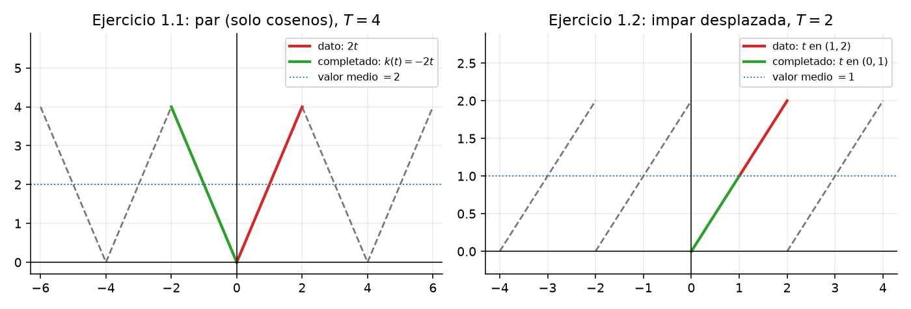
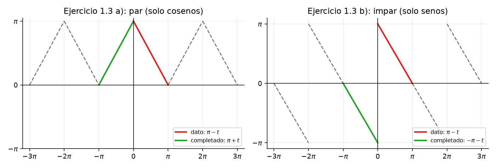
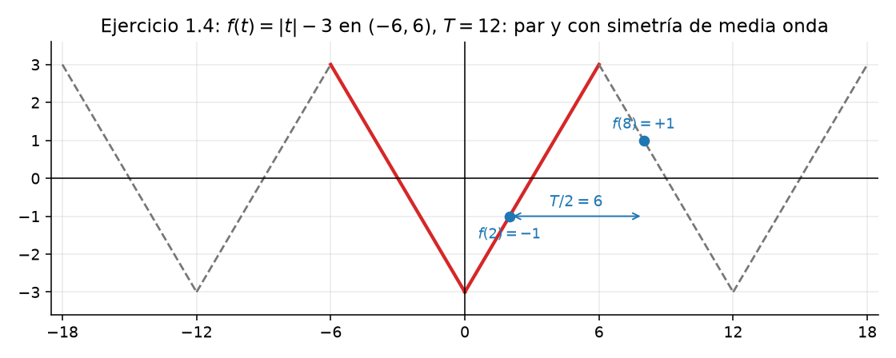
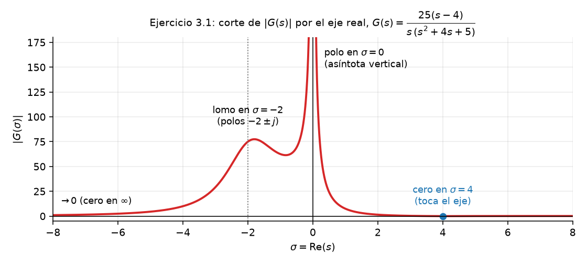
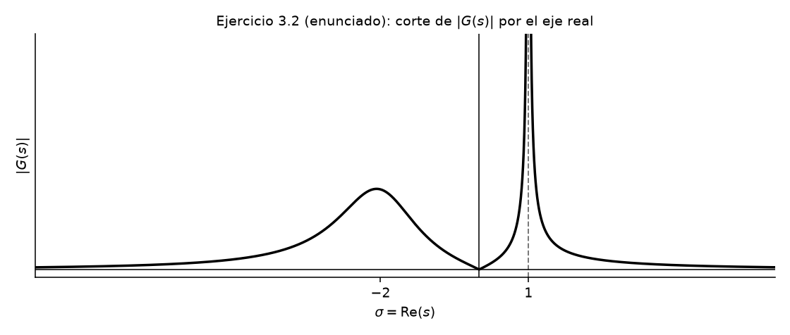
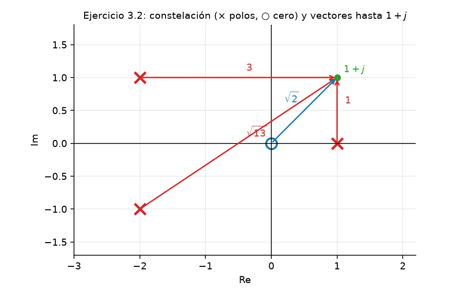

# Práctica — repaso del 1er parcial

> Fuente: `fuentes/clases/repaso primer parcial/Repaso Primer Parcial.pdf` (OneNote de la clase de repaso, 17 páginas: enunciados de parciales fotografiados + resolución manuscrita del profesor) · `fuentes/clases/repaso-clase-2026/pag-01…07.jpeg` (fotos de la carpeta de la clase de repaso 2026) · `primer-parcial/apuntes/transcripts/10-video-repaso-primer-parcial.json` (grabación de la clase del OneNote, transcripta con Whisper)

---

> **Cómo usarla:** son los 20 ejercicios que se resolvieron en las dos clases de repaso, **ordenados por ejercicio del parcial** (Ej1 Fourier · Ej2 Laplace · Ej3 Sistemas estables · Ej4 Transformada Z) y no por fuente. Leé el enunciado, **hacelo en papel con reloj** (el tiempo sugerido está en cada título) y recién después abrí la resolución. Solo ayudamemoria oficial (págs. 1–3), tabla de integrales y calculadora, como en el parcial.
>
> **Qué es del profesor y qué no:** las resoluciones están transcriptas del manuscrito del OneNote (`[OneNote p. N]`) o de las fotos de la clase 2026 (`[foto N]`). Lo que agregué yo está marcado `(cuenta intermedia agregada)`; lo que no se lee, `[poco claro en el manuscrito]`. Las notas **En clase** son lo que el profesor dice en la grabación, con el minuto real `[mm:ss]` del transcript. La línea **Qué mirar** al final de cada ejercicio es mía. Los tiempos sugeridos también.
>
> **Verificación:** todos los resultados se rehicieron con Python (sympy). Los resultados finales de las fuentes están **todos bien**; hay **7 erratas intermedias** (una dicha en la grabación, dos en el OneNote y cuatro en las fotos), marcadas con ⚠ donde aparecen y listadas al final.
>
> **Prioridad** (frecuencias de `examenes/INDICE.md`, 16 hojas, y de `estrategia.md`): 🔴 se toma casi siempre (o en las 3 hojas de 2025) · 🟠 se toma seguido (cerca de la mitad de las hojas, o 1–2 de las 3 de 2025) · ⚪ casi nunca o fuera del formato vigente.
>
> **Gemelos:** la columna "se parece a" cruza cada ejercicio con las hojas del `INDICE.md` (T1/T2 = Tema 1/2, rec = recuperatorio).

## Mapa de la práctica: qué ejercicio entrena qué ítem del parcial

| # | Ej. del parcial | Tipo de ítem | Origen | Se parece a (INDICE) | Entra |
|---|---|---|---|---|---|
| 1.1 | Ej1 a) + b) | Completar para que haya **solo cosenos** (par) y desarrollar la **SEF** con el puente `Cₙ = ½(aₙ − j bₙ)` `#CompletarFuncion` `#SerieExponencial` | OneNote p. 3–4 + video | **2015-05-29 T2 Ej1** (textual); 2025-1C T1 Ej1a, sfK-T2 Ej3 (misma receta) | 🔴 |
| 1.2 | Ej1 a) | Completar como **impar desplazada** (sin cosenos, valor medio 1), STF y **suma de una serie numérica** `#CompletarFuncion` `#ValorMedio` `#SumaSerieNumerica` | OneNote p. 4–6 + video | 2015-05-29 T1 Ej1, sf2-T1 Ej3, 2024-2C T2 Ej2 (impar desplazada con valor medio 3); 2022 Ej1 y 2024-1C (suma de serie) | 🔴 a · ⚪ b |
| 1.3 | Ej1 a) + b) | `π − t`: completar **par** (cosenos, `Cₙ` reales) e **impar** (senos, `Cₙ` imaginarios), STF y pasaje a SEF `#CompletarFuncion` `#SerieTrigonometrica` `#SerieExponencial` | fotos 1–2 (guía 4e) | **2025-1C T1 Ej1a** (es el ítem a) y **2025-1C T2 Ej1a** (es la función del ítem b) | 🔴 |
| 1.4 | Ej1 b) / c) | V/F conceptual: armónicas pares vs. **simetría de media onda**, `Cₙ` reales, series iguales ⇒ ¿funciones iguales? `#SimetriaMediaOnda` `#VoF` | foto 5 (guía 14 a, b, g) | 2025-1C T1/T2 Ej1b (ítem corto a justificar) y Ej1c (SMO); sfK-T2 Ej3b, sf2-T2 Ej3b ("¿tiene SMO?") | 🟠 |
| 2.1 | Ej2 | **EDO de 1er orden** por Laplace con fracciones simples (polo triple) `#Antitransformada` | OneNote p. 6–7 + video | sin gemelo textual; familia integro-diferencial de 2024-2C T1/T2 Ej3a | 🟠 |
| 2.2 | Ej2 a) | **Integral impropia** como transformada evaluada, multiplicación por `t` `#IntegralPorLaplace` | OneNote p. 7 + video | **2025-1C T1 Ej2a** (`∫ t e^{−5t} cos t`), sfK-T1 Ej2 (`∫ t cos 3t e^{−5t}`) | 🟠 |
| 2.3 | Ej2 a) | **Integral impropia** con **división por `t`** `#IntegralPorLaplace` | solo video (dictado por un alumno) | **2025-1C rec Ej2a** y sfK-T2 Ej2 (`∫ (e^{−5t} − e^{−10t})/t`, misma cuenta, también da `ln 2`) | 🟠 |
| 2.4 | Ej2 a) | **Transformada con truco**: `cos³ t` por Euler `#TransformadaLaplace` | foto 5 (guía 3d) | **2024-2C rec Ej3a** (textual), 2025-1C T2 Ej2a (`sen³ t`) | 🟠 |
| 2.5 | Ej2 b) | Antitransformar `1/(s²+1)²` **por convolución** `#Convolucion` `#Antitransformada` | foto 5 (guía 1b) | **2025-1C T1 Ej2b** y **2024-2C rec Ej3b** (textual); 2025-1C T2 Ej2b (`s²/(s²+1)²`) | 🔴 |
| 3.1 | Ej3 a) + b) | **K para que sea estable**, polos y ceros, **corte por el eje real**, **respuesta al impulso** `#Estabilidad` `#CorteEje` `#RespuestaTemporal` | OneNote p. 7–9 + video + fotos 3–4 | **2015-05-29 T2 Ej3** (textual) | 🔴 |
| 3.2 | Ej3 | Reconstruir `G(s)` **desde el gráfico del corte**, `K` con el **módulo por vectores**, respuesta a una entrada dada `#ModuloGrafico` `#RespuestaTemporal` `#TipoRespuesta` | OneNote p. 9–12 + video | sin gemelo para a); 2024-1C T2 Ej4c y 2015-05-29 T1 Ej3b (módulo gráfico); b) es la respuesta temporal de siempre | ⚪ a · 🔴 b |
| 3.3 | Ej3 c) | **Respuesta a `e^{−3t}`** con polos complejos (cancelar, tapar, completar cuadrados) `#RespuestaTemporal` | foto 4 ("otro ej. de parcial") | **2025-1C rec Ej3c** (textual; coincide con la respuesta oficial) | 🔴 |
| 3.4 | Ej3 a) + b) | Circuito RLC: de la **ecuación del sistema** a la respuesta al impulso `#FuncionTransferencia` `#RespuestaTemporal` | foto 3 (guía 18) | 2025-1C T1 Ej3 (sistema mecánico: `G(s)` desde la ecuación + respuesta) | 🟠 |
| 4.1 | Ej4 b) | **Ecuación en diferencias** de 1er orden + verificación con `x(2)` `#EcuacionDiferencia` | OneNote p. 12–13 + video | **2015-05-29 T2 Ej4** (textual); 2025-1C T2 Ej4b, 2024-2C rec Ej5 | 🟠 |
| 4.2 | Ej4 a) | **Región de convergencia** de una sucesión por casos (múltiplos de 3) `#TransformadaZ` `#ROC` | OneNote p. 13–15 + video | 2025-1C T1 Ej4a, 2025-1C rec Ej4a (V/F), 2024-2C T1/T2 Ej5a, sfK-T1 Ej5 (por paridad) | 🟠 |
| 4.3 | Ej4 a) | **Región de convergencia** (múltiplos de 5): la misma receta con 5 geométricas `#ROC` | foto 6 (guía 4c) | los mismos de 4.2 | 🟠 |
| 4.4 | Ej4 b) | **Ecuación en diferencias de 2º orden** con raíz doble `#EcuacionDiferencia` | fotos 6–7 (guía 7e) | 2024-1C T2 Ej5, 2022 Ej4 = 2024-1C T1 Ej4 (2º orden) | 🟠 |
| C.1 | — | Complejos: cuadrática con coeficientes complejos (multiple choice) `#PotenciasRaices` | OneNote p. 1–2 + video | formato viejo | ⚪ |
| C.2 | — | Complejos: raíces cuartas de `j`, producto y suma (multiple choice) `#PotenciasRaices` | OneNote p. 2–3 + video | formato viejo | ⚪ |
| C.3 | — | Complejos: `n` tal que `(1−2j)ⁿ = 117−44j`; `z⁴+16 = 0` dentro de un disco `#PotenciasRaices` `#ConjuntosComplejos` | OneNote p. 15–17 + video | **sfK-T1 Ej1** (textual) | ⚪ |

**Lectura rápida.** En Fourier y en Sistemas hay un tipo de ítem que domina (completar + desarrollar: 15 de 16 hojas; K estable + respuesta temporal: 15 y 14 de 16). En Laplace y en Z **no domina ninguno**: siempre hay un ítem (16 de 16 hojas en los dos temas), pero rota entre 3 o 4 tipos que caen la mitad de las veces cada uno. Por eso casi todo el Ej2 y el Ej4 figura 🟠: hay que tenerlos **todos**. Los complejos (anexo) no tienen ejercicio propio desde 2025 (0 de las 3 hojas); el profesor los dejó para "si sobra tiempo".

**Lo que el repaso no trae** y sí cae en el formato vigente: completar con **simetría de media onda** como ítem de dibujo (2025-1C T1/T2 Ej1c), **espectro** de amplitudes (2025-1C rec Ej1c), respuesta al **escalón** con tipo de respuesta y valor estable (2025-1C T2 Ej3), **suma de una serie numérica por Z** (2025-1C T1 Ej4b, T2 Ej4a), **secuencia finita** (2025-1C rec Ej4b) y la demostración de `L(2ᵗ)` (2025-1C T1 Ej2c). Eso se practica con las guías 01–04 y con las hojas 2025.

## Lo que el profesor dice del parcial (grabación)

> **En clase:** se puede llevar **la hoja de ayuda para el primer parcial sola** (nada de apuntes propios) y **tabla de integrales** (integrales, derivadas e identidades trigonométricas). "Con esto ya deberían andar." [02:40] [03:11]
>
> **En clase:** todos los profesores toman lo mismo: "los mismos ejercicios y los mismos tipos de ejercicios… hay muchos ejercicios, honestamente, se reciclan, se les cambian dos numeritos". [1:06:12]
>
> **En clase:** fracciones simples: "sí o sí va a haber alguna" en Laplace, en sistemas estables ("siempre aparece") o en Z. Hay que saber raíces reales simples y múltiples y complejas conjugadas simples ("pueden entrar tranquilamente"); **complejas múltiples "eso no lo voy a tomar"**. [1:04:04] [1:04:36] [1:07:16]
>
> **En clase:** cuánto justificar: si el ejercicio es directo, "se resuelven y chau" (para el corte por el eje real "con el gráfico alcanza"); si el resultado es dudoso o se puede interpretar de dos maneras, "siempre escriban y justifiquen, y eso siempre se valora". [1:33:03] [1:33:34]
>
> **En clase:** las raíces de una cuadrática con coeficientes reales que aparece en el medio de un ejercicio (fracciones simples, sistemas, Laplace) se pueden sacar con la calculadora. [14:50]
>
> **En clase:** simetría de media onda en Fourier: "puede pasar, está dentro de las posibilidades". [1:02:01] El espectro, si no dicen nada, se grafica con el **módulo** de `Cₙ`. [03:45]

## Orden sugerido "a ciegas"

No la hagas de corrido en el orden del documento: te conviene mezclar temas, como en el parcial.

| Tanda | Ejercicios | Tiempo | Para qué |
|---|---|---|---|
| **1 · un parcial entero armado con el repaso** (10 ítems, como el formato vigente) | **1.3** (a y b) + **1.4** → **2.2** + **2.5** + **2.4** → **3.1** (a y b) → **4.2** + **4.1** | ≈ 2 h 15 min | Simulacro: un ejercicio por tema, en el orden del parcial. Corregí contra el tablero del final y anotá qué ítems perdiste. |
| **2 · lo que más se recicla** | **3.3** → **1.1** → **2.3** → **4.4** | ≈ 1 h 15 min | Son gemelos textuales de hojas reales (2025-1C rec, 2015 T2) o la variante difícil (raíz doble). |
| **3 · variantes** | **1.2** → **2.1** → **3.4** → **4.3** | ≈ 1 h 15 min | Impar desplazada, EDO con polo triple, sistema dado por su ecuación, ROC con 5 geométricas. |
| **4 · si sobra tiempo** | **3.2** → anexo de complejos | ≈ 1 h | Método gráfico del módulo (2 de 16 hojas) y complejos (fuera del formato vigente). |

Entre tanda y tanda no mires las resoluciones de los ejercicios que todavía no hiciste: 1.1 y 1.3 comparten receta, lo mismo 4.2 y 4.3, y 3.1 con 3.2 y 3.3.

---

## Ej1 · Series de Fourier

> **En clase:** dos pasos que van siempre: **graficar** y **anotar los tres datos** `T` (período), `L` (semiperíodo) y `ω₀ = π/L`. [27:30]
>
> **En clase:** la parte conceptual que se juega en casi todos los ejercicios: **solo cosenos = función par = coeficientes reales** de la SEF (y solo senos = impar = imaginarios puros). "Están todos asociados." [28:01]

### 1.1 Completar para que haya cosenos + serie exponencial · 🔴 · 20 min

<strong>Ejercicio 1.1 🔴 — enunciado:</strong> f(t) = 2t si 0 &lt; t &lt; 2, k(t) si −2 &lt; t &lt; 0, con f(t) = f(t + 4). a) Hallar k(t) para que la serie trigonométrica tenga términos con cosenos. b) Desarrollar f(t) en serie exponencial de Fourier.

Dada la función

$$
f(t)=\begin{cases}2t & \text{si } 0<t<2\\ k(t) & \text{si } -2<t<0\end{cases}\qquad\text{y } f(t)=f(t+4)
$$

- a) Halle la función $k(t)$ para que la Serie Trigonométrica de Fourier tenga términos con cosenos.
- b) Desarrolle $f(t)$ en Serie Exponencial de Fourier.

*Origen:* OneNote p. 3–4 (foto de una hoja de examen) y grabación [26:59]. Es **textual el 2015-05-29 T2 Ej1**.

<strong>Resolución 1.1</strong>

**Paso 1 — graficar e interpretar (a).** Se dibuja la rama dada ($2t$ sube de $0$ a $4$ entre $0$ y $2$). La regla que el profesor deja escrita [OneNote p. 3]:

$$
\text{Cosenos (S.T.F.)} = \text{Par} = \text{Coef. reales (S.E.F.)}
$$

Hay que completar **en espejo** respecto del eje vertical:

$$
f(t)=\begin{cases}2t & \text{si } 0<t<2\\ -2t & \text{si } -2<t<0\end{cases}\qquad\Longrightarrow\qquad \boxed{\,k(t)=-2t\,}
$$

**Paso 2 — datos del período** [OneNote p. 3–4]:

$$
T=4,\qquad L=2,\qquad \omega_0=\frac{\pi}{L}=\frac{\pi}{2}
$$

**Paso 3 — el puente a la exponencial (b).** Como la función es par, $b_n=0$ (el profesor tacha el término):

$$
C_n=\frac12\left(a_n-b_n\,j\right)=\frac12\,a_n
$$

**Paso 4 — término constante** (por paridad, medio período y "2 por"):

$$
a_0=\frac{2}{L}\int_0^L f(t)\,dt=\frac22\int_0^2 2t\,dt=4\qquad\Longrightarrow\qquad \frac{a_0}{2}=C_0=2
$$

**Paso 5 — $a_n$** (integral de tabla de $t\cos$):

$$
a_n=\frac{2}{L}\int_0^L f(t)\cos(n\omega_0 t)\,dt=\frac22\int_0^2 2t\cos\!\left(\frac{n\pi}{2}t\right)dt
$$

$$
a_n=2\left[\frac{\cos\!\left(\frac{n\pi}{2}t\right)}{\left(\frac{n\pi}{2}\right)^2}+\frac{t\,\operatorname{sen}\!\left(\frac{n\pi}{2}t\right)}{\frac{n\pi}{2}}\right]_0^2
=2\left(\frac{4(-1)^n}{n^2\pi^2}+0-\frac{4}{n^2\pi^2}-0\right)
$$

Los dos términos con seno valen $0$ (en $t=2$ por $\operatorname{sen}(n\pi)=0$, en $t=0$ porque además está multiplicado por $t$).

**Paso 6 — separar por paridad de $n$:**

$$
a_n=\begin{cases}0 & n \text{ par}\\[2mm] \dfrac{-16}{n^2\pi^2} & n \text{ impar}\end{cases}
\qquad\Longrightarrow\qquad
C_n=\frac12 a_n=\frac{-8}{n^2\pi^2}\quad(n\text{ impar})
$$

**Paso 7 — la serie**, con $2k+1$ porque solo hay armónicas impares [OneNote p. 4]:

$$
\boxed{\,S(t)=2-\frac{8}{\pi^2}\sum_{k=-\infty}^{+\infty}\frac{1}{(2k+1)^2}\,e^{\,j(2k+1)\frac{\pi}{2}t}\,}
$$

Formato alternativo, de $k=0$ a $\infty$ con las dos exponenciales:

$$
S(t)=2-\frac{8}{\pi^2}\sum_{k=0}^{\infty}\frac{1}{(2k+1)^2}\left(e^{\,j(2k+1)\frac{\pi}{2}t}+e^{-j(2k+1)\frac{\pi}{2}t}\right)
$$

> Verificado: $a_n=\dfrac{8\left((-1)^n-1\right)}{\pi^2n^2}$, o sea $-16/\pi^2,\ 0,\ -16/(9\pi^2)$ para $n=1,2,3$; y la serie evaluada en $t=0{,}7$ da $1{,}4000=f(0{,}7)$.

> **En clase:** hallar $k(t)$ "gráficamente o analíticamente te tiene que dar lo mismo". [29:04]
>
> **En clase:** aunque pidan la exponencial, conviene calcular $a_n$ y $b_n$ y pasar con el puente: se aprovecha mejor la paridad y son las integrales de siempre (las que tienen la $j$ adentro "pueden ser un poquito más difíciles"). [30:06]
>
> **En clase:** el valor medio se puede sacar **por gráfico** (acá el promedio entre $0$ y $4$ es $2$); "si quieren aclarar: por gráfico". [33:13] [34:15]
>
> **En clase:** si solo sobreviven las impares, expresar la serie con $2k+1$: dejarla en función de $n$ "no es un error", pero "no está pipicucú el ejercicio". [38:25] Y cuando no hay distinción par/impar, poner $n\neq 0$ debajo de la sumatoria, porque $C_0$ ya está afuera. [41:35]

**Qué mirar:** el enunciado dice "tenga términos con cosenos" y se lee como **solo** cosenos (así lo resuelven el profesor y la hoja de 2015). Los tres datos $T$, $L$, $\omega_0$ van escritos al lado del gráfico. El error típico es el $(-1)^n-1$: para $n$ par da $0$, para $n$ impar da $-2$ (y con el $2$ de afuera y el $4$, $-16$).

### 1.2 Impar desplazada con valor medio 1 + suma de una serie · 🔴 a · ⚪ b · 25 min

<strong>Ejercicio 1.2 🔴 a · ⚪ b — enunciado:</strong> a) Dada f(t) = t en (1, 2), completar en (0, 1) con T = 2 para que la STF no tenga cosenos y su valor medio sea 1; desarrollar la serie. b) A partir de la serie hallada, calcular la suma de (−1)^k / (2k + 1) desde k = 0 hasta infinito.

- a) Dada $f(t)=t$ en $(1,2)$, complete en $(0,1)$ con $T=2$ para que la STF no tenga cosenos, y su valor medio sea $1$. Desarrolle la serie.
- b) A partir de la serie hallada, calcule el valor de

$$
\sum_{k=0}^{\infty}\frac{(-1)^k}{2k+1}
$$

*Origen:* OneNote p. 4–6 ("Ejercicio nº 2", tipeado) y grabación [42:07]; lo llevó un alumno por mail ("este ejercicio tiene su truquito" en la parte b). Es de la misma familia que el reciclado **2015-05-29 T1 Ej1 / sf2-T1 Ej3 / 2024-2C T2 Ej2** (sin cosenos + valor medio 3).

<strong>Resolución 1.2</strong>

**Paso 1 — interpretar (a).** "**Me piden impar desplazada (V.M. $=1$)**" [OneNote p. 5]: sin cosenos ⇒ impar; con valor medio $1$ ⇒ impar corrida una unidad hacia arriba. Se completa $(0,1)$ con la continuación de la misma recta (panel derecho de la figura del ejercicio 1.1):

$$
f(t)=t\quad\text{si } 0\le t\le 2,\qquad f(t)=f(t+2)
$$

**Paso 2 — datos:**

$$
T=2,\qquad L=1,\qquad \omega_0=\pi
$$

**Paso 3 — valor medio (por gráfico) y cosenos (por enunciado):**

$$
\frac{a_0}{2}=1,\qquad a_n=0
$$

**Paso 4 — $b_n$ integrando el período completo de $0$ a $2$** (sin "2 por": el intervalo no es simétrico) [OneNote p. 5]:

$$
b_n=\frac1L\int_0^2 t\,\operatorname{sen}(n\pi t)\,dt=\left[\frac{\operatorname{sen}(n\pi t)}{n^2\pi^2}-\frac{t\cos(n\pi t)}{n\pi}\right]_0^2=\frac{-2}{n\pi}
$$

De los cuatro términos solo sobrevive $-\dfrac{2\cos(2n\pi)}{n\pi}$, y $\cos(2n\pi)=1$ siempre.

**Paso 5 — la serie:**

$$
\boxed{\,S(t)=1-\frac{2}{\pi}\sum_{n=1}^{\infty}\frac1n\,\operatorname{sen}(n\pi t)\,}
$$

**Paso 6 — elegir el $t$ (b).** Si $t=\tfrac12$ [OneNote p. 5]:

| $n$ | $1$ | $2$ | $3$ | $4$ | $5$ | $6$ |
|---|---|---|---|---|---|---|
| $\operatorname{sen}(n\pi/2)$ | $1$ | $0$ | $-1$ | $0$ | $1$ | $0$ |

"**Sólo armónicas impares**", con signo alternado: $(-1)^k$ con $n=2k+1$.

**Paso 7 — igualar con el valor de la función.** Por gráfico $f(\tfrac12)=\tfrac12$ [OneNote p. 6]:

$$
f\!\left(\tfrac12\right)=\frac12=1-\frac{2}{\pi}\sum_{k=0}^{\infty}\frac{(-1)^k}{2k+1}
$$

$$
\frac{2}{\pi}\sum_{k=0}^{\infty}\frac{(-1)^k}{2k+1}=\frac12
\qquad\Longrightarrow\qquad
\boxed{\,\sum_{k=0}^{\infty}\frac{(-1)^k}{2k+1}=\frac{\pi}{4}\,}
$$

> Verificado: $b_n=-\dfrac{2}{\pi n}$ y la suma da $\dfrac{\pi}{4}$.

> **En clase:** las impares "puras, del libro" tienen valor medio cero; si además piden valor medio $1$, "no es una impar impar, sino… una impar desplazada". [43:11]
>
> **En clase:** el término que sobrevive tiene $\cos(2n\pi)$, que "siempre vale 1"; **no** es $(-1)^n$, eso es $\cos(n\pi)$. [46:21] Y $\cos(n\pi)=(-1)^n$ no hace falta justificarlo con la tablita: "ponemos menos 1 a la n y listo". [54:34]
>
> **En clase:** siempre se integra **un período completo** (de $0$ a $T$, de $-L$ a $L$ o cualquier otro); el "2 por" nace de las propiedades de las funciones pares/impares **en intervalos simétricos**. [47:54] Error típico que confiesa un alumno: integrar entre $-L$ y $L$ usando la misma fórmula que está definida entre $0$ y $T$ ("siempre me daba mal"); fuera del intervalo de definición la función es la copia corrida un período (acá $t+2$, no $t$). [49:56] [53:01]
>
> **En clase:** para sumar la serie numérica se elige un $t$ conveniente "para que ese seno o coseno se vaya y me quede lo que me interesa". [56:40] Y al reindexar, "hilando muy fino": **la primera armónica tiene que quedar positiva** (con $2k+1$ y $k=0$, $(-1)^0=1$; con $2k-1$ hay que arrancar en $k=1$ y ajustar el exponente). [59:27]

> ⚠ **Errata dicha en la grabación** [52:00]–[52:30]. Al comentar los caminos alternativos, el profesor dice que se puede hacer "2 por" entre $0$ y $1$ usando "la función $t$ por el seno, que es la misma integral… y en vez de tener un 1 vas a tener un 2". Con $t$ eso **no da lo mismo**: $2\int_0^1 t\,\operatorname{sen}(n\pi t)\,dt=-\dfrac{2(-1)^n}{n\pi}$. El "2 por" vale para la impar **sin desplazar**, $g(t)=t-1$: $2\int_0^1 (t-1)\,\operatorname{sen}(n\pi t)\,dt=-\dfrac{2}{n\pi}$ ✓. Lo de que "con $f$ o con $g$ da igual" [00:30] es cierto solo integrando el **período completo**, donde la constante se compensa. (Verificado con sympy.)

**Qué mirar:** (1) escribí la frase "impar desplazada" y el valor medio leído del gráfico; (2) integrá donde la función está definida, de $0$ a $2$, con $\frac1L$; (3) en b) hay que decir de dónde sale el $\tfrac12$ del lado izquierdo: $t=\tfrac12$ es un punto de continuidad y ahí la serie vale $f(\tfrac12)$.

### 1.3 Completar par e impar la función π − t: STF y pasaje a SEF · 🔴 · 30 min

<strong>Ejercicio 1.3 🔴 — enunciado:</strong> f(t) = π − t si 0 &lt; t &lt; π. a) Completarla para que la STF tenga solo cosenos (SEF con coeficientes reales) y desarrollar la STF. b) Completarla para que la STF tenga solo senos (SEF con coeficientes imaginarios), desarrollar la STF y pasarla a SEF.

$$
f(t)=\pi-t\qquad 0<t<\pi
$$

- a) STF solo cosenos (⇒ par ⇒ SEF $\in\mathbb{R}$). Graficar y desarrollar.
- b) STF solo senos (⇒ impar ⇒ SEF imaginaria). Graficar, desarrollar y pasar a SEF.

*Origen:* fotos 1–2 de la clase de repaso 2026 (rotulado "4) e) Fourier", ejercicio de la guía). El enunciado está reconstruido de las anotaciones de la carpeta. El ítem a) es **el 2025-1C T1 Ej1a** y la función del ítem b) es **la del 2025-1C T2 Ej1a**.

<strong>Resolución 1.3</strong>

**Paso 1 — completar como par (a)** [foto 1]:

$$
f(t)=\begin{cases}\pi-t & 0<t<\pi\\ \pi+t & -\pi<t<0\end{cases}\qquad f(t)=f(t+2\pi)
$$

$$
T=2\pi,\qquad L=\pi,\qquad \omega_0=1,\qquad b_n=0
$$

**Paso 2 — valor medio "visualmente"** [foto 2]:

$$
\frac{a_0}{2}=\frac{\pi}{2}
$$

**Paso 3 — $a_n$** (por paridad, medio período y "2 por"):

$$
a_n=\frac1\pi\cdot 2\int_0^{\pi}(\pi-t)\cos(nt)\,dt=\frac2\pi\left[\pi\int_0^\pi\cos(nt)\,dt-\int_0^\pi t\cos(nt)\,dt\right]
$$

$$
a_n=\frac2\pi\left[\pi\,\frac{\operatorname{sen}(nt)}{n}\bigg|_0^\pi-\left(\frac{t\,\operatorname{sen}(nt)}{n}+\frac{\cos(nt)}{n^2}\right)\bigg|_0^\pi\right]
$$

Los términos con seno se anulan (tachados en la foto):

$$
a_n=-\frac2\pi\left(\frac{\cos(n\pi)}{n^2}-\frac{\cos(0)}{n^2}\right)=\frac2\pi\left(\frac{1}{n^2}-\frac{(-1)^n}{n^2}\right)
$$

$$
\text{si } n \text{ impar} \Rightarrow a_n=\frac{4}{\pi n^2},\qquad \text{si } n \text{ par} \Rightarrow a_n=0
$$

**Paso 4 — la serie** (armónicas impares, $n=2k+1$):

$$
\boxed{\,S(t)=\frac{\pi}{2}+\sum_{k=0}^{\infty}\frac{4}{\pi(2k+1)^2}\cos\big((2k+1)t\big)\,}
$$

**Paso 5 — completar como impar (b)** [foto 2]: $a_n=0$, $a_0=0$,

$$
f(t)=\begin{cases}\pi-t & 0<t<\pi\\ -\pi-t & -\pi<t<0\end{cases}\qquad f(t)=f(t+2\pi)
$$

con los mismos $T=2\pi$, $L=\pi$, $\omega_0=1$.

**Paso 6 — $b_n$:**

$$
b_n=\frac2\pi\int_0^{\pi}(\pi-t)\operatorname{sen}(nt)\,dt=\frac2n
$$

> ⚠ **En la foto** el planteo dice $\dfrac1\pi\cdot 2\displaystyle\int_0^{2\pi}(\pi-t)\operatorname{sen}(nt)\,dt$, y los dos renglones siguientes arrastran los límites $0$ a $2\pi$. Con esos límites el $2$ sobra (daría $4/n$). Lo correcto es $\dfrac2\pi\displaystyle\int_0^{\pi}$ (medio período y "2 por") o $\dfrac1\pi\displaystyle\int_0^{2\pi}$ (período completo, y vale porque en todo $(0,2\pi)$ la función impar es $\pi-t$). El resultado $\dfrac2n$ que anotaron **está bien**. Al lado hay una nota que no se lee [poco claro en el manuscrito].

(cuenta intermedia agregada) $\displaystyle\int_0^\pi(\pi-t)\operatorname{sen}(nt)\,dt=\left[-\frac{(\pi-t)\cos(nt)}{n}-\frac{\operatorname{sen}(nt)}{n^2}\right]_0^\pi=\frac{\pi}{n}$.

**Paso 7 — la STF:**

$$
\boxed{\,S(t)=2\sum_{n=1}^{\infty}\frac{\operatorname{sen}(nt)}{n}\,}
$$

**Paso 8 — pasado a SEF** [foto 2]: $C_0=0$,

$$
C_n=\frac{a_n-b_n\,j}{2}=-\frac{j}{n},\qquad C_{-n}=\frac{a_n+b_n\,j}{2}=\frac{j}{n}
$$

$$
\boxed{\,S(t)=\sum_{n=1}^{\infty}\left(-\frac{j}{n}\,e^{\,njt}+\frac{j}{n}\,e^{-njt}\right)\,}
$$

> Verificado: $a_n=\dfrac{2\left(1-(-1)^n\right)}{\pi n^2}$, $b_n=\dfrac2n$; con el planteo de la foto ($\frac1\pi\cdot2\int_0^{2\pi}$) sale $\dfrac4n$.

> **En clase:** las integrales "son siempre las mismas: o $t$ por el coseno o $t$ por el seno"; al aplicar Barrow, el término con seno se anula las dos veces (en el extremo por $\operatorname{sen}(n\pi)=0$, en el $0$ porque además está multiplicado por $t$). [35:18] [36:20]

**Qué mirar:** es el ejercicio más parecido al Ej1 vigente: la hoja oficial 2025 lo resuelve igual (valor medio "por gráfico", separar en dos integrales, $2k+1$). Fijate qué piden: "coeficientes reales" = par = cosenos; "imaginarios puros" = impar = senos. En b) $C_n$ y $C_{-n}$ son conjugados: si te dan iguales, te comiste un signo.

### 1.4 Verdadero o falso conceptual (paridad, media onda, unicidad) · 🟠 · 10 min

<strong>Ejercicio 1.4 🟠 — enunciado:</strong> Sea f(t) = |t| − 3 con t en (−6, 6) y f(t) = f(t + 12). a) ¿Su STF tiene solo cosenos de armónicas pares? b) ¿Los coeficientes C_n de su SEF son reales? g) Si f(t) y g(t) son dos funciones periódicas con dominio real y sus series de Fourier son iguales, ¿entonces f(t) = g(t) para todo t real? Decidir verdadero o falso, justificando.

$$
f(t)=|t|-3\qquad t\in(-6,6)\ \wedge\ f(t)=f(t+12)
$$

- a) ¿Solo cosenos de armónicas pares? [la redacción exacta de la consigna está abreviada en la carpeta; poco claro en el manuscrito]
- b) ¿$C_n\in\mathbb{R}$?
- g) $f(t)$ y $g(t)$ son 2 funciones periódicas con $D\in\mathbb{R}$; si las $S(t)$ de ambas son iguales $\Rightarrow\ \forall t\in\mathbb{R}:\ f(t)=g(t)$.

*Origen:* foto 5 de la clase de repaso 2026 (rotulado "14) a)", "b)" y "g)", ejercicio de la guía). Las tres respuestas son las de la carpeta; el desarrollo de la justificación es agregado y está marcado.

<strong>Resolución 1.4</strong>

**Paso 1 — graficar** [foto 5]: una "V" con vértice en $(0,-3)$ que corta el eje en $t=\pm3$ y llega a $3$ en $t=\pm6$.

**Paso 2 — a)** "Como tiene SMO ⇒ solo impares ∴ **FALSO**" [foto 5].

(cuenta intermedia agregada) Simetría de media onda es $f(t+T/2)=-f(t)$ con $T/2=6$. Para $0<t<6$: $f(t)=t-3$ y $f(t-6)=|t-6|-3=3-t=-f(t)$ ✓. Es par (solo cosenos, sí), pero las armónicas que sobreviven son las **impares**: $a_n=\dfrac{12\left((-1)^n-1\right)}{\pi^2n^2}$, que vale $0$ para $n$ par y $-\dfrac{24}{\pi^2n^2}$ para $n$ impar; además $a_0=0$.

**Paso 3 — b)** "Como es par ∴ **V**" [foto 5]: par ⇒ $b_n=0$ ⇒ $C_n=\tfrac12a_n\in\mathbb{R}$.

**Paso 4 — g)** "**FALSO** por discontinuidades" [foto 5].

(justificación agregada) Dos funciones que difieren solo en puntos aislados (por ejemplo, en el valor que toman justo en un salto) tienen las mismas integrales y por lo tanto los mismos coeficientes y la misma serie, pero no son iguales en esos puntos.

**Respuestas:** a) F · b) V · g) F.

> Verificado: $a_n=-24/\pi^2,\ 0,\ -8/(3\pi^2),\ 0$ para $n=1,2,3,4$ y $a_0=0$.

> **En clase:** ¿qué tan probable es que aparezca simetría de media onda? "Puede pasar, está dentro de las posibilidades." [1:02:01]

**Qué mirar:** en un V/F el punto está en la justificación: para SMO escribí la condición $f(t+T/2)=-f(t)$ y mostrala con un punto del gráfico. Par y SMO no se excluyen: par decide **senos o cosenos**, SMO decide **qué armónicas** (solo impares, y valor medio $0$).

---

## Ej2 · Transformada de Laplace

> **En clase:** fracciones simples, el "truquito": la incógnita de la raíz de mayor multiplicidad y las de las raíces simples salen reemplazando $s$ por la raíz que anula su denominador en el resto de la función (tapando ese factor). Las demás, igualando coeficientes. "Sáquense de encima todas las incógnitas que puedan con el truquito", porque el sistema queda mucho más fácil. [1:08:18] [1:08:49]

### 2.1 Ecuación diferencial de primer orden por Laplace · 🟠 · 15 min

<strong>Ejercicio 2.1 🟠 — enunciado:</strong> Dada la ecuación diferencial y' − y = 2t − t² con y(0) = 1, resolverla analíticamente por transformada de Laplace.

$$
y'-y=2t-t^2\qquad\text{con } y(0)=1
$$

- a) Resuelva analíticamente por Transformada de Laplace.

*Origen:* OneNote p. 6–7 ("Ej. 2", foto de una hoja de examen con una parte tachada) y grabación [1:02:01]. No tiene gemelo textual en el `INDICE.md`: lo más cercano son las ecuaciones integro-diferenciales de 2024-2C T1/T2 Ej3a.

<strong>Resolución 2.1</strong>

**Paso 1 — "Laplace m.a.m."** (miembro a miembro) [OneNote p. 6]:

$$
s\,Y(s)-\underbrace{y(0)}_{1}-Y(s)=\frac{2}{s^2}-\frac{2}{s^3}
$$

**Paso 2 — agrupar y despejar:**

$$
Y(s)\,(s-1)=\frac{2}{s^2}-\frac{2}{s^3}+1
\qquad\Longrightarrow\qquad
Y(s)=\frac{2s-2+s^3}{s^3\,(s-1)}
$$

**Paso 3 — fracciones simples** (raíz triple en $0$, simple en $1$):

$$
\frac{s^3+2s-2}{s^3(s-1)}=\frac{A}{s^3}+\frac{B}{s^2}+\frac{C}{s}+\frac{D}{s-1}
$$

Tapando: $A=\dfrac{-2}{-1}=2$ (con $s=0$) y $D=\dfrac{1}{1}=1$ (con $s=1$).

**Paso 4 — $B$ y $C$ igualando el numerador:**

$$
2(s-1)+B\,s(s-1)+C\,s^2(s-1)+1\cdot s^3=s^3+2s-2
$$

- Cúbico: $C+1=1\Rightarrow C=0$.
- Cuadrático: $B=0$. (cuenta intermedia agregada: los términos en $s^2$ son $B-C=0$.)

**Paso 5 — antitransformar** [OneNote p. 6–7]:

$$
Y(s)=\frac{2}{s^3}+\frac{1}{s-1}
\qquad\Longrightarrow\qquad
\boxed{\,y(t)=t^2+e^{t}\,}
$$

> Verificado: $y'-y=2t-t^2$ y $y(0)=1$.

> **En clase:** es "ejercicio típico de Laplace"; la parte tachada del enunciado original es de la segunda parte de la materia ("un tema que todavía no vimos"). Y la consigna de siempre: "me cansé de repetirlo: Laplace miembro a miembro". [1:02:01] [1:02:32]
>
> **En clase:** ¿pasar dividiendo cada término o juntar todo? Si igual hay que hacer fracciones simples para algún término, conviene juntar todo con denominador común y hacerlas una sola vez: "hacemos fracciones simples de todo y chau". [1:04:04]
>
> **En clase:** en lugar de una EDO puede venir una **integro-diferencial o una ecuación integral**: hay que identificar las dos funciones dentro de la integral de convolución y su transformada es el producto de las transformadas; "ahí no deberían tener inconveniente tampoco". [1:10:23] [1:10:54]

**Qué mirar:** el signo de la condición inicial ($-y(0)$ pasa sumando como $+1$). En el polo triple el orden de los numeradores no importa, pero la que se tapa es la del **mayor exponente** ($A/s^3$); $B$ y $C$ salen por coeficientes. Verificá siempre $y(0)$ en el resultado: son 10 segundos.

### 2.2 Integral impropia con multiplicación por t · 🟠 · 10 min

<strong>Ejercicio 2.2 🟠 — enunciado:</strong> El valor de la integral entre 0 e infinito de t·sen(at)·e^(−2t) dt es: a) 4/(4 + a²) · b) −4a/(4 − a²)² · c) 4a/(4 + a²)² · d) −4/(a² + 4)² · e) n.a.

El valor de la siguiente integral es:

$$
\int_0^{\infty}t\,\operatorname{sen}(at)\,e^{-2t}\,dt
$$

- a) $\dfrac{4}{4+a^2}$
- b) $\dfrac{-4a}{(4-a^2)^2}$
- c) $\dfrac{4a}{(4+a^2)^2}$
- d) $\dfrac{-4}{(a^2+4)^2}$
- e) n.a.

*Origen:* OneNote p. 7 (foto de una hoja de examen, ítem "3)" multiple choice) y grabación [1:11:26]. Gemelos: **2025-1C T1 Ej2a** ($\int_0^\infty t\,e^{-5t}\cos t\,dt$) y sfK-T1 Ej2 ($\int_0^\infty t\cos(3t)\,e^{-5t}\,dt$).

<strong>Resolución 2.2</strong>

**Paso 1 — reconocer la definición** [OneNote p. 7]:

$$
\mathcal{L}\big(f(t)\big)=F(s)=\int_0^{\infty}f(t)\,e^{-st}\,dt
$$

Comparando, $f(t)=t\,\operatorname{sen}(at)$ y en lugar de $e^{-st}$ hay $e^{-2t}$:

$$
\int_0^{\infty}t\,\operatorname{sen}(at)\,e^{-2t}\,dt=\mathcal{L}\big[t\,\operatorname{sen}(at)\big]\Big|_{s=2}
$$

**Paso 2 — multiplicación por $t^n$ con $n=1$.** "1º) Derivo":

$$
\frac{d}{ds}\left(\frac{a}{s^2+a^2}\right)=\frac{-2\,a\,s}{(s^2+a^2)^2}
$$

"2º) Cambio signo (una vez)":

$$
\mathcal{L}\big[t\,\operatorname{sen}(at)\big]=\frac{2\,a\,s}{(s^2+a^2)^2}
$$

**Paso 3 — evaluar en $s=2$:**

$$
\mathcal{L}\big[t\,\operatorname{sen}(at)\big]\Big|_{s=2}=\frac{4a}{(4+a^2)^2}
\qquad\Longrightarrow\qquad\boxed{\,\text{opción c)}\,}
$$

> Verificado: la integral directa da $\dfrac{4a}{(a^2+4)^2}$.

> **En clase:** hay que identificar $f(t)$, "que es todo lo que no es la $e$ a la menos algo $t$"; si en vez de $e^{-st}$ aparece $e^{-2t}$, el resultado es la transformada **evaluada en 2**, no la genérica. [1:11:56]
>
> **En clase:** regla mnemotécnica: con $t^n$, "derivo $n$ veces, cambio el signo $n$ veces"; cambiar el signo en cada derivada o todo al final da lo mismo. [1:13:30] [1:16:06]
>
> **En clase:** para la multiplicación por $t$ **no** hay que verificar ningún límite: eso es solo para la división por $t$. [1:15:04]

**Qué mirar:** escribí la igualdad del Paso 1 (integral = transformada evaluada): es la justificación del ítem. Después, el orden: primero transformar con $s$ genérica, **recién al final** reemplazar $s=2$.

### 2.3 Integral impropia con división por t · 🟠 · 12 min

<strong>Ejercicio 2.3 🟠 — enunciado:</strong> Calcular la integral entre 0 e infinito de (e^(−3t) − e^(−6t)) / t dt.

$$
\int_0^{\infty}\frac{e^{-3t}-e^{-6t}}{t}\,dt
$$

*Origen:* solo la grabación [1:16:40]–[1:21:00]: lo dicta un alumno ("uno de división por $t$ que no termino de entender") y el profesor lo resuelve desde el OneNote de la práctica de Laplace. No está en el OneNote del repaso; el desarrollo sale de lo que dice en voz alta. Gemelo: **2025-1C rec Ej2a = sfK-T2 Ej2** ($\int_0^\infty (e^{-5t}-e^{-10t})/t\,dt$), que se hace igual y también da $\ln 2$.

<strong>Resolución 2.3</strong>

**Paso 1 — factor común $e^{-3t}$** [1:17:45]: lo que queda acompañándolo es la $f(t)$, y la integral es su transformada evaluada en $3$.

$$
\int_0^{\infty}\frac{1-e^{-3t}}{t}\,e^{-3t}\,dt=\mathcal{L}\left[\frac{1-e^{-3t}}{t}\right]\Bigg|_{s=3}
$$

**Paso 2 — antes de usar la propiedad, el límite** [1:18:48]. Es $0/0$, sale con L'Hôpital:

$$
\lim_{t\to 0}\frac{1-e^{-3t}}{t}=3
$$

Como no es infinito, existe y se puede aplicar la propiedad.

**Paso 3 — división por $t$** [1:18:48]–[1:19:28]: integral entre $s$ e $\infty$ de la transformada del numerador, escrita en $u$.

$$
\mathcal{L}\left[\frac{1-e^{-3t}}{t}\right]=\int_s^{\infty}\left(\frac1u-\frac{1}{u+3}\right)du
$$

**Paso 4 — logaritmos juntos** para salvar el $\infty-\infty$ [1:19:28]–[1:20:30]:

$$
\Big[\ln u-\ln(u+3)\Big]_s^{\infty}=\left[\ln\frac{u}{u+3}\right]_s^{\infty}=0-\ln\frac{s}{s+3}=\ln\frac{s+3}{s}
$$

**Paso 5 — evaluar en $s=3$** [1:20:30]–[1:21:00]:

$$
\ln\frac{3+3}{3}=\boxed{\,\ln 2\,}
$$

> Verificado: la integral directa da $\ln 6-\ln 3=\ln 2$, y el límite del Paso 2 da $3$.

> **En clase:** la división por $t$ "es otra también que puede tocar, que es un ejercicio bastante típico, clásico, así que ténganlo en cuenta". [1:14:33]
>
> **En clase:** "cuando hacés división por $t$ tenés que fijarte que el límite de la $f(t)$…" exista: es la condición para usar la propiedad, y hay que mostrarla. [1:15:04] [1:18:17]
>
> **En clase:** en el infinito "el argumento del logaritmo va a tender a 1, o sea que todo el logaritmo va a tender a 0". [1:20:30]

**Qué mirar:** tres cosas que tienen que estar escritas: el **límite** (sin él la propiedad no está justificada), la **variable muda** $u$ dentro de la integral y el paso de juntar los dos logaritmos en un cociente antes de evaluar en $\infty$.

### 2.4 Transformada con truco: coseno al cubo · 🟠 · 12 min

<strong>Ejercicio 2.4 🟠 — enunciado:</strong> Hallar la transformada de Laplace de cos³(t).

$$
\mathcal{L}\big[\cos^3(t)\big]
$$

*Origen:* foto 5 de la clase de repaso 2026 (rotulado "Laplace 3) d)", con una flecha que dice "**Practicar**"). Es **textual el 2024-2C rec Ej3a**; con seno, el 2025-1C T2 Ej2a.

<strong>Resolución 2.4</strong>

**Paso 1 — Euler** [foto 5]:

$$
\cos(t)=\frac{e^{jt}+e^{-jt}}{2}
$$

**Paso 2 — elevar al cubo** (binomio) y reagrupar:

$$
\cos^3(t)=\frac18\left(e^{3jt}+e^{-3jt}+3e^{jt}+3e^{-jt}\right)
=\frac14\cdot\frac{e^{3jt}+e^{-3jt}}{2}+\frac34\cdot\frac{e^{jt}+e^{-jt}}{2}
$$

$$
f(t)=\frac14\cos(3t)+\frac34\cos(t)
$$

> ⚠ **En la foto** hay dos errores de copia en estos renglones: el segundo paréntesis quedó escrito $\dfrac{e^{jt}+3e^{-jt}}{2}$ (el $3$ ya está afuera como $\tfrac34$) y la línea siguiente dice $f(t)=\tfrac14\operatorname{sen}(3t)+\tfrac34\cos(3t)$. Lo correcto es $\tfrac14\cos(3t)+\tfrac34\cos(t)$. La $F(s)$ recuadrada de la foto **está bien** y corresponde a esto.

**Paso 3 — tabla:**

$$
\boxed{\,F(s)=\frac14\cdot\frac{s}{s^2+9}+\frac34\cdot\frac{s}{s^2+1}\,}
$$

> Verificado: $\cos^3t-\left(\tfrac14\cos3t+\tfrac34\cos t\right)=0$ y la transformada coincide.

**Qué mirar:** la potencia de un seno o coseno **no** se transforma elevando la transformada. Siempre: Euler → binomio → juntar de a pares conjugados → tabla. Control rápido: en $t=0$, $\cos^3 0=1$ y $\tfrac14+\tfrac34=1$ ✓ (con el renglón errado de la foto daría $\tfrac34$).

### 2.5 Antitransformar por convolución · 🔴 · 15 min

<strong>Ejercicio 2.5 🔴 — enunciado:</strong> Hallar y(t) si Y(s) = 1/(s² + 1)², usando el teorema de convolución.

$$
Y(s)=\frac{1}{(s^2+1)^2}
$$

*Origen:* foto 5 de la clase de repaso 2026 (rotulado "1) b)", ejercicio de la guía). Es **textual el 2025-1C T1 Ej2b y el 2024-2C rec Ej3b**.

<strong>Resolución 2.5</strong>

**Paso 1 — partir en producto** [foto 5]:

$$
Y(s)=\frac{1}{s^2+1}\cdot\frac{1}{s^2+1},\qquad F(s)=G(s)=\frac{1}{s^2+1}\ \Rightarrow\ f(t)=g(t)=\operatorname{sen}(t)
$$

**Paso 2 — teorema de convolución:**

$$
\mathcal{L}^{-1}\big[F(s)\,G(s)\big]=\int_0^t f(u)\,g(t-u)\,du=\int_0^t\operatorname{sen}(u)\,\operatorname{sen}(t-u)\,du
$$

**Paso 3 — producto a suma:**

$$
=\frac12\int_0^t\big[\cos(2u-t)-\cos(t)\big]\,du
$$

**Paso 4 — integrar** ($\cos t$ es constante respecto de $u$):

$$
=\frac12\left[\frac{\operatorname{sen}(2u-t)}{2}-u\cos(t)\right]_0^t
=\frac12\left(\frac{\operatorname{sen}(t)-\operatorname{sen}(-t)}{2}-t\cos(t)\right)
$$

En la foto, sobre $\operatorname{sen}(t)-\operatorname{sen}(-t)$ está anotado "$2\operatorname{sen}(t)$".

$$
\boxed{\,y(t)=\frac{\operatorname{sen}(t)}{2}-\frac{t\cos(t)}{2}\,}
$$

> Verificado: la integral de convolución da ese resultado y su transformada es $\dfrac{1}{s^4+2s^2+1}=\dfrac{1}{(s^2+1)^2}$.

**Qué mirar:** la identidad que hay que tener a mano (fijate que esté en tu tabla): $\operatorname{sen}A\,\operatorname{sen}B=\tfrac12[\cos(A-B)-\cos(A+B)]$, con $A=u$, $B=t-u$. El error típico es integrar $\cos(t)$ como si dependiera de $u$: es una constante y da $u\cos t$. La variante 2025-1C T2 ($s^2/(s^2+1)^2$) es lo mismo con $f=g=\cos t$.

---

## Ej3 · Sistemas estables

> **En clase:** la estabilidad depende de los polos. Complejos conjugados con parte real negativa (semiplano izquierdo): "no me molestan". Polo en el origen: marginalmente estable, pero no lo hace inestable (en el OneNote, recuadrado: "**Marg. estable es estable**"). Polo real positivo: ese es el que hay que sacar. [1:22:35] [1:23:39]
>
> **En clase:** al calcular módulos, **no olvidarse la constante $K$**: un alumno cuenta que hacía todo bien, "me olvidaba esa constante y me daba cualquier cosa". [1:51:29]

### 3.1 K para que sea estable, corte por el eje real y respuesta al impulso · 🔴 · 30 min

<strong>Ejercicio 3.1 🔴 — enunciado:</strong> Sea G(s) = 25(s² − Ks + 12) / [(s² + 4s + 5)(s² − 3s)] la transferencia de un sistema. a) Hallar K real sabiendo que el sistema es estable, y graficar aproximadamente el corte de |G(s)| con el eje real. b) Hallar la respuesta del sistema a una entrada impulso unitario.

$$
G(s)=\frac{25\,(s^2-Ks+12)}{(s^2+4s+5)(s^2-3s)}
$$

- a) Halle el valor de $K\in\mathbb{R}$ sabiendo que el sistema es estable, y grafique aproximadamente el corte de $|G(s)|$ con el eje real.
- b) Halle la respuesta del sistema a una entrada impulso unitario.

*Origen:* **está en las tres fuentes.** OneNote p. 7–9 ("Ejercicio nº 3", foto de una hoja de examen) con las dos partes; grabación [1:21:00]; y fotos 3–4 de la clase 2026 ("ej. parcial: hallar $k$ / sea estable"), donde se hizo solo la parte a). Es **textual el 2015-05-29 T2 Ej3**.

<strong>Resolución 3.1</strong>

**Paso 1 — factorizar el denominador y mirar cada polo (a)** [OneNote p. 8]:

$$
G(s)=\frac{25\,(s^2-Ks+12)}{(s^2+4s+5)\cdot s\cdot(s-3)}
$$

- $(s^2+4s+5)$: "comp. conj. c/ parte real $<0$" → no molestan. (En la foto 3 se escribe ya como $(s+2)^2+1$.)
- $s$: polo en el origen. Recuadro del profesor: "**Marg. estable es estable**".
- $(s-3)$: "real positiva" → es el que hay que cancelar.

**Paso 2 — el numerador tiene que anularse en $s=3$:**

$$
\left[s^2-Ks+12\right]_{s=3}=0\ \Rightarrow\ 9-3K+12=0\ \Rightarrow\ \boxed{\,K=7\,}
$$

**Paso 3 — Ruffini** de $s^2-7s+12$ con la raíz $3$ [OneNote p. 8]:

$$
\begin{array}{c|ccc} & 1 & -7 & 12\\ 3 & & 3 & -12\\ \hline & 1 & -4 & 0\end{array}
\qquad\Longrightarrow\qquad
G(s)=\frac{25\,(s-4)}{(s^2+4s+5)\cdot s}
$$

**Paso 4 — ceros y polos:**

$$
Z_1=4,\quad Z_2=\infty,\qquad P_1=-2+j,\quad P_2=-2-j,\quad P_3=0
$$

**Paso 5 — corte por el eje real.** Asíntotas horizontales a izquierda y derecha (cero en el infinito), "montañita" en $\sigma=-2$ (parte real de los polos complejos), asíntota vertical en $\sigma=0$ (polo real) y toca el eje en $\sigma=4$ (cero). El profesor deja en el OneNote un link a GeoGebra con el gráfico (se lee `geogebra.org/classic/pgtuvdtj`).

**Paso 6 — respuesta al impulso (b)** [OneNote p. 8–9]. $G(s)\,F(s)=Y(s)$ con $F(s)=1$ ⇒ $G(s)=Y(s)$:

$$
Y(s)=\frac{25\,(s-4)}{s\,(s^2+4s+5)}=\frac{A}{s}+\frac{Bs+C}{s^2+4s+5}
$$

Tapando en $s=0$: $A=\dfrac{-100}{5}=-20$.

**Paso 7 — igualar el numerador:**

$$
-20\,(s^2+4s+5)+Bs^2+Cs=25s-100
$$

- Cuadráticos: $-20+B=0\Rightarrow B=20$.
- Lineales: $-80+C=25\Rightarrow C=105$.

**Paso 8 — completar el cuadrado y partir el numerador** ($105=40+65$):

$$
Y(s)=\frac{-20}{s}+\frac{20s+105}{(s+2)^2+1}=\frac{-20}{s}+\frac{20\,(s+2)}{(s+2)^2+1}+\frac{65}{(s+2)^2+1}
$$

**Paso 9 — antitransformar:**

$$
\boxed{\,y(t)=-20+20\cos(t)\,e^{-2t}+65\,\operatorname{sen}(t)\,e^{-2t}\,}
$$

> Verificado: $s^2-7s+12=(s-3)(s-4)$; $Y(s)=-\dfrac{20}{s}+\dfrac{20s+105}{s^2+4s+5}$; la transformada de $y(t)$ devuelve $Y(s)$.

> **En clase:** elegir $K$ para que el numerador tenga la misma raíz y se cancele el polo inestable es "una idea básica, pero que aparece en un montón de ejercicios de sistemas estables". [1:23:39] [1:24:42]
>
> **En clase:** poner el cero en el infinito "está copado si lo ponen, pero si se lo olvidan no es un error muy grave"; el cero finito "sí es más importante". [1:25:44]
>
> **En clase:** por qué los polos complejos dan una montañita y no una asíntota: el plano del corte pasa "justo en el medio de los dos volcanes" y no le emboca a ninguno; al polo real sí le corta "la boquita del volcán". [1:28:53] [1:29:24] El corte por $\operatorname{Re}(s)=-2$ "nunca se lo van a pedir". [1:30:58]
>
> **En clase:** ¿hay que justificar el gráfico con palabras? "No, con el gráfico alcanza." [1:33:03]
>
> **En clase:** el paso de completar cuadrados y hacer aparecer el mismo $s+2$ en el numerador (el $105$ "presta" $40$): "esto también puede aparecer, este tipo de truquitos". [1:35:39] [1:37:45]

**Qué mirar:** (1) el polo en $0$ **no** se cancela ni molesta: marginalmente estable cuenta como estable; (2) después de cancelar, escribí la lista de ceros y polos antes de dibujar; (3) en b) el $65$ sale de $105-20\cdot2$. (agregado, por analogía con lo que el profesor dice del ejercicio 3.2) Si te piden tipo de respuesta: **oscilatoria amortiguada**, valor estable $-20$ (el término $A/s$).

### 3.2 Reconstruir G(s) desde el gráfico del corte + respuesta a una entrada · ⚪ a · 🔴 b · 25 min

<strong>Ejercicio 3.2 ⚪ a · 🔴 b — enunciado:</strong> El gráfico muestra el corte de |G(s)| por el eje real: una joroba alrededor de σ = −2, toca cero en σ = 0 y tiene una asíntota vertical en σ = 1. a) Escribir G(s) sabiendo que tiene únicamente 3 polos (cuya distancia al eje real es entera y no mayor a 1) y un cero finito y simple, y además |G(1 + j)| = 2. b) Hallar la respuesta del sistema a la entrada x(t) = (1 − t)/√26, con t &gt; 0.

El siguiente gráfico muestra el corte de $|G(s)|$ por el eje real:

- a) Escriba la expresión de $G(s)$ sabiendo que tiene únicamente 3 polos (cuya distancia al eje real es entera y no mayor a 1) y un cero finito y simple, y además $|G(1+j)|=2$.
- b) Halle la respuesta del sistema a una entrada $x(t)=\dfrac{1}{\sqrt{26}}\,(1-t)$ (con $t>0$).

*Origen:* OneNote p. 9–12 ("Ejercicio 2", foto de una hoja de examen; el gráfico de arriba está redibujado con la $G(s)$ del resultado) y grabación [1:37:45]. Sin gemelo en el `INDICE.md` para la lectura inversa; el módulo por vectores aparece en 2024-1C T2 Ej4c y 2015-05-29 T1 Ej3b.

<strong>Resolución 3.2</strong>

**Paso 1 — leer el gráfico (a)** [OneNote p. 10]:

$$
Z_1=0,\qquad P_1=1,\qquad P_2=-2+b\,j,\qquad P_3=-2-b\,j,\qquad |G(1+j)|=2
$$

(toca el eje en el origen ⇒ cero; asíntota vertical en $1$ ⇒ polo real; joroba en $-2$ ⇒ par de polos complejos con parte real $-2$).

**Paso 2 — el dato rebuscado.** "$b$ es entero, no mayor que 1 y las raíces son conjugadas":

$$
\boxed{\,b=1\,}
$$

**Paso 3 — el polinomio de los polos complejos:**

$$
\big[s-(-2+j)\big]\cdot\big[s-(-2-j)\big]=s^2+2s+sj+2s+4-2j-js+2j+1=s^2+4s+5
$$

> ⚠ **En el OneNote** (renglón de arriba, transcripto tal cual) los dos términos $2j$ tienen el signo cambiado entre sí: dice $-2j\ \dots\ +2j$ y al distribuir sale $+2j\ \dots\ -2j$. No cambia nada: se cancelan igual y el resultado $s^2+4s+5$ es correcto.

$$
G(s)=\frac{K\,s}{(s-1)(s^2+4s+5)}
$$

**Paso 4 — constelación y vectores hasta $1+j$** [OneNote p. 10–11]:

$$
|G(1+j)|=\frac{K\cdot\sqrt2}{3\cdot\sqrt{13}\cdot1}=2
\qquad\Longrightarrow\qquad
K=3\sqrt{26}
$$

(cuenta intermedia agregada: $K=\dfrac{2\cdot3\sqrt{13}}{\sqrt2}=3\sqrt2\,\sqrt{13}$.)

$$
\boxed{\,G(s)=\frac{3\sqrt{26}\;s}{(s-1)(s^2+4s+5)}\,}
$$

**Paso 5 — transformar la entrada (b)** [OneNote p. 11]:

$$
Y(s)=G(s)\,X(s),\qquad X(s)=\frac{1}{\sqrt{26}}\left(\frac1s-\frac{1}{s^2}\right)=\frac{1}{\sqrt{26}}\left(\frac{s-1}{s^2}\right)
$$

**Paso 6 — multiplicar y cancelar** ($\sqrt{26}$, $(s-1)$ y una $s$, tachados en rojo):

$$
Y(s)=\frac{3\sqrt{26}\;s}{(s-1)(s^2+4s+5)}\cdot\frac{s-1}{s^2}\cdot\frac{1}{\sqrt{26}}=\frac{3}{s\,(s^2+4s+5)}
$$

**Paso 7 — fracciones simples:**

$$
Y(s)=\frac{A}{s}+\frac{Bs+C}{s^2+4s+5},\qquad A=\frac35
$$

$$
\frac35\,(s^2+4s+5)+Bs^2+Cs=3
$$

- Cuadráticos: $\frac35+B=0\Rightarrow B=-\frac35$.
- Lineales: $\frac{12}{5}+C=0\Rightarrow C=-\frac{12}{5}$.

**Paso 8 — completar el cuadrado y partir** ($\frac{12}{5}=\frac65+\frac65$) [OneNote p. 12]:

$$
Y(s)=\frac{3/5}{s}-\frac{\frac35 s+\frac{12}{5}}{(s+2)^2+1}
=\frac{3/5}{s}-\frac35\cdot\frac{s+2}{(s+2)^2+1}-\frac{6/5}{(s+2)^2+1}
$$

**Paso 9 — antitransformar:**

$$
\boxed{\,y(t)=\frac35-\frac35\cos(t)\,e^{-2t}-\frac65\,\operatorname{sen}(t)\,e^{-2t}\,}
$$

> Verificado: módulos $\sqrt2$, $3$, $\sqrt{13}$, $1$; $K=3\sqrt{26}$; $X(s)=\dfrac{\sqrt{26}\,(s-1)}{26\,s^2}$; la transformada de $y(t)$ devuelve $\dfrac{3}{s(s^2+4s+5)}$.

> **En clase:** es el camino inverso: "antes, a partir de los elementos hicimos el gráfico; ahora, a partir del gráfico vamos a ver los elementos". [1:38:49] Lo de la distancia entera y no mayor a 1 es "una forma medio rebuscada de decir que los polos son $-2\pm j$". [1:39:52]
>
> **En clase:** método gráfico: constelación (cruces los polos, circulitos los ceros), marcar el punto y trazar vectores desde cada cero y cada polo hasta él. [1:41:38] [1:42:08] El resultado: "número feo, pero da eso". [1:43:14]
>
> **En clase:** en $Y(s)$ "se me cancelan un montón de cosas"; el sistema "iba a ser inestable si yo no cancelaba al $s-1$", acá lo cancela la **entrada**. [1:44:48]
>
> **En clase:** si piden el tipo de respuesta: oscilatoria (por el seno/coseno), amortiguada (por la exponencial de exponente negativo) y desplazada (por el $\frac35$); "lo importante que me diga es **oscilatoria amortiguada**". El valor estable se saca con el límite; acá es $\frac35$. [1:47:54] [1:48:24]

**Qué mirar:** el ítem a) es raro (lectura inversa: 0 hojas; módulo gráfico: 2 de 16), pero la parte b) es la respuesta temporal de siempre. En el módulo por vectores van **todos** los polos y ceros finitos, y la $K$ multiplica. Cada vector es (punto) − (polo o cero): desde $-2-j$ hasta $1+j$ hay $3$ horizontal y $2$ vertical, $\sqrt{13}$.

### 3.3 Respuesta a una entrada exponencial · 🔴 · 20 min

<strong>Ejercicio 3.3 🔴 — enunciado:</strong> Sea G(s) = 2(s² + 2s − 3) / [(s − 1)(s + 2)(s² + 8s + 17)]. Dada la entrada f(t) = e^(−3t), calcular la respuesta y(t) del sistema.

$$
G(s)=\frac{2\,(s^2+2s-3)}{(s-1)(s+2)(s^2+8s+17)}
$$

Dada $f(t)=e^{-3t}$, calcular la respuesta del sistema $y(t)$.

*Origen:* foto 4 de la clase de repaso 2026 ("otro ej. parcial"). Es **textual el 2025-1C rec Ej3c**, y el resultado coincide con la hoja de respuestas oficial (`resueltos/RESOLUCIONES-2025.md`).

<strong>Resolución 3.3</strong>

**Paso 1 — factorizar y cancelar** [foto 4]:

$$
G(s)=\frac{2\,(s-1)(s+3)}{(s-1)(s+2)\big((s+4)^2+1\big)}=\frac{2\,(s+3)}{(s+2)\big((s+4)^2+1\big)}
$$

**Paso 2 — salida.** $Y(s)=F(s)\cdot G(s)$ con $F(s)=\dfrac{1}{s+3}$; el cero en $-3$ se cancela con la entrada:

$$
Y(s)=\frac{1}{s+3}\cdot\frac{2\,(s+3)}{(s+2)\big((s+4)^2+1\big)}=\frac{2}{(s+2)\big((s+4)^2+1\big)}
$$

**Paso 3 — fracciones simples:**

$$
\frac{A}{s+2}+\frac{Bs+C}{(s+4)^2+1}=\frac{2}{(s+2)\big((s+4)^2+1\big)}
$$

$$
A\big((s+4)^2+1\big)+(Bs+C)(s+2)=2
$$

Tapando en $s=-2$: $A=\dfrac25$. Igualando coeficientes:

$$
\begin{cases}A+B=0\\ 2=17A+2C\end{cases}
\qquad\Longrightarrow\qquad
B=-\frac25,\qquad C=-\frac{12}{5}
$$

**Paso 4 — hacer aparecer $s+4$ en el numerador:**

$$
Y(s)=\frac25\cdot\frac{1}{s+2}-\frac25\cdot\frac{s+6}{(s+4)^2+1}
=\frac25\cdot\frac{1}{s+2}-\frac25\cdot\frac{(s+4)+2}{(s+4)^2+1}
$$

$$
Y(s)=\frac25\cdot\frac{1}{s+2}-\frac25\cdot\frac{s+4}{(s+4)^2+1}-\frac45\cdot\frac{1}{(s+4)^2+1}
$$

**Paso 5 — antitransformar:**

$$
\boxed{\,y(t)=\frac25\,e^{-2t}-\frac25\cos(t)\,e^{-4t}-\frac45\,\operatorname{sen}(t)\,e^{-4t}\,}
$$

> Verificado: $s^2+2s-3=(s-1)(s+3)$; $Y(s)=\dfrac{2}{5(s+2)}-\dfrac{2(s+6)}{5(s^2+8s+17)}$; la transformada de $y(t)$ devuelve $Y(s)$.

**Qué mirar:** dos cancelaciones seguidas (el polo inestable $s-1$ con el numerador, y el cero $s+3$ con la entrada): hacelas explícitas tachando. Para $C$ la foto usa el término independiente ($17A+2C=2$), que es más corto que el lineal. Al sacar $-\frac25$ de factor común queda $s+6=(s+4)+2$, y el $2$ es el que va con el seno: $-\frac25\cdot2=-\frac45$. En el recuperatorio 2025 este mismo $G(s)$ traía además a) polos, ceros y estabilidad (ceros $-3$ y $\infty$; polos $-2$, $-4\pm j$; estable) y b) el corte por el eje real.

### 3.4 Circuito RLC: de la ecuación a la respuesta al impulso · 🟠 · 15 min

<strong>Ejercicio 3.4 🟠 — enunciado:</strong> En un circuito RLC en paralelo, i(t) = v(t)/R + (1/L)·∫ de 0 a t de v(t) dt + C·dv(t)/dt, con v(0) = 0, R = 6, L = 5 y C = 1/30. Hallar v(t) cuando la entrada es un impulso, i(t) = δ(t).

$$
i(t)=\frac{v(t)}{R}+\frac1L\int_0^t v(t)\,dt+C\,\frac{dv(t)}{dt}
$$

$$
v(0)=0,\qquad R=6,\qquad L=5,\qquad C=\frac{1}{30}
$$

Entrada impulso: $i(t)=\delta(t)$. Hallar $v(t)$.

*Origen:* foto 3 de la clase de repaso 2026 (rotulado "Sist. estables 18)", ejercicio de la guía, con el dibujo del circuito). El enunciado está reconstruido de los datos anotados en la carpeta. Se parece al **2025-1C T1 Ej3** (sistema mecánico dado por su ecuación diferencial).

<strong>Resolución 3.4</strong>

**Paso 1 — reemplazar los datos** [foto 3]:

$$
\delta(t)=\frac{v(t)}{6}+\frac15\int_0^t v(t)\,dt+\frac{1}{30}\,v'(t)
$$

**Paso 2 — "aplico $\mathcal{L}$"** ($v(0)=0$, tachado):

$$
1=\frac{V(s)}{6}+\frac15\cdot\frac{V(s)}{s}+\frac{1}{30}\big(s\,V(s)-v(0)\big)
$$

**Paso 3 — factor común y denominador común:**

$$
1=V(s)\left(\frac16+\frac{1}{5s}+\frac{s}{30}\right)=V(s)\left(\frac{5s+6+s^2}{30\,s}\right)
$$

**Paso 4 — despejar y factorizar:**

$$
V(s)=\frac{30\,s}{s^2+5s+6}=\frac{30\,s}{(s+2)(s+3)}=\frac{A}{s+2}+\frac{B}{s+3}=\frac{-60}{s+2}+\frac{90}{s+3}
$$

(cuenta intermedia agregada: tapando, $A=\dfrac{30\cdot(-2)}{-2+3}=-60$ y $B=\dfrac{30\cdot(-3)}{-3+2}=90$.)

**Paso 5 — "aplico $\mathcal{L}^{-1}$":**

$$
\boxed{\,v(t)=-60\,e^{-2t}+90\,e^{-3t}\,}
$$

> Verificado: $\dfrac{1}{\frac16+\frac{1}{5s}+\frac{s}{30}}=\dfrac{30s}{(s+2)(s+3)}=\dfrac{90}{s+3}-\dfrac{60}{s+2}$.

**Qué mirar:** las tres transformadas que se usan: $\mathcal{L}[\delta]=1$, $\mathcal{L}\left[\int_0^t v\right]=\dfrac{V(s)}{s}$ y $\mathcal{L}[v']=sV(s)-v(0)$. (agregado) La función de transferencia es $G(s)=\dfrac{V(s)}{I(s)}=\dfrac{30s}{(s+2)(s+3)}$: polos reales negativos $-2$ y $-3$ ⇒ estable; la respuesta es exponencial decreciente (no oscila) y tiende a $0$.

---

## Ej4 · Transformada Z

> **En clase:** "por favor, por favor, encarecidamente: cuando hagan fracciones simples de transformada Z, **hay que dejar una $z$ afuera**". [1:54:45] En el OneNote está en rojo y en mayúsculas, "DEJAR UNA Z AFUERA!!!!!!!", con un meme del Gato con Botas pidiendo "please" [OneNote p. 12].

### 4.1 Ecuación en diferencias de primer orden + verificación · 🟠 · 15 min

<strong>Ejercicio 4.1 🟠 — enunciado:</strong> Usando transformada Z, hallar la solución de la ecuación en diferencia x(n + 1) = 3·x(n) + 2 con x(0) = 2. Verificar el resultado hallando x(2) con la ecuación en diferencia y con la solución.

Usando Transformada Z hallar la solución de la siguiente ecuación en diferencia:

$$
x(n+1)=3\,x(n)+2,\qquad x(0)=2
$$

Verifique el resultado obtenido hallando el valor $x(2)$ usando la ecuación en diferencia y su solución.

*Origen:* OneNote p. 12–13 ("Ejercicio nº 4", foto de una hoja de examen) y grabación [1:52:37]. Es **textual el 2015-05-29 T2 Ej4**; mismo tipo que 2025-1C T2 Ej4b y 2024-2C rec Ej5.

<strong>Resolución 4.1</strong>

**Paso 1 — "Transf. Z m.a.m."** [OneNote p. 12]:

$$
z\,X(z)-z\,\underbrace{x(0)}_{2}=3\,X(z)+\frac{2z}{z-1}
$$

**Paso 2 — agrupar y despejar:**

$$
X(z)\,(z-3)=\frac{2z}{z-1}+2z
\qquad\Longrightarrow\qquad
X(z)=\frac{2z^2}{(z-1)(z-3)}
$$

**Paso 3 — fracciones simples dejando una $z$ afuera** (se descompone $2z$, no $2z^2$):

$$
\frac{2z}{(z-1)(z-3)}=\frac{A}{z-1}+\frac{B}{z-3},\qquad A=\frac{2}{-2}=-1,\quad B=\frac62=3
$$

**Paso 4 — reincorporar la $z$ y antitransformar** [OneNote p. 13]:

$$
X(z)=-\frac{z}{z-1}+\frac{3z}{z-3}
\qquad\Longrightarrow\qquad
\boxed{\,x(n)=-1+3\,(3)^n=-1+3^{\,n+1}\,}
$$

**Paso 5 — con la ecuación en diferencia:**

$$
x(0)=2,\qquad x(1)=3\cdot x(0)+2=8,\qquad x(2)=3\cdot x(1)+2=26\ \checkmark
$$

**Paso 6 — con la $x(n)$ hallada:**

$$
x(2)=-1+3\cdot3^2=26\ \checkmark
$$

> Verificado: $x(n)=2,\ 8,\ 26,\ 80$ y cumple la recurrencia.

> **En clase:** el $2$ suelto es "2 por el escalón unitario": en la tabla figura como la función $1$, $\dfrac{z}{z-1}$. [1:53:39]
>
> **En clase:** el profesor primero pensó en pasar dividiendo cada término por separado y se corrige ("ah miren, me confundí"): al hacer fracciones simples aparece un $\dfrac{z}{z-3}$ extra; "hubieran llegado al mismo resultado", con un pasito más. [1:53:39] [1:55:49]
>
> **En clase:** la verificación: "el valor siguiente es igual a 3 veces el anterior más 2"; se itera hasta $x(2)$ y se compara con la solución evaluada en $n=2$. [1:56:51]

**Qué mirar:** (1) en el desplazamiento, la condición inicial va multiplicada por $z$: $zX(z)-z\,x(0)$; (2) la $z$ afuera; (3) la verificación la pide el enunciado y tiene las **dos** cuentas (por recurrencia y por fórmula): es parte del punto.

### 4.2 Región de convergencia: sucesión definida por múltiplos de 3 · 🟠 · 12 min

<strong>Ejercicio 4.2 🟠 — enunciado:</strong> La región de convergencia de la transformada Z de x(n) = −3 si n no es múltiplo de 3, (−2)^n si n es múltiplo de 3, es: a) |z| &gt; 2 · b) |z| ≥ 3 · c) |z| ≥ 2 · d) |z| &lt; 3 · e) 2 &lt; |z| &lt; 3 · f) n.a.

La región de convergencia de la transformada Z de

$$
x(n)=\begin{cases}-3 & \text{si } n \text{ no es múltiplo de } 3\\ (-2)^n & \text{si } n \text{ es múltiplo de } 3\end{cases}
$$

- a) $|z|>2$
- b) $|z|\ge3$
- c) $|z|\ge2$
- d) $|z|<3$
- e) $2<|z|<3$
- f) n.a.

*Origen:* OneNote p. 13–15 (ítem "5)" multiple choice, foto de una hoja de examen) y grabación [1:58:58]. Es la versión "múltiplos de 3" de EL ítem de Z del formato vigente (sucesión por paridad + ROC: 2025-1C T1 Ej4a, 2025-1C rec Ej4a como V/F, 2024-2C T1/T2 Ej5a, sfK-T1 Ej5).

<strong>Resolución 4.2</strong>

**Paso 1 — definición y primeros términos** [OneNote p. 13]:

$$
X(z)=\sum_{n=0}^{\infty}x(n)\,z^{-n}=\frac{(-2)^0}{z^0}+\frac{-3}{z^1}+\frac{-3}{z^2}+\frac{(-2)^3}{z^3}+\frac{-3}{z^4}+\dots
$$

**Paso 2 — agrupar** según $n=3k$, $n=3k+1$, $n=3k+2$:

$$
X(z)=\sum_{k=0}^{\infty}\left(\frac{-2}{z}\right)^{3k}-3\sum_{k=0}^{\infty}\left(\frac1z\right)^{3k+1}-3\sum_{k=0}^{\infty}\left(\frac1z\right)^{3k+2}
$$

**Paso 3 — dejar "algo elevado a la $k$":**

$$
X(z)=\sum_{k=0}^{\infty}\left(\frac{-8}{z^3}\right)^{k}-\frac3z\sum_{k=0}^{\infty}\left(\frac{1}{z^3}\right)^{k}-\frac{3}{z^2}\sum_{k=0}^{\infty}\left(\frac{1}{z^3}\right)^{k}
$$

**Paso 4 — "Sólo importa la región de convergencia"** [OneNote p. 14]:

$$
\sum_{k=0}^{\infty}a^k\ \text{converge si y sólo si } |a|<1\qquad\left(\text{converge a } \frac{1}{1-a}\right)
$$

$$
\left|\frac{-8}{z^3}\right|<1\ \Rightarrow\ |z^3|>8\ \Rightarrow\ |z|>2
\qquad\qquad
\left|\frac{1}{z^3}\right|<1\ \Rightarrow\ |z^3|>1\ \Rightarrow\ |z|>1
$$

**Paso 5 — intersección.** Croquis: dos circunferencias concéntricas de radios $1$ y $2$, el exterior de cada una rayado con un color.

$$
\boxed{\,|z|>2\qquad\text{(opción a)}\,}
$$

**Paso 6 — "Para practicar, vamos a hallar la transformada"** (no lo pedía) [OneNote p. 14–15]:

$$
X(z)=\frac{1}{1-\left(\frac{-8}{z^3}\right)}-\frac3z\cdot\frac{1}{1-\frac{1}{z^3}}-\frac{3}{z^2}\cdot\frac{1}{1-\frac{1}{z^3}}
=\frac{z^3}{z^3+8}-\frac3z\cdot\frac{z^3}{z^3-1}-\frac{3}{z^2}\cdot\frac{z^3}{z^3-1}
$$

$$
\boxed{\,X(z)=\frac{z^3}{z^3+8}-\frac{3z^2}{z^3-1}-\frac{3z}{z^3-1}\,}
$$

> Verificado: sumando la serie numéricamente en $z=2{,}7$ da $-0{,}893118$, igual que la fórmula cerrada.

> **En clase:** el planteo es el mismo que con pares e impares, solo que con múltiplos de 3; "acuérdense que siempre el objetivo es dejar a algo elevado a la $k$". [1:59:30] [2:02:06]
>
> **En clase:** si piden solo la región de convergencia, "no es necesario que yo llegue al resultado final de la transformada Z". [2:03:08] Las constantes que multiplican ($3/z$, $3/z^2$) no importan: "lo importante es lo que queda en la sumatoria". [2:04:08]
>
> **En clase:** con desigualdad estricta, las circunferencias se dibujan **punteadas**, "para dejar en claro que no tomo la parte de la circunferencia sino solo lo que está afuera". [2:05:41]
>
> **En clase:** el resultado sin simplificar "está bien… no está mal", pero si pueden, mejor llegar a la forma recuadrada. [2:07:17]

**Qué mirar:** la respuesta se justifica con las **dos** condiciones y la palabra "intersección" (gana la más restrictiva). El $-3$ es constante: su geométrica tiene razón $1/z^3$ y solo pide $|z|>1$; el que manda es el $(-2)^n$. Desigualdad **estricta**: por eso c) $|z|\ge2$ es falsa.

### 4.3 Región de convergencia: sucesión definida por múltiplos de 5 · 🟠 · 10 min

<strong>Ejercicio 4.3 🟠 — enunciado:</strong> Sea x(n) = 3 si n es múltiplo de 5, (−2)^n si n no es múltiplo de 5. Hallar la región de convergencia de su transformada Z.

$$
x(n)=\begin{cases}3 & \text{si } n \text{ múltiplo de } 5\\ (-2)^n & \text{si } n \text{ no múltiplo de } 5\end{cases}
$$

"Piden calcular región de convergencia."

*Origen:* foto 6 de la clase de repaso 2026 (rotulado "Transf. Z 4) c)", ejercicio de la guía). Es la misma receta del 4.2 con los roles cambiados (la constante en los múltiplos, la potencia en el resto) y cinco geométricas en vez de tres: **no es un duplicado**, sirve para comprobar que la receta te sale sola.

<strong>Resolución 4.3</strong>

**Paso 1 — una sumatoria por cada resto** ($n=5k$, $5k+1$, …, $5k+4$) [foto 6]:

$$
X(z)=\sum_{k=0}^{\infty}\Big[3\,z^{-5k}+(-2)^{5k+1}z^{-(5k+1)}+(-2)^{5k+2}z^{-(5k+2)}+\dots+(-2)^{5k+4}z^{-(5k+4)}\Big]
$$

Nota de la carpeta sobre los cuatro últimos términos: "tienen = región de conv." (alcanza con analizar uno).

**Paso 2 — dejar "algo a la $k$":**

$$
3\sum_{k=0}^{\infty}\left(\frac{1}{z^5}\right)^{k}
\qquad\text{y}\qquad
\sum_{k=0}^{\infty}(-2)^1z^{-1}\,(-2)^{5k}z^{-5k}=(-2)\,z^{-1}\sum_{k=0}^{\infty}\left(\frac{(-2)^5}{z^5}\right)^{k}
$$

[En la foto, el exponente de la primera razón parece un 3 ($1/z^3$); por el renglón siguiente es $1/z^5$: poco claro en el manuscrito.]

**Paso 3 — condición de cada geométrica:**

$$
\left|\frac{1}{z^5}\right|<1\ \Rightarrow\ 1<|z^5|\ \Rightarrow\ |z|>1
\qquad\qquad
\left|\frac{(-2)^5}{z^5}\right|<1\ \Rightarrow\ 32<|z^5|\ \Rightarrow\ |z|>2
$$

**Paso 4 — intersección.** En la foto: dos circunferencias de radios $1$ y $2$ y rayado el exterior de la mayor.

$$
\boxed{\,|z|>2\,}
$$

> Verificado: con $X(z)=\dfrac{3z^5}{z^5-1}+\dfrac{z^5}{z^5+32}\displaystyle\sum_{r=1}^{4}\frac{(-2)^r}{z^r}$ (forma cerrada agregada, la carpeta no la calcula), la serie sumada numéricamente en $z=2{,}7$ da $2{,}777870$, igual que la fórmula.

**Qué mirar:** no hace falta desarrollar las cuatro sumatorias de los no múltiplos: todas tienen la misma razón $(-2)^5/z^5$ y lo único que cambia es la constante de adelante. Escribilo así ("tienen la misma región de convergencia") y analizá una.

### 4.4 Ecuación en diferencias de segundo orden con raíz doble · 🟠 · 25 min

<strong>Ejercicio 4.4 🟠 — enunciado:</strong> Resolver con transformada Z: x(n + 2) − 6·x(n + 1) + 9·x(n) = 5·2^n, con x(0) = 5 y x(1) = 13.

$$
x(n+2)-6\,x(n+1)+9\,x(n)=5\cdot2^n,\qquad x(0)=5,\quad x(1)=13
$$

*Origen:* fotos 6–7 de la clase de repaso 2026 (rotulado "7) e)", ejercicio de la guía). Mismo tipo que **2024-1C T2 Ej5** y **2022 Ej4 = 2024-1C T1 Ej4** (2º orden); este tiene **raíz doble**, el caso que usa $\mathcal{Z}[n\,a^n]$.

<strong>Resolución 4.4</strong>

**Paso 1 — "aplico Z"** [foto 6]:

$$
z^2X(z)-z^2\underbrace{x(0)}_{5}-z\,\underbrace{x(1)}_{13}-6\big(z\,X(z)-z\,\underbrace{x(0)}_{5}\big)+9\,X(z)=5\,\frac{z}{z-2}
$$

**Paso 2 — agrupar:**

$$
X(z)\,(z^2-6z+9)=5\,\frac{z}{z-2}+5z^2-17z=\frac{5z+5z^3-10z^2-17z^2+34z}{z-2}
$$

**Paso 3 — despejar y sacar la $z$:**

$$
X(z)=\frac{5z^3-27z^2+39z}{(z-2)(z-3)^2}=z\cdot\left(\frac{5z^2-27z+39}{(z-2)(z-3)^2}\right)
$$

**Paso 4 — fracciones simples** (polo simple en $2$, doble en $3$):

$$
\frac{A}{z-2}+\frac{B}{z-3}+\frac{C}{(z-3)^2}=\frac{5z^2-27z+39}{(z-2)(z-3)^2}
$$

$A=5$ y $C=3$ ⇒ "truquito". (cuenta intermedia agregada: $A=\dfrac{20-54+39}{(2-3)^2}=5$, $C=\dfrac{45-81+39}{3-2}=3$.)

$$
5z^2-27z+39=A\,(z-3)^2+B\,(z-2)(z-3)+C\,(z-2)
$$

> ⚠ **En la foto** el término de $B$ parece escrito como $B\,(z-2)(z-3)^2$ [poco claro en el manuscrito]. Lo correcto es $B\,(z-2)(z-3)$: con el cuadrado quedaría un término en $z^3$. La cuenta que sigue ($z^2$: $A+B=5$) corresponde a la forma correcta.

- $z^2$: $A+B=5\Rightarrow B=0$.

**Paso 5 — reincorporar la $z$ y antitransformar** [foto 7]:

$$
X(z)=5\,\frac{z}{z-2}+3\,\frac{z}{(z-3)^2}
\qquad\Longrightarrow\qquad
\boxed{\,x(n)=5\cdot2^n+n\cdot3^n\,}
$$

(cuenta intermedia agregada: por tabla $\mathcal{Z}[n\,a^n]=\dfrac{a\,z}{(z-a)^2}$; con $a=3$, $\dfrac{3z}{(z-3)^2}$ es exactamente $\mathcal{Z}[n\,3^n]$.)

**Paso 6 — verificación** (agregada: en las fotos no está, pero la consigna de parcial siempre la pide). Con la solución, $x(2)=5\cdot4+2\cdot9=38$. Con la ecuación en $n=0$: $x(2)=6\,x(1)-9\,x(0)+5\cdot2^0=78-45+5=38$ ✓.

> Verificado: $\dfrac{X(z)}{z}=\dfrac{5}{z-2}+\dfrac{3}{(z-3)^2}$; $x(n)=5,\ 13,\ 38,\ 121$ y cumple la recurrencia.

> **En clase:** las ecuaciones en diferencias de primer y segundo orden se resuelven igual: como en Laplace, transformada Z a ambos miembros. [1:53:07]

**Qué mirar:** (1) $\mathcal{Z}[x(n+2)]=z^2X-z^2x(0)-z\,x(1)$: dos condiciones iniciales, con $z^2$ y $z$; (2) ojo con el signo del $-6\,(\,\cdot\,)$ al distribuir: $+30z$, que con $-13z$ da $+17z$ del lado izquierdo ($-17z$ al pasar); (3) en el polo doble se tapa la de mayor potencia ($C$) y $B$ sale por coeficientes; (4) el $3$ del numerador es el que hace falta para que $\dfrac{3z}{(z-3)^2}$ sea justo $n\,3^n$: si te queda otro número, acomodá la constante.

---

## Anexo ⚪ · Números complejos (fuera del formato vigente)

Los parciales 2015–2024 traían un ejercicio de complejos; las 3 hojas de 2025 **no**, y el cronograma 2026 solo tiene un "repaso rápido". El profesor los resolvió al principio y al final de la clase ("**Si sobra tiempo**"). Hacelos solo si ya te salen los Ej1–Ej4.

> **En clase:** las raíces de las cuadráticas con coeficientes reales que aparecen en el medio de otro ejercicio se sacan con la calculadora; "pero en estos ejercicios de complejos" (cuadrática con coeficientes complejos, raíz cuadrada de un complejo) hay que hacer la cuenta a mano. [14:19] [14:50]
>
> **En clase:** el argumento se chequea siempre contra los signos de la parte real e imaginaria (la calculadora devuelve primer o cuarto cuadrante). [17:02] [18:04]

### C.1 Cuadrática con coeficientes complejos (multiple choice) · ⚪ · 12 min

<strong>Ejercicio C.1 ⚪ — enunciado:</strong> Sea z₁ la raíz de menor módulo de la ecuación z² + 2z + 3 + j(2z + 6) = 0 y z₂ la de mayor módulo. a) z₁ es imaginaria pura · b) z₂ pertenece al III cuadrante · c) el conjugado de z₁ es z₂ · d) z₂² es real · e) ninguna es correcta.

Sea $z_1$ la raíz de menor módulo de la ecuación $z^2+2z+3+j\,(2z+6)=0$ y $z_2$ la de mayor módulo:

- a) $z_1$ es imaginaria pura
- b) $z_2\in$ III cuadrante
- c) $\bar z_1=z_2$
- d) $z_2^2$ es real
- e) ninguna es correcta

*Origen:* OneNote p. 1–2 (foto de una hoja de examen) y grabación [05:18].

<strong>Resolución C.1</strong>

**Paso 1 — acomodar** [OneNote p. 1]:

$$
z^2+2z+3+2jz+6j=0\qquad\Longrightarrow\qquad z^2+(2+2j)\,z+3+6j=0
$$

**Paso 2 — resolvente:**

$$
z_{1,2}=\frac{-2-2j\pm\sqrt{(2+2j)^2-4\cdot1\cdot(3+6j)}}{2\cdot1}=\frac{-2-2j\pm\sqrt{4+8j-4-12-24j}}{2}=\frac{-2-2j\pm\sqrt{-12-16j}}{2}
$$

**Paso 3 — raíz cuadrada en binómica** (módulo $20$, parte real $-12$):

$$
x=\sqrt{\frac{20+(-12)}{2}}=2,\qquad y=\sqrt{\frac{20-(-12)}{2}}=4,\qquad b<0\Rightarrow\begin{cases}+\ -\\ -\ +\end{cases}
$$

**Paso 4 — las dos raíces** [OneNote p. 2]:

$$
z=\frac{-2-2j+2-4j}{2}=-3j\quad(|z|=3)=z_2
\qquad\qquad
z=\frac{-2-2j-2+4j}{2}=-2+j\quad(|z|=\sqrt5)=z_1
$$

**Respuestas:** a) F · b) F · c) F · **d) V** ($(-3j)^2=-9$) · e) F.

> Verificado: raíces $-3j$ y $-2+j$; $\sqrt{-12-16j}=\pm(2-4j)$.

> **En clase:** sobre b): "yo diría que es falso porque está sobre el eje y no… en el área del cuadrante; si me lo justifican bien tampoco va a estar mal, siempre y cuando lo ubiquen bien en el planito". [11:39]

**Qué mirar:** $(2+2j)^2=4+8j-4$: el tercer término es **negativo**. Y antes de mirar las opciones, decidí cuál es $z_1$ y cuál $z_2$ por el módulo.

### C.2 Raíces cuartas de j (multiple choice) · ⚪ · 10 min

<strong>Ejercicio C.2 ⚪ — enunciado:</strong> Sean w₀, w₁, w₂ y w₃ las raíces cuartas de la unidad imaginaria z = j. Se puede asegurar que: a) solo una de ellas es imaginaria pura · b) solo una de ellas es real · c) w₀·w₁·w₂·w₃ = −j · d) w₀ + w₁ + w₂ + w₃ = 1 · e) n.a.

Sean $w_0$, $w_1$, $w_2$ y $w_3$ las raíces cuartas de la unidad imaginaria $z=j$; se puede asegurar que:

- a) sólo una de ellas es imaginaria pura
- b) sólo una de ellas es real
- c) $w_0\cdot w_1\cdot w_2\cdot w_3=-j$
- d) $w_0+w_1+w_2+w_3=1$
- e) n.a.

*Origen:* OneNote p. 2–3 (foto de una hoja de examen) y grabación [15:24].

<strong>Resolución C.2</strong>

**Paso 1 — polar y fórmula de raíces** [OneNote p. 2]: $j=[1,\pi/2]=[\rho,\varphi]$,

$$
w_k=\left[\sqrt[n]{\rho}\,,\ \frac{\varphi+2k\pi}{n}\right],\ k=0\dots n-1
\qquad\Longrightarrow\qquad
w_k=\left[\sqrt[4]{1}\,,\ \frac{\pi/2+2k\pi}{4}\right],\ k=0\dots3
$$

$$
w_0=[1,\pi/8],\quad w_1=[1,5\pi/8],\quad w_2=[1,9\pi/8],\quad w_3=[1,13\pi/8]
$$

(separadas entre sí por $\pi/2$). Ninguna cae sobre los ejes: a) F, b) F.

**Paso 2 — producto** [OneNote p. 3]:

$$
w_0\,w_1\,w_2\,w_3=e^{j\pi/8}\,e^{j5\pi/8}\,e^{j9\pi/8}\,e^{j13\pi/8}=e^{\frac{28\pi}{8}j}=1\cdot e^{\frac{7\pi}{2}j}=-j
$$

**Paso 3 — suma** (en binómica):

$$
\cos\tfrac{\pi}{8}+j\operatorname{sen}\tfrac{\pi}{8}+\cos\tfrac{5\pi}{8}+j\operatorname{sen}\tfrac{5\pi}{8}+\cos\tfrac{9\pi}{8}+j\operatorname{sen}\tfrac{9\pi}{8}+\cos\tfrac{13\pi}{8}+j\operatorname{sen}\tfrac{13\pi}{8}=0
$$

**Respuestas:** a) F · b) F · **c) V** · d) F · e) F.

> Verificado: producto $=-j$, suma $=0$.

**Qué mirar:** el producto se hace en polar/exponencial (se suman los argumentos); la suma, en binómica. $7\pi/2$ menos una vuelta es $3\pi/2$: apunta hacia abajo, $-j$.

### C.3 Potencia con exponente incógnita y raíces dentro de un disco · ⚪ · 20 min

<strong>Ejercicio C.3 ⚪ — enunciado:</strong> a) Hallar el valor de n natural tal que (1 − 2j)^n = 117 − 44j, justificando cómo se halla. b) Resolver en los complejos: z⁴ + 16 = 0 y además |z + 1 − j| ≤ 1.

- a) Halle el valor de $n\in\mathbb{N}$ / $(1-2j)^n=117-44j$ (Justifique su forma de hallarlo).
- b) Resuelva en $\mathbb{C}$: $z^4+16=0\ \wedge\ |z+1-j|\le1$.

*Origen:* OneNote p. 15–17 ("Si sobra tiempo", "Ejercicio nº 1" tipeado) y grabación [2:07:49]. Es **textual el sfK-T1 Ej1** (≈2019).

<strong>Resolución C.3</strong>

**Paso 1 — polar (a)** [OneNote p. 15]:

$$
(1-2j)^n=\big[\sqrt5\,,\ \operatorname{arctg}(-2)\big]^n=\big[(\sqrt5)^n\,,\ n\cdot\operatorname{arctg}(-2)\big]
\qquad\qquad
117-44j=\left[125\,,\ \operatorname{arctg}\!\left(\frac{-44}{117}\right)\right]
$$

**Paso 2 — igualar módulos:**

$$
(\sqrt5)^n=125\ \Rightarrow\ n=6
$$

**Paso 3 — "Chequear los argumentos (llevar todo a 1er giro positivo)":**

$$
\operatorname{arctg}\!\left(\frac{-44}{117}\right)=-0{,}3597+2\pi=5{,}9235
\qquad\qquad
6\cdot\operatorname{arctg}(-2)=6\cdot(-1{,}1072+2\pi)=31{,}0562
$$

$31{,}0562-8\pi$ (4 giros) $=5{,}9235$ ✓ ⇒ $\boxed{\,n=6\,}$

**Paso 4 — raíces cuartas de $-16$ (b)** [OneNote p. 16]. En polar, $z=\sqrt[4]{[16,\pi]}$:

$$
w_0=[2,\pi/4]=\sqrt2+\sqrt2\,j,\qquad w_1=[2,3\pi/4]=-\sqrt2+\sqrt2\,j
$$

$$
w_2=[2,5\pi/4]=-\sqrt2-\sqrt2\,j,\qquad w_3=[2,7\pi/4]=\sqrt2-\sqrt2\,j
$$

> ⚠ **En el OneNote** los argumentos de $w_1$, $w_2$ y $w_3$ están escritos $5\pi/4$, $9\pi/4$ y $13\pi/4$ (sumando $\pi$ en vez de $\pi/2$). Los correctos son $3\pi/4$, $5\pi/4$ y $7\pi/4$, que salen de $(\pi+2k\pi)/4$. Las formas binómicas que el profesor escribe al lado **están bien** y corresponden a los argumentos corregidos.

**Paso 5 — en binómica, como control.** $z=\sqrt{\sqrt{-16}}$: $\sqrt{-16}=\pm4j$, y de cada rama dos raíces cuadradas con $x=\sqrt{\frac{|4j|+0}{2}}=\sqrt2$, $y=\sqrt{\frac{|4j|-0}{2}}=\sqrt2$: para $4j$ signos $(+,+)$ y $(-,-)$; para $-4j$ signos $(+,-)$ y $(-,+)$.

**Paso 6 — la condición** $|z+1-j|\le1$ es el disco de centro $-1+j$ y radio $1$ (en el OneNote, captura de GeoGebra con la circunferencia $(x+1)^2+(y-1)^2=1$). "Sólo cumple $z=-\sqrt2+\sqrt2\,j$." Si no se tiene el gráfico, probando cada raíz [OneNote p. 17]:

$$
\big|\sqrt2+\sqrt2\,j+1-j\big|=\sqrt6\approx2{,}4495\ \times
\qquad
\big|-\sqrt2-\sqrt2\,j+1-j\big|=\sqrt6\ \times
$$

$$
\big|\sqrt2-\sqrt2\,j+1-j\big|=2+\sqrt2\approx3{,}4142\ \times
\qquad
\big|-\sqrt2+\sqrt2\,j+1-j\big|=2-\sqrt2\approx0{,}5858\ \checkmark
$$

$$
\boxed{\,z=-\sqrt2+\sqrt2\,j\,}
$$

> Verificado: $(1-2j)^6=117-44j$; argumentos $5{,}92348$ y $31{,}05622$; módulos $2{,}4495$, $2{,}4495$, $3{,}4142$ y $0{,}5858$.

> **En clase:** igualar módulos da un candidato, pero "capaz tu argumento no es este": hay que comprobar que los argumentos sean congruentes, llevando todo al primer giro positivo. [2:09:53] [2:10:24]
>
> **En clase:** la raíz cuarta en binómica se hace como raíz de la raíz, porque "la única raíz que sé resolver en forma binómica es la cuadrada". [2:14:31]

**Qué mirar:** en a) el "justifique" es el chequeo de argumentos, no alcanza con los módulos. En b) las dos condiciones se cumplen a la vez (∧): primero las 4 raíces, después se prueba cada una en el disco.

---

## Tablero de resultados (para corregirte rápido)

| # | Resultado |
|---|---|
| 1.1 | $k(t)=-2t$; $C_0=2$, $C_n=-\dfrac{8}{n^2\pi^2}$ ($n$ impar), $0$ ($n$ par); $S(t)=2-\dfrac{8}{\pi^2}\displaystyle\sum_{k=-\infty}^{\infty}\dfrac{e^{j(2k+1)\frac{\pi}{2}t}}{(2k+1)^2}$ |
| 1.2 | $f(t)=t$ en $[0,2]$, $T=2$; $S(t)=1-\dfrac2\pi\displaystyle\sum_{n=1}^{\infty}\dfrac{\operatorname{sen}(n\pi t)}{n}$; suma $=\dfrac\pi4$ |
| 1.3 | a) $\pi+t$ en $(-\pi,0)$; $S(t)=\dfrac\pi2+\displaystyle\sum_{k=0}^{\infty}\dfrac{4\cos((2k+1)t)}{\pi(2k+1)^2}$ · b) $-\pi-t$ en $(-\pi,0)$; $S(t)=2\displaystyle\sum_{n=1}^{\infty}\dfrac{\operatorname{sen}(nt)}{n}$; $C_0=0$, $C_n=-\dfrac jn$, $C_{-n}=\dfrac jn$ |
| 1.4 | a) F (tiene SMO: solo impares) · b) V (par) · g) F (discontinuidades) |
| 2.1 | $Y(s)=\dfrac{2}{s^3}+\dfrac{1}{s-1}$; $y(t)=t^2+e^t$ |
| 2.2 | $\dfrac{4a}{(4+a^2)^2}$, opción c) |
| 2.3 | $\ln 2$ (límite previo $=3$) |
| 2.4 | $F(s)=\dfrac14\cdot\dfrac{s}{s^2+9}+\dfrac34\cdot\dfrac{s}{s^2+1}$ |
| 2.5 | $y(t)=\dfrac{\operatorname{sen}t}{2}-\dfrac{t\cos t}{2}$ |
| 3.1 | $K=7$; ceros $4,\ \infty$; polos $0,\ -2\pm j$; $y(t)=-20+20\cos(t)e^{-2t}+65\operatorname{sen}(t)e^{-2t}$ |
| 3.2 | $G(s)=\dfrac{3\sqrt{26}\,s}{(s-1)(s^2+4s+5)}$; $y(t)=\dfrac35-\dfrac35\cos(t)e^{-2t}-\dfrac65\operatorname{sen}(t)e^{-2t}$ |
| 3.3 | $y(t)=\dfrac25e^{-2t}-\dfrac25\cos(t)e^{-4t}-\dfrac45\operatorname{sen}(t)e^{-4t}$ |
| 3.4 | $V(s)=\dfrac{30s}{(s+2)(s+3)}$; $v(t)=-60e^{-2t}+90e^{-3t}$ |
| 4.1 | $x(n)=-1+3^{n+1}$; $x(2)=26$ |
| 4.2 | $\lvert z\rvert>2$, opción a); $X(z)=\dfrac{z^3}{z^3+8}-\dfrac{3z^2}{z^3-1}-\dfrac{3z}{z^3-1}$ |
| 4.3 | $\lvert z\rvert>2$ |
| 4.4 | $x(n)=5\cdot2^n+n\cdot3^n$; $x(2)=38$ |
| C.1 ⚪ | $z_1=-2+j$, $z_2=-3j$; opción d) |
| C.2 ⚪ | opción c) (producto $-j$, suma $0$) |
| C.3 ⚪ | a) $n=6$ · b) $z=-\sqrt2+\sqrt2\,j$ |

## Equivalencias entre las fuentes (por qué son 20 y no 32)

- **OneNote del repaso ≡ grabación.** El video es la clase en la que el profesor recorre ese OneNote: sus 11 ejercicios son los mismos (acá 1.1, 1.2, 2.1, 2.2, 3.1, 3.2, 4.1, 4.2, C.1, C.2, C.3). El manuscrito aporta las cuentas; la grabación, las notas **En clase**. El video suma **un** ejercicio que no está en el OneNote: el 2.3 (división por $t$), dictado por un alumno.
- **3.1 está tres veces:** OneNote p. 7–9, grabación y fotos 3–4 de la clase 2026 (ahí solo la parte a). Además es el 2015-05-29 T2 Ej3.
- **El OneNote del repaso copia tres ejercicios de una misma hoja**, la del 2015-05-29 Tema 2: Ej1 (acá 1.1), Ej3 (3.1) y Ej4 (4.1). C.3 es el Ej1 de la hoja sfK-T1.
- **Las fotos 2026 traen cuatro gemelos textuales de hojas recientes:** 1.3 (2025-1C T1 y T2 Ej1a), 2.4 (2024-2C rec Ej3a), 2.5 (2025-1C T1 Ej2b = 2024-2C rec Ej3b) y 3.3 (2025-1C rec Ej3c). Si los hacés acá, esos ítems ya no sirven "a ciegas" en un simulacro.
- **4.2 y 4.3 no son el mismo ejercicio** (múltiplos de 3 con $-3$ / $(-2)^n$, y múltiplos de 5 con $3$ / $(-2)^n$), pero sí la misma receta y el mismo resultado.

## Erratas encontradas en las fuentes

Ninguna cambia un resultado final.

| Dónde | Qué dice | Qué es |
|---|---|---|
| 1.2 · grabación [52:00]–[52:30] | que $b_n$ también sale con "2 por" entre $0$ y $1$ usando la función $t$ | con $t$ da $-\dfrac{2(-1)^n}{n\pi}$; el "2 por" vale con la impar sin desplazar $t-1$ |
| 1.3 b · foto 2 | $b_n=\dfrac1\pi\cdot2\displaystyle\int_0^{2\pi}(\pi-t)\operatorname{sen}(nt)\,dt$ | $\dfrac2\pi\displaystyle\int_0^{\pi}$ o $\dfrac1\pi\displaystyle\int_0^{2\pi}$ (así como está daría $4/n$) |
| 2.4 · foto 5 | $\dfrac34\cdot\dfrac{e^{jt}+3e^{-jt}}{2}$ | $\dfrac34\cdot\dfrac{e^{jt}+e^{-jt}}{2}$ |
| 2.4 · foto 5 | $f(t)=\tfrac14\operatorname{sen}(3t)+\tfrac34\cos(3t)$ | $\tfrac14\cos(3t)+\tfrac34\cos(t)$ |
| 3.2 a · OneNote p. 10 | al distribuir $[s-(-2+j)][s-(-2-j)]$ escribe $-2j\ \dots\ +2j$ | es $+2j\ \dots\ -2j$; se cancelan igual y $s^2+4s+5$ está bien |
| 4.4 · foto 6 | $B\,(z-2)(z-3)^2$ [poco claro] | $B\,(z-2)(z-3)$ |
| C.3 b · OneNote p. 16 | argumentos $5\pi/4$, $9\pi/4$, $13\pi/4$ | $3\pi/4$, $5\pi/4$, $7\pi/4$ (las formas binómicas están bien) |

---

*Generado el 2026-11-25 para el recuperatorio del 2026-12-01. Fuentes (fila "Repaso 1P" de la tabla "Fuentes del aula por tema (primer parcial)" de `MATERIA.md`): `fuentes/clases/repaso primer parcial/Repaso Primer Parcial.pdf` (17 páginas, leídas con visión), `fuentes/clases/repaso-clase-2026/pag-01…07.jpeg` (7 fotos, leídas con visión) y `primer-parcial/apuntes/transcripts/10-video-repaso-primer-parcial.json` (timestamps reales del transcript). Gemelos y frecuencias de `primer-parcial/examenes/INDICE.md` (16 hojas) y `primer-parcial/estrategia.md`, y respuesta oficial del 2025-1C rec Ej3c de `examenes/resueltos/RESOLUCIONES-2025.md`, sin releer los PDF de exámenes. Como ayuda se usaron las transcripciones previas `apuntes/por-fuente/07` y `10` y `repaso/practica-repaso-2026.md`, cotejadas contra los originales. Todos los resultados verificados con sympy. Agregados propios marcados en el texto: tiempos sugeridos, líneas "Qué mirar", justificaciones de 1.4, verificación de 4.4, clasificación de 3.4, cuentas intermedias señaladas y las figuras (`apuntes/img/05-fig1…6`, generadas con `img/05-figuras.py`; la fig. 5 redibuja el gráfico del enunciado de 3.2).*
