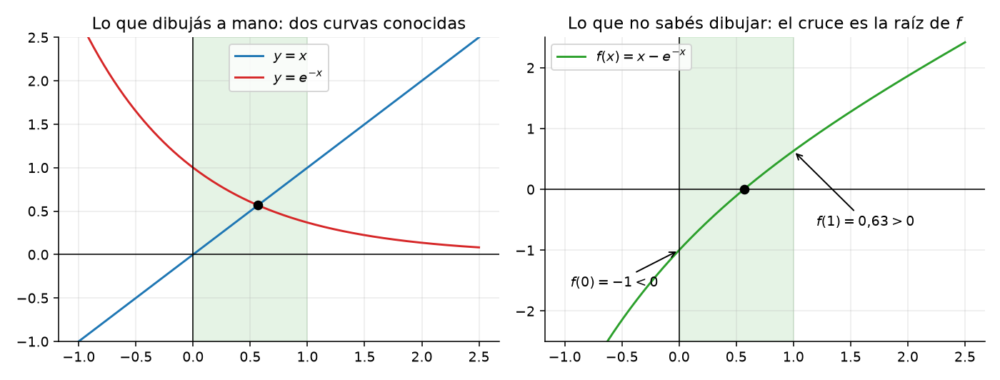
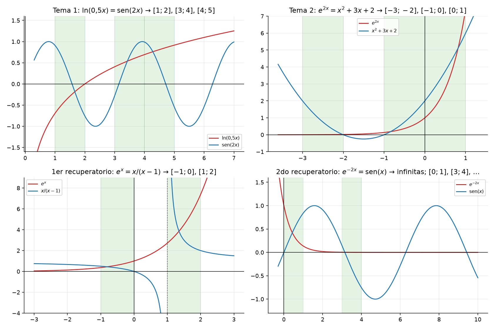
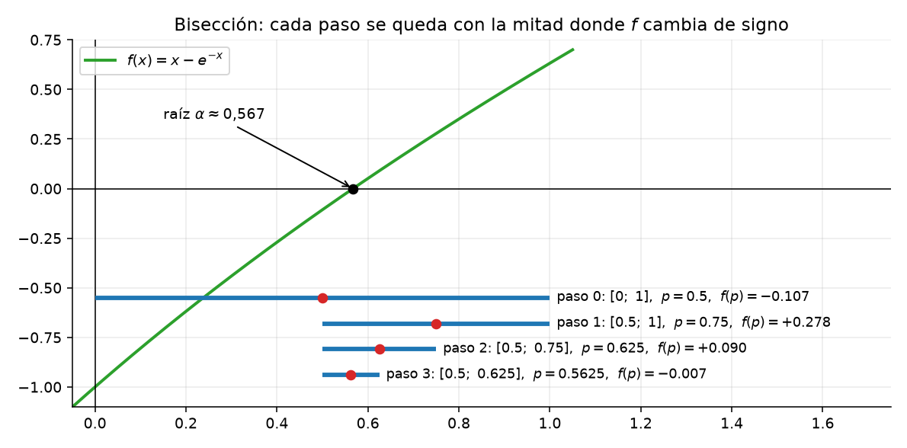
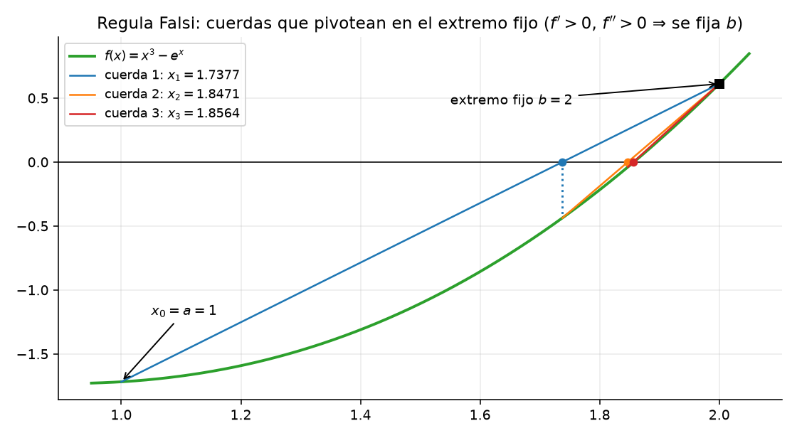
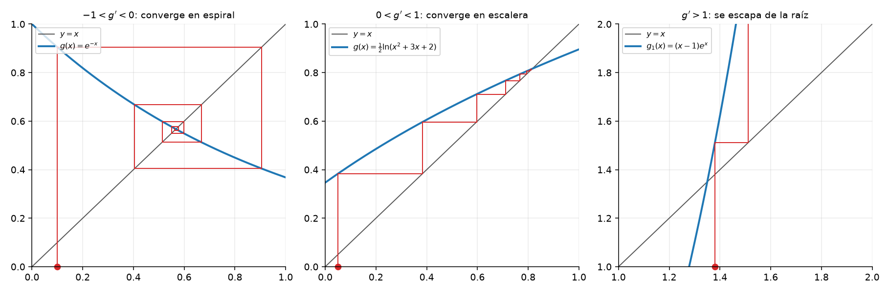
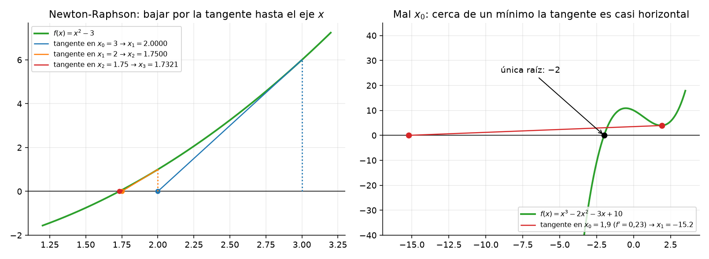

# Raíces de ecuaciones no lineales desde cero

> Fuentes: `fuentes/clases/Raices/Clase - Raices de ecuaciones no lineales.pdf` (PDF de clase, 24 p.), `fuentes/clases/Raices/Teorico catedra 2.2 - Raices de ecuaciones.pdf` (teórico de cátedra, 42 p.), `fuentes/clases/Raices/OneNote - Raices.pdf` (práctica manuscrita del profesor, 14 p.), transcripts `10-video-teorica-raices.json` (teórica, 2 h 13) y `11-video-practica-raices.json` (práctica, 1 h 53), `examenes/INDICE.md` y `examenes/resueltos/RESOLUCIONES-2025.md` (Ej1 de las 4 hojas 2025), apunte `06-practica-repaso-segundo-parcial.md` (ej. 1 y 2), `fuentes/Guia-ejercicios-parte-2-calculo-numerico.pdf` (ej. 1 a 30 de raíces, con sus respuestas) y `fuentes/AYUDAMEMORIA-OFICIAL.pdf` (pág. 4). Todos los números verificados con Python. Generado 2026-11-18.
>
> **Cómo usarla:** leé de arriba abajo, sin saltear. Los **Ejemplos guiados** están resueltos a la vista: leelos con lápiz y calculadora y rehacé cada cuenta. Los **Tu turno** se hacen en papel y **sin mirar**; la corrección está plegada (el enunciado va en texto plano en el título desplegable, porque ahí no se renderizan fórmulas). Las notas **En clase** son lo que dijo el profesor en los videos, con el minuto real del transcript (`teórica [mm:ss]` = video 10, `práctica [mm:ss]` = video 11). Tiempo total: ≈ 6 h con pausas.
>
> **Qué es de la cátedra y qué es mío:** métodos, fórmulas, criterios y ejemplos salen de las fuentes. Son agregados míos (para que se entienda) las explicaciones "en criollo", las cuentas intermedias que las fuentes hacen "en Excel", los gráficos, el truco de la tecla `Ans` y el aviso de poner la calculadora en radianes. El **Checkpoint** es un ejercicio con formato de parcial armado con una función de la guía (ej. 1g y 12d).

---

## 0. Qué te toman: el Ej1 vale 2 puntos

El Ej1 del 2do parcial es **siempre** raíces. Te dan una ecuación $f(x)=0$ que no se puede despejar (mezcla exponenciales, logaritmos o senos con polinomios) y 3 ítems. En el 1er recuperatorio 2025 el puntaje fue **a) 0,5 · b) 0,75 · c) 0,75**.

| Ítem | Qué te piden | Hojas 2025 | Frecuencia | Sección |
|---|---|---|---|---|
| **Separar raíces** | Un intervalo $[a;\ a+1]$ con $a\in\mathbb Z$ para **cada** raíz (gráficamente). A veces: "¿cuántas raíces tiene?" | T1 a, T2 a, R1 a, R2 a | **4/4** (siempre el ítem a) | §3 |
| **Newton-Raphson** | Hallar una raíz indicada ("la más cercana a 0", "la segunda positiva") con error $\varepsilon<10^{-4}$ o $10^{-5}$ | T1 b (dice "método conveniente"), T2 c, R2 b | **3/4** | §8 |
| **Punto fijo: condiciones** | Analizar si una $g(x)$ dada sirve en el intervalo, o elegir entre dos $g$ | T2 b, R1 b | **2/4** | §7 |
| **Punto fijo: iterar** | Aproximar la raíz con la $g$ elegida, $\varepsilon\le 10^{-2}$ | R1 c | 1/4 | §7 |
| **Bisección: cantidad de iteraciones** | Cuántas iteraciones garantizan un error dado en $[a-1;\ a+1]$. "¿Son suficientes o necesarias?" **Nunca se itera.** | T1 c, R2 c (reciclado) | **2/4** | §5 |
| Regula Falsi: qué extremo fijar | Verdadero/falso o multiple choice. No se itera. | Repaso 2026 (ej. 2, opción b) | 0/4 en 2025, 1 vez en el repaso | §6 |

T1/T2 = parcial Tema 1/2 · R1/R2 = 1er/2do recuperatorio.

**Lectura rápida:** el ejercicio tipo es **(a) separar raíces + (b) un ítem de justificar** (condiciones de punto fijo o iteraciones de bisección) **+ (c) Newton-Raphson con 2 o 3 iteraciones**. Si dominás §3, §5, §7 y §8, el Ej1 es tuyo.

> **En clase:** "si les tomo un ejercicio de hacer iteraciones siempre va a estar pensado para que tengan que hacer tres, cuatro, dos" (práctica [1:52:12]). Y a la pregunta de si conviene practicar iteraciones o condiciones: "a veces les va a tocar chequear condiciones, a veces hacer iteraciones, a veces las dos".

## 1. La idea en criollo

Una **raíz** de $f$ es un número $\alpha$ con $f(\alpha)=0$. Para $x^2-5x+6=0$ tenés la resolvente. Para $x-e^{-x}=0$ **no existe despeje**: la $x$ está adentro y afuera de la exponencial. Ahí entran los métodos numéricos.

Todos los métodos hacen lo mismo: fabrican una **lista de números** $x_0, x_1, x_2, \dots$ que se va pegando a la raíz:

$$
\{x_0,\ x_1,\ x_2,\ \dots,\ x_i,\ \dots\}\ \longrightarrow\ \alpha
$$

Casi nunca le pegan exacto: se acercan sin llegar. Por eso el enunciado siempre trae un **error tolerado** $\varepsilon$ (por ejemplo $\varepsilon<10^{-4}$) y vos tenés que decidir **cuándo parar** (§4).

Todo ejercicio de raíces tiene dos tiempos:

1. **Encerrar** cada raíz en un intervalo corto, en general de longitud 1 (§3). Sin esto no arranca ningún método.
2. **Afinar** la raíz que te piden con un método: bisección (§5), regula falsi (§6), punto fijo (§7) o Newton-Raphson (§8).

Vocabulario que aparece en los enunciados:

- "**$n$ decimales exactos**" significa $\varepsilon<10^{-n}$ (teórica [11:42]). "Dos decimales exactos" = error menor que $0{,}01$.
- **Error absoluto** entre dos iteraciones: $\lvert x_{i+1}-x_i\rvert$.
- **Converge** = la lista se acerca a la raíz. **Diverge** = se va para cualquier lado.

> **En clase:** "si no se aclara nada en el ejercicio […] entre 4 y 5 decimales para los ejercicios que vamos a trabajar está correcto, no corten en 2" (teórica [06:26]). Las resoluciones oficiales muestran entre 5 y 7.

**Calculadora (agregado mío):** ponela en **radianes** antes de empezar (los senos de estos ejercicios son de números, no de grados). Y usá la tecla `Ans`: escribí $x_0$, apretá `=`, después tipeá la fórmula del método con `Ans` en lugar de $x$ y apretá `=` una vez por iteración.

## 2. Qué tenés en el ayudamemoria y qué va de memoria

Mirá la pág. 4 del ayudamemoria oficial: tiene diferencias finitas, autovalores, matrices de Jacobi y Gauss-Seidel, errores de Trapecios y Simpson, Euler, Heun y Runge-Kutta. **De raíces no hay nada.** Todo este tema va de memoria. Es poco:

- 🧠 **Bolzano:** $f$ continua en $[a,b]$ y $f(a)$, $f(b)$ de distinto signo ⇒ hay al menos una raíz en $(a,b)$.
- 🧠 **Cota de bisección:** $\dfrac{b-a}{2^{i}}<\varepsilon$, y la respuesta "**suficientes, no necesarias**".
- 🧠 **Regula Falsi:** signos de $f'$ y $f''$ **iguales** ⇒ se fija $b$; **distintos** ⇒ se fija $a$.
- 🧠 **Punto fijo:** $x_{i+1}=g(x_i)$ y las dos condiciones: $g(x)\in[a,b]$ y $\lvert g'(x)\rvert<1$ para todo $x\in[a,b]$ (suficientes, no necesarias).
- 🧠 **Newton-Raphson:** $x_{i+1}=x_i-\dfrac{f(x_i)}{f'(x_i)}$, con un $x_0$ que dé derivada "grande" y cociente "chico".
- 🧠 **Parar** cuando $\lvert f(x_i)\rvert<\varepsilon$ (o $\lvert x_{i+1}-x_i\rvert<\varepsilon$).
- 🧠 Orden de convergencia: bisección, regula falsi y punto fijo $p=1$ (lineal); Newton-Raphson $p=2$ (cuadrática). Raíz múltiple ⇒ Newton lento.

---

## 3. Separar raíces: un intervalo $[a;\ a+1]$ para cada una (ítem a, 4/4)

### 3.1 La idea

No sabés graficar $f(x)=x-e^{-x}$ de memoria. Pero sí sabés graficar $y=x$ y $y=e^{-x}$ por separado. Como

$$
x-e^{-x}=0\quad\Longleftrightarrow\quad x=e^{-x}
$$

las raíces de $f$ son las **abscisas donde se cruzan las dos curvas**.

### 3.2 Receta

1. Escribí $f(x)=0$ y pasá términos hasta tener **una función conocida de cada lado** (exponencial, logaritmo, seno, recta, parábola, cúbica, $1/x$). Las constantes van del lado que más cómodo te quede.
2. Graficá las dos **en los mismos ejes y a escala**, marcando lo que sabés: raíces y vértice de la parábola, ordenada al origen, asíntotas, período y amplitud del seno.
3. Contá los cruces y leé entre qué enteros cae cada uno.
4. Preguntate **qué pasa más a la derecha y más a la izquierda** de lo que dibujaste (§3.3).
5. **Confirmá con Bolzano**: evaluá $f$ en los dos extremos de cada intervalo y mostrá el cambio de signo. Es una línea por intervalo y deja el ítem blindado.

> **En clase:** "cuando ustedes están en un examen seguramente no sepan cómo graficar esta función […] lo que hago es despejar de forma tal de llegar a dos funciones que yo sepa graficar en cada miembro" (teórica [23:47]–[24:18]). "Hay muchísimos ejercicios que arrancan así […] el punto A es: indique un intervalo de longitud 1 para la raíz" (teórica [25:24]).
>
> **En clase:** el gráfico es "a grosso modo": no importa si el cruce te queda en 0,4 o 0,6, importa no errarle al intervalo (teórica [26:57]). Y si el cruce cae justo al límite entre dos intervalos, "tienen la herramienta de Bolzano por si no están seguros" (teórica [27:59]–[28:31]).
>
> **En clase:** "ojo con la pendiente": con $\operatorname{sen}(x)=2x-1$ hay un solo cruce, pero si la recta fuera más acostada aparecerían varios; por eso hay que graficar "lo más precisamente que puedan" (práctica [03:10]–[03:41]).

### 3.3 Las raíces escondidas

Hay cruces que no entran en el dibujito de la hoja. El profesor da dos razones teóricas para sospechar:

- **La exponencial siempre le termina ganando a la polinómica.** Si a la derecha de tu dibujo la polinómica quedó arriba de la exponencial, en algún momento la exponencial la vuelve a pasar: hay **otro cruce**. Se busca con una tablita de valores enteros.
- **El logaritmo tiene una asíntota vertical en $0$**: cerca de $0$ baja hasta $-\infty$, así que cruza cualquier curva que ahí valga un número finito.

> **En clase:** "siempre piensen […] ¿qué pasa para la derecha? ¿qué pasa para la izquierda? ¿puede haber alguna razón teórica por la que haya algún cruce más que los obvios?" (práctica [11:32]–[12:02]). La raíz escondida aparece "relativamente cerca en términos de abscisas" (teórica [1:00:48]): entre 3 y 6, no en 1200.

### Ejemplo guiado 1: $f(x)=x-e^{-x}$ (PDF de clase)

**Paso 1.** $x=e^{-x}$: la recta identidad y la exponencial decreciente.

**Paso 2.** La exponencial arranca en $1$ (para $x=0$) y baja; la recta arranca en $0$ y sube. Se cruzan una sola vez, entre $0$ y $1$.

**Paso 3 — Bolzano.** $f(0)=0-1=-1<0$ y $f(1)=1-e^{-1}=0{,}6321>0$. $f$ es continua y cambia de signo.

**Respuesta:** una sola raíz, en $[0;\ 1]$.

### Ejemplo guiado 2: $f(x)=\ln(x)+x^2-8x+12$ (guía ej. 1j, OneNote)

**Paso 1.** $\ln x=-x^2+8x-12$.

**Paso 2.** La parábola: $-x^2+8x-12=-(x-4)^2+4$. Raíces: $(x-4)^2=4\Rightarrow x=2$ y $x=6$. Vértice en $(4;\ 4)$, ramas hacia abajo, ordenada al origen $-12$.

**Paso 3.** El logaritmo pasa por $(1;0)$ y crece lento. Cruces "obvios": uno apenas a la derecha de $2$ (la parábola sube desde $0$ y el logaritmo vale $0{,}69$) y otro antes de $6$.

**Paso 4 — raíz escondida.** Hacia la izquierda la parábola baja a $-12$ en $x=0$, pero el logaritmo baja a $-\infty$: se cruzan pegadito al eje $y$.

**Paso 5 — Bolzano.** $f(2)=0{,}693>0$, $f(3)=-1{,}901<0$; $f(5)=-1{,}391<0$, $f(6)=1{,}792>0$; y $f(1)=5>0$ con $f(x)\to-\infty$ cuando $x\to0^+$.

**Respuesta:** 3 raíces, en $[0;1]$, $[2;3]$ y $[5;6]$.

### Ejemplo guiado 3: $f(x)=e^{x}-x^{3}+1$ (guía ej. 1c con un signo cambiado, OneNote)

**Paso 1.** $e^x=x^3-1$.

**Paso 2.** Tablita: en $x=1$, $e=2{,}72$ contra $0$; en $x=2$, $7{,}39$ contra $7$; en $x=3$, $20{,}09$ contra $26$. La cúbica pasó arriba entre $2$ y $3$: **primer cruce en $[2;3]$**.

**Paso 3 — raíz escondida.** La cúbica quedó arriba, pero "exponencial siempre le termina ganando a polinómica". Sigo la tablita: en $x=4$, $54{,}6$ contra $63$ (sigue arriba la cúbica); en $x=5$, $148{,}4$ contra $124$ (ganó la exponencial). **Segundo cruce en $[4;5]$.**

**Respuesta:** 2 raíces, en $[2;3]$ y $[4;5]$.

### Tu turno 3

<strong>3.A (parcial 2025, Tema 1, ítem a)</strong> — Dada ln(0,5x) − sen(2x) = 0, encontrar un intervalo [a; a+1] con a ∈ ℤ para cada una de las raíces.

<strong>Resolución</strong>

**Paso 1.** $\ln(0{,}5x)=\operatorname{sen}(2x)$.

**Paso 2.** $\ln(0{,}5x)$ existe para $x>0$, vale $0$ en $x=2$ y crece lento. $\operatorname{sen}(2x)$ oscila entre $-1$ y $1$ con período $\pi\approx3{,}14$: ceros en $0;\ 1{,}57;\ 3{,}14;\ 4{,}71;\ 6{,}28$.

**Paso 3 — dónde puede haber cruces.** El seno nunca sale de $[-1;1]$, así que solo puede haber cruces donde $-1\le\ln(0{,}5x)\le1$, o sea $0{,}74\le x\le 2e\approx5{,}44$. A la derecha de $5{,}44$ el logaritmo ya superó $1$ y no vuelve: no hay más raíces.

**Paso 4 — Bolzano con una tablita** (calculadora en radianes):

| $x$ | 1 | 2 | 3 | 4 | 5 |
|---|---|---|---|---|---|
| $f(x)$ | −1,602 | 0,757 | 0,685 | −0,296 | 1,460 |

Cambia de signo entre 1 y 2, entre 3 y 4, y entre 4 y 5.

**Respuesta (coincide con la oficial):** 3 raíces, en $[1;2]$, $[3;4]$ y $[4;5]$. El gráfico de las cuatro hojas está al final de esta sección.

<strong>3.B (parcial 2025, Tema 2, ítem a)</strong> — Dada e²ˣ − x² − 3x − 2 = 0, indicar un intervalo [a; a+1] con a ∈ ℤ para cada una de las raíces.

<strong>Resolución</strong>

**Paso 1.** $e^{2x}=x^2+3x+2$ (así lo reescribe la resolución oficial).

**Paso 2 — la parábola.** Raíces:

$$
x=\frac{-3\pm\sqrt{9-4\cdot1\cdot2}}{2}=\frac{-3\pm1}{2}\ \Rightarrow\ x=-1,\ x=-2
$$

Vértice en $\left(-\frac32;\ -\frac14\right)$, ramas hacia arriba, ordenada al origen $2$.

**Paso 3 — los cruces.** $e^{2x}$ es siempre positiva, casi $0$ a la izquierda y vale $1$ en $x=0$.

- A la izquierda de $-2$ la parábola sube desde $0$ y la exponencial es casi $0$: se cruzan apenas a la izquierda de $-2$.
- Entre $-2$ y $-1$ la parábola es negativa y la exponencial positiva: no hay cruce.
- En $x=-1$ la parábola vale $0$ (exponencial arriba) y en $x=0$ vale $2$ contra $1$ (parábola arriba): cruce en $[-1;0]$.
- A la derecha la parábola quedó arriba, pero la exponencial le termina ganando: en $x=1$, $e^{2}=7{,}39$ contra $6$. Cruce en $[0;1]$.

**Paso 4 — Bolzano.**

| $x$ | −3 | −2 | −1 | 0 | 1 |
|---|---|---|---|---|---|
| $f(x)$ | −1,998 | 0,018 | 0,135 | −1 | 1,389 |

**Respuesta (coincide con la oficial):** 1 raíz en $[-3;-2]$, 1 en $[-1;0]$ y 1 en $[0;1]$.

<strong>3.C (1er recuperatorio 2025, ítem a, 0,5 puntos)</strong> — Dada x/(x − 1) − eˣ = 0, indicar un intervalo [a; a+1] para cada una de las raíces.

**Enunciado en limpio:** $\dfrac{x}{x-1}-e^{x}=0$.

<strong>Resolución</strong>

**Paso 1.** $\dfrac{x}{x-1}=e^{x}$. Es la misma ecuación del ej. 15 de la guía, que el profesor resuelve en el OneNote.

**Paso 2.** $\dfrac{x}{x-1}=1+\dfrac{1}{x-1}$ es una hipérbola: asíntota vertical en $x=1$, asíntota horizontal en $y=1$, pasa por $(0;0)$. A la izquierda de $1$ está debajo de $1$; a la derecha de $1$ baja desde $+\infty$ hacia $1$.

**Paso 3.** A la izquierda: en $x=-1$ la hipérbola vale $0{,}5$ y $e^{-1}=0{,}37$; en $x=0$ vale $0$ contra $1$. Cruce en $[-1;0]$. A la derecha de la asíntota la hipérbola baja y la exponencial sube: se cruzan una vez, antes de $2$ (ahí vale $2$ contra $7{,}39$).

**Paso 4 — Bolzano.** $f(-1)=0{,}132>0$ y $f(0)=-1<0$. En el otro, $f$ no existe en $x=1$: evalúo pegado a la derecha, $f(1{,}1)=11-3{,}004=7{,}996>0$, y $f(2)=2-7{,}389=-5{,}389<0$.

**Respuesta (coincide con la oficial):** 1 raíz en $[-1;0]$ y 1 raíz en $[1;2]$.

<strong>3.D (2do recuperatorio 2025, ítem a)</strong> — Dada e⁻²ˣ − sen(x) = 0, mostrar gráficamente dónde se encuentran las raíces. ¿Cuántas raíces tiene la ecuación?

<strong>Resolución</strong>

**Paso 1.** $e^{-2x}=\operatorname{sen}(x)$.

**Paso 2.** $e^{-2x}$ vale $1$ en $x=0$ y se aplasta contra el eje $x$ muy rápido, sin tocarlo. Para $x<0$ es mayor que $1$: ahí el seno no la alcanza nunca, **no hay raíces negativas**.

**Paso 3.** Para $x>0$ la exponencial es un número positivo cada vez más chico, y el seno sube y baja infinitas veces: en cada "lomo" positivo del seno ($[0;\pi]$, $[2\pi;3\pi]$, …) la corta dos veces. **Infinitas raíces.**

**Paso 4 — las dos primeras.** $f(0)=1>0$, $f(1)=-0{,}706<0$: una en $[0;1]$. $f(3)=-0{,}139<0$, $f(4)=0{,}757>0$: otra en $[3;4]$ (pegada a $\pi$, porque ahí la exponencial ya es casi $0$).

**Respuesta (coincide con la oficial):** "Infinitas raíces. Las primeras 2 en $[0,1]$ y $[3,4]$".

<strong>3.E (guía ej. 1a, 1b y 1m; OneNote y práctica)</strong> — Determinar gráficamente cuántas raíces reales tienen y un intervalo de longitud 1 para cada una: a) eˣ + x − 4 · b) sen(x) − 2x + 1 · m) x⁶ + 20x − 25.

<strong>Resolución</strong>

**a)** $e^x=-x+4$: exponencial creciente contra recta decreciente, un solo cruce. $f(1)=-0{,}282<0$, $f(2)=5{,}389>0$. **1 raíz en $[1;2]$.**

**b)** $\operatorname{sen}x=2x-1$: la recta pasa por $(0;-1)$ y $(1;1)$ con pendiente 2, más empinada que el seno: un solo cruce. $f(0)=1>0$, $f(1)=-0{,}159<0$. **1 raíz en $[0;1]$.**

**m)** $x^6=-20x+25$: $x^6$ tiene forma de parábola "con más base"; la recta baja de izquierda a derecha. Dos cruces: uno a la derecha ($f(1)=-4<0$, $f(2)=79>0$) y otro a la izquierda, donde $x^6$ sube muy rápido ($f(-3)=644>0$, $f(-2)=-1<0$). **2 raíces, en $[1;2]$ y $[-3;-2]$.**

Coinciden con las respuestas de la guía. El caso m) lo preguntó un compañero en la práctica [13:34]–[15:09]: la raíz negativa no se ve en el dibujo chico, pero "por la forma de la función te das cuenta que tiene que haber dos cruces".

Los cuatro ítems a) de 2025, graficados (para comparar con tu dibujo a mano):

---

## 4. Cuándo parar: el criterio de la cátedra

Como nunca llegás a la raíz exacta, necesitás una regla para frenar. El PDF de clase da tres:

1. **Error absoluto:** $\lvert x_{i+1}-x_i\rvert<\varepsilon$.
2. **Error relativo:** $\left\lvert\dfrac{x_{i+1}-x_i}{x_{i+1}}\right\rvert<\varepsilon$.
3. **Valor de la función:** $\lvert f(x_i)\rvert<\varepsilon$.

**El que usa la cátedra en las resoluciones de parcial es el 3.** Se ve en las cuatro tablas oficiales de 2025: todas paran en la **primera fila donde $\lvert f(x_i)\rvert$ quedó por debajo de $\varepsilon$**, aunque dos iteraciones seguidas todavía difieran en más que $\varepsilon$. Ejemplo (T2, $\varepsilon<10^{-4}$): paran en $x_3=-0{,}8391829$ porque $f(x_3)=-4{,}35\cdot10^{-7}$, y eso que $\lvert x_3-x_2\rvert=8\cdot10^{-4}$.

Por qué es cómodo: la columna $f(x_i)$ **ya la tenés calculada** (todos los métodos la usan), así que mirar el error no cuesta nada.

**Regla práctica para el parcial:** armá la tabla con una columna $f(x_i)$, pará en la primera fila con $\lvert f(x_i)\rvert<\varepsilon$ y **escribí el criterio**: "paro porque $\lvert f(x_i)\rvert<\varepsilon$".

La letra chica teórica: el criterio 3 "solamente es válido si la función tiene pendiente mayor a 1". Si $f$ es muy acostada ($\lvert f'\rvert<1$), $f(x_i)$ puede ser chiquito estando lejos de la raíz, y ahí el teórico manda usar el criterio 1. Puede aparecer como verdadero/falso (guía ej. 22b: "Si $\lvert f'(x)\rvert<1$ ⇒ el criterio de paro más conveniente es $\lvert f(x_n)\rvert<\varepsilon$" → **Falso**).

> **En clase:** sobre esa letra chica: "es algo bastante teórico, lo he visto más como pregunta teórica que como un impedimento práctico a la hora de hacer ejercicios" (teórica [15:19]).
>
> **En clase:** si el Excel (o la calculadora) te muestra $f(x)=0$ no es que le pegaste a la raíz exacta: es un error de *underflow*, "ya no le da la precisión para mostrar números tan chicos" (teórica [1:41:42]).

---

## 5. Bisección y la cuenta de iteraciones (2/4, nunca se itera en el parcial)

### 5.1 La idea

Es el método más simple: tenés la raíz encerrada en $[a,b]$ con cambio de signo (Bolzano). Probás el **punto medio**. Según el signo de $f$ ahí, la raíz quedó en la mitad izquierda o en la derecha. Te quedás con esa mitad y repetís. Cada paso el intervalo mide la mitad.

### 5.2 Receta

1. Verificá Bolzano en $[a,b]$: $f$ continua y $f(a)\cdot f(b)<0$.
2. Punto medio: $p=\dfrac{a+b}{2}$. Calculá $f(p)$.
3. Si $f(p)$ tiene el mismo signo que $f(a)$, entonces $a:=p$. Si no, $b:=p$. (Siempre te quedás con una imagen positiva y una negativa.)
4. Repetí hasta que se cumpla el criterio de paro.

**Lo que pide:** solo Bolzano. **Lo bueno:** si se cumple Bolzano converge siempre. **Lo malo:** es lento, y una iteración puede quedar más lejos de la raíz que la anterior.

### Ejemplo guiado 4: $x-e^{-x}=0$ en $[0;1]$ con dos decimales exactos (PDF de clase)

$f(x)=x-e^{-x}$, $\varepsilon<0{,}01$, criterio $\lvert f(p)\rvert<\varepsilon$.

| $i$ | $a$ | $b$ | $f(a)$ | $f(b)$ | $p$ | $f(p)$ | me quedo con |
|---|---|---|---|---|---|---|---|
| 0 | 0 | 1 | −1 | 0,63212 | 0,5 | −0,10653 | $[0{,}5;\ 1]$ |
| 1 | 0,5 | 1 | −0,10653 | 0,63212 | 0,75 | 0,27763 | $[0{,}5;\ 0{,}75]$ |
| 2 | 0,5 | 0,75 | −0,10653 | 0,27763 | 0,625 | 0,08974 | $[0{,}5;\ 0{,}625]$ |
| 3 | 0,5 | 0,625 | −0,10653 | 0,08974 | **0,5625** | **−0,00728** | paro |

En la fila 3, $\lvert f(p)\rvert=0{,}00728<0{,}01$. **Respuesta:** $x\approx0{,}5625$ (la raíz es $0{,}56714\ldots$).

Mirá las filas 0 y 1: el error pasó de $0{,}107$ a $0{,}278$. **Empeoró** antes de mejorar.

> **En clase:** "a veces la iteración siguiente es más lejana a la raíz que la iteración anterior. Puede pasar. Lo importante es que a la larga va a converger a la raíz" (teórica [35:23]).

### 5.3 La cuenta que sí se toma: ¿cuántas iteraciones?

Como bisección parte el intervalo a la mitad en cada paso, después de $i$ pasos el error **no puede superar** la longitud original dividida por $2^i$:

$$
\lvert x_i-\alpha\rvert\ \le\ \frac{b-a}{2^{i}}\ \le\ \varepsilon
$$

El primer $\le$ es lo que garantiza el método; el segundo es lo que vos exigís. La receta:

1. **Longitud del intervalo** $b-a$. Ojo: $[a;\ a+1]$ mide 1, pero $[a-1;\ a+1]$ mide **2**.
2. Plantear $\dfrac{b-a}{2^{i}}<\varepsilon$.
3. Despejar $i$ con logaritmos (cualquier base).
4. Tomar el **primer entero mayor**: siempre se redondea **para arriba**.
5. Escribir: "son **suficientes** $N$ iteraciones (no necesarias)" y por qué.

**La justificación de "suficientes" (hay que escribirla):** la fórmula es una **cota**. Con esa cantidad de iteraciones el error pedido está **garantizado**, pero se puede conseguir antes. El ejemplo del profesor: si la raíz es justo $2{,}5$ y trabajás en $[2;3]$, la primera iteración ya le pega exacto, aunque la fórmula diga 20.

Dos propiedades que también preguntan:

- La cantidad **no depende de la función** ni de un valor inicial: solo de la longitud del intervalo y de $\varepsilon$.
- Bisección tiene orden de convergencia $p=1$ (lineal) y radio $R=\frac12$, siempre.

> **En clase:** "siempre, siempre, siempre que hay un ejercicio de bisección, sea en un parcial o en un final, está siempre la misma pregunta […] ¿son suficientes o son necesarias?" (teórica [39:05]–[39:36]). "El método te dice que si hacés esas 20 iteraciones seguro sí o sí vas a obtener la precisión que buscás. No quiere decir que no la encuentres antes" (teórica [40:37]).
>
> **En clase:** "suficiente, porque el que me pone necesaria lo tengo que asesinar" (práctica [33:52]).
>
> **En clase:** el numerador es "la longitud del intervalo": si el intervalo es $[-3;-2]$ va $1$, en módulo (práctica [26:36]). Y "19 no, porque $i$ tiene que ser mayor a 19 y pico […] con 20 iteraciones, redondeando para arriba" (práctica [24:31]).

### Ejemplo guiado 5: $x^3+4x^2-10=0$ en $[1;2]$ con $\varepsilon<10^{-5}$ (PDF de clase y teórico)

$$
\frac{2-1}{2^{i}}<10^{-5}\ \Longrightarrow\ 2^{i}>10^{5}\ \Longrightarrow\ i\cdot\log_{10}2>5\ \Longrightarrow\ i>\frac{5}{\log_{10}2}=16{,}61
$$

**Respuesta:** son **suficientes 17 iteraciones**. La ecuación $x^3+4x^2-10$ no apareció en ninguna cuenta.

Tabla para chequearte (longitud 1; con longitud 2 sumale una iteración):

| $\varepsilon$ | $10^{-2}$ | $10^{-3}$ | $10^{-4}$ | $10^{-5}$ | $10^{-6}$ | $10^{-7}$ |
|---|---|---|---|---|---|---|
| $\log_2(1/\varepsilon)$ | 6,64 | 9,97 | 13,29 | 16,61 | 19,93 | 23,25 |
| iteraciones suficientes, longitud 1 | 7 | 10 | 14 | 17 | 20 | 24 |
| iteraciones suficientes, longitud 2 | 8 | 11 | 15 | 18 | 21 | 25 |

### Tu turno 5

<strong>5.A (parcial 2025, Tema 1, ítem c)</strong> — Con un intervalo [a−1, a+1] con a ∈ ℤ, indicar con cuántas iteraciones se puede garantizar un error ε &lt; 10⁻⁷ para hallar alguna raíz usando el método de bisección. ¿Son suficientes o necesarias?

<strong>Resolución</strong>

**Paso 1.** Longitud: $(a+1)-(a-1)=2$.

**Paso 2.**

$$
\frac{2}{2^{i}}<10^{-7}\ \Longrightarrow\ 2^{\,1-i}<10^{-7}
$$

**Paso 3.**

$$
(1-i)\log_{10}2<-7\ \Longrightarrow\ 1-i<\frac{-7}{\log_{10}2}\ \Longrightarrow\ i>1+\frac{7}{\log_{10}2}=24{,}25
$$

**Paso 4.** Primer entero mayor: $i=25$.

**Respuesta (coincide con la oficial):** son **suficientes 25 iteraciones**. No son necesarias: la cota garantiza el error con 25, pero se puede alcanzar antes (por ejemplo si un punto medio cae justo en la raíz).

<strong>5.B (2do recuperatorio 2025, ítem c)</strong> — Dada una ecuación f(x) = 0, indicar la cantidad de iteraciones que hay que hacer para asegurar un error de 10⁻⁵ usando el método de bisección en el intervalo [a−1; a+1] con a ∈ ℤ. ¿Son necesarias o suficientes dichas iteraciones? Justifique.

<strong>Resolución</strong>

$$
\frac{2}{2^{i}}\le10^{-5}\ \Longrightarrow\ 2^{\,1-i}\le10^{-5}\ \Longrightarrow\ 1-i\le\frac{-5}{\log_{10}2}\ \Longrightarrow\ i\ge17{,}61
$$

**Respuesta (coincide con la oficial):** **18 iteraciones, suficientes.**

**Justificación** (la hoja oficial no la escribe, pero el enunciado la pide): $\frac{b-a}{2^i}$ es una cota superior del error. Con 18 iteraciones el error queda garantizado por debajo de $10^{-5}$, pero el método puede alcanzar esa precisión antes; por eso no son necesarias. Además la cantidad no depende de $f$, solo de la longitud del intervalo y del error.

Es la misma cuenta del ej. 6 de la guía (intervalo $(3;5)$, $\varepsilon<10^{-5}$): respuesta "son suficientes 18 iteraciones".

<strong>5.C (guía ej. 4, OneNote y práctica)</strong> — Indicar un intervalo para la raíz positiva de x² − 2x − 2 = 0. Usar bisección para calcular la raíz con dos decimales exactos. Establecer el número máximo de pasos necesarios para aproximar la raíz con una precisión de 10⁻⁶.

<strong>Resolución</strong>

**Intervalo.** $x^2=2x+2$: parábola contra recta, dos cruces, en $[-2;-1]$ y en $[2;3]$. La positiva está en $[2;3]$: $f(2)=-2<0$, $f(3)=1>0$.

**Bisección** con $\lvert f(p)\rvert<0{,}01$:

| $i$ | $a$ | $b$ | $p$ | $f(p)$ |
|---|---|---|---|---|
| 0 | 2 | 3 | 2,5 | −0,75 |
| 1 | 2,5 | 3 | 2,75 | 0,0625 |
| 2 | 2,5 | 2,75 | 2,625 | −0,35938 |
| 3 | 2,625 | 2,75 | 2,6875 | −0,15234 |
| 4 | 2,6875 | 2,75 | 2,71875 | −0,04590 |
| 5 | 2,71875 | 2,75 | **2,734375** | **0,00806** |

$\lvert f(p)\rvert=0{,}008<0{,}01$: **$x\approx2{,}73$** (la raíz exacta es $1+\sqrt3=2{,}73205$). Es la fila donde frena el profesor (práctica [19:18]–[20:53]). La respuesta de la guía dice "en el octavo paso podemos asegurar 2,73": usa otro criterio (el ancho del intervalo), llega al mismo valor.

**Iteraciones para $10^{-6}$.**

$$
\frac{3-2}{2^{i}}<10^{-6}\ \Longrightarrow\ 2^{i}>10^{6}\ \Longrightarrow\ i>\frac{6}{\log_{10}2}=19{,}93
$$

**20 iteraciones son suficientes.**

<strong>5.D (guía ej. 5 y 7, verdadero/falso de bisección)</strong> — a) «Si f(x) tiene pendiente grande, bisección converge más rápido.» b) «Con una raíz en (a; a+1), al cabo de 10 iteraciones de bisección se tiene una precisión de 10⁻¹⁰.» c) f(x) = 1/(3x − 1) cumple sg f(0) ≠ sg f(1): ¿qué localiza bisección en (0; 1)? ¿Es una raíz?

**Enunciado en limpio (c):** $f(x)=\dfrac{1}{3x-1}$ en $(a,b)=(0,1)$.

<strong>Resolución</strong>

**a) Falso.** La velocidad de bisección no depende de la función: el intervalo se divide por 2 en cada paso, sea cual sea $f$ ($R=\frac12$ fijo).

**b) Falso.** Con longitud 1 y 10 iteraciones la cota es $\frac{1}{2^{10}}=\frac{1}{1024}\approx10^{-3}$, no $10^{-10}$.

**c)** $f$ no es continua en $(0;1)$: tiene una asíntota vertical en $x=\frac13$. Bolzano no se cumple (falta la continuidad) aunque los signos sean distintos. Bisección converge al punto de discontinuidad $x=\frac13$, que **no es una raíz** (el numerador nunca se anula).

La moraleja del profesor para el caso $\cos(10x)$ del mismo ejercicio: en $(0;1)$ tiene tres raíces ($\frac{\pi}{20}$, $\frac{3\pi}{20}$, $\frac{5\pi}{20}$) y bisección converge a alguna de ellas; hay que "trabajar con intervalos de longitud conveniente según la función" (práctica [31:17]).

<strong>5.E (repaso 2026, ejercicio 1)</strong> — Sea f(x) = x⁴ − 8x³ + 30x² − 25x + 2 − 12e⁻ˣ con una raíz en [a−1, a+1]. Para asegurar un error menor que 10⁻⁷ por bisección: a) son necesarias 23 iteraciones · b) son suficientes 24 · c) depende de f(x) · d) son suficientes 23 · e) depende del valor inicial · f) n.a.

<strong>Resolución</strong>

Es la cuenta de 5.A: longitud 2, $i>24{,}25$, **suficientes 25**. Ninguna opción lo dice ⇒ **f) n.a.** La trampa: si usás longitud 1 te da 24 y marcás la b). Resolución completa del profesor en el apunte `06`, ejercicio 1.

---

## 6. Regula Falsi: solo te preguntan qué extremo fijar

### 6.1 La idea

En vez de probar el punto medio (que no mira la función), Regula Falsi une con una **cuerda** (recta secante) los puntos $(a, f(a))$ y $(b, f(b))$ y toma como aproximación el punto donde la cuerda corta al eje $x$. Después repite, pero **dejando siempre fijo uno de los dos extremos**: todas las cuerdas pivotean ahí.

### 6.2 La regla del extremo fijo (esto es lo que se toma)

Depende del **crecimiento** (signo de $f'$) y de la **concavidad** (signo de $f''$) de $f$ en el intervalo:

| Signos de $f'$ y $f''$ en $(a,b)$ | Extremo fijo | Valor inicial |
|---|---|---|
| **Iguales** (creciente y cóncava hacia arriba, o decreciente y cóncava hacia abajo) | **$b$** | $x_0=a$ |
| **Distintos** (creciente y cóncava hacia abajo, o decreciente y cóncava hacia arriba) | **$a$** | $x_0=b$ |

Condición para poder usar la regla: $f'$ y $f''$ **no cambian de signo** en el intervalo. Si hay un máximo, un mínimo o un punto de inflexión adentro, no se puede usar Regula Falsi en ese intervalo sin cambiar de extremo fijo.

Fórmulas (teórico de cátedra):

$$
\text{fijo } b:\quad x_{n+1}=b-f(b)\,\frac{b-x_n}{f(b)-f(x_n)},\qquad x_0=a
$$

$$
\text{fijo } a:\quad x_{n+1}=a-f(a)\,\frac{x_n-a}{f(x_n)-f(a)},\qquad x_0=b
$$

**Cómo se justifica en el examen:** (1) Bolzano en el intervalo; (2) $f'$ con su signo y por qué no cambia; (3) $f''$ con su signo y por qué no cambia; (4) "signos iguales ⇒ se fija $b$" o "signos distintos ⇒ se fija $a$".

> **En clase:** "nunca vi, y de hecho en la guía de ejercicios no hay, un ejercicio donde se tome aproximar con regula falsi […] ¿qué es lo que se toma? Todo este análisis de cuál es el punto que hay que fijar" (teórica [56:09]–[56:42]). Lo repite en la práctica [34:52]–[35:25].
>
> **En clase:** "si los signos eran iguales, yo iba a fijar el extremo B […] y si son distintos […] ahí fijo el extremo A" (práctica [35:57]–[36:31]).
>
> ⚠ En la teórica, al explicar los cuatro dibujos, el profesor se enreda y en [50:44] dice la regla al revés. Diez minutos después, en el ejemplo, la aplica bien: "positiva y positiva, son signos iguales, entonces lo que hago es fijar […] el extremo B" (teórica [1:06:01]). La regla correcta es la de la tabla: coincide con el teórico de cátedra, el OneNote y el repaso.

### Ejemplo guiado 6: $x^{3}-e^{x}=0$, raíz más cercana a 0 (teórica)

**Paso 1 — intervalo.** $x^3=e^x$: en $x=1$, $1$ contra $2{,}72$; en $x=2$, $8$ contra $7{,}39$. Cruce en $[1;2]$. (Hay otra raíz en $[4;5]$, la escondida: $f(4)=9{,}40>0$, $f(5)=-23{,}4<0$.)

**Paso 2 — $f'(x)=3x^2-e^x$ en $[1;2]$.** Los dos términos son crecientes. En $x=1$: $3-2{,}72=0{,}28>0$. En $x=2$: $12-7{,}39=4{,}61>0$. Positiva en todo el intervalo ⇒ $f$ creciente.

**Paso 3 — $f''(x)=6x-e^x$ en $[1;2]$.** En $x=1$: $6-2{,}72=3{,}28>0$. En $x=2$: $12-7{,}39=4{,}61>0$. Positiva ⇒ cóncava hacia arriba.

**Paso 4.** Signos iguales ⇒ **se fija $b=2$**, $x_0=a=1$.

**Paso 5 — una iteración, para ver la fórmula andando.** $f(2)=0{,}61094$, $f(1)=-1{,}71828$:

$$
x_1=2-0{,}61094\cdot\frac{2-1}{0{,}61094-(-1{,}71828)}=2-\frac{0{,}61094}{2{,}32922}=1{,}73771
$$

Siguen $x_2=1{,}84710$, $x_3=1{,}85639$, $x_4=1{,}85712$, … hacia la raíz $1{,}85718$. A diferencia de bisección, cada iteración queda más cerca que la anterior.

> **En clase:** el argumento de los pasos 2 y 3 ("los dos términos crecen, evalúo en los extremos y veo cuál gana") "es válido" como justificación (teórica [1:05:31]).

### Tu turno 6

<strong>6.A (guía ej. 11, OneNote)</strong> — Verdadero o falso, justificando: a) Sea eˣ + x⁴ − x − 2 = 0 con raíz en (0, 1) ⇒ se puede usar Regula Falsi fijando el 1. b) El método de bisección siempre converge más lentamente que Regula Falsi. c) Dada f(x) = x⁴ − 8x³ + 30x² − 25x + 2 − 12e⁻ˣ, se puede usar Regula Falsi en [1, 2] fijando el 2. d) Si f(x) es creciente en (a, b), en Regula Falsi queda fijo el extremo b.

<strong>Resolución</strong>

**a) Verdadero.** $f'(x)=e^x+4x^3-1$: en $(0,1)$, $e^x>1$ compensa el $-1$ y $4x^3>0$, así que $f'>0$. $f''(x)=e^x+12x^2>0$ siempre. Signos iguales ⇒ se fija $b=1$.

**b) Falso.** Los dos tienen orden $p=1$; desempata el radio. El de bisección es fijo, $R=\frac12$; el de Regula Falsi es variable (depende de la función y del extremo fijado): puede dar mayor o menor que $\frac12$. No se puede decir "siempre".

**c) Verdadero.** $f'(x)=4x^3-24x^2+60x-25+12e^{-x}$ vale $19{,}4$ en $x=1$ y $32{,}6$ en $x=2$; $f''(x)=12x^2-48x+60-12e^{-x}$ vale $19{,}6$ en $x=1$ y $10{,}4$ en $x=2$ (el polinomio $12x^2-48x+60$ tiene mínimo $12$ en $x=2$ y le resto a lo sumo $12e^{-1}=4{,}4$). Las dos positivas en $[1;2]$ ⇒ se fija $b=2$. Y hay raíz: $f(1)=-4{,}41$, $f(2)=22{,}4$.

**d) Falso.** Que sea creciente solo dice $f'>0$. Falta la concavidad: si $f''>0$ se fija $b$, si $f''<0$ se fija $a$.

Respuestas de la guía: V, F, V, F. Sobre el c) el profesor avisa que el análisis de signos "es un poco más molesto […] capaz no es tan para tomar en un examen", pero el concepto es el mismo (práctica [42:54]–[43:56]).

<strong>6.B (teórico de cátedra, ejercicio pág. 36)</strong> — Verdadero o falso: se puede aplicar Regula Falsi para hallar una raíz de x³ − 3x² − 9x + 20 = 0 en el intervalo (1, 2) dejando siempre fijo el extremo 2.

<strong>Resolución</strong>

**Bolzano:** $f(1)=9>0$, $f(2)=8-12-18+20=-2<0$. Hay raíz.

**Crecimiento:** $f'(x)=3x^2-6x-9=3(x^2-2x-3)$ tiene raíces en $3$ y $-1$: en $(1,2)$ es siempre **negativa**.

**Concavidad:** $f''(x)=6x-6$ se anula en $x=1$: en $(1,2)$ es siempre **positiva**.

Signos distintos ⇒ hay que fijar $a=1$, no el 2. **Falso.**

<strong>6.C (guía ej. 9 y 10)</strong> — a) Dada f(x) = x·ln(x) + x, indicar un intervalo y qué extremo fijarías para hallar la raíz no nula por Regula Falsi. b) Dada 2eˣ − x² − 6x − 5 = 0, ¿qué intervalo podrías tomar para calcular la menor raíz real por Regula Falsi sin cambiar de extremo fijo? ¿Cuál sería ese extremo?

<strong>Resolución</strong>

**a)** $f(x)=x(\ln x+1)$ se anula cuando $\ln x=-1$, o sea cerca de $0{,}37$. La guía propone $(0{,}2;\ 0{,}4)$: $f(0{,}2)=-0{,}122<0$, $f(0{,}4)=0{,}033>0$. $f'(x)=\ln x+2$: en $0{,}2$ vale $0{,}39>0$ y crece ⇒ positiva. $f''(x)=\frac1x>0$. Signos iguales ⇒ **se fija $b=0{,}4$**. (La guía da la raíz $0{,}36806641$, que es una aproximación del método; la exacta es $e^{-1}=0{,}36788$.)

**b)** $2e^x=x^2+6x+5=(x+1)(x+5)$. La menor raíz está pegada a $-5$: $f(-6)=0{,}005-36+36-5=-5<0$, $f(-5)=0{,}013>0$. Intervalo $(-6;-5)$. $f'(x)=2e^x-2x-6$: vale $6{,}005$ en $-6$ y $4{,}013$ en $-5$ ⇒ positiva. $f''(x)=2e^x-2<0$ para todo $x<0$. Signos distintos ⇒ **se fija $a=-6$**.

Coinciden con las respuestas de la guía.

<strong>6.D (repaso 2026, ejercicio 2, opción b)</strong> — Dada sen(4x) + 3x + 3 = 0: «se puede aplicar Regula Falsi en [−2; −0,5] fijando el extremo b = −0,5». ¿Verdadero o falso?

<strong>Resolución</strong>

$f'(x)=4\cos(4x)+3$ y $f''(x)=-16\operatorname{sen}(4x)$. Tabla del profesor:

| $x$ | $f'$ | $f''$ |
|---|---|---|
| −2 | 2,418 | 15,830 |
| −0,9 | −0,587 | −7,080 |
| −0,5 | 1,335 | 14,549 |

Ni $f'$ ni $f''$ mantienen el signo en $[-2;-0{,}5]$: la regla del extremo fijo no se puede aplicar ahí. **Falso.** (Resolución completa de las 5 opciones en el apunte `06`, ejercicio 2, que es el ej. 23 de la guía.)

---

## 7. Punto fijo: las dos condiciones (2/4) y la iteración (1/4)

### 7.1 La idea

Reescribís $f(x)=0$ como $x=g(x)$: **una $x$ sola de un lado, todo lo demás del otro**. Una raíz de $f$ es entonces un número que $g$ deja igual (un "punto fijo" de $g$). El método es lo más simple que hay: metés un número en $g$, lo que sale lo volvés a meter, y así:

$$
x_{i+1}=g(x_i)
$$

Gráficamente la raíz es el cruce de $y=g(x)$ con la recta $y=x$, y las iteraciones dibujan una escalera o una espiral:

**Hay muchas $g$ para la misma $f$.** Para $x^2-4x=0$: $g=\sqrt{4x}$, $g=\frac{x^2}{4}$, y más. Unas convergen y otras no: por eso el ítem de parcial es "¿esta $g$ sirve?" o "¿cuál de estas dos conviene?".

### 7.2 Las condiciones de convergencia (lo que hay que escribir)

Sea $x=g(x)$ y $[a,b]$ el intervalo donde está la raíz. Si se cumplen las dos, el método converge para cualquier $x_0\in[a,b]$:

1. $g(x)\in[a,b]$ para todo $x\in[a,b]$ (las imágenes no se salen del intervalo).
2. $\lvert g'(x)\rvert\le k<1$ para todo $x\in[a,b]$ (la derivada, en módulo, siempre menor que 1).

Son **suficientes, no necesarias**:

- Se cumplen las dos ⇒ **converge, asegurado**.
- Falla alguna ⇒ **no se puede asegurar** la convergencia (puede converger igual, o irse a otra raíz, o divergir). Para saberlo hay que probar iterando.

Cuanto más chico $\lvert g'\rvert$, más rápido converge: el orden es $p=1$ y el radio $R=\lvert g'(\alpha)\rvert$.

### 7.3 Cómo se justifica cada condición sin graficador

**El truco de la monotonía.** Si una función es **siempre creciente o siempre decreciente** en $[a,b]$, todos sus valores quedan entre los valores de los extremos. Entonces alcanza con evaluar en $a$ y en $b$:

- Condición 1: si $g$ es monótona, calculás $g(a)$ y $g(b)$. Si los dos están en $[a,b]$, todas las imágenes están en $[a,b]$.
- Condición 2: si $g'$ es monótona, calculás $g'(a)$ y $g'(b)$ y mirás los dos **en módulo**. Si los dos son menores que 1, listo.

**El truco del "0, y pico".** Si $g'$ es un cociente, acotás numerador y denominador por separado: "el numerador se mueve entre tanto y tanto, el denominador entre tanto y tanto ⇒ el cociente es menor que 1". Así justifica la cátedra en las dos resoluciones oficiales de 2025.

**Para descartar una $g$ alcanza un contraejemplo:** un solo $x$ del intervalo con $g(x)\notin[a,b]$, o con $\lvert g'(x)\rvert\ge1$. Y como hacen falta las dos condiciones, si falla una ni mirás la otra.

Receta del ítem "analizar si se puede usar $g$":

1. (Opcional, una línea) Verificá que $g$ sea un despeje válido de $f(x)=0$.
2. Condición 1: mostrá que $g([a,b])\subset[a,b]$.
3. Calculá $g'(x)$ y mostrá que $\lvert g'(x)\rvert<1$ en todo $[a,b]$.
4. Conclusión con las palabras justas: "se cumplen las dos condiciones ⇒ el método converge" o "no se cumple la condición N ⇒ no se puede asegurar la convergencia".

> **En clase:** "si se me cumplen las dos el método va a converger seguro; si no se me cumplen […] el método puede converger igual. […] No puedo asegurar que no converge" (teórica [1:19:39]–[1:20:10]).
>
> **En clase:** "como es el módulo, tengo que chequear los dos valores de los extremos del intervalo […] en alguno de esos dos va a estar el mayor valor en módulo, porque la función es creciente" (práctica [55:33]).
>
> **En clase:** "yo siempre chequeo que $g(x)$ sea un despeje válido de la $x$. Nunca lo vi fallar […] pero yo lo hago por las dudas" (práctica [1:03:54]).
>
> **En clase:** "los logaritmos son peligrosos": una $g$ con logaritmo se rompe si alguna iteración hace negativo el argumento (práctica [1:02:20]).
>
> **En clase:** para $x_0$, "en general cuando saben dónde está la raíz se trabaja con el punto medio, o si no con uno de los extremos del intervalo" (teórica [1:15:22]). Las resoluciones 2025 arrancan del extremo ($x_0=2$ en R1).

### Ejemplo guiado 7: ¿sirve $g(x)=e^{-x}$ en $[0;1]$? (teórica)

Para $x-e^{-x}=0$ el despeje obvio es $x=e^{-x}$.

**Condición 1.** $g$ es decreciente: $g(0)=1$, $g(1)=e^{-1}=0{,}368$. Todas las imágenes están entre $0{,}368$ y $1$ ⇒ dentro de $[0;1]$ ✓.

**Condición 2.** $g'(x)=-e^{-x}$ es creciente. En los extremos: $\lvert g'(1)\rvert=0{,}368$ y $\lvert g'(0)\rvert=1$. En $x=0$ queda **justo** en 1: caso borde. Para todo $x>0$ ya es menor que 1.

**Conclusión del profesor:** en el interior del intervalo $\lvert g'\rvert<1$, se puede decir que converge, explicándolo. "Todo lo que ustedes me quieran chamullar en el examen explicando todo esto vale" (teórica [1:32:13]).

**Iterando** desde $x_0=0{,}5$ (tabla del PDF de clase, columnas $x_i$, $x_{i+1}=g(x_i)$, $f(x_{i+1})$):

| $x_i$ | $x_{i+1}=g(x_i)$ | $f(x_{i+1})$ |
|---|---|---|
| 0,5 | 0,60653 | 0,06129 |
| 0,60653 | 0,54524 | −0,03446 |
| 0,54524 | 0,57970 | 0,01964 |
| 0,57970 | 0,56006 | −0,01111 |
| 0,56006 | 0,57117 | 0,00631 |

Va saltando a un lado y al otro de la raíz ($0{,}56714$): es la espiral del primer gráfico, porque $g'<0$. Converge, pero lento: después de 12 iteraciones el error todavía es $\approx10^{-4}$.

> ⚠ La tercera columna de la tabla del PDF de clase trae otros números ($-0{,}0452$; $0{,}0268$; $-0{,}0148$; …) que no coinciden con $f(x_{i+1})=x_{i+1}-e^{-x_{i+1}}$. Acá van los recalculados; las columnas $x_i$ y $x_{i+1}$ sí coinciden.

### Ejemplo guiado 8: ¿sirve $g(x)=\sqrt[3]{2x-1}$? (guía ej. 13c, OneNote)

No te dan $f$: la recuperás deshaciendo el despeje. $x=\sqrt[3]{2x-1}\Rightarrow x^3=2x-1\Rightarrow f(x)=x^3-2x+1$, con raíces $1$, $0{,}618\ldots$ y $-1{,}618\ldots$ **La respuesta depende del intervalo.**

**En $[0;1]$ (raíz $0{,}618$):** contraejemplo, $g\left(\frac13\right)=\sqrt[3]{-\frac13}=-0{,}693\notin[0;1]$. Falla la condición 1 ⇒ no se puede asegurar la convergencia.

**En $[-2;-1]$ (raíz $-1{,}618$):**

$$
g'(x)=\frac23\cdot\frac{1}{\sqrt[3]{(2x-1)^2}}
$$

Es positiva y creciente en $[-2;-1]$ (cuanto más negativa la $x$, más grande el denominador). Extremos: $g'(-2)=0{,}228$, $g'(-1)=0{,}320$. Máximo $0{,}32<1$ ✓. Y $g$ es creciente: $g(-2)=-1{,}710$, $g(-1)=-1{,}442$, los dos en $[-2;-1]$ ✓. **Se cumplen las dos ⇒ converge.** Desde $x_0=-1{,}5$: $-1{,}58740;\ -1{,}61020;\ -1{,}61604;\ -1{,}61752;\ \ldots\to-1{,}61803$.

**Respuesta de la guía: Verdadero** (puede utilizarse: hay un intervalo donde converge).

> **En clase:** lo que pasa con la raíz $0{,}618$: arrancando de $0{,}5$ o $0{,}61$ el método se va a la raíz negativa, y arrancando de $0{,}62$ se va a la raíz $1$. "El método converge a cosas, pero esa cosa no es la que yo estaba buscando" (práctica [58:43]–[59:43]).

### Tu turno 7

<strong>7.A (parcial 2025, Tema 2, ítem b)</strong> — Para e²ˣ − x² − 3x − 2 = 0, analizar si es posible usar el método del punto fijo con g(x) = ½·ln(x² + 3x + 2) para hallar la raíz positiva usando el intervalo hallado en a), por medio de las condiciones de convergencia.

**Enunciado en limpio:** $e^{2x}-x^{2}-3x-2=0$ con $g(x)=\dfrac12\ln(x^{2}+3x+2)$.

<strong>Resolución</strong>

La raíz positiva está en $[0;1]$ (ver 3.B).

**Despeje válido:** $e^{2x}=x^2+3x+2\Rightarrow 2x=\ln(x^2+3x+2)\Rightarrow x=\frac12\ln(x^2+3x+2)$ ✓.

**Condición 1.** $g$ es creciente en $[0;1]$ (el logaritmo es creciente y $x^2+3x+2$ también). Entonces se mueve entre

$$
[g(0);\ g(1)]=\left[\tfrac12\ln2;\ \tfrac12\ln6\right]=[0{,}3466;\ 0{,}8959]\subset[0;1]\ \checkmark
$$

**Condición 2.**

$$
g'(x)=\frac12\cdot\frac{2x+3}{x^2+3x+2}=\frac{2x+3}{2x^2+6x+4}
$$

En $[0;1]$ el numerador se mueve entre $3$ y $5$, y el denominador entre $4$ y $12$ (los dos crecientes). "Siempre es más grande el denominador que el numerador" ⇒

$$
\lvert g'(x)\rvert<1\quad\forall x\in[0;1]\ \checkmark
$$

(Cuenta agregada para dejarlo redondo: $g'(0)=\frac34=0{,}75$ y $g'(1)=\frac5{12}=0{,}417$; en el medio queda entre esos dos valores.)

**Respuesta (oficial):** se cumplen las dos condiciones ⇒ "se puede usar esa $g(x)$ para esa raíz".

Si iterás desde $x_0=0{,}5$: $0{,}66088;\ 0{,}74300;\ 0{,}78233;\ 0{,}80061;\ \ldots\to0{,}81596$. Es la escalera del segundo gráfico ($g'>0$), y es lenta porque $g'(\alpha)\approx0{,}45$.

<strong>7.B (1er recuperatorio 2025, ítem b, 0,75 puntos)</strong> — Para x/(x − 1) − eˣ = 0, sean g₁(x) = (x − 1)·eˣ y g₂(x) = x/eˣ + 1 dos g(x) posibles para el método del punto fijo. Indicar cuál de las dos es la más adecuada para la mayor raíz.

**Enunciado en limpio:** $\dfrac{x}{x-1}-e^{x}=0$, con $g_1(x)=(x-1)\,e^{x}$ y $g_2(x)=\dfrac{x}{e^{x}}+1$.

<strong>Resolución</strong>

La mayor raíz está en $[1;2]$ (ver 3.C).

**$g_1(x)=(x-1)e^x$.** Contraejemplo de la condición 1: $g_1(2)=e^2=7{,}39\notin[1;2]$ ✗. Descartada. (El OneNote la descarta por la otra condición: $g_1'(x)=xe^x>1$ en todo $[1;2]$, ya que $g_1'(1)=e=2{,}72$.)

**$g_2(x)=\dfrac{x}{e^x}+1$.**

**Condición 1.** En $[1;2]$, $e^x$ es siempre más grande que $x$, así que $\dfrac{x}{e^x}$ "siempre va a valer entre 0 y 1". Sumándole 1:

$$
g_2(x)\in[1;2]\quad\forall x\in[1;2]\ \checkmark
$$

(Cuentas: $g_2(1)=1{,}368$, $g_2(2)=1{,}271$.)

**Condición 2.**

$$
g_2'(x)=\frac{e^{x}-x\,e^{x}}{e^{2x}}=\frac{1-x}{e^{x}}
$$

El numerador varía entre $0$ y $-1$ (en módulo, entre $0$ y $1$). El denominador varía entre $e=2{,}72$ y $e^2=7{,}39$. Un "0, y pico" dividido por algo mayor que $2{,}7$:

$$
\lvert g_2'(x)\rvert<1\quad\forall x\in[1;2]\ \checkmark
$$

**Respuesta (oficial):** la más adecuada es $g_2$.

Es el ej. 15 de la guía, resuelto en la práctica [1:08:33]–[1:10:38]. Ahí hay una tercera opción, $g(x)=\ln\left(\frac{x}{x-1}\right)$, que se descarta con el contraejemplo $g(1{,}1)=\ln 11=2{,}398\notin[1;2]$.

<strong>7.C (1er recuperatorio 2025, ítem c, 0,75 puntos)</strong> — Hallar una aproximación de esa raíz usando la g(x) elegida en b) con ε ≤ 10⁻².

<strong>Resolución</strong>

$x_{i+1}=g_2(x_i)=\dfrac{x_i}{e^{x_i}}+1$, con $x_0=2$ (extremo del intervalo, como en la hoja oficial). Columna de control: $f(x_i)=\dfrac{x_i}{x_i-1}-e^{x_i}$.

| $x_i$ | $g(x_i)$ | $f(x_i)$ |
|---|---|---|
| 2 | 1,27067 | −5,38906 |
| 1,27067 | 1,35661 | 1,13129 |
| 1,35661 | 1,34937 | −0,07877 |
| **1,34937** | 1,35003 | **0,00728** |

En la cuarta fila $\lvert f(x_i)\rvert=0{,}00728\le0{,}01$: paro.

**Respuesta:** $x\approx1{,}349$ (redondeado, $1{,}35$). Coincide con la tabla oficial; la raíz es $1{,}34998$.

Mirá la tercera fila: ahí $\lvert g(x_i)-x_i\rvert=0{,}007$ ya era menor que $0{,}01$, pero la hoja oficial **siguió una fila más**, hasta que $\lvert f(x_i)\rvert$ bajó de $0{,}01$. Es el criterio de §4.

<strong>7.D (guía ej. 13b, OneNote)</strong> — Verdadero o falso: sea eˣ + x⁴ − x − 2 = 0 con raíz en (0, 1) ⇒ se puede usar g(x) = eˣ + x⁴ − 2 para hallar la raíz por punto fijo.

<strong>Resolución</strong>

$g'(x)=e^x+4x^3$. En $(0,1)$: $e^x>1$ y $4x^3>0$, así que $g'(x)>1$ **en todo el intervalo**. No se cumple la condición de la derivada, y no hace falta mirar la otra. **Falso** (respuesta de la guía).

Al probar en Excel desde $x_0=0$, $0{,}5$ y $1$, "siempre se me va para cualquier demonio el valor" (práctica [50:17]).

<strong>7.E (guía ej. 14, OneNote)</strong> — La ecuación x³ − eˣ + 3 = 0 tiene 2 raíces, una próxima a −1,4 y otra cerca de 4,6. Usando punto fijo con g(x) = ln(x³ + 3) el método converge a: a) la raíz cercana a 4,6 · b) la raíz cercana a −1,4 · c) ninguna · d) no es una g adecuada porque contiene un logaritmo.

<strong>Resolución</strong>

**Raíz $4{,}6$, intervalo $[4;5]$.** $g$ es creciente: $g(4)=\ln67=4{,}205$, $g(5)=\ln128=4{,}852$, los dos en $[4;5]$ ✓. $g'(x)=\dfrac{3x^2}{x^3+3}$: $g'(4)=\frac{48}{67}=0{,}716$ y $g'(5)=\frac{75}{128}=0{,}586$, menor que 1 ✓ (en $[4;5]$ el numerador va de 48 a 75 y el denominador de 67 a 128: siempre gana el denominador). Converge: desde $x_0=5$ sale $4{,}85203;\ 4{,}76412;\ 4{,}71070;\ \ldots$

**Raíz $-1{,}4$.** En $[-2;-1]$ el logaritmo se rompe: $g(-2)=\ln(-5)$ no existe. Y probando valores iniciales cerca ($-1$; $-1{,}3$) el método se va igual a la raíz positiva.

**Respuesta: a).** La d) es falsa: el logaritmo es peligroso, no prohibido.

<strong>7.F (guía ej. 12a)</strong> — Para sen(x) − 2x + 1 = 0, proponer un intervalo de longitud 1 con una raíz y una g(x) que cumpla las condiciones de punto fijo. Hacer tres iteraciones y decir la precisión obtenida.

<strong>Resolución</strong>

**Intervalo:** $[0;1]$ (ver 3.E b).

**Despeje:** $2x=\operatorname{sen}x+1\Rightarrow g(x)=\dfrac{\operatorname{sen}(x)+1}{2}$.

**Condición 1.** En $[0;1]$ el seno es creciente: $g(0)=0{,}5$, $g(1)=0{,}9207$. Imágenes en $[0{,}5;\ 0{,}92]\subset[0;1]$ ✓.

**Condición 2.** $g'(x)=\dfrac{\cos x}{2}$, y como $\lvert\cos x\rvert\le1$, $\lvert g'(x)\rvert\le0{,}5<1$ ✓.

**Iteraciones** desde $x_0=1$:

| $x_i$ | $g(x_i)$ | $f(x_i)$ |
|---|---|---|
| 1 | 0,92074 | −0,15853 |
| 0,92074 | 0,89802 | −0,04542 |
| 0,89802 | 0,89105 | −0,01395 |

$x_3=0{,}89105$, con $f(x_3)=-0{,}0044$: precisión $\varepsilon<0{,}01$. Coincide con la guía ($x_1=0{,}9207355$, $x_2=0{,}8980235$, $x_3=0{,}8910484$).

<strong>7.G (repaso 2026, ejercicio 2, opción d)</strong> — Para sen(4x) + 3x + 3 = 0 (raíz en [−2; −1]): «el método de punto fijo converge con g(x) = sen(4x) + 4x + 3». ¿Verdadero o falso?

<strong>Resolución</strong>

$g'(x)=4\cos(4x)+4$. En $[-2;-1]$ su valor mínimo es $g'(-1)=4\cos(-4)+4=1{,}385>1$: $\lvert g'\rvert>1$ en todo el intervalo. No se cumple la condición 1 ⇒ no se puede asegurar que converge **ni que no converge**. El profesor recién lo decide iterando: desde $x_0=-2$ la sucesión se multiplica por ≈4 en cada paso y diverge. **Falso.** (Detalle y tablas en el apunte `06`, ejercicio 2.)

<strong>7.H (guía ej. 30, nota del OneNote)</strong> — Querés aproximar √3 por punto fijo con f(x) = x² − 3. ¿Por qué no sirve g(x) = 3/x? Proponé una que sí.

<strong>Resolución</strong>

Con $g(x)=\frac3x$: $x_1=\dfrac{3}{x_0}$ y $x_2=\dfrac{3}{x_1}=\dfrac{3}{3/x_0}=x_0$. Volvés al punto de partida: la sucesión queda saltando entre dos valores para siempre. No es un problema de las condiciones, es la forma de la función.

**Mejor:** $x^2=3\Rightarrow x^3=3x\Rightarrow g(x)=\sqrt[3]{3x}$. Desde $x_0=1{,}5$: $1{,}65096;\ 1{,}70459;\ 1{,}72285;\ 1{,}72898;\ \ldots\to1{,}73205$.

"Esto fue realmente mi intento personal de hacer punto fijo […] y me daba siempre los mismos valores" (práctica [1:49:38]).

---

## 8. Newton-Raphson: el que más se toma (3/4)

### 8.1 La idea

Parás en un punto $x_0$ cerca de la raíz, trazás la **recta tangente** a $f$ ahí y bajás por la tangente hasta el eje $x$. Ese corte es $x_1$. Repetís desde $x_1$.

De dónde sale la fórmula: la tangente en $x_0$ es $y-f(x_0)=f'(x_0)\,(x-x_0)$. Corta al eje cuando $y=0$ y $x=x_1$: $0-f(x_0)=f'(x_0)(x_1-x_0)$. Despejando y generalizando:

$$
x_{i+1}=x_i-\frac{f(x_i)}{f'(x_i)}
$$

El cociente $\dfrac{f(x_i)}{f'(x_i)}$ es un **factor de corrección**: cuánto le sumás o restás a tu aproximación para mejorarla. Cerca de la raíz tiene que ser chiquito y achicarse cada vez más.

**Por qué es el preferido:** orden de convergencia $p=2$ (cuadrática). En cada paso se duplica, más o menos, la cantidad de decimales correctos: 2 o 3 iteraciones alcanzan para $10^{-4}$ o $10^{-5}$. Por eso cuando el enunciado dice "un método conveniente" la respuesta oficial es: **"más rápido es Newton-Raphson"** (T1 ítem b).

### 8.2 Receta

1. Escribí $f(x)$ y calculá $f'(x)$. Escribí la fórmula recursiva.
2. Elegí $x_0$ en el intervalo de la raíz que te piden: el punto medio o un extremo. Chequealo (§8.3).
3. Armá la tabla con columnas $x_i$ · $f(x_i)$ · $f'(x_i)$ · $x_{i+1}$.
4. Pará en la primera fila con $\lvert f(x_i)\rvert<\varepsilon$ (§4) y recuadrá ese $x_i$.

### 8.3 Cómo se elige $x_0$ (criterio del profesor)

El método falla cuando la tangente es casi horizontal: $f'(x_0)$ cerca de $0$ ⇒ el cociente se hace enorme ⇒ pegás un salto y caés en otra raíz, o en un lugar donde la función no existe (logaritmo de un negativo). Entonces, con el $x_0$ candidato calculá $f(x_0)$ y $f'(x_0)$ y fijate dos cosas:

1. **Derivada "grande":** $\lvert f'(x_0)\rvert$ lejos de $0$ (idealmente mayor que 1). Eso es no estar cerca de un máximo o un mínimo de $f$.
2. **Cociente "chico":** $\left\lvert\dfrac{f(x_0)}{f'(x_0)}\right\rvert<1$, cuanto más cerca de $0$ mejor. **Mirá siempre el cociente entero, no solo el denominador.**

Si el candidato no pasa, probá otro punto del intervalo.

Qué eligió la cátedra en 2025:

| Hoja | Intervalo | $x_0$ | $f'(x_0)$ | $f(x_0)/f'(x_0)$ |
|---|---|---|---|---|
| T1 b | $[1;2]$ | 1,5 (punto medio) | 2,647 | −0,162 |
| T2 c | $[-1;0]$ | −0,5 (punto medio) | −1,264 | 0,302 |
| R2 b | $[3;4]$ | 3 (extremo) | 0,985 | −0,141 |
| OneNote ej. 15d | $[1;2]$ | 2 (extremo) | 8,389 | 0,642 |

El R2 pide explícitamente "eligiendo un punto conveniente para iniciar los cálculos": ahí **hay que escribir** el chequeo.

La versión teórica son las **condiciones suficientes de Fourier** (por si las preguntan): con $f$ continua y derivada continua, (1) $x_0$ cercano a la raíz; (2) $f'$ no cercana a $0$ en $(a,b)$, o sea sin puntos críticos; (3) $f''$ sin cambio de signo en $(a,b)$, o sea sin cambios de concavidad; (4) elegir $x_0$ con $f(x_0)\cdot f''(x_0)>0$. Son suficientes, no necesarias: si alguna no se cumple el método puede converger igual. La 4 garantiza que las iteraciones se acerquen a la raíz sin retroceder.

> **En clase:** las condiciones de Fourier "son súper teóricas y en general nadie usa […] nosotros lo que hacíamos eran condiciones más a ojo": no estar cerca de un máximo o un mínimo (práctica [1:13:58]).
>
> **En clase:** "lo que hacemos siempre es tratar de buscar un $x$ inicial que […] hagan que este cociente sea algo chiquito y que esta derivada […] sea un número grande, entre comillas" (práctica [1:17:06]). Con $x_0=2$: "la derivada da $e^2+1$, o sea 8,30 y pico […] cuanto más grande sea ese número, mejor" y el cociente "es un número menor a 1 […] cuanto más cercano a 0 sea, mejor" (práctica [1:17:36]).
>
> **En clase:** "por favor siempre chequeen el cociente en su conjunto, no se queden solo con el denominador" (práctica [1:35:21]): en el ej. 27 la derivada da $-3{,}7$ (parece buena) pero $f(x_0)=23$ y el cociente es enorme.
>
> **En clase:** el cociente "funciona como un factor de corrección […] no es conveniente que sea un número gigante" (teórica [1:46:54]–[1:47:24]).

### Ejemplo guiado 9: $x-e^{-x}=0$ con $x_0=0{,}5$ (PDF de clase)

$f(x)=x-e^{-x}$, $f'(x)=1+e^{-x}$:

$$
x_{i+1}=x_i-\frac{x_i-e^{-x_i}}{1+e^{-x_i}}
$$

Chequeo de $x_0=0{,}5$: $f'(0{,}5)=1{,}6065$ (lejos de 0) y $\dfrac{f}{f'}=\dfrac{-0{,}1065}{1{,}6065}=-0{,}066$ (chico) ✓.

| $i$ | $x_i$ | $f(x_i)$ | $f'(x_i)$ | $x_{i+1}$ |
|---|---|---|---|---|
| 0 | 0,5 | −0,10653066 | 1,60653066 | 0,56631100 |
| 1 | 0,56631100 | −0,00130451 | 1,56761551 | 0,56714317 |
| 2 | 0,56714317 | −1,9648·10⁻⁷ | 1,56714336 | 0,56714329 |
| 3 | 0,56714329 | −4,4·10⁻¹⁵ | | |

La cuenta de la primera fila, entera: $x_1=0{,}5-\dfrac{-0{,}10653066}{1{,}60653066}=0{,}5+0{,}06631100=0{,}56631100$.

Compará: bisección necesitó 4 pasos para 2 decimales; punto fijo, 12 para 4 decimales; Newton-Raphson en **3 pasos tiene 14**.

### Ejemplo guiado 10 (parcial 2025, Tema 1, ítem b): raíz más cercana a 0 de $\ln(0{,}5x)-\operatorname{sen}(2x)=0$ con $\varepsilon<10^{-4}$

"Método conveniente" ⇒ Newton-Raphson, por ser el más rápido ($p=2$). La raíz más cercana a 0 es la de $[1;2]$.

**Paso 1 — derivada.** $\left(\ln(0{,}5x)\right)'=\dfrac{0{,}5}{0{,}5x}=\dfrac1x$ y $\left(\operatorname{sen}(2x)\right)'=2\cos(2x)$:

$$
f'(x)=\frac1x-2\cos(2x)
$$

**Paso 2 — $x_0=1{,}5$** (punto medio). $f(1{,}5)=\ln(0{,}75)-\operatorname{sen}(3)=-0{,}28768-0{,}14112=-0{,}42880$. $f'(1{,}5)=0{,}66667-2\cos(3)=0{,}66667+1{,}97998=2{,}64665$. Derivada mayor que 1 y cociente $-0{,}162$ ✓.

**Paso 3 — tabla.**

| $x_i$ | $f(x_i)$ | $f'(x_i)$ | $x_{i+1}$ |
|---|---|---|---|
| 1,50000 | −0,42880 | 2,64665 | 1,66202 |
| 1,66202 | −0,00368 | 2,56849 | 1,66345 |
| **1,66345** | −0,0000011 | 2,56692 | 1,66345 |

**Paso 4 — parada.** En la segunda fila $\lvert f\rvert=0{,}00368>10^{-4}$: sigo. En la tercera $\lvert f\rvert=1{,}1\cdot10^{-6}<10^{-4}$: paro.

**Respuesta (coincide con la oficial):** $x\approx1{,}66345$.

### Tu turno 8

<strong>8.A (parcial 2025, Tema 2, ítem c)</strong> — Para e²ˣ − x² − 3x − 2 = 0, hallar la raíz negativa más cercana a 0 usando Newton-Raphson con ε &lt; 10⁻⁴.

<strong>Resolución</strong>

La raíz negativa más cercana a 0 es la de $[-1;0]$ (ver 3.B).

$$
f(x)=e^{2x}-x^2-3x-2,\qquad f'(x)=2e^{2x}-2x-3
$$

**$x_0=-0{,}5$** (punto medio): $f(-0{,}5)=e^{-1}-0{,}25+1{,}5-2=-0{,}38212$; $f'(-0{,}5)=2e^{-1}+1-3=-1{,}26424$. $\lvert f'\rvert>1$ y cociente $0{,}302$ ✓.

| $x_i$ | $f(x_i)$ | $f'(x_i)$ | $x_{i+1}$ |
|---|---|---|---|
| −0,5 | −0,3821206 | −1,2642411 | −0,8022529 |
| −0,8022529 | −0,0358621 | −0,9935165 | −0,8383491 |
| −0,8383491 | −0,0007916 | −0,9493211 | −0,8391829 |
| **−0,8391829** | −4,354·10⁻⁷ | | |

En la tercera fila $\lvert f\rvert=7{,}9\cdot10^{-4}$ todavía es mayor que $10^{-4}$. En la cuarta, $4{,}4\cdot10^{-7}<10^{-4}$: paro.

**Respuesta (coincide con la oficial):** $x\approx-0{,}83918$.

Ojo con el otro extremo: $x_0=0$ da $f(0)=-1$, $f'(0)=-1$, cociente $=1$ (no es chico): salta a $-1$. Converge igual, pero con una iteración más.

<strong>8.B (2do recuperatorio 2025, ítem b)</strong> — Para e⁻²ˣ − sen(x) = 0, hallar la segunda raíz positiva en orden ascendente usando Newton-Raphson con un error menor a 10⁻⁵, eligiendo un punto conveniente para iniciar los cálculos.

<strong>Resolución</strong>

La segunda raíz positiva es la de $[3;4]$ (ver 3.D).

$$
f(x)=e^{-2x}-\operatorname{sen}x,\qquad f'(x)=-2e^{-2x}-\cos x
$$

**Punto conveniente: $x_0=3$.** $f(3)=0{,}00248-0{,}14112=-0{,}13864$; $f'(3)=-0{,}00496+0{,}98999=0{,}98504$. La derivada no está cerca de $0$ (no hay máximo ni mínimo cerca: los del seno están en $\frac{\pi}{2}$ y $\frac{3\pi}{2}=4{,}71$) y el cociente es $-0{,}141$, chico ✓.

| $x_i$ | $f(x_i)$ | $f'(x_i)$ | $x_{i+1}$ |
|---|---|---|---|
| 3 | −0,1386413 | 0,985035 | 3,1407475 |
| 3,1407475 | 0,0010255 | 0,9962584 | 3,1397182 |
| **3,1397182** | 4,596·10⁻⁹ | | |

Segunda fila: $\lvert f\rvert=1{,}0\cdot10^{-3}>10^{-5}$. Tercera: $4{,}6\cdot10^{-9}<10^{-5}$: paro.

**Respuesta (coincide con la oficial):** $x\approx3{,}13972$. Tiene sentido: está pegada a $\pi=3{,}14159$, porque ahí $e^{-2x}$ ya es casi $0$.

<strong>8.C (guía ej. 17, OneNote)</strong> — Dada x⁵ − 2x³ − ln(x) = 0, usar Newton-Raphson con x₀ = 1 e iterar hasta asegurar 5 decimales. ¿Qué ocurre si se parte de x₀ = 1,1? Explicar.

<strong>Resolución</strong>

$$
f(x)=x^5-2x^3-\ln x,\qquad f'(x)=5x^4-6x^2-\frac1x
$$

**Con $x_0=1$:**

| $x_i$ | $f(x_i)$ | $f'(x_i)$ | $x_{i+1}$ |
|---|---|---|---|
| 1 | −1 | −2 | 0,5 |
| 0,5 | 0,4743972 | −3,1875 | 0,6488305 |
| 0,6488305 | 0,0012822 | −3,1809960 | 0,6492336 |
| **0,6492336** | 4,3·10⁻⁹ | | |

$x\approx0{,}64923$ (coincide con la guía).

**Con $x_0=1{,}1$:** $f(1{,}1)=-1{,}14680$ y $f'(1{,}1)=7{,}3205-7{,}26-0{,}9091=-0{,}84859$. La derivada es menor que 1 en módulo y el cociente da $1{,}351$: grande. El primer paso salta a

$$
x_1=1{,}1-1{,}351=-0{,}251
$$

y en el paso siguiente hay que calcular $\ln(-0{,}251)$, que no existe: **el método se rompe**.

El OneNote lo resume: "rompe porque […] se da un salto grande, y mi primera aproximación es negativa, rompiendo el logaritmo del paso siguiente". (El manuscrito escribe $0<f'(x_0)<1$; el valor es $-0{,}849$: lo que vale es el módulo.)

<strong>8.D (guía ej. 26 y 27, OneNote)</strong> — a) Aplicar Newton-Raphson a x³ − 2x² − 3x + 10 = 0 con x₀ = 1,9. ¿Cómo se explica el comportamiento extraño de los valores? b) x⁵ − 8x⁴ + 17x³ − 8x² − 14x + 20 = 0 tiene una raíz en (−2, 1); sin embargo con x₀ = −0,3 Newton-Raphson llega a otra raíz, en 5. ¿Por qué?

<strong>Resolución</strong>

**a)** $f'(x)=3x^2-4x-3$. En $x_0=1{,}9$: $f=3{,}939$ y $f'=0{,}23$, casi $0$. Cociente $=17{,}1$:

$$
x_1=1{,}9-17{,}1=-15{,}23
$$

Después se va acomodando: $-10{,}00;\ -6{,}56;\ -4{,}34;\ -2{,}98;\ -2{,}27;\ -2{,}03;\ -2{,}0004\to-2$, la única raíz real. **Explicación:** cerca de $1{,}9$ hay un mínimo local ($f'=0$ en $x=1{,}869$), la tangente es casi horizontal y el primer salto es gigante. Es el gráfico de la derecha de §8.1.

**b)** $f(-0{,}3)=22{,}95$ y $f'(-0{,}3)=-3{,}71$. La derivada sola parece buena (casi 4 en módulo), pero el cociente es $-6{,}19$:

$$
x_1=-0{,}3+6{,}19=5{,}89
$$

y de ahí converge a la raíz $5$. **Explicación:** cerca de $-0{,}3$ hay un máximo local; $f(x_0)$ es grande y el cociente no es chico. "Siempre chequear ambas condiciones" (OneNote).

<strong>8.E (final 28/9/2023, OneNote; gemelo del ej. 20 de la guía)</strong> — Dada (x − 1)·e⁻²ˣ = 0, con única raíz real en α = 1, el método de Newton-Raphson converge a ella: a) ∀ x₀ ∈ ℝ · b) solo si x₀ &lt; 1 · c) solo si x₀ &lt; 1,5 · d) n.a.

**Enunciado en limpio:** $(x-1)\,e^{-2x}=0$.

<strong>Resolución</strong>

$$
f'(x)=e^{-2x}-2(x-1)e^{-2x}=e^{-2x}\,(3-2x)
$$

Se anula en $x=1{,}5$: ahí $f$ tiene un **máximo**. Además $f$ viene desde muy abajo por la izquierda, cruza en $1$, sube hasta el máximo en $1{,}5$ y después baja acercándose al eje $x$ sin tocarlo.

- Si $x_0<1{,}5$: las tangentes tienen pendiente positiva y llevan hacia la raíz. Con $x_0=0$: $0{,}333;\ 0{,}619;\ 0{,}835;\ 0{,}959;\ 0{,}997\to1$. Con $x_0=1{,}4$ pega un salto a $-0{,}6$ (derivada chica) pero vuelve.
- Si $x_0=1{,}5$: división por cero.
- Si $x_0>1{,}5$: las tangentes tienen pendiente negativa y cortan al eje cada vez más a la derecha. Con $x_0=1{,}6$: $4{,}6;\ 5{,}18;\ 5{,}75;\ 6{,}31;\ \ldots$ No vuelve nunca.

**Respuesta: c).**

"Este ejercicio […] se contesta a partir de saber cómo es que funciona este método": hallar el máximo con la derivada y pensar para dónde apuntan las tangentes (práctica [1:42:10]–[1:42:42]). El ej. 20 de la guía es igual con $f(x)=x\,e^{-x}$: $f'=e^{-x}(1-x)$, máximo en $1$, converge solo con $x_0<1$.

<strong>8.F (guía ej. 29 y 30, OneNote)</strong> — Calcular √3 con Newton-Raphson.

<strong>Resolución</strong>

Hay que inventar una función que tenga a $\sqrt3$ como raíz: la más simple es $f(x)=x^2-3$, con $f'(x)=2x$. La raíz está en $(1;2)$.

**$x_0=2$:** $\dfrac{f(2)}{f'(2)}=\dfrac14=0{,}25$, chico ✓.

| $x_i$ | $f(x_i)$ | $f'(x_i)$ | $x_{i+1}$ |
|---|---|---|---|
| 2 | 1 | 4 | 1,75 |
| 1,75 | 0,0625 | 3,5 | 1,7321429 |
| 1,7321429 | 0,0003189 | 3,4642857 | 1,7320508 |
| **1,7320508** | 8,5·10⁻⁹ | | |

$\sqrt3\approx1{,}7320508$. (Ej. 29: con $f=x^2-a$ la fórmula queda $x_{n+1}=x_n-\dfrac{x_n^2-a}{2x_n}=\dfrac12\left(x_n+\dfrac{a}{x_n}\right)$.)

---

## 9. Lo que se toma poco: velocidad, variantes y raíces múltiples

Leelo una vez. Puede caer como verdadero/falso o multiple choice; no se itera.

**Orden $p$ y radio $R$ de convergencia.** Miden la velocidad. A mayor $p$, más rápido; a igual $p$, más rápido el de menor $R$ (y para converger hace falta $R<1$).

| Método | Qué pide | Orden $p$ | Radio $R$ | ¿Converge siempre? |
|---|---|---|---|---|
| Bisección | Bolzano | 1 (lineal) | $\frac12$, fijo | Sí |
| Regula Falsi | Bolzano + $f'$ y $f''$ sin cambio de signo + extremo bien fijado | 1 (lineal) | variable | Sí, si se fija bien |
| Punto fijo | $g([a,b])\subset[a,b]$ y $\lvert g'\rvert<1$ | 1 (lineal) | $\lvert g'(\alpha)\rvert$ | No |
| Newton-Raphson | Buen $x_0$ (Fourier) | **2 (cuadrática)** | — | No |
| Secantes | Dos valores iniciales | $\approx1{,}6$ (superlineal) | — | No |

> **En clase:** "nadie te va a pedir calcular un radio de convergencia nunca" (práctica [41:54]). Lo que sí preguntan es comparar: Newton le gana a todos por el orden; bisección contra Regula Falsi "depende", porque un radio es fijo y el otro variable.
>
> **En clase:** bisección, regula falsi, punto fijo y Newton-Raphson "son los más importantes. Los que vemos ahora son variaciones […] si tienen que priorizar, prioricen los de arriba" (teórica [1:57:11]).

**Von Mises.** Newton-Raphson con la derivada congelada en el punto inicial: $x_{i+1}=x_i-\dfrac{f(x_i)}{f'(x_0)}$. Traza paralelas a la primera tangente. Más lento, pero la derivada se calcula una sola vez; sirve si $f'$ es fea o si algún $f'(x_n)$ intermedio queda cerca de $0$.

**Secantes.** Como Regula Falsi pero sin extremo fijo: la secante pasa por las **dos últimas** iteraciones. Necesita $x_0$ y $x_1$:

$$
x_{n+1}=x_n-f(x_n)\,\frac{x_n-x_{n-1}}{f(x_n)-f(x_{n-1})}
$$

**Raíces múltiples.** $\alpha$ es raíz de multiplicidad $m$ si anula a $f$ y a sus primeras $m-1$ derivadas, pero no a la $m$-ésima. Raíz doble: $f(\alpha)=0$, $f'(\alpha)=0$, $f''(\alpha)\ne0$. Dos consecuencias:

- Si la multiplicidad es **par**, la función "rebota" en el eje y **no cumple Bolzano**.
- Como $f'(\alpha)=0$, el denominador de Newton-Raphson tiende a $0$ al acercarse: el método **converge, pero lento** (pierde el orden cuadrático).

Los dos arreglos (el segundo pide conocer $m$):

$$
x_{i+1}=x_i-\frac{f(x_i)\,f'(x_i)}{\left[f'(x_i)\right]^2-f(x_i)\,f''(x_i)}\qquad\qquad x_{i+1}=x_i-m\,\frac{f(x_i)}{f'(x_i)}
$$

> **En clase:** "cuando ustedes vean un ejercicio que les diga: puede ser que Newton-Raphson esté convergiendo de manera muy lenta, ¿por qué será? La única causa que vemos […] de convergencia lenta es por raíces múltiples" (teórica [2:03:25]).

<strong>Tu turno 9.A (guía ej. 21, OneNote)</strong> — La ecuación x⁴ − 4x² + 4 = 0 tiene una raíz en x = −√2. Newton-Raphson se acerca a ella con precisión 10⁻⁹ recién luego de 20 iteraciones. La causa es: a) f'' cambia de signo cerca de −√2 · b) se consideró un x₀ con f(x₀)·f''(x₀) &lt; 0 · c) −√2 es raíz con multiplicidad mayor a 1 · d) ninguna.

<strong>Resolución</strong>

**a)** $f''(x)=12x^2-8=0\Rightarrow x=\pm\sqrt{\frac23}=\pm0{,}816$: lejos de $-1{,}414$. No.

**b)** El enunciado no define ningún $x_0$. Y esa condición habla de converger o no, no de velocidad.

**c)** $f(-\sqrt2)=4-8+4=0$ y $f'(x)=4x^3-8x=4x(x^2-2)\Rightarrow f'(-\sqrt2)=0$. Anula a la función y a la derivada: **raíz doble**. También se ve factorizando: $f(x)=(x^2-2)^2$.

**Respuesta: c).** Raíz múltiple ⇒ convergencia lenta.

Números (desde $x_0=-1$): con Newton-Raphson común, después de 15 iteraciones el error todavía es $\approx9\cdot10^{-6}$ (se divide por 2 en cada paso, como bisección). Con la fórmula con $m=2$: $-1{,}5;\ -1{,}41667;\ -1{,}4142157;\ -1{,}4142136$: 4 iteraciones.

<strong>Tu turno 9.B (guía ej. 22a y 13a)</strong> — Verdadero o falso: a) Dada f(x) = 0 con raíz p ∈ (a, b), si existe x ∈ (a, b) con f'(x) = 0 entonces Newton-Raphson no converge a p. b) Si 0 &lt; g'(x) &lt; 1 en punto fijo, la convergencia es en forma de espiral o alternada.

<strong>Resolución</strong>

**a) Falso.** Que no haya puntos críticos es una condición **suficiente**, no necesaria: si no se cumple no se puede asegurar la convergencia, pero tampoco la no convergencia. (En 8.E hay un máximo en $1{,}5$ y con $x_0<1{,}5$ converge igual.)

**b) Falso.** Con $0<g'<1$ ($g$ creciente) converge en forma **escalonada**. La espiral es con $-1<g'<0$ ($g$ decreciente). Mirá los dos primeros gráficos de §7.1.

---

## Resumen en una página

**Ítem a — separar raíces.** $f(x)=0\Rightarrow$ función conocida = función conocida. Graficar las dos a escala, contar cruces, mirar "qué pasa a la derecha y a la izquierda" (exponencial le gana a polinómica; el logaritmo se va a $-\infty$ en $0$), confirmar cada intervalo con Bolzano ($f(a)\cdot f(a+1)<0$).

**Parar.** Columna $f(x_i)$ en la tabla; frenar en la primera fila con $\lvert f(x_i)\rvert<\varepsilon$ y decirlo. "$n$ decimales exactos" = $\varepsilon<10^{-n}$.

**Bisección.** $p=\frac{a+b}{2}$; quedarse con la mitad donde cambia el signo. Cantidad de iteraciones:

$$
\frac{b-a}{2^{i}}<\varepsilon\ \Longrightarrow\ i>\frac{\log_{10}\left(\frac{b-a}{\varepsilon}\right)}{\log_{10}2}\ \Longrightarrow\ \text{primer entero mayor}
$$

$[a-1;a+1]$ mide 2. Respuesta: "**suficientes**, no necesarias: es una cota, la precisión se puede alcanzar antes". No depende de $f$.

**Regula Falsi.** $\operatorname{sg}f'=\operatorname{sg}f''$ en todo el intervalo ⇒ fijo $b$ ($x_0=a$). Signos distintos ⇒ fijo $a$ ($x_0=b$). Si $f'$ o $f''$ cambian de signo adentro, no se puede.

**Punto fijo.** $x_{i+1}=g(x_i)$. Condiciones (suficientes, no necesarias), las dos en todo $[a,b]$:

$$
g(x)\in[a,b]\qquad\text{y}\qquad\lvert g'(x)\rvert<1
$$

Se justifican por monotonía (evaluar en los extremos, en módulo) o acotando numerador y denominador. Un contraejemplo alcanza para descartar. Si falla una: "no se puede asegurar la convergencia".

**Newton-Raphson.**

$$
x_{i+1}=x_i-\frac{f(x_i)}{f'(x_i)}
$$

$x_0$ = punto medio o extremo del intervalo, con $\lvert f'(x_0)\rvert$ lejos de $0$ y $\left\lvert\frac{f(x_0)}{f'(x_0)}\right\rvert<1$. Tabla $x_i$ · $f(x_i)$ · $f'(x_i)$ · $x_{i+1}$. Es el "método conveniente" porque $p=2$.

**Teoría suelta.** $p=1$: bisección ($R=\frac12$), regula falsi, punto fijo ($R=\lvert g'(\alpha)\rvert$). $p=2$: Newton. Newton lento ⇒ raíz múltiple ($f(\alpha)=f'(\alpha)=0$). Fourier: $f(x_0)\cdot f''(x_0)>0$.

## Errores típicos

1. **Calculadora en grados.** $\operatorname{sen}(3)$ tiene que dar $0{,}1411$, no $0{,}0523$.
2. **Usar longitud 1 con $[a-1;\ a+1]$.** Mide 2: da una iteración más (25 y no 24; 18 y no 17).
3. **Redondear la cantidad de iteraciones para abajo**, o dejar "24,25 iteraciones".
4. **Escribir "necesarias"**, o poner "suficientes" sin el porqué.
5. **Dar un solo intervalo cuando piden "para cada una de las raíces"**, o no ver la raíz escondida.
6. **Aplicar Bolzano en un punto donde $f$ no existe o no es continua** ($x=1$ en $\frac{x}{x-1}$, $x=0$ en $\ln x$).
7. **Chequear una sola condición de punto fijo**, o chequear $\lvert g'\rvert<1$ en un solo punto en lugar de en todo el intervalo.
8. **Olvidarse del módulo** en $g'$: si $g'$ es negativa hay que mirar el extremo donde es más negativa.
9. **Concluir "diverge" porque falló una condición.** Lo correcto: "no se puede asegurar la convergencia".
10. **Dar vuelta la regla de Regula Falsi.** Iguales ⇒ $b$. Y no olvidar ver que $f'$ y $f''$ no cambian de signo.
11. **Newton con un $x_0$ de derivada casi nula**, o mirar solo la derivada y no el cociente.
12. **Derivar mal**: $\left(\ln(0{,}5x)\right)'=\frac1x$ (no $\frac{1}{0{,}5x}$), $\left(e^{2x}\right)'=2e^{2x}$, $\left(\operatorname{sen}(2x)\right)'=2\cos(2x)$, $\left(e^{-2x}\right)'=-2e^{-2x}$.
13. **Cortar los decimales en el medio.** Arrastrá 6 o 7 decimales en la tabla aunque te pidan $10^{-4}$; redondeá solo la respuesta.
14. **Parar una fila antes**: el $x_i$ que entregás es el de la fila donde $\lvert f(x_i)\rvert<\varepsilon$, y esa fila tiene que estar escrita.

## Checkpoint (≈ 25 min, con reloj)

Ejercicio con formato de parcial, armado con la función de los ej. 1g y 12d de la guía. Solo calculadora: de raíces no hay nada en el ayudamemoria.

<strong>Ejercicio 1 (2 puntos)</strong> — Dada la ecuación 2e⁻ˣ − x² + 6x − 5 = 0: a) Indicar un intervalo [a; a+1] con a ∈ ℤ para cada una de las raíces. b) Analizar, por medio de las condiciones de convergencia, si es posible usar el método del punto fijo con g(x) = (2e⁻ˣ + 6x − 5)/x para hallar la mayor raíz en el intervalo hallado en a). c) Hallar la raíz positiva más cercana a 0 usando Newton-Raphson con ε &lt; 10⁻⁴. Yapa: d) ¿con cuántas iteraciones de bisección se garantiza ε &lt; 10⁻⁴ en un intervalo [a−1; a+1]? ¿Son suficientes o necesarias?

**Enunciado en limpio:** $2e^{-x}-x^{2}+6x-5=0$, con $g(x)=\dfrac{2e^{-x}+6x-5}{x}$ para el ítem b).

<strong>Resolución y puntaje</strong>

**a) (0,5 puntos)** $2e^{-x}=x^2-6x+5=(x-1)(x-5)$. Parábola con raíces $1$ y $5$, vértice $(3;-4)$, ordenada al origen $5$. Exponencial decreciente que vale $2$ en $x=0$.

- En $x=0$: $2$ contra $5$ (parábola arriba). En $x=1$: $0{,}74$ contra $0$ (exponencial arriba). Cruce en $[0;1]$.
- Entre $1$ y $5$ la parábola es negativa: no hay cruce. En $x=5$: $0{,}013$ contra $0$; en $x=6$: $0{,}005$ contra $5$. Cruce en $[5;6]$.
- A la izquierda la exponencial crece más rápido que la parábola: en $x=-2$, $14{,}8$ contra $21$; en $x=-3$, $40{,}2$ contra $32$. Cruce en $[-3;-2]$.

| $x$ | −3 | −2 | 0 | 1 | 5 | 6 |
|---|---|---|---|---|---|---|
| $f(x)$ | 8,171 | −6,222 | −3 | 0,736 | 0,013 | −4,995 |

**Respuesta:** 3 raíces, en $[-3;-2]$, $[0;1]$ y $[5;6]$ (coincide con la guía). *Puntaje: el gráfico o la tabla de signos con los tres intervalos; si falta la raíz negativa, la mitad.*

**b) (0,75 puntos)** Mayor raíz: $[5;6]$. Despeje válido: $x^2=2e^{-x}+6x-5\Rightarrow x=\dfrac{2e^{-x}+6x-5}{x}$ ✓.

**Condición 1.** Reescribo $g(x)=6-\dfrac{5-2e^{-x}}{x}$. En $[5;6]$, $2e^{-x}$ es menor que $0{,}014$, así que el numerador $5-2e^{-x}$ está entre $4{,}98$ y $5$; dividido por un $x$ entre $5$ y $6$ da un número entre $0{,}83$ y $1$. Entonces $g(x)$ está entre $5$ y $5{,}17$:

$$
g(x)\in[5;6]\quad\forall x\in[5;6]\ \checkmark
$$

(Cuentas: $g(5)=5{,}0027$, $g(6)=5{,}1675$.)

**Condición 2.**

$$
g'(x)=\frac{(-2e^{-x}+6)\,x-(2e^{-x}+6x-5)}{x^2}=\frac{5-2e^{-x}(x+1)}{x^2}
$$

En $[5;6]$ el numerador está entre $4{,}9$ y $5$ y el denominador entre $25$ y $36$:

$$
\lvert g'(x)\rvert\le\frac{5}{25}=0{,}2<1\quad\forall x\in[5;6]\ \checkmark
$$

**Respuesta:** se cumplen las dos condiciones ⇒ se puede usar esa $g$ para esa raíz. *Puntaje: 0,25 por cada condición bien justificada en todo el intervalo, 0,25 por la derivada y la conclusión.* (Si iterás desde $x_0=5$: $5{,}00270;\ 5{,}00323;\ 5{,}00333;\ \ldots\to5{,}00335$, como en la guía.)

**c) (0,75 puntos)** Raíz positiva más cercana a 0: la de $[0;1]$.

$$
f(x)=2e^{-x}-x^2+6x-5,\qquad f'(x)=-2e^{-x}-2x+6
$$

$x_0=0{,}5$: $f=1{,}21306-0{,}25+3-5=-1{,}03694$; $f'=-1{,}21306-1+6=3{,}78694$. Derivada mayor que 1, cociente $-0{,}274$ ✓.

| $x_i$ | $f(x_i)$ | $f'(x_i)$ | $x_{i+1}$ |
|---|---|---|---|
| 0,5 | −1,0369387 | 3,7869387 | 0,7738198 |
| 0,7738198 | −0,0333827 | 3,5298650 | 0,7832770 |
| **0,7832770** | −0,0000483 | | |

$\lvert f\rvert=4{,}8\cdot10^{-5}<10^{-4}$: paro. **Respuesta:** $x\approx0{,}78328$ (la raíz es $0{,}78329$). *Puntaje: 0,25 fórmula y derivada, 0,25 elección de $x_0$ y tabla, 0,25 parada justificada y resultado.*

**d) (yapa)** Longitud 2: $\dfrac{2}{2^i}<10^{-4}\Rightarrow i>1+\dfrac{4}{\log_{10}2}=14{,}29$. **Suficientes 15 iteraciones** (es una cota: no son necesarias).

Si te sobra tiempo, rehacé de corrido una hoja real: el **Tema 2** entero está repartido en 3.B, 7.A y 8.A; el **1er recuperatorio** en 3.C, 7.B y 7.C; el **Tema 1** en 3.A, el Ejemplo guiado 10 y 5.A; el **2do recuperatorio** en 3.D, 8.B y 5.B.

---

*Guía generada el 2026-11-18. Fuentes: PDF de clase "Raíces de ecuaciones no lineales", teórico de cátedra 2.2, OneNote de la práctica de raíces, transcripciones de la clase teórica y de la práctica (videos 10 y 11), Ej1 de las 4 hojas del 2do parcial 2025 con sus resoluciones oficiales, ejercicios 1 y 2 del repaso 2026, guía de ejercicios parte 2 (cálculo de raíces, ej. 1 a 30) y ayudamemoria oficial pág. 4. Figuras: `apuntes/img/01-figuras.py`.*
