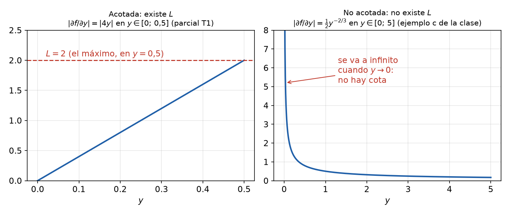
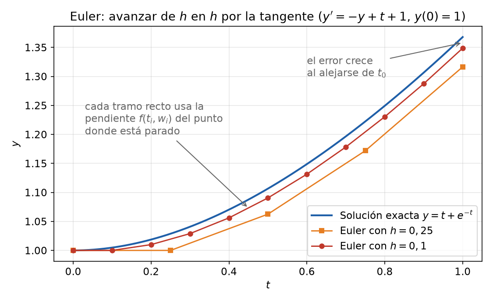
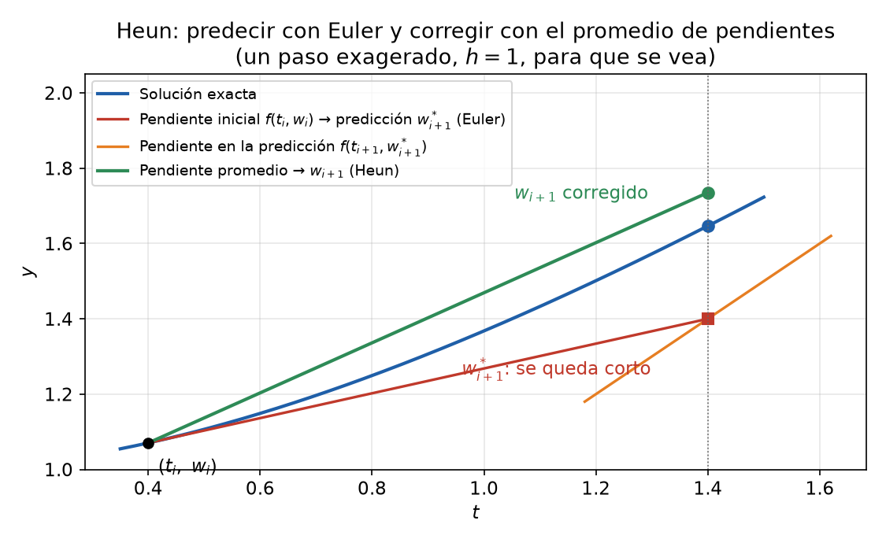
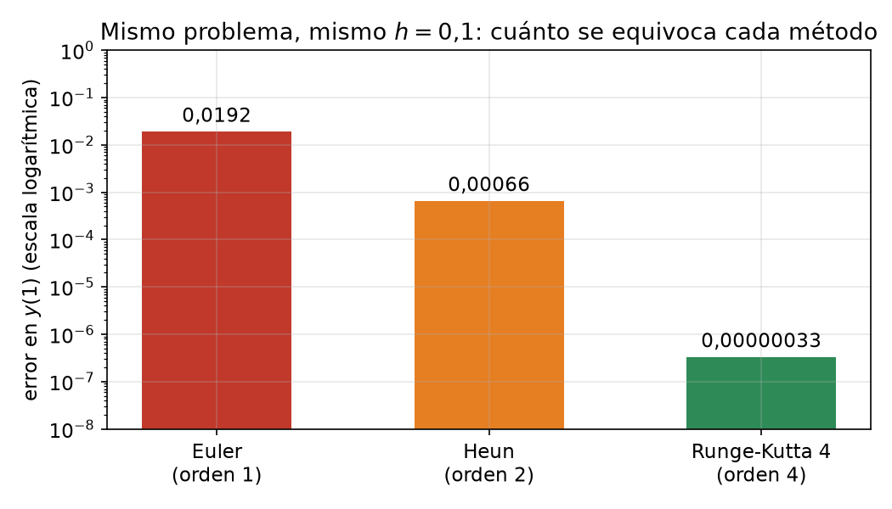

# Ecuaciones diferenciales desde cero

> Fuentes: `fuentes/clases/Ecuaciones Diferenciales/Clase - Metodos numericos para ecuaciones diferenciales.pdf` (PDF de clase, 11 p.), `fuentes/clases/Ecuaciones Diferenciales/Teorico catedra 2.6 - Ecuaciones diferenciales.pdf` (teórico de cátedra, 32 p.), `fuentes/clases/Ecuaciones Diferenciales/OneNote - Ecuaciones Diferenciales.pdf` (práctica manuscrita del profesor, 8 p.), transcripts `16-video-teorica-ecuaciones-diferenciales.json` (teórica, 1 h 07) y `17-video-practica-ecuaciones-diferenciales.json` (práctica, 1 h 14), `examenes/INDICE.md` y `examenes/resueltos/RESOLUCIONES-2025.md` (Ej5 de las 4 hojas 2025), apunte `06-practica-repaso-segundo-parcial.md` (ej. 12 y 13), `fuentes/Guia-ejercicios-parte-2-calculo-numerico.pdf` (ecuaciones diferenciales: ej. 1, 2, 4 a 15 y sus respuestas; no usé el 3 ni el 16) y `fuentes/AYUDAMEMORIA-OFICIAL.pdf` (pág. 4). Todos los números verificados con Python. Generado 2026-11-19.
>
> **Cómo usarla:** leé de arriba abajo. Los **Ejemplos guiados** están resueltos a la vista: rehacé cada cuenta con la calculadora. Los **Tu turno** se hacen en papel y **sin mirar**; la corrección está plegada (el enunciado va en texto plano en el título desplegable, porque ahí no se renderizan fórmulas). Las notas **En clase** son lo que dijo el profesor en los videos, con el minuto real del transcript (`teórica [mm:ss]` = video 16, `práctica [mm:ss]` = video 17). El repaso del 2P **no trae ningún ejercicio de iterar** Euler, Heun ni Runge-Kutta: la práctica de tablas a mano está toda acá (§4, §5 y §6). Tiempo total: ≈ 4 h con pausas.
>
> **Qué es de la cátedra y qué es mío:** métodos, fórmulas, criterios y ejemplos salen de las fuentes. Son agregados míos las explicaciones "en criollo", las cuentas intermedias que las fuentes hacen "en Excel", la columna $f(t_i,w_i)$ de las tablas (la cátedra muestra solo $t_i$, $w_i$, $w_{i+1}$), los gráficos, el aviso de la calculadora en radianes, una variante marcada como tal (Tu turno 5.4) y el puntaje orientativo del **Checkpoint**, que está armado con la ecuación de los ej. 2 y 9 de la guía.

---

## 0. Qué te toman: el Ej5 vale 2 puntos

El Ej5 del 2do parcial es **siempre** ecuaciones diferenciales. Te dan un **problema de valor inicial** (una ecuación $y'=f(t,y)$ y un dato $y(t_0)=\alpha$) y uno o dos ítems.

| Ítem | Qué te piden | Hojas 2025 | Frecuencia | Sección |
|---|---|---|---|---|
| **Constante de Lipschitz** | "Hallar si es posible la $L$ de Lipschitz" de $f(t,y)$ en el dominio dado | T1 a ($L=2$), T2 a ($L=1$) | **2/4** (+ ej. 13 del repaso 2026, $L=96$) | §3 |
| **Euler** | $y(0{,}3)$ con $h=0{,}1$: tabla de **3 filas** | T1 b, T2 b | **2/4** | §4 |
| **Heun** (Euler modificado) | $y(0{,}2)$ con $h=0{,}1$: tabla de **2 filas** | R1 (ejercicio entero; es el ej. 7 de la guía, textual) | 1/4 | §5 |
| **Runge-Kutta de orden 4** | $y(0{,}3)$ con $h=0{,}3$: **una sola fila** | R2 a | 1/4 | §6 |
| **Clasificar una fórmula** | ¿Explícita o implícita? ¿De cuántos pasos? No se calcula nada. | R2 b (+ ej. 12 del repaso 2026) | 1/4 | §7 |

T1/T2 = parcial Tema 1/2 · R1/R2 = 1er/2do recuperatorio.

**Lectura rápida:** en el **parcial** cayó dos veces lo mismo: **(a) Lipschitz + (b) Euler con 3 pasos**. En los **recuperatorios** suben de método (Heun, Runge-Kutta 4) y agregan la pregunta corta de clasificar. Todo es mecánico: si sabés armar la tabla y no te equivocás con la calculadora, son 2 puntos baratos.

> **En clase:** "en los parciales se suele tomar más que nada aplicaciones de los métodos que vemos, que son los de Euler, los de Heun y el de Runge-Kutta. En los finales se suele tomar un poquito más teórico" (práctica [00:00]–[00:31]). Los verdadero/falso de teoría (§8) "capaz también aparecen como parte A o parte B en ejercicio parcial, son muy cortitos" (práctica [51:31]).

## 1. La idea en criollo

Una **ecuación diferencial** de las nuestras te dice **cuánto vale la pendiente** de una función desconocida $y(t)$ en cada punto: $y'=f(t,y)$. El problema: la pendiente depende de la propia $y$ que no conocés.

Hay infinitas curvas que cumplen la ecuación (para $y'=2t$ son todas las $y=t^2+C$). El **valor inicial** $y(a)=\alpha$ elige una sola: la que pasa por ese punto (teórica [01:33]). Las dos cosas juntas forman el **problema de valor inicial (PVI)**, que la cátedra escribe así:

$$
\begin{cases} y' = f(t,y) \\ y(a)=\alpha \end{cases}\qquad t\in[a,b],\quad y\in[c,d]
$$

Muchas veces esa $y(t)$ no se puede despejar con una fórmula. Entonces en vez de buscar la función, buscamos **una tabla de valores**: arrancamos del punto que nos dan y avanzamos de a saltitos de tamaño $h$ (el **tamaño de paso**, siempre es dato), usando la pendiente $f$ para estimar cuánto sube o baja la curva en cada salto.

$$
t_0=a,\quad t_1=t_0+h,\quad t_2=t_1+h,\ \dots\qquad t_{i+1}-t_i=h
$$

> **En clase:** "nos van a dar un valor inicial, ponele $y(0)=1$, nos van a dar que $h$ vale $0{,}1$ y nos preguntan cuánto vale $y(0{,}3)$. Entonces van a ir saltando desde $y(0)$ de $h$ en $h$: $y(0{,}1)$, $y(0{,}2)$ y después $y(0{,}3)$" (teórica [03:08]).

**Notación de la cátedra (usala igual en el examen):**

- $y(t_i)$ o $y_i$: el valor **exacto** de la solución en $t_i$ (casi nunca lo conocés).
- $w_i$: el valor **aproximado** que calcula el método. "El exacto es la $y$, el aproximado es la $w$" (teórica [04:10]).
- $w_0=\alpha$: el dato inicial. Es el único $w$ que es exacto (teórica [29:46]).
- **Cantidad de filas de la tabla** $=\dfrac{t_{\text{final}}-t_0}{h}$. De $0$ a $0{,}3$ con $h=0{,}1$ son 3 filas.

Los tres métodos que se toman hacen lo mismo con distinta puntería:

| Método | Cómo estima el salto | Orden | Clasificación (§7) |
|---|---|---|---|
| **Euler** (§4) | con la pendiente del punto donde está parado | 1 | explícito, de un paso |
| **Heun** = Euler modificado (§5) | con el promedio de dos pendientes (inicio y fin del salto) | 2 | implícito (predictor-corrector), de un paso |
| **Runge-Kutta 4** (§6) | con un promedio pesado de cuatro pendientes | 4 | explícito, de un paso |

**Antes de arrancar cualquier ejercicio: despejá $y'$.** La $f(t,y)$ es "lo que queda del otro lado cuando $y'$ está sola". En el T1 2025 te dieron $y'(t)+2y(t)^2=\dfrac{1}{1+t^2}$: primero se escribe $y'=\dfrac{1}{1+t^2}-2y^2$ y recién después se trabaja.

> **En clase:** "por más que sea fácil, no se manden a hacer nada sin tener la $y'$ despejada" (práctica [40:49]).

**Calculadora (agregado mío):** ponela en **radianes**. Los PVI del T2 y del R2 2025 tienen $\operatorname{sen}(t)$ y $\cos(t)$ con $t=0{,}1;\ 0{,}2;\ 0{,}3$: en grados dan cualquier cosa.

## 2. Qué tenés en el ayudamemoria y qué va de memoria

La pág. 4 del ayudamemoria oficial tiene un bloque "Resolución numérica de ecuaciones diferenciales" con **cuatro fórmulas**:

- 📄 **Euler:** $w_{i+1}=w_i+h\cdot f(t_i,w_i)$ con $w_0=y_0$.
- 📄 **Runge-Kutta de 2do orden:** $w_{i+1}=w_i+h\,f\!\left(t_i+\frac h2,\ w_i+\frac h2 f(t_i,w_i)\right)$. **No se toma** (§9).
- 📄 **Heun**, escrita en una sola línea: $w_{i+1}=w_i+\frac h2\left[f(t_i,w_i)+f\big(t_i+h,\ w_i+h\,f(t_i,w_i)\big)\right]$. Es la misma de la clase: lo que está adentro del segundo $f$, $w_i+h\,f(t_i,w_i)$, es el $w^*_{i+1}$ de Euler (§5).
- 📄 **Runge-Kutta de 4to orden:** $w_{i+1}=w_i+\frac16(k_1+2k_2+2k_3+k_4)$ con las cuatro fórmulas de $k_1\dots k_4$.

**No está** y va de memoria:

- 🧠 **Lipschitz:** la definición $\lvert f(t,y_1)-f(t,y_2)\rvert\le L\,\lvert y_1-y_2\rvert$ y el atajo $L=\max\left\lvert\dfrac{\partial f}{\partial y}\right\rvert$ en el dominio.
- 🧠 **Problema bien planteado** (solución que existe y es única) = $f$ continua en el rectángulo + cumple Lipschitz.
- 🧠 **Clasificación:** explícita / implícita (¿aparece $w_{i+1}$ a la derecha?) y cantidad de pasos (contar hacia atrás desde $w_i$ hasta el más viejo).
- 🧠 Que Heun = **Euler modificado**, que es **implícito** y se usa como **corrector** con Euler de **predictor**.
- 🧠 **Órdenes:** Euler 1, Heun 2, Runge-Kutta 4 ⇒ si $h$ baja a la mitad, el error global baja a $\frac12$, $\frac14$ y $\frac1{16}$.

> **En clase:** "cuando yo hice esta materia como alumno no teníamos hoja de fórmulas, pero si me tomaban Runge-Kutta te lo daban, porque son 800.000 fórmulas y es muy fácil equivocarse. Igual ustedes tienen hoja de fórmulas, así que esto es copiarlo y hacerlo" (teórica [55:55]).

---

## 3. Lipschitz: ¿el problema está bien planteado? (ítem a, 2/4)

### 3.1 La idea

Antes de calcular nada, la pregunta es si el PVI **tiene solución y es una sola**. Cuando pasa eso, la cátedra dice que el problema está **bien planteado**. Las dos condiciones (PDF de clase, pág. 1):

1. $f(t,y)$ es **continua** en el rectángulo $R=\{(t,y)\ /\ t\in[a,b]\ \wedge\ y\in[c,d]\}$.
2. $f$ cumple la **condición de Lipschitz** en $R$.

La condición de Lipschitz dice que $f$ no puede cambiar "infinitamente rápido" cuando movés la $y$: existe un número $L>0$ tal que

$$
\lvert f(t,y_1)-f(t,y_2)\rvert \le L\cdot\lvert y_1-y_2\rvert
$$

$L$ es la **constante (o número) de Lipschitz**: una cota superior de la pendiente de $f$ respecto de $y$. Por el teorema del valor medio, esa pendiente es la derivada parcial, y de ahí sale el atajo (PDF de clase, pág. 2; teórico, pág. 160):

$$
L=\max_{(t,y)\in R}\left\lvert\frac{\partial f(t,y)}{\partial y}\right\rvert
$$

> **En clase:** "¿cómo sé si un problema está bien planteado? Que es una pregunta de examen. El chequeo de estas condiciones, sobre todo de la segunda" (teórica [04:48]). Y el máximo es sobre **las dos** variables: "no solo se usa el máximo de $t$, sino que también se usa el máximo de $y$" (teórica [09:26]).

**Qué garantiza y qué no** (anotación del OneNote y práctica [01:05]): Lipschitz es condición **suficiente pero no necesaria**. Si se cumple, el PVI tiene solución única y los métodos numéricos **convergen**. Si no se cumple, "puede que converjan o no".

### 3.2 Receta (por la derivada parcial, la que prefiere el profesor)

1. **Despejá** $y'$ para tener $f(t,y)$.
2. **Derivá respecto de $y$** tratando a $t$ como constante. Todo término sin $y$ desaparece.
3. Tomá **módulo**.
4. Buscá el **máximo** de ese módulo en el dominio: mirá cada factor por separado y elegí el valor de $t$ y de $y$ que lo hace más grande.
   - Factor creciente ($t$, $y$, $y^2$, $e^t$): el extremo de **mayor módulo**.
   - Variable en el **denominador** ($\frac1t$, $\frac1{\sqrt t}$): el valor **más chico** (teórica [15:43]).
   - Seno o coseno: fijate si el intervalo incluye el punto donde vale $\pm1$; no alcanza con probar los extremos.
5. **Concluí** con una frase: "$\left\lvert\frac{\partial f}{\partial y}\right\rvert$ está acotada en $R$ ⇒ $f$ cumple Lipschitz con $L=\dots$; como además $f$ es continua en $R$, el problema está bien planteado (solución única)".

Cualquier $L>0$ real sirve: "lo importante es que $L$ sea mayor a 0; después si es 0,1 o 100 millones no importa" (práctica [07:28]).

### 3.3 La otra forma: por la definición (la resta)

Escribís $\lvert f(t,y_1)-f(t,y_2)\rvert$ (la función dos veces: una con $y_1$ y otra con $y_2$), operás hasta que quede **algo** $\cdot\ \lvert y_1-y_2\rvert$, y acotás ese "algo". Da el mismo $L$. Si te piden "de dos formas" (como en el ej. 13 del repaso), hacés las dos.

> **En clase:** "yo usé las dos, pero si tengo que elegir una prefiero la derivada parcial, a mí se me hace más corta. Cualquiera de las dos sirve y tienen que llegar al mismo resultado" (práctica [12:43]).

### 3.4 Cuándo **no** se puede

- **La derivada no está acotada** en el dominio (se va a infinito en algún punto): no existe $L$, no cumple Lipschitz.
- **Falta el intervalo de $y$ y la derivada depende de $y$:** no se puede calcular el máximo, así que no se puede afirmar que esté bien planteado (práctica [09:05]–[10:07]).
- **El intervalo de $t$ sí se puede deducir** cuando no te lo dan: va del $t$ inicial al $t$ donde te piden la solución. "El de la $t$ lo podés llegar a deducir; el de la $y$, difícilmente" (práctica [50:27]).

Por eso el "si es posible" de los enunciados: en el T1 2025 la derivada dependía de $y$ y te dieron "$y\in[0;\,0{,}5]$"; en el T2 la derivada dependía solo de $t$ y alcanzó con $t\in[0;2]$.

### Ejemplo guiado 1: $f(t,y)=e^{-2t}-2y$ en $0\le t\le3$, $0\le y\le5$ (PDF de clase, ejemplo a)

**Por la definición:**

$$
\lvert f(t,y_1)-f(t,y_2)\rvert=\lvert e^{-2t}-2y_1-e^{-2t}+2y_2\rvert=\lvert -2\rvert\cdot\lvert y_1-y_2\rvert
$$

Lo que acompaña a $\lvert y_1-y_2\rvert$ es $2$ ⇒ $L=2$.

**Por la derivada parcial:** $e^{-2t}$ no tiene $y$, su derivada es 0.

$$
\left\lvert\frac{\partial f}{\partial y}\right\rvert=\lvert -2\rvert=2\quad\Longrightarrow\quad L=2
$$

### Ejemplo guiado 2: $f(t,y)=2ty^2$ en el mismo rectángulo (PDF de clase, ejemplo b)

**Por la derivada parcial:**

$$
\left\lvert\frac{\partial f}{\partial y}\right\rvert=\lvert 4ty\rvert\le 4\cdot3\cdot5=60\quad\Longrightarrow\quad L=60
$$

El producto es máximo con $t$ en su máximo ($3$) e $y$ en su máximo ($5$).

**Por la definición** (diferencia de cuadrados):

$$
\lvert 2ty_1^2-2ty_2^2\rvert=\lvert 2t\rvert\cdot\lvert y_1+y_2\rvert\cdot\lvert y_1-y_2\rvert\le 6\cdot10\cdot\lvert y_1-y_2\rvert=60\,\lvert y_1-y_2\rvert
$$

> **En clase:** para acotar $\lvert y_1+y_2\rvert$ "vamos a pensar como que fuera $2y$, porque $y_1$ e $y_2$ van a tomar el mismo valor [el del extremo]": $5+5=10$ (teórica [14:08]).

### Ejemplo guiado 3: $f(t,y)=\frac32\,y^{1/3}$ en el mismo rectángulo (PDF de clase, ejemplo c)

$$
\frac{\partial f}{\partial y}=\frac12\,y^{-2/3}=\frac{1}{2\sqrt[3]{y^2}}
$$

El dominio incluye $y=0$ y ahí la derivada **se va a infinito**: no está acotada, no existe $L$. **No cumple Lipschitz** (panel derecho del gráfico de arriba).

> **En clase:** "yo no puedo plantear esto como menor a $L\cdot\lvert y_1-y_2\rvert$ porque este valor vale infinito, no lo puedo acotar con ningún número real $L$" (teórica [16:46]).

### Tu turno 3

<strong>Tu turno 3.1 (parcial 2025, Tema 1, ítem a).</strong> PVI y′(t) + 2y(t)² = 1/(1+t²), t ∈ [0; 1], y(0) = 0. Sabiendo que y ∈ [0; 0,5], hallá si es posible la constante de Lipschitz.

$$
y'(t)+2y(t)^2=\frac{1}{1+t^2},\qquad t\in[0;1],\quad y(0)=0,\quad y\in[0;\,0{,}5]
$$

<strong>Resolución</strong>

**Paso 1: despejar.**

$$
y'=f(t,y)=\frac{1}{1+t^2}-2y^2
$$

**Paso 2: derivar respecto de $y$.** El término $\frac{1}{1+t^2}$ no tiene $y$.

$$
\frac{\partial f}{\partial y}=-4y
$$

**Paso 3: módulo y máximo** en $y\in[0;\,0{,}5]$. $\lvert 4y\rvert$ crece con $y$: máximo en $y=0{,}5$.

$$
L=\max_{0\le y\le 0{,}5}\lvert -4y\rvert=4\cdot0{,}5=2
$$

**Paso 4: conclusión.** $f$ es continua (el denominador $1+t^2$ nunca se anula) y $\left\lvert\frac{\partial f}{\partial y}\right\rvert\le2$ ⇒ **sí es posible, $L=2$**. El problema está bien planteado.

La resolución oficial es una sola línea: $\left\lvert\frac{\partial f(t,y)}{\partial y}\right\rvert=\lvert 4y\rvert=L$ con $y\in[0;\,0{,}5]$ ⇒ $L=2$.

**Por la definición (control):** $\lvert -2y_1^2+2y_2^2\rvert=2\,\lvert y_1+y_2\rvert\,\lvert y_1-y_2\rvert\le2\cdot(0{,}5+0{,}5)\cdot\lvert y_1-y_2\rvert$ ⇒ $L=2$ ✔.

<strong>Tu turno 3.2 (parcial 2025, Tema 2, ítem a).</strong> PVI y′ = y·sen(t), y(0) = 1, t ∈ [0; 2]. Calculá si es posible la L de Lipschitz.

<strong>Resolución</strong>

**Paso 1:** ya está despejada, $f(t,y)=y\cdot\operatorname{sen}(t)$.

**Paso 2:** para $y$, $\operatorname{sen}(t)$ es una constante que multiplica.

$$
\frac{\partial f}{\partial y}=\operatorname{sen}(t)
$$

**Paso 3:** la derivada **no depende de $y$**, así que no hace falta intervalo de $y$. Máximo de $\lvert\operatorname{sen}t\rvert$ en $[0;2]$: el seno vale 1 en $t=\frac{\pi}{2}\approx1{,}571$, que **está adentro** de $[0;2]$.

$$
L=\max_{0\le t\le2}\lvert\operatorname{sen}t\rvert=1
$$

**Resultado: $L=1$** (coincide con la resolución oficial).

**Trampa:** si solo probás los extremos, $\operatorname{sen}(0)=0$ y $\operatorname{sen}(2)\approx0{,}909$, y contestás $0{,}909$. Con senos y cosenos mirá si el pico cae adentro.

<strong>Tu turno 3.3 (guía ej. 1, resuelto en el OneNote).</strong> ¿Está bien planteado el PVI? a) y′ = y·cos(x), x ∈ [0,1], y(0)=1 · b) y′ = (2/x)·y + eˣ·x², x ∈ [1,2], y(1)=0 · c) y′ = 1 − y, x ∈ [0,1], y(0)=0 · d) y′ = −x·y + 4x/y, x ∈ [0,1], y(0)=1 · e) y′ = x²·y + 1, x ∈ [0,1], y(0)=1

$$
\text{b) } y'=\frac2x\,y+e^x x^2\qquad\qquad \text{d) } y'=-xy+\frac{4x}{y}
$$

<strong>Resolución</strong>

**a)** $\frac{\partial f}{\partial y}=\cos x$. En $[0,1]$ el coseno es máximo en $x=0$: $L=1$ ✔. Por la definición: $\lvert y_1\cos x-y_2\cos x\rvert=\lvert\cos x\rvert\cdot\lvert y_1-y_2\rvert\le1\cdot\lvert y_1-y_2\rvert$.

**b)** El término $e^x x^2$ no tiene $y$. $\left\lvert\frac{\partial f}{\partial y}\right\rvert=\left\lvert\frac2x\right\rvert$: la $x$ está en el denominador, el máximo es en el $x$ **más chico**, $x=1$: $L=2$ ✔.

**c)** $\left\lvert\frac{\partial f}{\partial y}\right\rvert=\lvert-1\rvert$: $L=1$ ✔.

**d)** $\frac{\partial f}{\partial y}=-x-\frac{4x}{y^2}$. Depende de $y$ y **no hay intervalo para $y$**: no se puede calcular el máximo ⇒ **no se puede asegurar** que esté bien planteado ✗. (Si el intervalo de $y$ incluyera el 0, habría una división por cero.) Por la definición se llega a lo mismo después de muchas cuentas: $\left\lvert -x-\frac{4x}{y_1y_2}\right\rvert\cdot\lvert y_1-y_2\rvert$.

**e)** $\left\lvert\frac{\partial f}{\partial y}\right\rvert=x^2$, máximo en $x=1$: $L=1$ ✔.

**Respuesta de la guía:** bien planteados y con solución única a) $L=1$, b) $L=2$, c) $L=1$, e) $L=1$.

> **En clase:** sobre el d), "fue bastante incordioso hacer todos estos pasos desde la resta […] si hubieran ido directamente por el lado de la derivada parcial ya les quedaba" (práctica [10:07]).

<strong>Tu turno 3.4 (guía ej. 2, resuelto en el OneNote).</strong> La ecuación y′(t) = −t·y con y(0) = 1 en R = {0 ≤ t ≤ 3, 0 ≤ y ≤ 2}: a) cumple Lipschitz con L = 2 · b) con L = 3 · c) con L = 6 · d) no cumple.

<strong>Resolución</strong>

$$
\left\lvert\frac{\partial f}{\partial y}\right\rvert=\lvert -t\rvert=t\le3
$$

Como $0\le t\le3$, el máximo es $3$. **Opción b), $L=3$.**

**Distractores:** el 2 es el máximo de $y$ (no interviene, porque al derivar respecto de $y$ la $y$ desaparece) y el 6 es $3\cdot2$ (máximo de $\lvert f\rvert$, no de su derivada).

<strong>Tu turno 3.5 (repaso 2026, ej. 13).</strong> Hallá de dos formas la constante de Lipschitz de f(t,y) = 2·t^(−1/2)·y³ en R = {1 ≤ t ≤ 4, −4 ≤ y ≤ 3}.

$$
f(t,y)=\frac{2}{\sqrt t}\,y^3,\qquad R=\{(t,y)\ /\ 1\le t\le4\ \wedge\ -4\le y\le3\}
$$

<strong>Resolución</strong>

**Forma 1, derivada parcial.**

$$
\left\lvert\frac{\partial f}{\partial y}\right\rvert=\left\lvert\frac{6}{\sqrt t}\,y^2\right\rvert
$$

$\frac{6}{\sqrt t}$ es máximo en el $t$ **más chico** ($t=1$, vale 6). $y^2$ es máximo en el extremo de **mayor módulo**: $y=-4$ ($y^2=16$), no $y=3$.

$$
L=6\cdot16=96
$$

**Forma 2, definición.** Con $y_1^3-y_2^3=(y_1-y_2)(y_1^2+y_1y_2+y_2^2)$:

$$
\left\lvert\frac{2}{\sqrt t}\right\rvert\cdot\lvert y_1^2+y_1y_2+y_2^2\rvert\cdot\lvert y_1-y_2\rvert\le\frac{2}{\sqrt1}\cdot(16+16+16)\cdot\lvert y_1-y_2\rvert=96\,\lvert y_1-y_2\rvert
$$

**Resultado: $L=96$** por las dos formas. La resolución completa del profesor está en el apunte 06 (ej. 13).

**Error típico:** tomar $y=3$ porque "es el más grande" ⇒ $6\cdot9=54$. Lo que importa es el módulo.

<strong>Tu turno 3.6 (guía ej. 11 a, y teórico pág. 174 a).</strong> a) t·y′(t) + y(t) = 0 con y(1) = 1: verificá Lipschitz para t ∈ [1,2] e indicá si tiene solución única. b) y′(t) = 2y(t) + t² − 2t con y(0) = 1: verificá Lipschitz.

<strong>Resolución</strong>

**a) Despejar primero:** $y'=-\dfrac{y}{t}$.

$$
\left\lvert\frac{\partial f}{\partial y}\right\rvert=\left\lvert-\frac1t\right\rvert=\frac1t\le\frac11=1\quad(t\in[1,2])
$$

$L=1$ (respuesta de la guía). $f$ es continua en $[1,2]$ porque $t\ne0$ ⇒ **tiene solución única**.

**b)** Los términos $t^2-2t$ no tienen $y$.

$$
\left\lvert\frac{\partial f}{\partial y}\right\rvert=\lvert2\rvert\quad\Longrightarrow\quad L=2
$$

Por la definición (apéndice del teórico): $\lvert(2y_1+t^2-2t)-(2y_2+t^2-2t)\rvert=2\,\lvert y_1-y_2\rvert$.

---

## 4. Euler: el que más se toma (ítem b, 2/4)

### 4.1 La idea

Estás parado en $(t_i,w_i)$. La ecuación te dice la pendiente ahí: $f(t_i,w_i)$. Euler supone que **esa pendiente se mantiene durante todo el salto** y avanza en línea recta:

$$
\text{valor nuevo}=\text{valor actual}+\text{paso}\times\text{pendiente}
$$

Sale de cortar la serie de Taylor de $y(t)$ en la derivada primera (por eso también se llama "Taylor de orden 1"; PDF de clase, pág. 4). Como $y$ en realidad se va curvando, cada salto mete un error, y los errores se acumulan.

### 4.2 La fórmula (está en el ayudamemoria)

$$
\begin{cases} w_{i+1}=w_i+h\cdot f(t_i,w_i) \\ w_0=\alpha \end{cases}
$$

### 4.3 Receta

1. **Despejá** $y'=f(t,y)$ y anotá $h$, $t_0$, $w_0$.
2. Escribí la **fórmula ya particularizada**: en $f$, donde dice $y$ va $w_i$ y donde dice $t$ va $t_i$.
3. Armá la **tabla** con una fila por salto. Columnas: $t_i$ · $w_i$ · $f(t_i,w_i)$ · $w_{i+1}$.
4. Llená **de a una fila**. El $w_{i+1}$ de una fila es el $w_i$ de la siguiente; el $t$ sube de $h$ en $h$.
5. Parás cuando el $w_{i+1}$ corresponde al $t$ pedido. **Señalá el resultado**: "$y(0{,}3)\approx\dots$".

**Calculadora:** guardá cada $w$ con todos los decimales (tecla `Ans` o una memoria) y redondeá solo al escribir.

> **En clase:** a la pregunta de qué hay que dejar escrito en el parcial: "en algún lugar me escribiría la definición de la función, para tenerla cerca, el valor inicial, capaz la fórmula de Euler […] en definitiva quiero que tengan esto [la tabla]. Cuanto más detalle tenga, tendría otras herramientas a la hora de corregir: si yo veo números así no tengo ni idea de dónde lo sacó, pero si veo un poquito más de detalle puedo decir 'ah, pobre, se equivocó porque puso menos en vez de más'" (práctica [20:06]–[21:07]).
>
> **Decimales:** "4 o 5 está bien. Si no aclara nada el ejercicio, con 4 o 5 y redondeando, estamos" (práctica [19:34]). Las resoluciones oficiales muestran 7 u 8 porque salen de una planilla.

### Ejemplo guiado 4: $y'=-y+t+1$, $y(0)=1$; hallar $y(0{,}4)$ con $h=0{,}1$ (PDF de clase)

Es **el** ejemplo de la cátedra: lo resuelven con los tres métodos. Su solución exacta es $y=t+e^{-t}$ (sirve para comparar) y cumple Lipschitz con $L=1$, porque $\left\lvert\frac{\partial f}{\partial y}\right\rvert=\lvert-1\rvert$.

**Fórmula particularizada:**

$$
\begin{cases} w_{i+1}=w_i+0{,}1\cdot(-w_i+t_i+1) \\ w_0=1 \end{cases}
$$

**Fila por fila** ($0{,}4/0{,}1=4$ filas):

$$
\begin{gathered}
w_1=1+0{,}1\cdot(-1+0+1)=1+0{,}1\cdot0=1 \\[6pt]
w_2=1+0{,}1\cdot(-1+0{,}1+1)=1+0{,}1\cdot0{,}1=1{,}01 \\[6pt]
w_3=1{,}01+0{,}1\cdot(-1{,}01+0{,}2+1)=1{,}01+0{,}1\cdot0{,}19=1{,}029 \\[6pt]
w_4=1{,}029+0{,}1\cdot(-1{,}029+0{,}3+1)=1{,}029+0{,}1\cdot0{,}271=1{,}0561
\end{gathered}
$$

| $i$ | $t_i$ | $w_i$ | $f(t_i,w_i)$ | $w_{i+1}=w_i+h\cdot f$ |
|---|---|---|---|---|
| 0 | $0$ | $1$ | $0$ | $1$ |
| 1 | $0{,}1$ | $1$ | $0{,}1$ | $1{,}01$ |
| 2 | $0{,}2$ | $1{,}01$ | $0{,}19$ | $1{,}029$ |
| 3 | $0{,}3$ | $1{,}029$ | $0{,}271$ | $\mathbf{1{,}0561}$ |

**Resultado:** $y(0{,}4)\approx1{,}0561$. El exacto es $0{,}4+e^{-0{,}4}=1{,}07032$: error $\approx0{,}014$, coincide un solo decimal.

**Cómo leer la tabla de la cátedra.** En el PDF y en las resoluciones de parcial la tabla tiene tres columnas: $t_i$, $w_i$, $w_{i+1}$. El valor de $y(0{,}4)$ es el $w_{i+1}$ de la fila $t_i=0{,}3$ (o, lo que es lo mismo, el $w_i$ de la fila $t_i=0{,}4$). **No hagas una fila de más**: la fila $t_i=0{,}4$ calcula $y(0{,}5)$.

> **En clase:** el PDF trae una columna **ETL** (error de truncamiento local: "el error absoluto entre mi aproximación y mi valor exacto"), pero "esta columna no siempre la tienen ustedes, la agregué por la parte teórica; en general no la van a trabajar" (teórica [30:16]). Y el error crece al alejarte del dato: "cuanto más cerquita esté de tu valor inicial, obviamente va a ser mejor" (teórica [33:27]).

### Tu turno 4

<strong>Tu turno 4.1 (parcial 2025, Tema 1, ítem b).</strong> PVI y′(t) + 2y(t)² = 1/(1+t²), y(0) = 0. Hallá y(0,3) usando el método de Euler con h = 0,1.

$$
y'(t)+2y(t)^2=\frac{1}{1+t^2},\qquad y(0)=0,\qquad h=0{,}1
$$

<strong>Resolución</strong>

**Paso 1: despejar.** $f(t,y)=\dfrac{1}{1+t^2}-2y^2$, $t_0=0$, $w_0=0$.

**Paso 2: fórmula.**

$$
w_{i+1}=w_i+0{,}1\cdot\left(\frac{1}{1+t_i^2}-2w_i^2\right)
$$

**Paso 3: tres filas.**

$$
\begin{gathered}
w_1=0+0{,}1\cdot\left(\frac{1}{1+0}-2\cdot0^2\right)=0{,}1 \\[6pt]
w_2=0{,}1+0{,}1\cdot\left(\frac{1}{1{,}01}-2\cdot0{,}1^2\right)=0{,}1+0{,}1\cdot0{,}970099=0{,}1970099 \\[6pt]
w_3=0{,}1970099+0{,}1\cdot\left(\frac{1}{1{,}04}-2\cdot0{,}1970099^2\right)=0{,}1970099+0{,}1\cdot0{,}8839127=0{,}2854012
\end{gathered}
$$

| $i$ | $t_i$ | $w_i$ | $f(t_i,w_i)$ | $w_{i+1}=w_i+h\cdot f$ |
|---|---|---|---|---|
| 0 | $0$ | $0$ | $1$ | $0{,}1$ |
| 1 | $0{,}1$ | $0{,}1$ | $0{,}970099$ | $0{,}1970099$ |
| 2 | $0{,}2$ | $0{,}1970099$ | $0{,}8839127$ | $\mathbf{0{,}2854012}$ |

**Resultado:** $y(0{,}3)\approx0{,}28540$ (oficial: $0{,}28540117$ ✔).

**Ojo:** el $2y^2$ pasa restando, y es $2\cdot w^2$, no $(2w)^2$.

<strong>Tu turno 4.2 (parcial 2025, Tema 2, ítem b).</strong> PVI y′ = y·sen(t), y(0) = 1. Hallá y(0,3) usando el método de Euler con h = 0,1.

<strong>Resolución</strong>

$f(t,y)=y\cdot\operatorname{sen}(t)$, $t_0=0$, $w_0=1$. **Calculadora en radianes.**

$$
\begin{gathered}
w_{i+1}=w_i+0{,}1\cdot w_i\cdot\operatorname{sen}(t_i) \\[6pt]
w_1=1+0{,}1\cdot1\cdot\operatorname{sen}(0)=1 \\[6pt]
w_2=1+0{,}1\cdot1\cdot\operatorname{sen}(0{,}1)=1+0{,}1\cdot0{,}0998334=1{,}0099833 \\[6pt]
w_3=1{,}0099833+0{,}1\cdot1{,}0099833\cdot\operatorname{sen}(0{,}2)=1{,}0099833+0{,}1\cdot0{,}2006527=1{,}0300486
\end{gathered}
$$

| $i$ | $t_i$ | $w_i$ | $f(t_i,w_i)$ | $w_{i+1}=w_i+h\cdot f$ |
|---|---|---|---|---|
| 0 | $0$ | $1$ | $0$ | $1$ |
| 1 | $0{,}1$ | $1$ | $0{,}0998334$ | $1{,}0099833$ |
| 2 | $0{,}2$ | $1{,}0099833$ | $0{,}2006527$ | $\mathbf{1{,}0300486}$ |

**Resultado:** $y(0{,}3)\approx1{,}03005$ (oficial: $1{,}030048613$ ✔).

**Control de radianes:** si te da $w_2=1{,}00017$, estabas en grados.

<strong>Tu turno 4.3 (guía ej. 4, resuelto en Excel en la práctica).</strong> Resolvé por Euler: a) y′ = y + 1, y(0) = 0, y(0,1) = ?, h = 0,02 · b) y′ = 2(y − 1)/t, y(1) = 2, y(1,5) = ?, h = 0,1 · c) y′ − y = 2t − t², y(0) = 1, y(1) = ?, h = 0,2

$$
\text{b) } y'=\frac{2\,(y-1)}{t}
$$

<strong>Resolución</strong>

**a)** $f=y+1$ (no tiene $t$). $w_{i+1}=w_i+0{,}02\cdot(w_i+1)$. Cinco filas ($0{,}1/0{,}02$).

| $i$ | $t_i$ | $w_i$ | $f(t_i,w_i)$ | $w_{i+1}=w_i+h\cdot f$ |
|---|---|---|---|---|
| 0 | $0$ | $0$ | $1$ | $0{,}02$ |
| 1 | $0{,}02$ | $0{,}02$ | $1{,}02$ | $0{,}0404$ |
| 2 | $0{,}04$ | $0{,}0404$ | $1{,}0404$ | $0{,}061208$ |
| 3 | $0{,}06$ | $0{,}061208$ | $1{,}061208$ | $0{,}0824322$ |
| 4 | $0{,}08$ | $0{,}0824322$ | $1{,}0824322$ | $\mathbf{0{,}1040808}$ |

$y(0{,}1)\approx0{,}10408$ (guía: $0{,}1040808$ ✔).

**b)** $w_{i+1}=w_i+0{,}1\cdot\dfrac{2\,(w_i-1)}{t_i}$. Arranca en $t_0=1$ (no en 0) con $w_0=2$. Cinco filas.

| $i$ | $t_i$ | $w_i$ | $f(t_i,w_i)$ | $w_{i+1}=w_i+h\cdot f$ |
|---|---|---|---|---|
| 0 | $1$ | $2$ | $2$ | $2{,}2$ |
| 1 | $1{,}1$ | $2{,}2$ | $2{,}1818182$ | $2{,}4181818$ |
| 2 | $1{,}2$ | $2{,}4181818$ | $2{,}3636364$ | $2{,}6545455$ |
| 3 | $1{,}3$ | $2{,}6545455$ | $2{,}5454545$ | $2{,}9090909$ |
| 4 | $1{,}4$ | $2{,}9090909$ | $2{,}7272727$ | $\mathbf{3{,}1818182}$ |

$y(1{,}5)\approx3{,}18182$ (guía: $3{,}18181818$ ✔).

**c) Despejar:** $y'=2t-t^2+y$. $w_{i+1}=w_i+0{,}2\cdot(2t_i-t_i^2+w_i)$. Cinco filas.

| $i$ | $t_i$ | $w_i$ | $f(t_i,w_i)$ | $w_{i+1}=w_i+h\cdot f$ |
|---|---|---|---|---|
| 0 | $0$ | $1$ | $1$ | $1{,}2$ |
| 1 | $0{,}2$ | $1{,}2$ | $1{,}56$ | $1{,}512$ |
| 2 | $0{,}4$ | $1{,}512$ | $2{,}152$ | $1{,}9424$ |
| 3 | $0{,}6$ | $1{,}9424$ | $2{,}7824$ | $2{,}49888$ |
| 4 | $0{,}8$ | $2{,}49888$ | $3{,}45888$ | $\mathbf{3{,}190656}$ |

$y(1)\approx3{,}190656$ (guía ✔). La exacta es $y=t^2+e^t$, o sea $y(1)=1+e=3{,}71828$: con $h=0{,}2$ Euler le erra por $0{,}53$.

> **En clase:** "la primera parte de Euler, el $w_i$ más $h$, siempre lo mismo. Lo que va a cambiar es la definición de la función […] es el más fácil de los tres" (práctica [19:02]–[19:34]).

<strong>Tu turno 4.4 (guía ej. 11 b y teórico pág. 169 a).</strong> a) t·y′ + y = 0, y(1) = 1: obtené y(1,2) e y(1,4) por Euler con h = 0,2. b) y′ = 0,002·(1 − y), y(0) = 0,01: calculá y(4) por Euler con h = 2.

<strong>Resolución</strong>

**a)** $f=-\dfrac{y}{t}$, $t_0=1$, $w_0=1$.

| $i$ | $t_i$ | $w_i$ | $f(t_i,w_i)$ | $w_{i+1}=w_i+h\cdot f$ |
|---|---|---|---|---|
| 0 | $1$ | $1$ | $-1$ | $0{,}8$ |
| 1 | $1{,}2$ | $0{,}8$ | $-0{,}6666667$ | $\mathbf{0{,}6666667}$ |

$y(1{,}2)\approx0{,}8$ e $y(1{,}4)\approx0{,}66667$ (guía ✔). Exactos ($y=1/t$): $0{,}83333$ y $0{,}71429$.

**b)** $f=0{,}002\,(1-y)$, $h=2$, dos filas.

| $i$ | $t_i$ | $w_i$ | $f(t_i,w_i)$ | $w_{i+1}=w_i+h\cdot f$ |
|---|---|---|---|---|
| 0 | $0$ | $0{,}01$ | $0{,}00198$ | $0{,}01396$ |
| 1 | $2$ | $0{,}01396$ | $0{,}00197208$ | $\mathbf{0{,}01790416}$ |

$y(4)\approx0{,}01790416$ (teórico ✔). Exacto: $0{,}017888404$.

<strong>Tu turno 4.5 (guía ej. 15 b, problema aplicado).</strong> Radioactividad: y′ = −k·y con k = 0,01 y 100 g en t = 0. ¿Cuánto queda en t = 100? Resolvé con Euler y h = 25.

<strong>Resolución</strong>

$f=-0{,}01\,y$, $t_0=0$, $w_0=100$. Cuatro filas ($100/25$).

$$
w_{i+1}=w_i+25\cdot(-0{,}01\,w_i)=0{,}75\,w_i
$$

| $i$ | $t_i$ | $w_i$ | $f(t_i,w_i)$ | $w_{i+1}=w_i+h\cdot f$ |
|---|---|---|---|---|
| 0 | $0$ | $100$ | $-1$ | $75$ |
| 1 | $25$ | $75$ | $-0{,}75$ | $56{,}25$ |
| 2 | $50$ | $56{,}25$ | $-0{,}5625$ | $42{,}1875$ |
| 3 | $75$ | $42{,}1875$ | $-0{,}421875$ | $\mathbf{31{,}640625}$ |

$y(100)\approx31{,}640625$ (guía ✔). El exacto es $100\,e^{-1}=36{,}7879$.

Con pasos más chicos (guía): $h=10\Rightarrow34{,}8678$; $h=5\Rightarrow35{,}8486$; $h=1\Rightarrow36{,}6032$. Achicar $h$ acerca, pero despacio.

> **En clase:** "tenía que dar 36, casi 37, y dio 31. Pésimo" (práctica [1:11:28]).

<strong>Tu turno 4.6 (guía ej. 8 a, tabla larga para ganar velocidad).</strong> y′·(t² + t) − y = 0 con y(1) = 0,5. Hallá y(2) con h = 0,1 mediante Euler.

<strong>Resolución</strong>

**Despejar:** $y'=\dfrac{y}{t^2+t}$. $t_0=1$, $w_0=0{,}5$. Diez filas.

| $i$ | $t_i$ | $w_i$ | $f(t_i,w_i)$ | $w_{i+1}=w_i+h\cdot f$ |
|---|---|---|---|---|
| 0 | $1$ | $0{,}5$ | $0{,}25$ | $0{,}525$ |
| 1 | $1{,}1$ | $0{,}525$ | $0{,}2272727$ | $0{,}5477273$ |
| 2 | $1{,}2$ | $0{,}5477273$ | $0{,}2074725$ | $0{,}5684745$ |
| 3 | $1{,}3$ | $0{,}5684745$ | $0{,}1901253$ | $0{,}587487$ |
| 4 | $1{,}4$ | $0{,}587487$ | $0{,}1748473$ | $0{,}6049718$ |
| 5 | $1{,}5$ | $0{,}6049718$ | $0{,}1613258$ | $0{,}6211044$ |
| 6 | $1{,}6$ | $0{,}6211044$ | $0{,}1493039$ | $0{,}6360348$ |
| 7 | $1{,}7$ | $0{,}6360348$ | $0{,}1385697$ | $0{,}6498917$ |
| 8 | $1{,}8$ | $0{,}6498917$ | $0{,}1289468$ | $0{,}6627864$ |
| 9 | $1{,}9$ | $0{,}6627864$ | $0{,}1202879$ | $\mathbf{0{,}6748152}$ |

$y(2)\approx0{,}67482$ (guía: $0{,}67481519$ ✔). Exacto: $y=\frac{t}{t+1}$, $y(2)=0{,}66667$.

En un parcial no te van a pedir 10 filas: "Euler se puede negociar 3, 4, 5, porque es mucho más rápido" (práctica [46:47]).

---

## 5. Heun = Euler modificado (1/4, recuperatorio)

### 5.1 La idea

Euler usa solo la pendiente del arranque del salto. Heun usa el **promedio** entre la pendiente del arranque y la pendiente de la llegada:

$$
w_{i+1}=w_i+\frac h2\Big(f(t_i,w_i)+f(t_{i+1},w_{i+1})\Big)
$$

Problema: para calcular $w_{i+1}$ necesitás $w_{i+1}$ (está de los dos lados). Eso es una fórmula **implícita**. La salida es hacerlo en dos tiempos:

1. **Predecir** un $w^*_{i+1}$ provisorio con Euler común (fórmula **predictora**, explícita).
2. **Corregir**: meter ese $w^*_{i+1}$ en la fórmula de Heun (fórmula **correctora**, implícita).

> **En clase:** "le vas a pasar una aproximación no tan buena, quizás, y el método te va a decir 'bueno, yo te la mejoro y te la devuelvo'" (teórica [46:05]). "Cuando hay fórmulas implícitas, como es el método de Heun, se usan como etapa correctora y necesitamos siempre una fórmula explícita que va a actuar como predictora. Siempre van así, de a pares. Cosa que se pregunta muchísimo en final" (teórica [46:37]).

**Nombres:** el enunciado puede decir **Heun** o **Euler modificado**: es lo mismo (teórica [41:55], práctica [30:46]). El PDF de clase titula "Método de Euler modificado o método de Heun".

### 5.2 Las fórmulas (par predictor-corrector, PDF de clase pág. 9)

$$
\begin{cases} w^*_{i+1}=w_i+h\cdot f(t_i,w_i) & \text{predictora (Euler)} \\[4pt] w_{i+1}=w_i+\dfrac h2\Big(f(t_i,w_i)+f(t_{i+1},w^*_{i+1})\Big) & \text{correctora (Heun)} \\[4pt] w_0=\alpha \end{cases}
$$

En el ayudamemoria está en una sola línea, con $w_i+h\,f(t_i,w_i)$ en lugar de $w^*_{i+1}$ y $t_i+h$ en lugar de $t_{i+1}$. Es lo mismo.

### 5.3 Receta

1. Despejá $f$, anotá $h$, $t_0$, $w_0$.
2. Tabla con columnas: $t_i$ · $w_i$ · $f(t_i,w_i)$ · $w^*_{i+1}$ · $f(t_{i+1},w^*_{i+1})$ · $w_{i+1}$.
3. En cada fila:
   - $f(t_i,w_i)$: la pendiente donde estás.
   - $w^*_{i+1}=w_i+h\cdot f(t_i,w_i)$: Euler.
   - $f(t_{i+1},w^*_{i+1})$: la pendiente en la llegada, con el **$t$ siguiente** y el **$w$ predicho**.
   - $w_{i+1}=w_i+\frac h2\cdot(\text{suma de las dos pendientes})$.
4. A la fila siguiente pasa el $w_{i+1}$ **corregido** (el de Heun), nunca el $w^*$.

> **En clase:** "mi $w$ de la fila siguiente será el de Heun, no el de Euler, porque estoy trabajando con Heun" (teórica [49:45]). En el segundo $f$ "el cálculo ya implica elementos de dos filas diferentes": el $t$ de la fila siguiente (o $t_i+h$) y el $w^*$ recién predicho (práctica [35:31]). Las columnas son libres: "yo no los obligo a hacer estas columnas […] siempre y cuando señalen bien cuál es el resultado final" (práctica [36:34]–[37:05]).

### Ejemplo guiado 5: $y'=-y+t+1$, $y(0)=1$, $h=0{,}1$ con Heun (PDF de clase)

**Fila 1** ($t_0=0$, $w_0=1$):

$$
\begin{gathered}
f(t_0,w_0)=-1+0+1=0\qquad w^*_1=1+0{,}1\cdot0=1 \\[6pt]
f(t_1,w^*_1)=-1+0{,}1+1=0{,}1\qquad w_1=1+\frac{0{,}1}{2}\,(0+0{,}1)=1{,}005
\end{gathered}
$$

**Fila 2** ($t_1=0{,}1$, $w_1=1{,}005$):

$$
\begin{gathered}
f(t_1,w_1)=-1{,}005+0{,}1+1=0{,}095\qquad w^*_2=1{,}005+0{,}1\cdot0{,}095=1{,}0145 \\[6pt]
f(t_2,w^*_2)=-1{,}0145+0{,}2+1=0{,}1855\qquad w_2=1{,}005+\frac{0{,}1}{2}\,(0{,}095+0{,}1855)=1{,}019025
\end{gathered}
$$

Tabla completa hasta $y(0{,}4)$:

| $t_i$ | $w_i$ | $f(t_i,w_i)$ | $w^*_{i+1}$ (Euler) | $f(t_{i+1},w^*_{i+1})$ | $w_{i+1}$ (Heun) |
|---|---|---|---|---|---|
| $0$ | $1$ | $0$ | $1$ | $0{,}1$ | $1{,}005$ |
| $0{,}1$ | $1{,}005$ | $0{,}095$ | $1{,}0145$ | $0{,}1855$ | $1{,}019025$ |
| $0{,}2$ | $1{,}019025$ | $0{,}180975$ | $1{,}037122$ | $0{,}262878$ | $1{,}041218$ |
| $0{,}3$ | $1{,}041218$ | $0{,}258782$ | $1{,}067096$ | $0{,}332904$ | $\mathbf{1{,}070802}$ |

**Resultado:** $y(0{,}4)\approx1{,}070802$. Exacto: $1{,}070320$. Error $\approx0{,}0005$ (Euler tenía $0{,}014$): ya coinciden tres decimales.

> **En clase:** el número de Heun es **idéntico** al de Taylor de orden 2, "exactamente el mismo, con exactamente los mismos decimales", sin haber calculado derivadas implícitas (teórica [50:47]). **Errata del teórico:** "habla de que el método de Heun es preciso de orden 3 y es de orden 2 […] quédense con eso" (teórica [54:52]).

### Tu turno 5

<strong>Tu turno 5.1 (1er recuperatorio 2025, Ej5 completo; guía ej. 7).</strong> Sea el problema de valor inicial y′ = x/y, siendo y(0) = 1. Calculá y(0,2) por el método de HEUN tomando h = 0,1.

$$
y'=\frac{x}{y},\qquad y(0)=1,\qquad h=0{,}1
$$

<strong>Resolución</strong>

$f(x,y)=\dfrac xy$, $x_0=0$, $w_0=1$. Dos filas.

**Fila 1:**

$$
\begin{gathered}
f(0;\,1)=\frac01=0\qquad w^*_1=1+0{,}1\cdot0=1 \\[6pt]
f(0{,}1;\,1)=\frac{0{,}1}{1}=0{,}1\qquad w_1=1+0{,}05\cdot(0+0{,}1)=1{,}005
\end{gathered}
$$

**Fila 2:**

$$
\begin{gathered}
f(0{,}1;\,1{,}005)=\frac{0{,}1}{1{,}005}=0{,}0995025\qquad w^*_2=1{,}005+0{,}1\cdot0{,}0995025=1{,}0149502 \\[6pt]
f(0{,}2;\,1{,}0149502)=\frac{0{,}2}{1{,}0149502}=0{,}197054 \\[6pt]
w_2=1{,}005+0{,}05\cdot(0{,}0995025+0{,}197054)=1{,}0198278
\end{gathered}
$$

| $x_i$ | $w_i$ | $f(x_i,w_i)$ | $w^*_{i+1}$ (Euler) | $f(x_{i+1},w^*_{i+1})$ | $w_{i+1}$ (Heun) |
|---|---|---|---|---|---|
| $0$ | $1$ | $0$ | $1$ | $0{,}1$ | $1{,}005$ |
| $0{,}1$ | $1{,}005$ | $0{,}0995025$ | $1{,}0149502$ | $0{,}197054$ | $\mathbf{1{,}0198278}$ |

**Resultado:** $y(0{,}2)\approx1{,}01983$ (oficial y guía: $1{,}01982782$ ✔). La exacta es $y=\sqrt{1+x^2}$: $y(0{,}2)=1{,}0198039$.

La hoja oficial muestra la tabla con columnas $x_i$, $w_i$, $w^*_{i+1}$ (Euler), $w_{i+1}$ (Heun) y arriba la fórmula de Heun en una línea, como en el ayudamemoria.

> **En clase:** $y'=x/y$ es "bastante candidato a no cumplir Lipschitz [depende del intervalo de $y$] y sin embargo el método numérico converge" (práctica [38:07]): suficiente, no necesaria. Y si te dicen resolver, resolvés: "si te dicen que está bien planteado te fijás; si acá no dice nada, seguí" (práctica [47:49]).

<strong>Tu turno 5.2 (teórico pág. 169 b).</strong> y′ = 0,002·(1 − y) con y(0) = 0,01. Calculá y(4) por el método de Heun con h = 4 y comparalo con el exacto y(4) = 0,017888404 y con el Euler del Tu turno 4.4.

<strong>Resolución</strong>

Una sola fila ($h=4$).

$$
\begin{gathered}
f(0;\,0{,}01)=0{,}002\cdot0{,}99=0{,}00198\qquad w^*_1=0{,}01+4\cdot0{,}00198=0{,}01792 \\[6pt]
f(4;\,0{,}01792)=0{,}002\cdot(1-0{,}01792)=0{,}00196416 \\[6pt]
w_1=0{,}01+\frac42\cdot(0{,}00198+0{,}00196416)=0{,}01788832
\end{gathered}
$$

| $t_i$ | $w_i$ | $f(t_i,w_i)$ | $w^*_{i+1}$ (Euler) | $f(t_{i+1},w^*_{i+1})$ | $w_{i+1}$ (Heun) |
|---|---|---|---|---|---|
| $0$ | $0{,}01$ | $0{,}00198$ | $0{,}01792$ | $0{,}00196416$ | $\mathbf{0{,}01788832}$ |

**Comparación (teórico):** Heun con **un** paso de $h=4$ da $0{,}01788832$, con 5 cifras exactas. Euler con **dos** pasos de $h=2$ dio $0{,}01790416$, con solo 2 cifras exactas.

<strong>Tu turno 5.3 (guía ej. 15 c).</strong> Radioactividad: y′ = −0,01·y, y(0) = 100. Hallá y(100) con Heun y h = 20.

<strong>Resolución</strong>

Cinco filas. Fila 1 a mano:

$$
\begin{gathered}
f(0;\,100)=-1\qquad w^*_1=100+20\cdot(-1)=80\qquad f(20;\,80)=-0{,}8 \\[6pt]
w_1=100+\frac{20}{2}\cdot(-1-0{,}8)=82
\end{gathered}
$$

| $t_i$ | $w_i$ | $f(t_i,w_i)$ | $w^*_{i+1}$ (Euler) | $f(t_{i+1},w^*_{i+1})$ | $w_{i+1}$ (Heun) |
|---|---|---|---|---|---|
| $0$ | $100$ | $-1$ | $80$ | $-0{,}8$ | $82$ |
| $20$ | $82$ | $-0{,}82$ | $65{,}6$ | $-0{,}656$ | $67{,}24$ |
| $40$ | $67{,}24$ | $-0{,}6724$ | $53{,}792$ | $-0{,}53792$ | $55{,}1368$ |
| $60$ | $55{,}1368$ | $-0{,}551368$ | $44{,}10944$ | $-0{,}441094$ | $45{,}212176$ |
| $80$ | $45{,}212176$ | $-0{,}452122$ | $36{,}169741$ | $-0{,}361697$ | $\mathbf{37{,}073984}$ |

$y(100)\approx37{,}07398$ (guía: $37{,}0739843$ ✔). Exacto: $36{,}78794$. Con $h=10$ la guía da $36{,}8540985$.

<strong>Tu turno 5.4 (variante mía: el PVI del parcial Tema 2 con el método del recuperatorio).</strong> PVI y′ = y·sen(t), y(0) = 1. Hallá y(0,2) por Euler modificado con h = 0,1.

<strong>Resolución</strong>

"Euler modificado" = Heun. Radianes.

**Fila 1:** $f(0;1)=0$, $w^*_1=1$, $f(0{,}1;\,1)=\operatorname{sen}(0{,}1)=0{,}0998334$.

$$
w_1=1+0{,}05\cdot(0+0{,}0998334)=1{,}0049917
$$

**Fila 2:** $f(0{,}1;\,1{,}0049917)=1{,}0049917\cdot0{,}0998334=0{,}1003318$, $w^*_2=1{,}0150248$, $f(0{,}2;\,1{,}0150248)=1{,}0150248\cdot0{,}1986693=0{,}2016543$.

$$
w_2=1{,}0049917+0{,}05\cdot(0{,}1003318+0{,}2016543)=1{,}020091
$$

| $t_i$ | $w_i$ | $f(t_i,w_i)$ | $w^*_{i+1}$ (Euler) | $f(t_{i+1},w^*_{i+1})$ | $w_{i+1}$ (Heun) |
|---|---|---|---|---|---|
| $0$ | $1$ | $0$ | $1$ | $0{,}0998334$ | $1{,}0049917$ |
| $0{,}1$ | $1{,}0049917$ | $0{,}1003318$ | $1{,}0150248$ | $0{,}2016543$ | $\mathbf{1{,}020091}$ |

$y(0{,}2)\approx1{,}02009$. Exacto ($y=e^{1-\cos t}$): $1{,}020133$. Euler en $t=0{,}2$ daba $1{,}00998$.

---

## 6. Runge-Kutta de orden 4 (1/4, recuperatorio)

### 6.1 La idea

Mismo espíritu que Heun pero con **cuatro** pendientes por salto: una al principio ($k_1$), dos en la mitad ($k_2$, $k_3$) y una al final ($k_4$). Se promedian dándole doble peso a las del medio. Logra la precisión de Taylor de orden 4 **sin calcular ninguna derivada**. Es **explícito y de un paso**: a la derecha solo aparece $w_i$ (teórica [56:27]).

### 6.2 Las fórmulas (están en el ayudamemoria)

$$
\begin{cases} w_{i+1}=w_i+\dfrac16\,(k_1+2k_2+2k_3+k_4) \\[4pt] k_1=h\cdot f(t_i,\ w_i) \\[2pt] k_2=h\cdot f\!\left(t_i+\dfrac h2,\ w_i+\dfrac{k_1}{2}\right) \\[4pt] k_3=h\cdot f\!\left(t_i+\dfrac h2,\ w_i+\dfrac{k_2}{2}\right) \\[4pt] k_4=h\cdot f(t_i+h,\ w_i+k_3) \\[2pt] w_0=\alpha \end{cases}
$$

Fijate el patrón: cada $k$ usa el anterior. $k_2$ y $k_3$ usan el **mismo $t$** (la mitad del salto) y **medio** $k$; $k_4$ usa el $t$ del final y el $k_3$ **entero**. Cada $k$ ya viene multiplicado por $h$.

### 6.3 Receta

1. Despejá $f$, anotá $h$, $t_i$, $w_i$ y calculá aparte $t_i+\frac h2$ y $t_i+h$.
2. Calculá en orden $k_1\to k_2\to k_3\to k_4$, **escribiendo en qué punto evaluás** $f$ cada vez.
3. $w_{i+1}=w_i+\frac16(k_1+2k_2+2k_3+k_4)$.
4. Tabla de la cátedra: $t_i$ · $w_i$ · $k_1$ · $k_2$ · $k_3$ · $k_4$ · $w_{i+1}$.

> **En clase:** "como es larga la fila que tienen que hacer, en general no se les pide más de una o dos iteraciones" (teórica [1:03:43]; lo repite en práctica [46:47]: "un renglón o dos renglones"). "Parece más feo de lo que es: si tienen las formulitas escritas, es cuestión de no pifiarle a la calculadora" (teórica [1:03:12]). La tabla con las $k$ "es la que hago yo; si a ustedes no les gusta poner las $k$ ahí o se acomodan de otra manera, me da igual, mientras lleguen al resultado" (teórica [58:34]).

### Ejemplo guiado 6: $y'=-y+t+1$, $y(0)=1$, un paso con $h=0{,}1$ (PDF de clase)

$t_0=0$, $w_0=1$, $t_0+\frac h2=0{,}05$, $t_0+h=0{,}1$. $f(t,y)=-y+t+1$.

$$
\begin{gathered}
k_1=0{,}1\cdot f(0;\ 1)=0{,}1\cdot(-1+0+1)=0 \\[6pt]
k_2=0{,}1\cdot f\!\left(0{,}05;\ 1+\tfrac02\right)=0{,}1\cdot(-1+0{,}05+1)=0{,}005 \\[6pt]
k_3=0{,}1\cdot f\!\left(0{,}05;\ 1+\tfrac{0{,}005}{2}\right)=0{,}1\cdot(-1{,}0025+0{,}05+1)=0{,}00475 \\[6pt]
k_4=0{,}1\cdot f(0{,}1;\ 1+0{,}00475)=0{,}1\cdot(-1{,}00475+0{,}1+1)=0{,}009525 \\[6pt]
w_1=1+\frac16\,(0+2\cdot0{,}005+2\cdot0{,}00475+0{,}009525)=1+\frac{0{,}029025}{6}=1{,}0048375
\end{gathered}
$$

Con una fila más llegás a $y(0{,}2)$:

| $t_i$ | $w_i$ | $k_1$ | $k_2$ | $k_3$ | $k_4$ | $w_{i+1}$ |
|---|---|---|---|---|---|---|
| $0$ | $1$ | $0$ | $0{,}005$ | $0{,}00475$ | $0{,}009525$ | $1{,}0048375$ |
| $0{,}1$ | $1{,}0048375$ | $0{,}0095162$ | $0{,}0140404$ | $0{,}0138142$ | $0{,}0181348$ | $\mathbf{1{,}0187309}$ |

**Resultado:** $y(0{,}1)\approx1{,}0048375$ (exacto $1{,}0048374$) e $y(0{,}2)\approx1{,}0187309$ (exacto $1{,}0187308$). El error es del orden de $10^{-7}$: "seis decimales exactos, un montón" (teórica [1:02:42]).

### Tu turno 6

<strong>Tu turno 6.1 (2do recuperatorio 2025, ítem a).</strong> PVI y′ = y·cos(t), y(0) = 2, t ∈ [0; 1]. Hallá y(0,3) usando el método de Runge-Kutta de orden 4 con h = 0,3.

<strong>Resolución</strong>

Una sola fila: de $0$ a $0{,}3$ hay un salto. $t_0=0$, $w_0=2$, $t_0+\frac h2=0{,}15$, $t_0+h=0{,}3$. **Radianes:** $\cos(0{,}15)=0{,}9887711$, $\cos(0{,}3)=0{,}9553365$.

$$
\begin{gathered}
k_1=0{,}3\cdot f(0;\ 2)=0{,}3\cdot2\cdot\cos(0)=0{,}6 \\[6pt]
k_2=0{,}3\cdot f(0{,}15;\ 2+0{,}3)=0{,}3\cdot2{,}3\cdot0{,}9887711=0{,}682252 \\[6pt]
k_3=0{,}3\cdot f(0{,}15;\ 2+0{,}341126)=0{,}3\cdot2{,}341126\cdot0{,}9887711=0{,}6944513 \\[6pt]
k_4=0{,}3\cdot f(0{,}3;\ 2+0{,}6944513)=0{,}3\cdot2{,}6944513\cdot0{,}9553365=0{,}7722323 \\[6pt]
w_1=2+\frac16\,(0{,}6+2\cdot0{,}682252+2\cdot0{,}6944513+0{,}7722323)=2+\frac{4{,}125639}{6}=2{,}6876065
\end{gathered}
$$

| $t_i$ | $w_i$ | $k_1$ | $k_2$ | $k_3$ | $k_4$ | $w_{i+1}$ |
|---|---|---|---|---|---|---|
| $0$ | $2$ | $0{,}6$ | $0{,}682252$ | $0{,}6944513$ | $0{,}7722323$ | $\mathbf{2{,}6876065}$ |

**Resultado:** $y(0{,}3)\approx2{,}68761$ (oficial: $2{,}6876065$ ✔; la hoja muestra solo esta fila). Exacto ($y=2e^{\operatorname{sen}t}$): $2{,}6876505$.

**Errores que cuestan el ítem:** sumar $k_1$ entero en $k_2$ (va $k_1/2=0{,}3$); usar $t=0{,}3$ en $k_2$ y $k_3$ (va $0{,}15$); olvidar el $h$ adelante de cada $k$.

<strong>Tu turno 6.2 (teórico pág. 172, ejemplo 1).</strong> y′ = 1/(t + y) con y(0) = 2. Hallá y(0,4) con h = 0,2 utilizando Runge-Kutta de orden 4.

$$
y'=f(t,y)=\frac{1}{t+y},\qquad y(0)=2,\qquad h=0{,}2
$$

<strong>Resolución</strong>

Dos filas. **Primer paso** (de $0$ a $0{,}2$):

$$
\begin{gathered}
k_1=0{,}2\cdot f(0;\ 2)=0{,}2\cdot0{,}5=0{,}1 \\[6pt]
k_2=0{,}2\cdot f(0{,}1;\ 2{,}05)=0{,}2\cdot\frac{1}{2{,}15}=0{,}0930233 \\[6pt]
k_3=0{,}2\cdot f(0{,}1;\ 2{,}0465116)=0{,}2\cdot\frac{1}{2{,}1465116}=0{,}0931744 \\[6pt]
k_4=0{,}2\cdot f(0{,}2;\ 2{,}0931744)=0{,}2\cdot\frac{1}{2{,}2931744}=0{,}0872153 \\[6pt]
w_1=2+\frac16\,(0{,}1+0{,}1860466+0{,}1863488+0{,}0872153)=2{,}0932685
\end{gathered}
$$

**Segundo paso** (de $0{,}2$ a $0{,}4$): igual, partiendo de $w_1$.

| $t_i$ | $w_i$ | $k_1$ | $k_2$ | $k_3$ | $k_4$ | $w_{i+1}$ |
|---|---|---|---|---|---|---|
| $0$ | $2$ | $0{,}1$ | $0{,}0930233$ | $0{,}0931744$ | $0{,}0872153$ | $2{,}0932685$ |
| $0{,}2$ | $2{,}0932685$ | $0{,}0872118$ | $0{,}0820723$ | $0{,}082159$ | $0{,}077657$ | $\mathbf{2{,}1754904}$ |

**Resultado:** $y(0{,}4)\approx2{,}17549$ (teórico: $2{,}17549036$ ✔).

<strong>Tu turno 6.3 (guía ej. 15 d y teórico pág. 173).</strong> Radioactividad: y′ = −0,01·y, y(0) = 100. Hallá y(100) con Runge-Kutta 4: a) con h = 100 · b) con h = 50.

<strong>Resolución</strong>

**a) $h=100$, una fila.** Como $f$ no depende de $t$, solo cambia el segundo argumento.

$$
\begin{gathered}
k_1=100\cdot(-0{,}01\cdot100)=-100\qquad k_2=100\cdot(-0{,}01\cdot(100-50))=-50 \\[6pt]
k_3=100\cdot(-0{,}01\cdot(100-25))=-75\qquad k_4=100\cdot(-0{,}01\cdot(100-75))=-25 \\[6pt]
w_1=100+\frac16\,(-100-100-150-25)=100-62{,}5=37{,}5
\end{gathered}
$$

**b) $h=50$, dos filas.**

| $t_i$ | $w_i$ | $k_1$ | $k_2$ | $k_3$ | $k_4$ | $w_{i+1}$ |
|---|---|---|---|---|---|---|
| $0$ | $100$ | $-50$ | $-37{,}5$ | $-40{,}625$ | $-29{,}6875$ | $60{,}677083$ |
| $50$ | $60{,}677083$ | $-30{,}338542$ | $-22{,}753906$ | $-24{,}650065$ | $-18{,}013509$ | $\mathbf{36{,}817084}$ |

$y(100)\approx37{,}5$ con un paso y $\approx36{,}81708$ con dos (guía ✔). Exacto: $36{,}78794$.

> **En clase:** "Runge-Kutta de orden 4 es mucho más potente. Se vuelve más largo el cálculo, es cierto, pero con dos iteraciones llegó mucho mejor que Euler con un montón" (práctica [1:14:05]).

<strong>Tu turno 6.4 (teórico pág. 173, ejemplo 3).</strong> y′ − y = 2t − t² con y(0) = 1. Hallá y(1) por Runge-Kutta 4 con h = 0,5 y comparalo con la solución analítica y(t) = t² + eᵗ.

<strong>Resolución</strong>

**Despejar:** $f(t,y)=2t-t^2+y$. **Primer paso** ($t_0=0$, $w_0=1$, $t_0+\frac h2=0{,}25$):

$$
\begin{gathered}
k_1=0{,}5\cdot f(0;\ 1)=0{,}5\cdot1=0{,}5 \\[6pt]
k_2=0{,}5\cdot f(0{,}25;\ 1{,}25)=0{,}5\cdot(0{,}5-0{,}0625+1{,}25)=0{,}84375 \\[6pt]
k_3=0{,}5\cdot f(0{,}25;\ 1{,}421875)=0{,}5\cdot1{,}859375=0{,}9296875 \\[6pt]
k_4=0{,}5\cdot f(0{,}5;\ 1{,}9296875)=0{,}5\cdot(1-0{,}25+1{,}9296875)=1{,}3398438 \\[6pt]
w_1=1+\frac16\,(0{,}5+1{,}6875+1{,}859375+1{,}3398438)=1{,}8977865
\end{gathered}
$$

| $t_i$ | $w_i$ | $k_1$ | $k_2$ | $k_3$ | $k_4$ | $w_{i+1}$ |
|---|---|---|---|---|---|---|
| $0$ | $1$ | $0{,}5$ | $0{,}84375$ | $0{,}9296875$ | $1{,}3398438$ | $1{,}8977865$ |
| $0{,}5$ | $1{,}8977865$ | $1{,}3238932$ | $1{,}7486165$ | $1{,}8547974$ | $2{,}3762919$ | $\mathbf{3{,}7156219}$ |

**Resultado:** $y(1)\approx3{,}71562$ (teórico: $3{,}71562194823$ ✔). Exacto: $1+e=3{,}71828$. Error absoluto $0{,}00266$, relativo $0{,}07\,\%$. Euler con $h=0{,}2$ (Tu turno 4.3 c) había dado $3{,}19$.

<strong>Tu turno 6.5 (guía ej. 8 b, resuelto en la práctica).</strong> y′·(t² + t) − y = 0 con y(1) = 0,5. Hallá y(2) con h = 0,5 mediante Runge-Kutta de 4to orden. ¿Es más precisa que el Euler con h = 0,1 del Tu turno 4.6?

<strong>Resolución</strong>

$f(t,y)=\dfrac{y}{t^2+t}$. **Primer paso** ($t_0=1$, $w_0=0{,}5$, $t_0+\frac h2=1{,}25$, $t_0+h=1{,}5$):

$$
\begin{gathered}
k_1=0{,}5\cdot\frac{0{,}5}{1^2+1}=0{,}125\qquad k_2=0{,}5\cdot\frac{0{,}5+0{,}0625}{1{,}25^2+1{,}25}=0{,}5\cdot\frac{0{,}5625}{2{,}8125}=0{,}1 \\[6pt]
k_3=0{,}5\cdot\frac{0{,}5+0{,}05}{2{,}8125}=0{,}0977778\qquad k_4=0{,}5\cdot\frac{0{,}5+0{,}0977778}{1{,}5^2+1{,}5}=0{,}0797037 \\[6pt]
w_1=0{,}5+\frac16\,(0{,}125+0{,}2+0{,}1955556+0{,}0797037)=0{,}6000432
\end{gathered}
$$

| $t_i$ | $w_i$ | $k_1$ | $k_2$ | $k_3$ | $k_4$ | $w_{i+1}$ |
|---|---|---|---|---|---|---|
| $1$ | $0{,}5$ | $0{,}125$ | $0{,}1$ | $0{,}0977778$ | $0{,}0797037$ | $0{,}6000432$ |
| $1{,}5$ | $0{,}6000432$ | $0{,}0800058$ | $0{,}0664983$ | $0{,}0657966$ | $0{,}0554867$ | $\mathbf{0{,}6667236}$ |

**Resultado:** $y(2)\approx0{,}66672$. Exacto: $0{,}66667$. Runge-Kutta con **2** filas erra por $0{,}00006$; Euler con **10** filas erraba por $0{,}008$: gana Runge-Kutta.

**Discrepancia con la guía:** las respuestas impresas dicen $y(2)\approx0{,}65807284$. Está mal. El profesor lo confirmó: su Excel da $0{,}6667$ y la guía "nada que ver […] después le voy a decir a María Alicia si lo corrigen" (práctica [51:00]). Python da $0{,}6667236$.

> **En clase:** aunque no lo pidan, acá $L=\frac12$: $\left\lvert\frac{\partial f}{\partial y}\right\rvert=\frac{1}{t^2+t}$ es máxima en $t=1$, y el intervalo de $t$ se deduce: va del dato ($t=1$) al valor pedido ($t=2$) (práctica [48:52]).

---

## 7. Clasificar una fórmula: ¿explícita o implícita? ¿cuántos pasos? (1/4 + repaso)

No se calcula nada: te dan una fórmula rara y hay que mirarla. Dos preguntas independientes.

### 7.1 ¿Explícita o implícita?

Buscá $w_{i+1}$ **del lado derecho** (suele estar escondido adentro de un $f(t_{i+1};\,w_{i+1})$).

- **No aparece** ⇒ **explícita**. Se puede usar sola, o como **predictora**.
- **Aparece** ⇒ **implícita**. Solo puede usarse como **correctora**, acompañada de una explícita que prediga.

En el teórico (pág. 176) es lo mismo dicho con coeficientes: si el coeficiente $b_m$ de $f(t_{i+1},y_{i+1})$ es 0, explícita; si no, implícita.

### 7.2 ¿De cuántos pasos?

Contá cuántos valores **anteriores** hacen falta, desde $w_i$ hacia atrás hasta el **más viejo** que aparezca:

- solo $w_i$ ⇒ **de un paso** (paso simple);
- llega hasta $w_{i-1}$ ⇒ 2 pasos; hasta $w_{i-2}$ ⇒ 3 pasos; hasta $w_{i-3}$ ⇒ 4 pasos.

**Dos reglas del profesor:**

1. **$w_{i+1}$ no se cuenta.** Que la fórmula sea implícita no cambia la cantidad de pasos (práctica [53:37]).
2. **Los intermedios que faltan se cuentan igual.** "Siempre se cuenta desde el paso más anterior en adelante […] los que aparecen y los que no aparecen" (práctica [57:43]–[58:44]). Atajo: si el índice más viejo es $i-k$, son $k+1$ pasos.

> **En clase:** a la pregunta de por qué $w_{i+1}$ no cuenta como paso: "es la definición […] tu objetivo siempre es calcular el $w_{i+1}$, no es algo que tenés que mirar para atrás" (práctica [1:01:21]).

### 7.3 Los tres métodos del parcial, clasificados

| Método | ¿$w_{i+1}$ a la derecha? | Tipo | Valores anteriores | Pasos |
|---|---|---|---|---|
| Euler | no | **explícito** (predictor) | $w_i$ | **1** |
| Heun | sí | **implícito** (corrector; predictor = Euler) | $w_i$ | **1** |
| Runge-Kutta 4 | no | **explícito** | $w_i$ | **1** |

Los multipaso de la cátedra (teórico, págs. 176–180; **nunca se itera con ellos**): **Adams-Bashforth** (explícitos, de 2, 3 y 4 pasos), **Adams-Moulton** (implícitos), el par predictor-corrector **Adams-Bashforth-Moulton** y **Milne-Simpson**. "Hay otros métodos que nunca se toman pero que son multipasos" (teórica [56:27]); lo que aparece es la pregunta de clasificarlos.

### Ejemplo guiado 7 (guía ej. 12, OneNote)

$$
w_{i+1}=w_{i-3}+\frac43\,h\,\big[2f(t_i;w_i)-f(t_{i-1};w_{i-1})+2f(t_{i-2};w_{i-2})\big]
$$

Opciones: a) método de paso simple · b) método de 2 pasos · c) fórmula explícita · d) ninguna.

- **¿$w_{i+1}$ a la derecha?** No ⇒ **explícita**.
- **¿El más viejo?** $w_{i-3}$ ⇒ $w_i,\ w_{i-1},\ w_{i-2},\ w_{i-3}$ ⇒ **4 pasos**.

Respuesta: **c)**. (Es la predictora de Milne del teórico.)

### Tu turno 7

<strong>Tu turno 7.1 (2do recuperatorio 2025, ítem b).</strong> Indicá si la siguiente fórmula es implícita o no y de cuántos pasos es: w(i+1) = (h/2)·[3·f(t(i); w(i)) − f(t(i−1); w(i−1))].

$$
w_{i+1}=\frac h2\,\big[3f(t_i;w_i)-f(t_{i-1};w_{i-1})\big]
$$

<strong>Resolución</strong>

- $w_{i+1}$ **no** aparece a la derecha ⇒ **no es implícita: es explícita**.
- El más viejo es $w_{i-1}$ ⇒ usa $w_i$ y $w_{i-1}$ ⇒ **2 pasos**.

**Respuesta oficial: explícita, 2 pasos.**

En el examen justificalo en una línea: "explícita porque no usa $w_{i+1}$ en el segundo miembro; de 2 pasos porque necesita $w_i$ y $w_{i-1}$".

**Nota:** la hoja la imprime así, sin el "$w_i+$" adelante del corchete. Es la fórmula de Adams-Bashforth de 2 pasos del teórico, $w_{i+1}=w_i+\frac h2[3f(t_i;w_i)-f(t_{i-1};w_{i-1})]$. La clasificación no cambia.

<strong>Tu turno 7.2 (repaso 2026, ej. 12).</strong> La fórmula w(i+1) = w(i) + (h/24)·[9·f(t(i+1); w(i+1)) + 19·f(t(i); w(i)) − 5·f(t(i−1); w(i−1)) + f(t(i−3); w(i−3))] corresponde a una fórmula ……… (explícita / implícita) de …… pasos.

$$
w_{i+1}=w_i+\frac{h}{24}\Big[9f(t_{i+1};w_{i+1})+19f(t_i;w_i)-5f(t_{i-1};w_{i-1})+f(t_{i-3};w_{i-3})\Big]
$$

<strong>Resolución</strong>

- Aparece $f(t_{i+1};w_{i+1})$ a la derecha ⇒ **implícita** (solo sirve como etapa correctora).
- El más viejo es $w_{i-3}$ ⇒ $w_i,\ w_{i-1},\ w_{i-2},\ w_{i-3}$ ⇒ **4 pasos**, aunque $w_{i-2}$ no esté escrito.

**Respuesta: implícita, de 4 pasos.** Así está impresa en el repaso, con subíndice $i-3$ en el último término (ver apunte 06, ej. 12).

<strong>Tu turno 7.3 (guía ej. 13 y teórico pág. 177).</strong> Verdadero o falso, justificando: a) Una fórmula implícita no puede usarse como etapa predictora. b) La fórmula w(i+1) = w(i) + (h/24)·[9·f(t(i+1); w(i+1)) + 19·f(t(i); w(i)) − 5·f(t(i−1); w(i−1)) + f(t(i−2); w(i−2))] corresponde a un método de paso múltiple (si es así, ¿de cuántos pasos?). c) La fórmula anterior solamente puede usarse como etapa correctora.

$$
w_{i+1}=w_i+\frac{h}{24}\Big[9f(t_{i+1};w_{i+1})+19f(t_i;w_i)-5f(t_{i-1};w_{i-1})+f(t_{i-2};w_{i-2})\Big]
$$

<strong>Resolución</strong>

**a) Verdadero.** Las predictoras deben ser explícitas. Vale justificar por cualquiera de los dos lados: "la implícita tiene que ser correctora" o "para ser predictora tenés que ser explícita" (práctica [59:16]).

**b) Verdadero, 3 pasos:** $w_i,\ w_{i-1},\ w_{i-2}$. (Es Adams-Moulton de 3 pasos.)

**c) Verdadero**, porque es implícita: tiene $w_{i+1}$ a la derecha.

**Compará con el Tu turno 7.2:** casi la misma fórmula, pero allá el último término era $i-3$ ⇒ 4 pasos. Mirá siempre el subíndice más viejo.

<strong>Tu turno 7.4 (ejemplo "inventadísimo" del profesor, OneNote).</strong> ¿De cuántos pasos es w(i+1) = (1/2)·f(t(i−1); w(i−1)) + (5/4)·w(i−1)? ¿Es explícita?

$$
w_{i+1}=\frac12\,f(t_{i-1};w_{i-1})+\frac54\,w_{i-1}
$$

<strong>Resolución</strong>

- No aparece $w_{i+1}$ a la derecha ⇒ **explícita**.
- El más viejo es $w_{i-1}$ ⇒ **2 pasos** ($w_{i-1}$ y $w_i$), **aunque $w_i$ no aparezca**.

Anotación del OneNote: "se cuenta desde el más 'anterior', contando todos los pasos intermedios". Y: "ojo que si es explícita o implícita, la cantidad de pasos no cambia, porque $w_{i+1}$ no se cuenta".

---

## 8. Teoría corta: órdenes, errores y verdadero/falso

Preguntas de final que "capaz aparecen como parte A o parte B" en un parcial (práctica [51:31]). Lo que hay que saber:

**Orden y error global.** Cada método equivale a cortar la serie de Taylor en un cierto término:

| Método | Equivale a Taylor de orden | Si $h$ baja a la mitad, el error global… | Da exacto si $y(t)$ es… (práctica [29:13]–[30:14]) |
|---|---|---|---|
| Euler | 1 | baja a la **mitad** | lineal |
| Heun | 2 | baja a **un cuarto** ($\frac{1}{2^2}$) | polinomio de grado ≤ 2 |
| Runge-Kutta 4 | 4 | baja a **un dieciseisavo** ($\frac{1}{2^4}$) | polinomio de grado ≤ 4 |

Lo dice el profesor en teórica [1:05:49]–[1:06:19] y práctica [23:13]–[23:44]. Verificado con el ejemplo de la clase en $t=1$: al pasar de $h=0{,}1$ a $h=0{,}05$ el error de Euler se divide por $2{,}04$, el de Heun por $4{,}16$ y el de Runge-Kutta 4 por $16{,}7$.

**Errata del teórico (pág. 175):** dice que con Heun el error baja a la octava parte "(Heun es de orden 3)". El profesor lo corrige: **Heun es de orden 2** (teórica [54:52]). En el examen, un cuarto.

**Error de truncamiento local (ETL).** Es $y_i-w_i$, la diferencia entre el exacto y el aproximado en cada punto (teórico, pág. 161; el PDF de clase lo usa como error absoluto). Para Euler el teórico da $\text{ETL}=\frac{h^2}{2}\,y''(\xi)$, y el error global es de orden $h$.

**Por qué no Taylor.** Taylor de orden 2 da lo mismo que Heun, pero obliga a calcular la derivada de una función implícita, $f'=f'_t+f'_y\cdot y'$. Heun y Runge-Kutta consiguen esa precisión **sin derivadas** (PDF de clase, págs. 7–10).

**Achicar $h$ tiene un límite:** mejora la precisión, pero con $h$ muy chico crecen los errores operativos (teórico, pág. 164). Si hace falta más precisión, se cambia a un método de orden mayor.

<strong>Tu turno 8.1 (guía ej. 5, resuelto en el OneNote).</strong> ¿Cuál es verdadera? a) En cualquier método, al reducir el h a la mitad, el error global se reduce a la mitad. b) Es preferible utilizar el método de Taylor de orden 2 en vez de Heun. c) Si y(t) es lineal, al resolver y′(t) = f(t,y) por Euler se obtiene resultado exacto, para todo h. d) Ninguna de las anteriores es correcta.

<strong>Resolución</strong>

**a) Falso.** El único con comportamiento lineal es Euler. "Con decir que Euler es el único con comportamiento lineal, o de orden 1, con eso alcanza" (práctica [23:44]).

**b) Falso.** Taylor 2 necesita las derivadas de la función implícita y llega al mismo número que Heun. "Gana Heun por todos lados" (práctica [28:12]).

**c) Verdadero.** Euler sale de cortar Taylor después de la derivada primera; si $y(t)$ es lineal, de la derivada segunda en adelante todo vale 0 y no se pierde nada.

**Respuesta: c)** (coincide con la guía).

<strong>Tu turno 8.2 (guía ej. 10, resuelto en el OneNote).</strong> Verdadero o falso: a) Con el método de Euler se puede lograr siempre muy buena precisión. b) Los métodos de Runge-Kutta son de paso simple. c) El método de Euler es un método de paso simple. d) La ventaja de los métodos de Runge-Kutta es que obtienen la misma precisión que Taylor de orden superior sin necesidad de calcular derivadas de orden superior.

<strong>Resolución</strong>

**a) Falso.** Depende de la función y de qué se considere buena precisión; además, de los tres es el peor (práctica [51:31]–[52:04]).

**b) Verdadero.** Para calcular $w_{i+1}$ solo usa $w_i$ (también adentro de las $k$).

**c) Verdadero.** Ídem: solo usa $w_i$.

**d) Verdadero.** Vale para orden 2 y para orden 4.

<strong>Tu turno 8.3 (guía ej. 6, teórico).</strong> a) Diferencias entre métodos de paso simple y de paso múltiple, con ejemplos. b) ¿Qué ventaja tienen los métodos de Runge-Kutta? c) ¿En qué consiste emplear un método predictor-corrector? Nombrá algunos.

<strong>Resolución</strong>

**a)** Paso simple: $w_{i+1}$ se calcula solo con información de $t_i$ y $w_i$ (Euler, Taylor, Heun, Runge-Kutta). Paso múltiple: usa varios valores anteriores $w_i,\ w_{i-1},\ w_{i-2},\dots$ (Adams-Bashforth, Adams-Moulton, Milne-Simpson).

**b)** Dan la precisión de Taylor de orden superior usando solo evaluaciones de $f$, sin derivadas de orden superior.

**c)** Una fórmula **explícita** predice un valor $w^*_{i+1}$ y una **implícita** lo corrige. Los implícitos nunca se usan solos (teórico, pág. 177). Ejemplos: Euler-Heun, Adams-Bashforth-Moulton, Milne-Simpson.

## 9. Lo que casi no se toma (leelo una vez)

- **Taylor de orden 2:** $w_{i+1}=w_i+h\,f(t_i,w_i)+\frac{h^2}{2}f'(t_i,w_i)$. "Este método no se usa, así que no se preocupen mucho" (teórica [40:49]). Solo sirve para comparar con Heun (§8).
- **Runge-Kutta de 2do orden** (punto medio): está en el ayudamemoria, pero "han aparecido preguntas teóricas con respecto al Runge-Kutta de orden 2, pero nunca prácticas" (práctica [41:22]); "esa no se toma" (teórica [58:03]).
- **Multipaso para iterar** (Adams-Bashforth, Adams-Moulton, incisos optativos del ej. 11 y el 15 e de la guía): "eso lo pueden ignorar perfectamente" (práctica [1:10:56]). Solo clasificar (§7).
- **Comparar métodos** (guía ej. 9): para $y'=-ty$, $y(0)=1$, ¿con cuál se obtiene mejor $y(1)$? Respuesta de la guía: **b) Heun con $h=0{,}2$**. Verificado, errores contra $e^{-1/2}$: Euler $h=0{,}1$: $0{,}0216$ · Heun $h=0{,}2$: $0{,}0004$ · Taylor 2 $h=0{,}5$: $0{,}0323$ · Runge-Kutta 4 $h=1$: $0{,}0024$. No alcanza con mirar el orden: también pesa el $h$.
- **Mezcla con Laplace:** "lo que sí suele pasar en finales, no en parciales, es que mezclen los dos temas": resolver exacto por Laplace y numéricamente por un método, y estimar el error (teórica [27:44], práctica [1:02:30]).
- **Sistemas de ecuaciones diferenciales con Euler** (guía ej. 14): "no es algo que haya visto que se tome" (práctica [1:08:16]). Se aplica Euler a cada función por separado, usando en cada fila los valores de **las dos**.

<strong>Guía ej. 14, por si querés verlo una vez.</strong> x′(t) = 3x − y, y′(t) = 4x − y, x(0) = 0,2, y(0) = 0,5. Hallá x(0,5) e y(0,5) con Euler y h = 0,1.

$x_{i+1}=x_i+h\cdot f(t_i,x_i,y_i)$ con $f=3x-y$; $y_{i+1}=y_i+h\cdot g(t_i,x_i,y_i)$ con $g=4x-y$.

| $t_i$ | $x_i$ | $y_i$ | $f=3x_i-y_i$ | $g=4x_i-y_i$ | $x_{i+1}$ | $y_{i+1}$ |
|---|---|---|---|---|---|---|
| $0$ | $0{,}2$ | $0{,}5$ | $0{,}1$ | $0{,}3$ | $0{,}21$ | $0{,}53$ |
| $0{,}1$ | $0{,}21$ | $0{,}53$ | $0{,}1$ | $0{,}31$ | $0{,}22$ | $0{,}561$ |
| $0{,}2$ | $0{,}22$ | $0{,}561$ | $0{,}099$ | $0{,}319$ | $0{,}2299$ | $0{,}5929$ |
| $0{,}3$ | $0{,}2299$ | $0{,}5929$ | $0{,}0968$ | $0{,}3267$ | $0{,}23958$ | $0{,}62557$ |
| $0{,}4$ | $0{,}23958$ | $0{,}62557$ | $0{,}09317$ | $0{,}33275$ | $\mathbf{0{,}248897}$ | $\mathbf{0{,}658845}$ |

$x(0{,}5)\approx0{,}248897$, $y(0{,}5)\approx0{,}658845$ (guía ✔). Con las exactas $x=0{,}2e^t-0{,}1te^t$, $y=0{,}5e^t-0{,}2te^t$: errores relativos $0{,}64\,\%$ y $0{,}10\,\%$.

---

## Resumen en una página

**PVI:** $y'=f(t,y)$, $y(a)=\alpha$. Siempre **despejar $y'$** primero. $y_i$ exacto, $w_i$ aproximado, $w_0=\alpha$. Filas $=(t_{\text{final}}-t_0)/h$.

**Lipschitz (🧠 de memoria):**

$$
\lvert f(t,y_1)-f(t,y_2)\rvert\le L\,\lvert y_1-y_2\rvert\qquad\text{o}\qquad L=\max_{R}\left\lvert\frac{\partial f}{\partial y}\right\rvert
$$

Derivar respecto de $y$ → módulo → máximo en el dominio (denominador: valor más chico; potencias pares: mayor módulo; seno/coseno: ¿el pico cae adentro?). $f$ continua + Lipschitz ⇒ **bien planteado** (solución única) y los métodos convergen. Suficiente, no necesaria. Derivada no acotada, o depende de $y$ y no hay intervalo de $y$ ⇒ no se puede.

**Euler (📄):** explícito, 1 paso, orden 1.

$$
w_{i+1}=w_i+h\,f(t_i,w_i)
$$

**Heun = Euler modificado (📄 en una línea):** implícito (corrector) + Euler (predictor), 1 paso, orden 2.

$$
w^*_{i+1}=w_i+h\,f(t_i,w_i)\qquad w_{i+1}=w_i+\frac h2\Big(f(t_i,w_i)+f(t_{i+1},w^*_{i+1})\Big)
$$

**Runge-Kutta 4 (📄):** explícito, 1 paso, orden 4.

$$
\begin{gathered}
w_{i+1}=w_i+\tfrac16(k_1+2k_2+2k_3+k_4) \\[6pt]
k_1=h\,f(t_i,w_i)\quad k_2=h\,f\!\left(t_i+\tfrac h2,\,w_i+\tfrac{k_1}{2}\right)\quad k_3=h\,f\!\left(t_i+\tfrac h2,\,w_i+\tfrac{k_2}{2}\right)\quad k_4=h\,f(t_i+h,\,w_i+k_3)
\end{gathered}
$$

**Tablas:**

| Método | Columnas | Filas típicas de examen |
|---|---|---|
| Euler | $t_i$ · $w_i$ · $f(t_i,w_i)$ · $w_{i+1}$ | 3 ($h=0{,}1$ hasta $0{,}3$) |
| Heun | $t_i$ · $w_i$ · $f(t_i,w_i)$ · $w^*_{i+1}$ · $f(t_{i+1},w^*_{i+1})$ · $w_{i+1}$ | 2 ($h=0{,}1$ hasta $0{,}2$) |
| Runge-Kutta 4 | $t_i$ · $w_i$ · $k_1$ · $k_2$ · $k_3$ · $k_4$ · $w_{i+1}$ | 1 ($h=0{,}3$ hasta $0{,}3$) |

**Clasificar (🧠):** ¿$w_{i+1}$ a la derecha? Sí ⇒ implícita (correctora); no ⇒ explícita (predictora). Pasos: desde $w_i$ hasta el más viejo; índice $i-k$ ⇒ $k+1$ pasos; $w_{i+1}$ no cuenta; los que faltan en el medio sí.

**Error al bajar $h$ a la mitad (🧠):** Euler $\frac12$ · Heun $\frac14$ · Runge-Kutta 4 $\frac1{16}$.

**Presentación:** $f$ despejada, dato inicial, fórmula del método, tabla, y el resultado señalado: "$y(0{,}3)\approx\dots$". 4 o 5 decimales, redondeando. **Radianes.**

## Errores típicos

1. **No despejar $y'$** y usar como $f$ el lado derecho tal cual viene (T1 2025: falta pasar el $2y^2$ restando).
2. **Calculadora en grados** con $\operatorname{sen}(t)$ o $\cos(t)$.
3. **Una fila de más o de menos:** $y(0{,}3)$ con $h=0{,}1$ es $w_3$, el $w_{i+1}$ de la fila $t_i=0{,}2$.
4. **Euler:** evaluar $f$ con el $t$ de la fila siguiente. En Euler todo es de la **misma** fila.
5. **Heun:** pasar a la fila siguiente el $w^*$ (predicho) en vez del $w_{i+1}$ (corregido); o evaluar el segundo $f$ con $t_i$ en vez de $t_{i+1}$; o olvidar el $\frac h2$.
6. **Runge-Kutta:** sumar $k_1$ entero en $k_2$ (va $\frac{k_1}{2}$); usar $\frac{k_3}{2}$ en $k_4$ (va $k_3$ entero); usar $t_i+h$ en $k_2$ y $k_3$ (va $t_i+\frac h2$); olvidar el $h$ de cada $k$; olvidar el $\frac16$ o los "2" de $k_2$ y $k_3$.
7. **Lipschitz:** derivar respecto de $t$ en vez de $y$; olvidar el módulo; maximizar con el valor "más grande" cuando importa el de mayor módulo ($y\in[-4,3]$ con $y^2$ ⇒ $y=-4$); con $t$ en el denominador, tomar el $t$ más grande; con senos, probar solo los extremos.
8. **Lipschitz:** contestar un número cuando la derivada depende de $y$ y no hay intervalo de $y$.
9. **Clasificar:** contar $w_{i+1}$ como paso; contar "cuántos términos hay escritos" en vez de ir hasta el índice más viejo; decir que Heun es explícito.
10. **Redondear en el medio:** arrastrar $w$ con 2 o 3 decimales. Guardá todo en la calculadora.
11. **No señalar el resultado final** en la tabla.

## Checkpoint (≈ 25 min, con reloj)

Formato de Ej5 de parcial (2 puntos), armado con la ecuación de los ej. 2 y 9 de la guía. Solo ayudamemoria y calculadora.

<strong>Checkpoint.</strong> Dado el PVI y′ = −t·y, y(0) = 1, con t ∈ [0; 3] e y ∈ [0; 2]: a) Hallá si es posible la constante de Lipschitz e indicá qué garantiza. b) Hallá y(0,3) usando el método de Euler con h = 0,1. c) Indicá si la fórmula w(i+1) = w(i) + (h/12)·[5·f(t(i+1); w(i+1)) + 8·f(t(i); w(i)) − f(t(i−1); w(i−1))] es implícita o no y de cuántos pasos es. Extra (si te sobra tiempo): d) y(0,2) por Heun con h = 0,1 · e) y(0,3) por Runge-Kutta 4 con h = 0,3.

$$
\text{c) } w_{i+1}=w_i+\frac{h}{12}\Big[5f(t_{i+1};w_{i+1})+8f(t_i;w_i)-f(t_{i-1};w_{i-1})\Big]
$$

<strong>Resolución y puntaje</strong>

**a) Lipschitz.** $f(t,y)=-t\,y$.

$$
\left\lvert\frac{\partial f}{\partial y}\right\rvert=\lvert-t\rvert=t\le3\quad\Longrightarrow\quad L=3
$$

$f$ es continua en $R$ y cumple Lipschitz con $L=3$ ⇒ el problema está **bien planteado**: tiene solución única (y los métodos numéricos convergen).

**b) Euler.** $w_{i+1}=w_i+0{,}1\cdot(-t_i\,w_i)$, $w_0=1$. Tres filas.

$$
\begin{gathered}
w_1=1+0{,}1\cdot(-0\cdot1)=1 \\[6pt]
w_2=1+0{,}1\cdot(-0{,}1\cdot1)=1-0{,}01=0{,}99 \\[6pt]
w_3=0{,}99+0{,}1\cdot(-0{,}2\cdot0{,}99)=0{,}99-0{,}0198=0{,}9702
\end{gathered}
$$

| $i$ | $t_i$ | $w_i$ | $f(t_i,w_i)$ | $w_{i+1}=w_i+h\cdot f$ |
|---|---|---|---|---|
| 0 | $0$ | $1$ | $0$ | $1$ |
| 1 | $0{,}1$ | $1$ | $-0{,}1$ | $0{,}99$ |
| 2 | $0{,}2$ | $0{,}99$ | $-0{,}198$ | $\mathbf{0{,}9702}$ |

$y(0{,}3)\approx0{,}9702$. (Exacto, con $y=e^{-t^2/2}$ del ej. 9 de la guía: $0{,}955997$.)

**c) Clasificar.** Tiene $f(t_{i+1};w_{i+1})$ a la derecha ⇒ **implícita** (solo sirve como correctora). El valor más viejo es $w_{i-1}$ ⇒ usa $w_i$ y $w_{i-1}$ ⇒ **2 pasos**. (Es Adams-Moulton de 2 pasos, teórico pág. 176.)

**Extra d) Heun hasta $y(0{,}2)$:**

| $t_i$ | $w_i$ | $f(t_i,w_i)$ | $w^*_{i+1}$ (Euler) | $f(t_{i+1},w^*_{i+1})$ | $w_{i+1}$ (Heun) |
|---|---|---|---|---|---|
| $0$ | $1$ | $0$ | $1$ | $-0{,}1$ | $0{,}995$ |
| $0{,}1$ | $0{,}995$ | $-0{,}0995$ | $0{,}98505$ | $-0{,}19701$ | $\mathbf{0{,}9801745}$ |

$y(0{,}2)\approx0{,}98017$ (exacto $0{,}980199$).

**Extra e) Runge-Kutta 4, un paso de $h=0{,}3$:** $k_1=0{,}3\cdot(-0\cdot1)=0$; $k_2=0{,}3\cdot(-0{,}15\cdot1)=-0{,}045$; $k_3=0{,}3\cdot(-0{,}15\cdot0{,}9775)=-0{,}0439875$; $k_4=0{,}3\cdot(-0{,}3\cdot0{,}9560125)=-0{,}0860411$.

| $t_i$ | $w_i$ | $k_1$ | $k_2$ | $k_3$ | $k_4$ | $w_{i+1}$ |
|---|---|---|---|---|---|---|
| $0$ | $1$ | $0$ | $-0{,}045$ | $-0{,}0439875$ | $-0{,}0860411$ | $\mathbf{0{,}9559973}$ |

$y(0{,}3)\approx0{,}955997$: coincide con el exacto en 6 decimales, contra los 0 decimales de Euler.

**Puntaje (orientativo, mío: las hojas 2025 no desglosan el Ej5):**

| Ítem | Puntos | Qué tiene que estar |
|---|---|---|
| a | 0,75 | Derivada parcial respecto de $y$ con módulo (0,25) · máximo en el dominio, $L=3$ (0,25) · conclusión: bien planteado / solución única (0,25) |
| b | 1 | $f$ y fórmula de Euler particularizada (0,25) · las tres filas correctas (0,5) · resultado señalado $y(0{,}3)\approx0{,}9702$ (0,25) |
| c | 0,25 | Implícita y 2 pasos, con la justificación de una línea |

Si a) y b) te salieron en menos de 15 minutos y sin errores de cuenta, el Ej5 de parcial está. Los extras d) y e) son el entrenamiento para el recuperatorio.

---

*Generado el 2026-11-19. Fuentes: PDF de clase "Métodos numéricos para resolver ecuaciones diferenciales" (11 p.), teórico de cátedra 2.6 "Ecuaciones diferenciales" (págs. 157–188), OneNote de la práctica (8 p.), transcripts 16 (teórica) y 17 (práctica), Ej5 de las 4 hojas 2025 (`examenes/INDICE.md` y `examenes/resueltos/RESOLUCIONES-2025.md`), ej. 12 y 13 del repaso (`06-practica-repaso-segundo-parcial.md`), guía de ejercicios parte 2 (ecuaciones diferenciales, ej. 1, 2, 4–15 y respuestas) y ayudamemoria oficial (pág. 4). Tablas y resultados recalculados con Python; figuras generadas con `../img/05-figuras.py`.*
