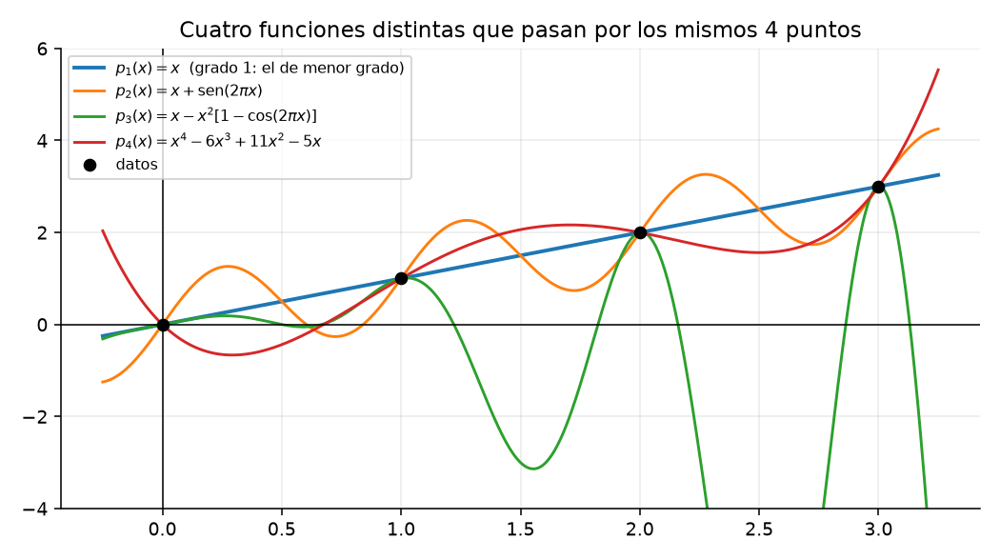
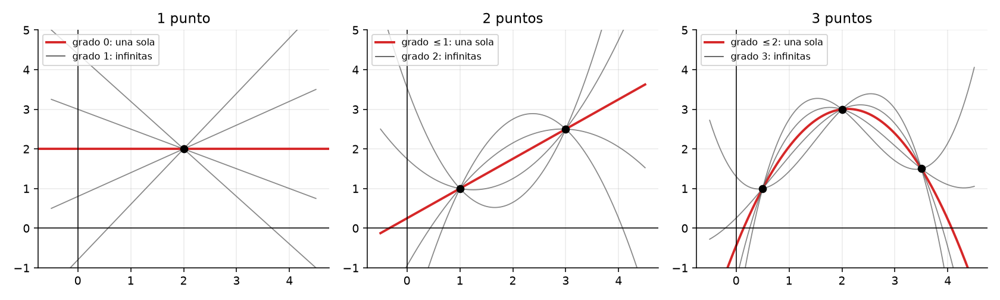
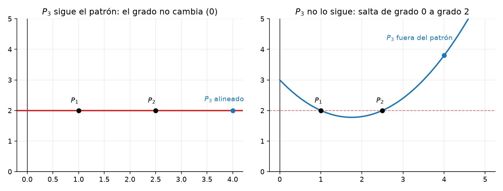
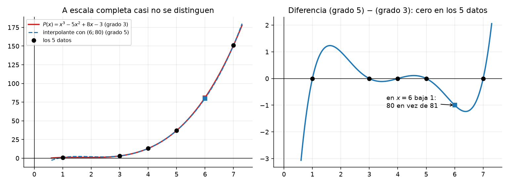
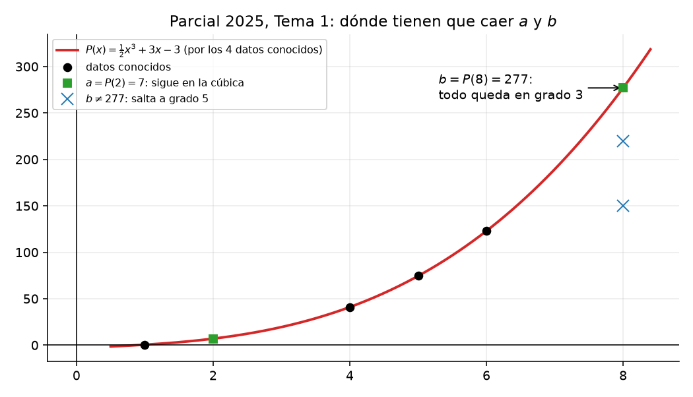
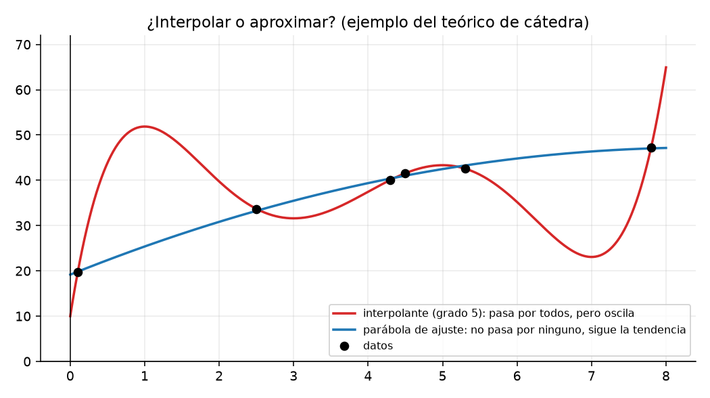

# Interpolación desde cero

> Fuentes: `fuentes/clases/Interpolacion/Clase - Interpolacion general.pdf` (PDF de clase, 2 p.), `Clase - Metodo de Lagrange.pdf` (3 p.) y `Clase - Metodo de Newton-Gregory.pdf` (5 p.), `fuentes/clases/Interpolacion/Teorico catedra 2.4 - Interpolacion y aproximacion.pdf` (solo la parte de interpolación, págs. 89 a 103 del teórico), `fuentes/clases/Interpolacion/OneNote - Interpolacion.pdf` (práctica manuscrita del profesor, 13 p.; el video de la práctica no se pudo bajar), transcript `13-video-teorica-interpolacion.json` (teórica, 1 h 32), `examenes/INDICE.md` y `examenes/resueltos/RESOLUCIONES-2025.md` (Ej3 de las 4 hojas 2025), apunte `08-practica-repaso-segundo-parcial.md` (ej. 3, 4, 7 y 8), `fuentes/Guia-ejercicios-parte-2-calculo-numerico.pdf` (interpolación, ej. 1 a 21, con sus respuestas) y `fuentes/AYUDAMEMORIA-OFICIAL.pdf` (pág. 4). Todos los números verificados con Python (sympy). Generado 2026-11-19.
>
> **Cómo usarla:** leé de arriba abajo, sin saltear. Los **Ejemplos guiados** están resueltos a la vista: leelos con lápiz y calculadora y rehacé cada cuenta. Los **Tu turno** se hacen en papel y **sin mirar**; la corrección está plegada (el enunciado va en texto plano en el título desplegable, porque ahí no se renderizan fórmulas, y se repite en limpio adentro). Las notas **En clase** son lo que dijo el profesor en el video de la teórica, con el minuto real del transcript `[mm:ss]`. Tiempo total: ≈ 5 h con pausas.
>
> **Qué es de la cátedra y qué es mío:** métodos, fórmulas, criterios y ejemplos salen de las fuentes. Son agregados míos (para que se entienda) las explicaciones "en criollo", las cuentas intermedias que las resoluciones oficiales no escriben, los gráficos, la tabla "regla del conteo" (que resume lo que el profesor explica con ejemplos) y la justificación con el polinomio $c\,(x-x_0)\cdots(x-x_n)$ de por qué hay infinitos. El **Checkpoint** es un ejercicio con formato de parcial armado con los datos del ej. 6 de la guía.
>
> **Alcance 2026:** en 2025 el Ej3 mezclaba interpolación con un ítem de **ajuste por mínimos cuadrados**. En 2026 ajuste **no entra**: acá esos ítems figuran como ⚪ y no se desarrollan (si los querés ver igual: `00-ajuste-explicado-paso-a-paso.md`). La derivación numérica propiamente dicha está en la guía 06; acá solo lo que se deduce de la tabla.

---

## 0. Qué te toman: el Ej3 vale 2 puntos

El Ej3 del 2do parcial es **siempre** una tabla de **6 puntos** con uno, dos o tres valores de $y$ tapados con letras ($a$, $b$, $c$, $k$). En el 1er recuperatorio 2025 el puntaje fue **a) 0,5 · b) 0,25 · c) 0,25 · d) 1** (el d era el ajuste; sin ajuste, en 2026 los 2 puntos se reparten entre los ítems de interpolación).

| Ítem | Qué te piden | Hojas 2025 | Frecuencia | Sección |
|---|---|---|---|---|
| **Hallar los valores tapados** | "Hallar $a$, $b$ (y $c$) para que por los puntos pase el único polinomio de menor grado", "hallar $k$ para que el interpolante sea de grado 3", "qué condiciones deben cumplir $a$ y $b$ para que…" | T1 a, T2 a, R1 a, R2 a | **4/4** (siempre el ítem a) | §7 |
| **Escribir el polinomio** | "Hallar dicho polinomio". Se deja en forma de Newton, **sin distribuir** | T2 a (explícito); en las otras 3 es un paso obligado del ítem a | 1/4 explícito, 4/4 como paso | §6 |
| **¿Cuántos polinomios de grado $n$ pasan?** | Ninguno, uno o infinitos, para 2 o 3 grados distintos. "Justifique" | T1 b, R1 b, R1 c | **2/4** hojas (3 ítems) | §8 |
| **¿De qué grado es el interpolante?** | Cambian un valor y preguntan el grado. "Justifique" | R2 b | 1/4 | §8 |
| ⚪ Ajuste por mínimos cuadrados | Recta (T1 c), exponencial (T2 b, R2 c + error del ajuste), potencial (R1 d) | T1, T2, R1, R2 | 4/4 en 2025 · **no entra en 2026** | `00-ajuste-explicado-paso-a-paso.md` |

T1/T2 = parcial Tema 1/2 · R1/R2 = 1er/2do recuperatorio.

En el **repaso 2026** el profesor sumó tres cosas que en 2025 no estaban en el Ej3:

| Ítem del repaso | Dónde | Sección |
|---|---|---|
| Indicar el grado del interpolante y hallarlo "usando Newton-Gregory (no es necesario distribuir)" | repaso ej. 7 a | §6 |
| Derivada segunda en un punto de la tabla ("2da diferencia", fórmula central) | repaso ej. 4 c y 7 b | §11 |
| Multiple choice: ¿interpolación o aproximación? ¿qué fórmula de derivación se puede usar? | repaso ej. 8 | §11 |

**Lectura rápida:** el ejercicio tipo es **(a) tabla de diferencias divididas con los puntos conocidos → polinomio de Newton → evaluar en las $x$ tapadas** + **(b) contar polinomios o decir el grado, justificando con el teorema**. Si dominás §3, §6, §7 y §8, el Ej3 es tuyo.

> **En clase:** "las preguntas de examen, en general, si bien siempre hay un ejercicio de Newton-Gregory, van a venir más que nada por este teorema y las consecuencias que tiene" [05:49]. Y sobre agregar un punto a un conjunto: "acá vienen el 80% de las preguntas del examen" [13:40].

## 1. La idea en criollo

Te dan una **tabla** de puntos $(x_i;\ y_i)$ y tenés que encontrar una función que **pase exactamente por todos**. Eso es **interpolar**: "sería como una especie de unir los puntitos, como si fuera un dibujo infantil" [01:02].

El problema es que hay **infinitas** funciones que pasan por los mismos puntos. El PDF de clase lo muestra con la tabla $(0;0)$, $(1;1)$, $(2;2)$, $(3;3)$: las cuatro funciones de abajo valen lo mismo que la tabla en $x=0,1,2,3$.

Para no ahogarse entre infinitas opciones, la cátedra trabaja **solo con polinomios** y, entre todos los polinomios, con **el de menor grado** (en el ejemplo, $p_1(x)=x$, de grado 1). Ese polinomio tiene una propiedad que es el corazón del tema: **existe y es único** (§3).

Vocabulario que aparece en los enunciados:

- **Soporte** o **tabla de datos**: los puntos $(x_i;\ y_i)$. Las $x_i$ son todas distintas.
- **Polinomio interpolante** (P.I.): el polinomio que pasa por todos, o sea $P(x_i)=y_i$ para todo $i$.
- **$n+1$ puntos**: se numeran de $x_0$ a $x_n$, por eso son $n+1$ ("el 0 cuenta" [02:03]). El grado máximo posible es **uno menos que la cantidad de puntos**.
- **Equiespaciados**: la distancia entre $x$ consecutivas es siempre la misma (el paso $h$).
- **Interpolar un valor**: evaluar el polinomio en una $x$ que está **dentro** del rango de la tabla. Fuera del rango es **extrapolar** (§10).

> **En clase:** "en general, creo que en todos los ejercicios, nosotros no conocemos la función original, o capaz no hay una función original de la cual sacaron esos datos. Simplemente nos dan una serie de puntos" [03:05].

## 2. Qué tenés en el ayudamemoria y qué va de memoria

La pág. 4 del ayudamemoria oficial trae, de este tema, **solo las diferencias finitas**:

$$
\Delta f_i=f_{i+1}-f_i\qquad \Delta^2 f_i=f_{i+2}-2f_{i+1}+f_i\qquad \Delta^{n+1}f_i=\Delta^n f_{i+1}-\Delta^n f_i
$$

$$
\nabla f_i=f_i-f_{i-1}\qquad \nabla^2 f_i=f_i-2f_{i-1}+f_{i-2}\qquad \nabla^{n+1}f_i=\nabla^n f_i-\nabla^n f_{i-1}
$$

Sirven para puntos equiespaciados (§9) y la de orden 2 es el numerador de la derivada segunda central (§11). **Todo lo demás va de memoria**, y es lo que más se toma:

- 🧠 **Teorema de existencia y unicidad:** por $n+1$ puntos pasa un **único** polinomio de grado **menor o igual** a $n$.
- 🧠 **Regla del conteo** (§8): con $m$ puntos y un interpolante de grado $g$: hay **1** de grado $g$, **0** de cualquier otro grado hasta $m-1$, e **infinitos** de cada grado $\ge m$.
- 🧠 **Agregar un punto:** si cae sobre el polinomio que ya tenías, el grado no cambia; si no, **salta al grado máximo** (cantidad de puntos menos 1).
- 🧠 **Diferencias divididas:** resta de dos valores consecutivos de la columna anterior, dividido "última $x$ menos primera $x$" de los puntos que abarca.
- 🧠 **Polinomio de Newton-Gregory:** $P(x)=y_0+a_1(x-x_0)+a_2(x-x_0)(x-x_1)+\dots$ con los $a_i$ de la diagonal de arriba de la tabla.
- 🧠 **Grado en la tabla:** lo marca la **última columna no nula**.
- 🧠 **Lagrange:** $P(x)=\sum \dfrac{y_i}{L_i(x_i)}\,L_i(x)$, con $L_i(x)$ = producto de todos los $(x-x_k)$ menos el propio.

---

## 3. El teorema de existencia y unicidad (de acá sale todo)

### 3.1 El enunciado

> **Teorema (existencia y unicidad del polinomio interpolante).** Dados $x_0, x_1, \dots, x_n$, un conjunto de $n+1$ puntos en $[a;b]$, y sus imágenes $f(x_0), f(x_1), \dots, f(x_n)$, **existe un único polinomio de grado menor o igual a $n$** que interpola a $f$ en $[a;b]$.

El profesor lo llama "teorema de Lagrange" [06:20] y en el OneNote lo escribe así: dados $n+1$ puntos $\{(x_i;y_i)\}_0^n$, $\exists!\,P(x)$ tal que $P(x_i)=y_i$ y $gr[P(x)]\le n$.

Las tres palabras que hay que subrayar: **existe**, **único** y **menor o igual**.

En criollo, con 5 puntos: hay un solo polinomio de grado 0, 1, 2, 3 o 4 que pasa por los cinco. No dice que sea de grado 4: dice que es de grado 4 **o menos**. De qué grado sale depende de **cómo están ubicados** los puntos.

### 3.2 Los ejemplos fáciles del profesor

El profesor lo piensa con casos chicos [07:53] y después generaliza:

- **1 punto** ($n=0$): pasa una única **constante** (recta horizontal), grado 0.
- **2 puntos** ($n=1$): pasa un único polinomio de grado $\le 1$. Si están a la misma altura es la constante (grado 0); si no, la recta inclinada (grado 1).
- **3 puntos** ($n=2$): un único polinomio de grado $\le 2$. Si están alineados horizontalmente, grado 0; si están alineados sobre una recta inclinada, grado 1; si no, una parábola (grado 2).

### 3.3 Primera consecuencia: de grado igual a la cantidad de puntos (o más) hay infinitos

El teorema limita hasta el grado $n$ (cantidad de puntos menos 1). **A partir del grado igual a la cantidad de puntos ya no hay límite** [12:36]:

- Por **1** punto, ¿cuántas rectas (grado 1) pasan? **Infinitas** ("una así, una más acostada, una para el otro lado" [13:07]).
- Por **2** puntos, ¿cuántas parábolas (grado 2) pasan? **Infinitas**.

Son las curvas grises de la figura de arriba. En el OneNote queda como regla:

> Si tenemos $m$ puntos, hay **infinitos** polinomios de grado $\ge m$ que los interpolan.

**Por qué (agregado mío, sirve para justificar):** si $P$ es el interpolante y los puntos son $x_0,\dots,x_n$, el polinomio

$$
Q(x)=P(x)+c\,(x-x_0)(x-x_1)\cdots(x-x_n)
$$

también pasa por todos (el segundo término vale 0 en cada $x_i$), tiene grado $n+1$ = cantidad de puntos, y hay uno distinto para cada $c\neq 0$. Multiplicando ese término por $x$, $x^2$, … se consiguen infinitos de cada grado más alto.

### 3.4 Segunda consecuencia: qué pasa si agrego un punto (lo que más se toma)

Tenés puntos por los que pasa un interpolante $P$ de cierto grado y agregás un punto nuevo $(x^{*};\ y^{*})$. Hay **solo dos** posibilidades [14:41]:

1. **El punto nuevo sigue el patrón**, o sea $P(x^{*})=y^{*}$. El interpolante es **el mismo** y el grado **no cambia**.
2. **El punto nuevo no sigue el patrón**, $P(x^{*})\neq y^{*}$. El grado **salta directo al máximo** para la nueva cantidad de puntos (cantidad de puntos menos 1), **salteando todos los grados intermedios**.

**Por qué salta y no sube de a uno** (la explicación del profesor, [17:20] y OneNote): $P_1$ y $P_2$ están a la misma altura, así que por ellos pasa el polinomio de grado 0. El teorema dice que por esos dos puntos pasa **un único** polinomio de grado $\le 1$: ya es la constante, entonces **ninguna recta inclinada** pasa por $P_1$ y $P_2$. Si agrego un $P_3$ que no está a esa altura, la constante ya no sirve, y la recta "ya estaba descartada de antes" [17:50], agregues lo que agregues. Si existiera un interpolante de grado 1 para los tres, por $P_1$ y $P_2$ pasarían un polinomio de grado 0 **y** otro de grado 1: "sería una contradicción al teorema". Lo único que queda es el grado 2.

El **corolario** tal como está en el OneNote:

> Si tengo $n+1$ puntos (es decir que podría tener un polinomio interpolante de a lo sumo grado $n$), pero debido a la disposición de esos puntos el polinomio interpolante es de grado menor a $n$; entonces si agrego un punto que no está "alineado" a ese polinomio interpolante, inmediatamente salto hacia el grado más alto posible. Para nuestro ejemplo serían $n+2$ puntos, entonces el grado debe ser $n+1$. De lo contrario, resultaría en una contradicción con el teorema.

"Alineado" va entre comillas: "no quiere decir que sea una línea recta. Quiere decir que no siga el patrón que seguían los otros puntos, aunque esos puntos formen un polinomio de grado 6" [18:22].

**Cómo se chequea si el punto sigue el patrón** [21:27]: se **evalúa el polinomio** en la $x$ nueva. Si da la $y$ nueva, pertenece; si da distinto, no pertenece.

> **En clase:** "si yo tenía un polinomio de grado 3 para 7 puntos y le agrego un punto más, voy a tener que chequear si ese punto que yo agrego sigue con el mismo polinomio de grado 3, y si no pertenece ya me voy al grado máximo posible: si son 7 puntos más 1 serán 8 puntos, será grado 7. Entonces de 3 salté a 7, salteándome el 4, el 5 y el 6" [19:55].

> **En clase:** "todas las preguntas que tengan que ver con el grado se explican con lo que acabo de explicar" [19:24].

### Ejemplo guiado 1: la tabla de la guía y el punto $(6;\ 80)$ (guía ej. 11 b, OneNote)

Por los 5 puntos $(1;1)$, $(3;3)$, $(4;13)$, $(5;37)$, $(7;151)$ pasa el polinomio $P(x)=x^3-5x^2+8x-3$, de grado 3 (lo vas a calcular en §6). Podría haber sido de grado 4, pero no llegó.

**Pregunta:** ¿de qué grado es el polinomio de menor grado que pasa por esos 5 puntos y además por $(6;\ 80)$?

**Paso 1:** evalúo el polinomio que ya tengo en la $x$ nueva.

$$
P(6)=6^3-5\cdot 6^2+8\cdot 6-3=216-180+48-3=81
$$

**Paso 2:** comparo. $P(6)=81\neq 80$: el punto nuevo **no** sigue el patrón.

**Paso 3:** salto al grado máximo. Ahora son 6 puntos, así que el interpolante es de **grado 5**.

Lo que anota el profesor: "Si agrego el punto $(6;81)$, el P.I. se mantiene igual. Si agrego el punto $(6;80)$, el P.I. salta al grado máximo para 6 puntos, que es grado 5". Y la respuesta de la guía: "es de grado 5, ya que no existe ninguno de grado menor o igual a 4 que pase por todos ellos".

Una diferencia de 1 en un solo dato cambió el grado de 3 a 5. No existe el término medio.

### Tu turno 3

<strong>3.A</strong> (guía ej. 18) — El polinomio interpolante de menor grado que pasa por (1;5), (2;7) y (x;y) es: a) siempre una parábola de 2do grado · b) siempre una recta · c) siempre una cúbica · d) depende de (x;y).

<strong>Resolución</strong>

Por $(1;5)$ y $(2;7)$ pasa una recta (grado 1, porque no están a la misma altura). El tercer punto tiene las dos posibilidades de §3.4.

Del OneNote: "Si $(x,y)$ pertenece a la recta, entonces grado 1. Si no, grado 2".

**Respuesta: d) depende de $(x;y)$.** Nunca puede ser una cúbica: con 3 puntos el máximo es grado 2.

<strong>3.B</strong> (guía ej. 14 e y 14 f) — Verdadero o falso, justificando: e) Dada una tabla de n pares de valores (xᵢ; yᵢ), es posible encontrar más de un polinomio de grado n que interpole todos los datos. f) Dado un conjunto de n puntos (xᵢ; yᵢ), existe una única función interpolante tal que f(xᵢ) = yᵢ para todo i.

<strong>Resolución</strong>

**e) Verdadero: son infinitos.** Son $n$ puntos y se pregunta por grado $n$ = cantidad de puntos. El teorema solo garantiza unicidad hasta grado $n-1$; de grado igual a la cantidad de puntos hay infinitos (§3.3).

**f) Falso: infinitas.** Del OneNote: "no aclara grado y ni siquiera si son polinomios". La unicidad es del **polinomio de grado menor o igual a $n-1$**, no de "la función interpolante" (acordate de las cuatro funciones de la primera figura).

<strong>3.C</strong> (para pensar, sale del video) — Tenés 7 puntos por los que pasa un polinomio de grado 3. Agregás un octavo punto que no pertenece a ese polinomio. a) ¿De qué grado es ahora el interpolante? b) ¿Cuántos polinomios de grado 8 pasan por los 8 puntos?

<strong>Resolución</strong>

**a) Grado 7.** El punto no sigue el patrón ⇒ se salta al máximo para 8 puntos, que es $8-1=7$, "salteándome el 4, el 5 y el 6" [19:55].

**b) Infinitos.** Grado 8 = cantidad de puntos: "si es misma cantidad de puntos que de grado, vimos que no está limitado" [19:24].

## 4. De dónde salen los métodos: el sistema que nadie resuelve

Ya sabés que el polinomio existe y es único. Falta **hallarlo**. La forma directa: escribirlo en forma estándar con coeficientes incógnita,

$$
p(x)=a_0+a_1x+a_2x^2+\dots+a_nx^n
$$

y pedir que pase por cada punto: $p(x_i)=f(x_i)$. Sale un sistema de $n+1$ ecuaciones con $n+1$ incógnitas (los $a_i$) cuya matriz de coeficientes es

$$
A=\begin{pmatrix}1 & x_0 & x_0^2 & \cdots & x_0^n\\ 1 & x_1 & x_1^2 & \cdots & x_1^n\\ \vdots & \vdots & \vdots & & \vdots\\ 1 & x_n & x_n^2 & \cdots & x_n^n\end{pmatrix}\qquad B=\begin{pmatrix}f_0\\ f_1\\ \vdots\\ f_n\end{pmatrix}
$$

El determinante de $A$ es el de **Vandermonde** y "generalmente es muy complicado de calcular para matrices de orden superior a 3" (PDF de clase). Por eso existen dos métodos que arman el polinomio **sin resolver ningún sistema**: **Lagrange** (§5) y **Newton-Gregory** (§6).

Dato clave para el examen: **los tres caminos dan el mismo polinomio**, porque es único.

> **En clase:** "el método de Lagrange, o el método Newton-Gregory, sea el general, o el equiespaciado, o el regresivo, o el progresivo, van a hallar siempre el mismo polinomio. […] Si existe y es único, cualquier método bien aplicado me va a hallar ese mismo polinomio. Lo que sí quizás me pase es que a primera vista no se vean iguales" [51:35].

---

## 5. Método de Lagrange (se toma poco, pero hay que saber armarlo)

### 5.1 La idea

Lagrange escribe el polinomio como una suma de $n+1$ términos. Cada término tiene un coeficiente $a_i$ y **todos los factores $(x-x_k)$ menos el propio**:

$$
P(x)=a_0(x-x_1)(x-x_2)\cdots(x-x_n)+a_1(x-x_0)(x-x_2)\cdots(x-x_n)+\dots+a_n(x-x_0)(x-x_1)\cdots(x-x_{n-1})
$$

¿Para qué esa forma tan rara? Porque al evaluar en $x_0$ **se anulan todos los términos menos el primero** (todos los demás tienen el factor $(x-x_0)$). Entonces $P(x_0)=a_0(x_0-x_1)\cdots(x_0-x_n)=y_0$ y se despeja $a_0$ de una, sin sistema. Lo mismo con cada $x_i$:

$$
a_i=\frac{y_i}{(x_i-x_0)(x_i-x_1)\cdots(x_i-x_{i-1})(x_i-x_{i+1})\cdots(x_i-x_n)}
$$

Para abreviar se llama

$$
L_i(x)=(x-x_0)(x-x_1)\cdots(x-x_{i-1})(x-x_{i+1})\cdots(x-x_n)
$$

("el factor de los $(x-x_k)$ en donde no está $(x-x_i)$") y queda la fórmula que hay que saber:

$$
P(x)=\sum_{i=0}^{n}\frac{y_i}{L_i(x_i)}\,L_i(x)
$$

### 5.2 Receta

1. Para cada fila $i$ de la tabla, escribí $L_i(x)$: el producto de $(x-\text{cada otra }x)$, **salteando la $x$ de esa fila**.
2. Evaluá ese producto en la $x$ de la fila: $L_i(x_i)$. Es un número.
3. El término de esa fila es $\dfrac{y_i}{L_i(x_i)}\cdot L_i(x)$.
4. Sumá los términos. En general **no se pide distribuir**.

### 5.3 Dos notaciones para lo mismo

El teórico de cátedra llama $L_i(x)$ **al cociente entero**:

$$
P(x)=\sum_{i=0}^{n}L_i(x)\,f(x_i)\qquad\text{con}\qquad L_i(x)=\frac{(x-x_0)\cdots(x-x_{i-1})(x-x_{i+1})\cdots(x-x_n)}{(x_i-x_0)\cdots(x_i-x_{i-1})(x_i-x_{i+1})\cdots(x_i-x_n)}
$$

Es exactamente lo mismo: "nosotros separamos lo que la guía junta. […] Es una cuestión de nomenclatura" [47:24]. Usá la que te resulte más clara; el polinomio que sale es idéntico.

### Ejemplo guiado 2: tres puntos (PDF de clase, Ejemplo 1)

| $i$ | $x$ | $y$ |
|---|---|---|
| 0 | 1 | 6 |
| 1 | 3 | 10 |
| 2 | 7 | 8 |

**Paso 1:** los $L_i(x)$ y su valor en la $x$ de la fila.

$$
L_0(x)=(x-3)(x-7)\qquad L_0(1)=(1-3)(1-7)=(-2)(-6)=12
$$

$$
L_1(x)=(x-1)(x-7)\qquad L_1(3)=(3-1)(3-7)=2\cdot(-4)=-8
$$

$$
L_2(x)=(x-1)(x-3)\qquad L_2(7)=(7-1)(7-3)=6\cdot 4=24
$$

**Paso 2:** armo el polinomio (cada $y_i$ dividido su $L_i(x_i)$).

$$
P(x)=\frac{6}{12}(x-3)(x-7)-\frac{10}{8}(x-1)(x-7)+\frac{8}{24}(x-1)(x-3)
$$

**Paso 3:** ¿de qué grado es? Con 3 puntos puede ser 0, 1 o 2. En Lagrange no se ve a simple vista: hay que sumar los coeficientes de adelante, que son los que van a multiplicar a $x^2$ al distribuir.

$$
\frac{1}{2}-\frac{5}{4}+\frac{1}{3}=-\frac{5}{12}\neq 0\ \Longrightarrow\ \text{grado 2}
$$

Si esa suma diera 0, el polinomio sería de grado menor y habría que seguir distribuyendo para saber cuál [43:13].

**Paso 4** (solo si lo piden): distribuyendo,

$$
P(x)=-\frac{5}{12}x^2+\frac{11}{3}x+\frac{11}{4}
$$

**Control:** $P(1)=6$, $P(3)=10$, $P(7)=8$ ✓. Fijate que el coeficiente de $x^2$ es justo el $-\frac{5}{12}$ del paso 3.

### Ejemplo guiado 3: cuatro puntos (PDF de clase, Ejemplo 2)

| $i$ | $x$ | $y$ |
|---|---|---|
| 0 | $-2$ | 5 |
| 1 | 0 | 1 |
| 2 | 1 | 6 |
| 3 | 4 | 10 |

$$
L_0(x)=x(x-1)(x-4)\qquad L_0(-2)=(-2)(-3)(-6)=-36
$$

$$
L_1(x)=(x+2)(x-1)(x-4)\qquad L_1(0)=2\cdot(-1)\cdot(-4)=8
$$

$$
L_2(x)=(x+2)\,x\,(x-4)\qquad L_2(1)=3\cdot 1\cdot(-3)=-9
$$

$$
L_3(x)=(x+2)\,x\,(x-1)\qquad L_3(4)=6\cdot 4\cdot 3=72
$$

$$
P(x)=-\frac{5}{36}\,x(x-1)(x-4)+\frac{1}{8}(x+2)(x-1)(x-4)-\frac{6}{9}(x+2)\,x\,(x-4)+\frac{10}{72}(x+2)\,x\,(x-1)
$$

En forma estándar: $P(x)=-\dfrac{13}{24}x^3+\dfrac{43}{24}x^2+\dfrac{15}{4}x+1$. Con solo 4 puntos ya es un choclo.

### 5.4 Cuándo conviene y cuándo no

- **Ventaja** (PDF de clase): no resuelve sistemas de ecuaciones.
- **Desventaja:** polinomio con muchos factores en cada término; a medida que la tabla tiene más puntos "el método resulta incómodo" y "si hay que distribuir resulta muy molesto". Y **no se ve el grado** [42:12].
- **Usalo solo si el enunciado dice "Lagrange"** o si son 2 o 3 puntos. Para todo lo demás, Newton-Gregory.

> **En clase:** "hay algún ejercicio de la guía, en exámenes no, que dice 'usá Lagrange'. En general yo toda la vida uso Newton-Gregory" [41:41]. "Los ejercicios con los que vamos a trabajar en general tienen mínimo cinco, pueden tener siete, ocho puntos, porque van a usar Newton-Gregory, no esto" [45:20].

### 5.5 El error (solo si conocés la función original)

El teórico da una **estimación del error** del método de Lagrange. Tal como está impresa:

$$
E=\lvert f(x)-P(x)\rvert\le\lvert (x-x_0)(x-x_2)\cdots(x-x_n)\rvert\cdot\left\lvert\frac{f^{(n)}(\varphi)}{n!}\right\rvert\qquad\text{con }\varphi\in[a,b]
$$

con la observación: "solamente será posible estimar el error en el caso de conocer la verdadera función $f(x)$, ya que para acotar el error se necesita la derivada n-ésima de $f$". (Así figura en el teórico; ojo que ahí se saltea el factor $(x-x_1)$, que es una errata de tipeo: el producto es de **todos** los $(x-x_i)$. No la vi usada en la práctica ni en los parciales.)

En la práctica el profesor "estima el error" de la forma directa: **valor real menos valor interpolado**, $E=\lvert\bar y-y\rvert$ (ejercicio 5.A de abajo). En las tablas de parcial no hay función original, así que esto no se toma.

### Tu turno 5

<strong>5.A</strong> (guía ej. 3, resuelto en el OneNote) — Sean los puntos (0; 0), (1/6; 1/2) y (1/2; 1). a) Verificar que pertenecen a f(x) = sen(πx). b) Hallar el polinomio interpolante de Lagrange. c) Calcular sen(π/3) mediante el polinomio hallado. d) Estimar el error que se comete en c).

**En limpio:** puntos $(0;0)$, $\left(\tfrac16;\tfrac12\right)$, $\left(\tfrac12;1\right)$ y $f(x)=\operatorname{sen}(\pi x)$.

<strong>Resolución</strong>

**a)** $f(0)=\operatorname{sen}(0)=0$ ✓ · $f\left(\tfrac16\right)=\operatorname{sen}\left(\tfrac{\pi}{6}\right)=\tfrac12$ ✓ · $f\left(\tfrac12\right)=\operatorname{sen}\left(\tfrac{\pi}{2}\right)=1$ ✓

**b)** Tal como lo arma el profesor (cada $y_i$ sobre su denominador):

$$
P(x)=\frac{0}{\left(0-\frac16\right)\left(0-\frac12\right)}\left(x-\tfrac16\right)\left(x-\tfrac12\right)+\frac{\frac12}{\left(\frac16-0\right)\left(\frac16-\frac12\right)}(x-0)\left(x-\tfrac12\right)+\frac{1}{\left(\frac12-0\right)\left(\frac12-\frac16\right)}\left(x-\tfrac16\right)(x-0)
$$

(cuentas intermedias) El primer término se va porque $y_0=0$. Denominadores: $\tfrac16\cdot\left(-\tfrac13\right)=-\tfrac{1}{18}$, y $\tfrac12\cdot\tfrac13=\tfrac16$. Coeficientes: $\tfrac12\div\left(-\tfrac1{18}\right)=-9$ y $1\div\tfrac16=6$.

$$
P(x)=-9\,x\left(x-\tfrac12\right)+6\,x\left(x-\tfrac16\right)
$$

Distribuido (respuesta de la guía): $P(x)=-3x^2+3{,}5x$.

**c)** $\operatorname{sen}(\pi x)\approx P(x)$ en $\left[0;\tfrac12\right]$. Como $\operatorname{sen}\left(\tfrac{\pi}{3}\right)=f\left(\tfrac13\right)$, evalúo en $x=\tfrac13$:

$$
P\left(\tfrac13\right)=-9\cdot\tfrac13\cdot\left(-\tfrac16\right)+6\cdot\tfrac13\cdot\tfrac16=\tfrac12+\tfrac13=\tfrac56=0{,}8\overline{3}
$$

**d)** Valor real: $\operatorname{sen}\left(\tfrac{\pi}{3}\right)=\tfrac{\sqrt3}{2}=0{,}866025\ldots$

$$
E=\lvert\bar y-y\rvert=\lvert 0{,}866025-0{,}833333\rvert=0{,}03269\ldots
$$

**Qué mirar:** el truco del ítem c) es darse cuenta de que $\tfrac{\pi}{3}=\pi\cdot\tfrac13$, o sea que la $x$ a evaluar es $\tfrac13$ (que está dentro de $\left[0;\tfrac12\right]$).

<strong>5.B</strong> (guía ej. 1) — Tabla: x = 1, 2, 4; y = 1, 8, 64. a) Hallar el valor de y para x = 3 y x = 7 aplicando la fórmula de Lagrange. b) Suponiendo que la función original fuese y = x³, hallar el error relativo de cada estimación.

<strong>Resolución</strong>

**a)** $L_0(x)=(x-2)(x-4)$, $L_0(1)=(-1)(-3)=3$ · $L_1(x)=(x-1)(x-4)$, $L_1(2)=1\cdot(-2)=-2$ · $L_2(x)=(x-1)(x-2)$, $L_2(4)=3\cdot 2=6$.

$$
P(x)=\frac{1}{3}(x-2)(x-4)-\frac{8}{2}(x-1)(x-4)+\frac{64}{6}(x-1)(x-2)
$$

Distribuido (respuesta de la guía): $P(x)=7x^2-14x+8$.

$$
P(3)=\tfrac13(1)(-1)-4(2)(-1)+\tfrac{32}{3}(2)(1)=-\tfrac13+8+\tfrac{64}{3}=29
$$

$$
P(7)=\tfrac13(5)(3)-4(6)(3)+\tfrac{32}{3}(6)(5)=5-72+320=253
$$

**b)** Valores reales: $3^3=27$ y $7^3=343$.

$$
e_r(3)=\frac{\lvert 29-27\rvert}{27}=7{,}4\,\%\qquad e_r(7)=\frac{\lvert 253-343\rvert}{343}=26\,\%
$$

**Qué mirar:** $x=3$ está **dentro** del rango $[1;4]$ y el error es chico; $x=7$ está **afuera** (extrapolación) y el error se dispara. Es la advertencia de §10.

<strong>5.C</strong> (ejercicio del teórico de cátedra, pág. 93) — Hallar el polinomio interpolante por la fórmula de Lagrange para la tabla x = 0, 1, 2, 4; f(x) = 1, 1, 2, 5. Escribirlo también en forma normalizada.

<strong>Resolución</strong>

(El teórico deja los renglones en blanco; la resolución es mía, con la receta de §5.2.)

$$
L_0(x)=(x-1)(x-2)(x-4)\qquad L_0(0)=(-1)(-2)(-4)=-8
$$

$$
L_1(x)=x(x-2)(x-4)\qquad L_1(1)=1\cdot(-1)\cdot(-3)=3
$$

$$
L_2(x)=x(x-1)(x-4)\qquad L_2(2)=2\cdot 1\cdot(-2)=-4
$$

$$
L_3(x)=x(x-1)(x-2)\qquad L_3(4)=4\cdot 3\cdot 2=24
$$

$$
P(x)=-\frac{1}{8}(x-1)(x-2)(x-4)+\frac{1}{3}\,x(x-2)(x-4)-\frac{2}{4}\,x(x-1)(x-4)+\frac{5}{24}\,x(x-1)(x-2)
$$

Grado: $-\tfrac18+\tfrac13-\tfrac12+\tfrac{5}{24}=-\tfrac{1}{12}\neq0$ ⇒ grado 3.

Normalizado:

$$
P(x)=-\frac{1}{12}x^3+\frac{3}{4}x^2-\frac{2}{3}x+1
$$

**Control:** $P(0)=1$ · $P(1)=-\tfrac1{12}+\tfrac34-\tfrac23+1=1$ · $P(2)=-\tfrac23+3-\tfrac43+1=2$ · $P(4)=-\tfrac{16}{3}+12-\tfrac83+1=5$ ✓

---

## 6. Newton-Gregory general: la tabla de diferencias divididas (el método del parcial)

### 6.1 La idea

Newton arma el polinomio **agregando un factor por vez**:

$$
P(x)=a_0+a_1(x-x_0)+a_2(x-x_0)(x-x_1)+a_3(x-x_0)(x-x_1)(x-x_2)+\dots+a_n(x-x_0)(x-x_1)\cdots(x-x_{n-1})
$$

El truco es el mismo que en Lagrange pero escalonado. Si evalúo en $x_0$ se anula todo menos $a_0$: entonces $a_0=y_0$. Si evalúo en $x_1$ sobreviven dos términos: $y_0+a_1(x_1-x_0)=y_1$, de donde

$$
a_1=\frac{y_1-y_0}{x_1-x_0}
$$

"Como si fuera la pendiente de una recta" [57:52]. Ese cociente se llama **diferencia dividida de orden 1** y se anota $f[x_0,x_1]$. Los demás coeficientes son diferencias divididas de orden cada vez mayor:

$$
f[x_i,x_{i+1}]=\frac{y_{i+1}-y_i}{x_{i+1}-x_i}
$$

$$
f[x_i,x_{i+1},x_{i+2}]=\frac{f[x_{i+1},x_{i+2}]-f[x_i,x_{i+1}]}{x_{i+2}-x_i}
$$

$$
f[x_0,x_1,\dots,x_n]=\frac{f[x_1,x_2,\dots,x_n]-f[x_0,x_1,\dots,x_{n-1}]}{x_n-x_0}
$$

En palabras: **arriba**, la resta de las dos diferencias del orden anterior (la de los últimos puntos menos la de los primeros); **abajo**, siempre "**última $x$ menos primera $x$**" de los puntos que abarca [59:59]. Y se puede demostrar que

$$
a_0=y_0\qquad a_1=f[x_0,x_1]\qquad a_2=f[x_0,x_1,x_2]\qquad\dots\qquad a_n=f[x_0,x_1,\dots,x_n]
$$

Esta es la **fórmula general**: sirve para puntos equiespaciados **y** no equiespaciados. Es la única que usa el profesor.

> **En clase:** "¿para qué yo les voy a hacer aprenderse dos fórmulas y dos maneras de trabajar si hay una que sirve para los dos casos y la otra solo sirve para un caso particular? […] Yo siempre voy a trabajar con el general" [50:00]. En el OneNote: "Siempre fórmula general".

> **En clase:** "no me interesa mucho que se acuerden qué es una diferencia dividida y la parte teórica. Me importa que sepan cómo se terminó armando esta tablita, cómo se arma el polinomio en base a esa tablita, y cómo se dan cuenta de qué grado es el polinomio al ver la tablita" [1:17:43].

### 6.2 Receta para armar la tabla ("piquitos y salteos")

1. Copiá los datos en dos columnas, $x$ e $y$ (la columna $i$ no hace falta [1:03:41]). Dejá un renglón libre entre fila y fila.
2. **Columna O1:** para cada par de filas consecutivas, $\dfrac{\text{resta de las } y}{\text{resta de sus } x}$. Se escribe en el renglón del medio (el "piquito").
3. **Columna O2:** para cada par de valores consecutivos de O1, resta de los dos valores dividido la resta de las $x$ **salteando una** (la $x$ de más abajo que toca el piquito menos la de más arriba).
4. **Columna O3:** igual con los valores de O2, salteando **dos** $x$. O4: salteando **tres**. Y así.
5. Cada columna tiene un valor menos que la anterior. Con $m$ puntos llegás como mucho a la columna O$(m-1)$, que tiene un solo valor.

La resta va siempre **el de abajo menos el de arriba**, tanto en el numerador como en el denominador.

> **En clase:** "yo lo hago así siempre, con los dedos, para saltearme tantas $x$ como corresponda según el orden que esté calculando" [1:17:12]. "Primero no me salteé ninguno, después me salteé 1, después me salteé 2, ahora me salteo 3" [1:11:58].

### Ejemplo guiado 4: la tabla del PDF de clase (es también el ej. 11 a de la guía)

Datos: $(1;1)$, $(3;3)$, $(4;13)$, $(5;37)$, $(7;151)$. Son 5 puntos: "grado 4 como máximo" (OneNote).

**Paso 1 — O1** (resta de $y$ sobre resta de $x$, sin saltear):

$$
\frac{3-1}{3-1}=1\qquad\frac{13-3}{4-3}=10\qquad\frac{37-13}{5-4}=24\qquad\frac{151-37}{7-5}=\frac{114}{2}=57
$$

**Paso 2 — O2** (salteando una $x$):

$$
\frac{10-1}{4-1}=3\qquad\frac{24-10}{5-3}=7\qquad\frac{57-24}{7-4}=11
$$

**Paso 3 — O3** (salteando dos $x$):

$$
\frac{7-3}{5-1}=1\qquad\frac{11-7}{7-3}=1
$$

**Paso 4 — O4** (salteando tres $x$):

$$
\frac{1-1}{7-1}=\frac{0}{6}=0
$$

La tabla completa:

| $x$ | $y$ | O1 | O2 | O3 | O4 |
|---|---|---|---|---|---|
| 1 | **1** | | | | |
| | | **1** | | | |
| 3 | 3 | | **3** | | |
| | | 10 | | **1** | |
| 4 | 13 | | 7 | | **0** |
| | | 24 | | 1 | |
| 5 | 37 | | 11 | | |
| | | 57 | | | |
| 7 | 151 | | | | |

**Paso 5 — armar el polinomio progresivo.** Los coeficientes son la **diagonal de arriba** (en negrita): el primer valor de cada columna. Cada coeficiente se multiplica por los $(x-x_i)$ de las $x$ de arriba hacia abajo, agregando una por término:

$$
P(x)=1+1\,(x-1)+3\,(x-1)(x-3)+1\,(x-1)(x-3)(x-4)+0\cdot(x-1)(x-3)(x-4)(x-5)
$$

$$
P(x)=1+(x-1)+3(x-1)(x-3)+(x-1)(x-3)(x-4)
$$

Ahí se puede dejar. Distribuido da $P(x)=x^3-5x^2+8x-3$.

**Paso 6 — leer el grado.** La columna O4 es nula ⇒ no hay término con cuatro factores ⇒ no hay $x^4$. La última columna no nula es O3 ⇒ **grado 3**. En el OneNote: "No llegó al grado 4, es de grado 3".

**Control rápido:** $P(3)=1+2+0+0=3$ ✓ · $P(4)=1+3+3\cdot3\cdot1+0=13$ ✓.

### 6.3 Cómo se lee el grado en la tabla

> "En general, si una columna de las diferencias se hace toda cero entonces el grado del polinomio está indicado por la **última columna no nula**" (PDF de clase).

Dicho de otro modo: si la columna O$g$ queda **toda con el mismo número** (constante, distinto de 0), la siguiente se anula entera y el polinomio es de **grado $g$**. En el ejemplo, O3 vale $1$ y $1$.

Esta es **la** ventaja sobre Lagrange: el grado se ve sin armar el polinomio.

> **En clase:** "en general no se pide tanto cuál es el polinomio, depende del ejercicio, pero se trabaja más con 'yo te doy una lista de puntos, ¿de qué grado es?'. No hace falta hacer todo el desarrollo y hallar el polinomio: yo puedo ya saber si este polinomio es de grado 0, 1, 2, 3 o 4 solo al ver la tabla" [1:16:41].

> **En clase:** sobre distribuir y llevar a forma estándar: "depende del ejercicio, en general no se pide" [1:18:49]. Las resoluciones oficiales de parcial dejan el polinomio en forma de Newton, y el repaso 2026 lo dice en el enunciado: "no es necesario distribuir".

### 6.4 El regresivo: misma tabla, diagonal de abajo

El polinomio de Newton-Gregory **regresivo** se arma con los puntos de abajo hacia arriba:

$$
P(x)=a_n+a_{n-1}(x-x_n)+a_{n-2}(x-x_n)(x-x_{n-1})+\dots+a_0(x-x_n)(x-x_{n-1})\cdots(x-x_1)
$$

**No hay que hacer otra tabla.** Los coeficientes son la **diagonal de abajo**: el **último** valor de cada columna. En el ejemplo: $151$, $57$, $11$, $1$, $0$. Y los factores usan las $x$ de abajo hacia arriba ($7$, $5$, $4$, …):

$$
P(x)=151+57\,(x-7)+11\,(x-7)(x-5)+1\,(x-7)(x-5)(x-4)
$$

Distribuido da otra vez $x^3-5x^2+8x-3$: "como vemos, al distribuir y normalizar el polinomio nos da igual al progresivo" (PDF de clase).

**¿Cuándo uno y cuándo otro?** Criterio del PDF de clase y del profesor: "conviene usar la hilera de valores más simples de operar". Acá conviene el progresivo ($1, 1, 3, 1$ contra $151, 57, 11, 1$).

> **En clase:** "no arrancan pensando 'voy a usar el progresivo, voy a usar el regresivo': arman la tabla, la tabla les va a ofrecer las dos posibilidades y después eligen según la conveniencia. […] Si tengo más ceros en una diagonal que en otra, esa es la elección en general, salvo que el ejercicio me diga 'hallá el progresivo' o 'hallá el regresivo'" [1:23:31]. "No hay mucha teoría atrás de si elegir uno o elegir el otro, porque van a terminar en lo mismo" [1:25:02].

(El teórico de cátedra agrega otro criterio, pensado para interpolar un valor: la progresiva "conviene si el punto a interpolar está cerca del principio del intervalo" y la regresiva "si está cerca del final". Es el que se usa para justificar en el ej. 5 de la guía, §9.)

### Ejemplo guiado 5: regresivo con ceros (guía ej. 8, OneNote)

**Enunciado:** calcular con la fórmula de Newton-Gregory **regresiva** el polinomio que pasa por $(-1;1)$, $(0;1)$, $(1;1)$ y $(2;-5)$. Interpolar en $x=1{,}5$ y $x=2{,}5$.

| $x$ | $y$ | O1 | O2 | O3 |
|---|---|---|---|---|
| $-1$ | 1 | | | |
| | | 0 | | |
| 0 | 1 | | 0 | |
| | | 0 | | $-1$ |
| 1 | 1 | | $-3$ | |
| | | $-6$ | | |
| 2 | $-5$ | | | |

Cuentas: O1: $\frac{1-1}{1}=0$, $\frac{1-1}{1}=0$, $\frac{-5-1}{2-1}=-6$. O2: $\frac{0-0}{1-(-1)}=0$, $\frac{-6-0}{2-0}=-3$. O3: $\frac{-3-0}{2-(-1)}=-1$.

**Regresivo** (diagonal de abajo: $-5$, $-6$, $-3$, $-1$; factores con $2$, $1$, $0$):

$$
P_R(x)=-5-6\,(x-2)-3\,(x-2)(x-1)-1\,(x-2)(x-1)\,x
$$

**Progresivo** (diagonal de arriba: $1$, $0$, $0$, $-1$): dos ceros, queda cortísimo.

$$
P_P(x)=1-1\,(x+1)\,x\,(x-1)
$$

Los dos son el mismo: $P_R=P_P=P(x)=-x^3+x+1$.

**Interpolar:**

$$
P(1{,}5)=1-(2{,}5)(1{,}5)(0{,}5)=1-1{,}875=-0{,}875
$$

$$
P(2{,}5)=1-(3{,}5)(2{,}5)(1{,}5)=1-13{,}125=-12{,}125
$$

El profesor anota al lado de $P(2{,}5)$: "salto 'importante'. Fuera del intervalo: +10 %". $x=2{,}5$ está fuera de $[-1;2]$ (ver §10).

**Qué mirar:** el enunciado pedía el regresivo, y hay que darlo. Pero esta tabla es el caso típico donde, si te dejan elegir, conviene el progresivo por los ceros.

### Tu turno 6

<strong>6.A</strong> (guía ej. 10) — Dada la función tabulada x = 1, 3, 5, 6, 8; y = 1,2; 2,4; 10; 19,2; 54,4, hallar el polinomio de menor grado que interpola todos los puntos.

<strong>Resolución</strong>

| $x$ | $y$ | O1 | O2 | O3 | O4 |
|---|---|---|---|---|---|
| 1 | 1,2 | | | | |
| | | 0,6 | | | |
| 3 | 2,4 | | 0,8 | | |
| | | 3,8 | | 0,2 | |
| 5 | 10 | | 1,8 | | 0 |
| | | 9,2 | | 0,2 | |
| 6 | 19,2 | | 2,8 | | |
| | | 17,6 | | | |
| 8 | 54,4 | | | | |

Cuentas: O1: $\frac{1{,}2}{2}=0{,}6$, $\frac{7{,}6}{2}=3{,}8$, $\frac{9{,}2}{1}=9{,}2$, $\frac{35{,}2}{2}=17{,}6$. O2: $\frac{3{,}8-0{,}6}{5-1}=0{,}8$, $\frac{9{,}2-3{,}8}{6-3}=1{,}8$, $\frac{17{,}6-9{,}2}{8-5}=2{,}8$. O3: $\frac{1{,}8-0{,}8}{6-1}=0{,}2$, $\frac{2{,}8-1{,}8}{8-3}=0{,}2$. O4: $\frac{0{,}2-0{,}2}{8-1}=0$.

O3 constante, O4 nula ⇒ **grado 3**.

$$
P(x)=1{,}2+0{,}6\,(x-1)+0{,}8\,(x-1)(x-3)+0{,}2\,(x-1)(x-3)(x-5)
$$

Distribuido (respuesta de la guía): $P(x)=0{,}2x^3-x^2+2x$.

<strong>6.B</strong> (repaso 2026, ej. 7 a; "Ejercicio 4" de un parcial viejo, 1 punto) — Dado el conjunto de puntos x = 1, 3, 4, 5, 7; y = −1,5; −4,5; 0; 12,5; 73,5: indicar el grado del polinomio interpolante que pasa por todos los puntos y hallarlo usando Newton-Gregory (no es necesario distribuir).

<strong>Resolución</strong>

(En el repaso el profesor solo hizo el ítem b, que está en §11; la tabla es con el mismo método.)

| $x$ | $y$ | O1 | O2 | O3 | O4 |
|---|---|---|---|---|---|
| 1 | $-1{,}5$ | | | | |
| | | $-1{,}5$ | | | |
| 3 | $-4{,}5$ | | 2 | | |
| | | 4,5 | | 0,5 | |
| 4 | 0 | | 4 | | 0 |
| | | 12,5 | | 0,5 | |
| 5 | 12,5 | | 6 | | |
| | | 30,5 | | | |
| 7 | 73,5 | | | | |

Cuentas: O1: $\frac{-4{,}5+1{,}5}{2}=-1{,}5$, $\frac{0+4{,}5}{1}=4{,}5$, $\frac{12{,}5}{1}=12{,}5$, $\frac{61}{2}=30{,}5$. O2: $\frac{4{,}5+1{,}5}{4-1}=2$, $\frac{12{,}5-4{,}5}{5-3}=4$, $\frac{30{,}5-12{,}5}{7-4}=6$. O3: $\frac{4-2}{5-1}=0{,}5$, $\frac{6-4}{7-3}=0{,}5$. O4: $0$.

**Grado:** la columna O3 es constante ($0{,}5$) y O4 se anula ⇒ **grado 3**.

$$
P(x)=-1{,}5-1{,}5\,(x-1)+2\,(x-1)(x-3)+0{,}5\,(x-1)(x-3)(x-4)
$$

(Distribuido, por si querés controlar: $P(x)=0{,}5x^3-2x^2$.)

**Qué mirar:** la respuesta tiene **dos partes** y hay que escribir las dos: el grado **con su justificación** ("O4 es nula, la última columna no nula es O3") y el polinomio.

<strong>6.C</strong> (guía ej. 6) — Si existe algún polinomio de grado 3 que interpola los siguientes datos, hallarlo: x = −1, 0, 1, 2, 3, 4; f(x) = 0, 5, 4, 3, 8, 25.

<strong>Resolución</strong>

| $x$ | $y$ | O1 | O2 | O3 | O4 | O5 |
|---|---|---|---|---|---|---|
| $-1$ | 0 | | | | | |
| | | 5 | | | | |
| 0 | 5 | | $-3$ | | | |
| | | $-1$ | | 1 | | |
| 1 | 4 | | 0 | | 0 | |
| | | $-1$ | | 1 | | 0 |
| 2 | 3 | | 3 | | 0 | |
| | | 5 | | 1 | | |
| 3 | 8 | | 6 | | | |
| | | 17 | | | | |
| 4 | 25 | | | | | |

Cuentas (las $x$ van de a 1): O2: $\frac{-1-5}{2}=-3$, $\frac{-1+1}{2}=0$, $\frac{5+1}{2}=3$, $\frac{17-5}{2}=6$. O3: $\frac{0+3}{3}=1$, $\frac{3-0}{3}=1$, $\frac{6-3}{3}=1$. O4 y O5: nulas.

O3 constante ⇒ **sí existe**, y es de grado 3:

$$
P(x)=0+5\,(x+1)-3\,(x+1)\,x+1\,(x+1)\,x\,(x-1)
$$

Distribuido (respuesta de la guía): $P(x)=x^3-3x^2+x+5$.

**Qué mirar:** con 6 puntos el interpolante podría llegar a grado 5. Que exista uno de grado 3 se ve en que O4 y O5 son nulas. Si O4 no fuera toda nula, la respuesta sería "no existe".

<strong>6.D</strong> (guía ej. 2) — Hallar el polinomio interpolante de la función dada por la tabla x = −2, −1, 1, 2; y = −18, −2, 6, 10.

<strong>Resolución</strong>

| $x$ | $y$ | O1 | O2 | O3 |
|---|---|---|---|---|
| $-2$ | $-18$ | | | |
| | | 16 | | |
| $-1$ | $-2$ | | $-4$ | |
| | | 4 | | 1 |
| 1 | 6 | | 0 | |
| | | 4 | | |
| 2 | 10 | | | |

Cuentas: O1: $\frac{-2+18}{1}=16$, $\frac{6+2}{2}=4$, $\frac{10-6}{1}=4$. O2: $\frac{4-16}{1-(-2)}=-4$, $\frac{4-4}{2-(-1)}=0$. O3: $\frac{0+4}{2-(-2)}=1$.

$$
P(x)=-18+16\,(x+2)-4\,(x+2)(x+1)+1\,(x+2)(x+1)(x-1)
$$

Regresivo (tiene un cero, queda más corto): $P(x)=10+4\,(x-2)+0+1\,(x-2)(x-1)(x+1)$.

Distribuido (respuesta de la guía): $P(x)=x^3-2x^2+3x+4$.

---

## 7. El ítem a del parcial: hallar los valores tapados (4/4)

### 7.1 La idea

La tabla trae 6 puntos, pero algunos tienen la $y$ tapada con una letra. La consigna pide elegir esas letras para que el interpolante tenga cierto grado (o "el menor grado posible").

La clave está en §3.4: los puntos **conocidos** ya determinan un polinomio $P$. Cada punto tapado tiene dos opciones:

- cae **sobre** $P$ (su letra vale $P$ evaluado en su $x$) y el grado no cambia, o
- cae **fuera** de $P$ y el grado salta al máximo.

Entonces "hallar la letra para que el grado sea bajo" es, siempre, **armar $P$ con los puntos conocidos y evaluarlo en la $x$ tapada**.

La regla de oro del profesor, anotada al margen en el OneNote:

> "**No meter la $k$ en el proceso. Tomar solo la cantidad de puntos necesaria.**"

O sea: nada de arrastrar la letra por la tabla de diferencias (se puede, y la guía lo hace en la respuesta del ej. 12, pero es más largo y es donde aparecen los errores de cuentas).

### 7.2 Receta

1. **Sacá las filas con letras.** Quedan los puntos conocidos.
2. **Elegí cuántos puntos conocidos usar:**
   - Si piden **grado $g$**: necesitás $g+1$ puntos conocidos (grado 3 ⇒ 4 puntos; grado 2 ⇒ 3 puntos). Si sobran, usás $g+1$ y los demás quedan para el paso 4.
   - Si piden "**el único polinomio de menor grado**": usás **todos** los conocidos.
3. **Tabla de diferencias divididas** con esos puntos y **polinomio de Newton** (diagonal de arriba, sin distribuir).
4. **Verificá los puntos conocidos que no usaste:** evaluá $P$ en su $x$. Si da su $y$ ✓. Si no da, **no existe** ningún valor de la letra que cumpla lo pedido (por eso el enunciado dice "si existe" o "si es posible").
5. **Evaluá $P$ en cada $x$ tapada.** Ese es el valor de la letra.
6. **Respondé lo que pregunta la consigna:**

| La consigna dice… | Respuesta |
|---|---|
| "…pase el único polinomio de menor grado" / "…sea de grado $g$" | cada letra **=** $P(\text{su } x)$ |
| "…sea de grado máximo (5), pero por los primeros puntos pase uno de grado $g$" | la letra de los primeros puntos **=** $P(\text{su } x)$; la otra **≠** $P(\text{su } x)$ |
| "para los demás valores de $k$, ¿de qué grado es?" | salta al máximo: cantidad de puntos menos 1 |

**Lo que tiene que quedar escrito para que el ítem esté completo:** la tabla, el polinomio en forma de Newton, la verificación de los puntos que no usaste (con el tilde), la evaluación en cada $x$ tapada y la respuesta recuadrada.

### Ejemplo guiado 6: hallar $k$ para grado 3 (guía ej. 13 a, OneNote)

| $x$ | 0 | 1 | 4 | 5 | 7 | 8 |
|---|---|---|---|---|---|---|
| $f(x)$ | 4 | 3 | 0 | $k$ | 123 | 220 |

**Enunciado:** hallar, si es posible, el valor de $k\in\mathbb R$ tal que por todos los puntos dados pase un polinomio de grado 3.

**Paso 1:** saco $(5;k)$. Quedan 5 puntos conocidos.

**Paso 2:** piden grado 3 ⇒ uso **4**: $x=0,\ 1,\ 4,\ 7$. El quinto, $(8;220)$, queda para verificar.

**Paso 3:** tabla.

| $x$ | $y$ | O1 | O2 | O3 |
|---|---|---|---|---|
| 0 | 4 | | | |
| | | $-1$ | | |
| 1 | 3 | | 0 | |
| | | $-1$ | | 1 |
| 4 | 0 | | 7 | |
| | | 41 | | |
| 7 | 123 | | | |

Cuentas: O1: $\frac{3-4}{1}=-1$, $\frac{0-3}{4-1}=-1$, $\frac{123-0}{7-4}=41$. O2: $\frac{-1-(-1)}{4-0}=0$, $\frac{41-(-1)}{7-1}=7$. O3: $\frac{7-0}{7-0}=1$.

Polinomio (diagonal $4,\ -1,\ 0,\ 1$):

$$
P(x)=4-1\,(x-0)+0+1\,(x-0)(x-1)(x-4)=4-x+x(x-1)(x-4)
$$

**Paso 4:** verifico el punto que no usé.

$$
P(8)=4-8+8\cdot 7\cdot 4=4-8+224=220\ \checkmark
$$

El profesor anota: "si $P(8)\neq 220$, entonces $\nexists\,k\in\mathbb R$ tal que un polinomio de grado 3 interpole a todos los puntos".

**Paso 5:** evalúo en la $x$ tapada.

$$
P(5)=4-5+5\cdot 4\cdot 1=19
$$

$$
\boxed{\,k=19\,}
$$

(En el manuscrito el último término de $P$ parece escrito con signo menos; con la tabla, O3 $=+1$, y es con el signo más que dan $P(8)=220$ y $P(5)=19$, los valores que el propio manuscrito recuadra y que coinciden con la respuesta de la guía.)

### Ejemplo guiado 7 (parcial 2025, Tema 2, ítem a): hallar $k$ para grado 3 y el polinomio

| $x$ | 1 | 1,5 | 2 | 2,5 | 3 | 4 |
|---|---|---|---|---|---|---|
| $y$ | 7,8 | 14,675 | $K$ | 50,625 | 84,2 | 193,8 |

**Enunciado:** hallar el valor de $k$ real, si existe, para que el polinomio interpolante que pase por todos los puntos sea de grado 3. Hallar dicho polinomio.

**Paso 1 y 2:** saco $(2;K)$. Grado 3 ⇒ 4 puntos: la resolución oficial usa $x=1;\ 1{,}5;\ 2{,}5;\ 3$ y deja $(4;193{,}8)$ para verificar.

**Paso 3:** tabla (resolución oficial; las cuentas intermedias son mías).

| $x$ | $y$ | O1 | O2 | O3 |
|---|---|---|---|---|
| 1 | 7,8 | | | |
| | | 13,75 | | |
| 1,5 | 14,675 | | 14,8 | |
| | | 35,95 | | 3 |
| 2,5 | 50,625 | | 20,8 | |
| | | 67,15 | | |
| 3 | 84,2 | | | |

O1: $\frac{14{,}675-7{,}8}{0{,}5}=13{,}75$, $\frac{50{,}625-14{,}675}{1}=35{,}95$, $\frac{84{,}2-50{,}625}{0{,}5}=67{,}15$. O2: $\frac{35{,}95-13{,}75}{2{,}5-1}=14{,}8$, $\frac{67{,}15-35{,}95}{3-1{,}5}=20{,}8$. O3: $\frac{20{,}8-14{,}8}{3-1}=3$.

$$
P(x)=7{,}8+13{,}75\,(x-1)+14{,}8\,(x-1)(x-1{,}5)+3\,(x-1)(x-1{,}5)(x-2{,}5)
$$

**Paso 4:** verifico el sexto punto.

$$
P(4)=7{,}8+13{,}75\cdot 3+14{,}8\cdot 3\cdot 2{,}5+3\cdot 3\cdot 2{,}5\cdot 1{,}5=7{,}8+41{,}25+111+33{,}75=193{,}8\ \checkmark
$$

**Paso 5:** evalúo en $x=2$.

$$
P(2)=7{,}8+13{,}75\cdot 1+14{,}8\cdot 1\cdot 0{,}5+3\cdot 1\cdot 0{,}5\cdot(-0{,}5)=7{,}8+13{,}75+7{,}4-0{,}75=28{,}2
$$

$$
\boxed{\,k=28{,}2\,}\qquad\text{con el polinomio }P(x)\text{ de arriba}
$$

La hoja oficial lo deja así, **en forma de Newton, sin desarrollar**. (Si distribuís da $P(x)=3x^3-0{,}2x^2+5$.)

**Qué mirar:** "si existe" es el paso 4. Sin el $P(4)=193{,}8\ \checkmark$ escrito, no justificaste que $k$ existe.

### Tu turno 7

<strong>7.A</strong> (parcial 2025, Tema 1, ítem a) — Tabla: x = 1, 2, 4, 5, 6, 8; y = 0,5; a; 41; 74,5; 123; b. ¿Qué condiciones deben cumplir a y b para que el polinomio que interpola a todos los puntos sea de grado 5 pero que por los cinco primeros puntos pase un polinomio de grado 3?

<strong>Resolución</strong>

**Paso 1:** saco $(2;a)$ y $(8;b)$. Quedan 4 conocidos, $x=1,4,5,6$: justo los que hacen falta para un grado 3.

**Paso 2:** tabla (resolución oficial).

| $x$ | $y$ | O1 | O2 | O3 |
|---|---|---|---|---|
| 1 | 0,5 | | | |
| | | $27/2$ | | |
| 4 | 41 | | $5$ | |
| | | $67/2$ | | $1/2$ |
| 5 | 74,5 | | $15/2$ | |
| | | $97/2$ | | |
| 6 | 123 | | | |

(cuentas mías) O1: $\frac{41-0{,}5}{3}=13{,}5$, $\frac{74{,}5-41}{1}=33{,}5$, $\frac{123-74{,}5}{1}=48{,}5$. O2: $\frac{33{,}5-13{,}5}{5-1}=5$, $\frac{48{,}5-33{,}5}{6-4}=7{,}5$. O3: $\frac{7{,}5-5}{6-1}=0{,}5$.

$$
P(x)=\frac12+\frac{27}{2}(x-1)+5\,(x-1)(x-4)+\frac12\,(x-1)(x-4)(x-5)
$$

**Paso 3:** evalúo en las $x$ tapadas.

$$
P(2)=0{,}5+13{,}5\cdot 1+5\cdot 1\cdot(-2)+0{,}5\cdot 1\cdot(-2)\cdot(-3)=0{,}5+13{,}5-10+3=7
$$

$$
P(8)=0{,}5+13{,}5\cdot 7+5\cdot 7\cdot 4+0{,}5\cdot 7\cdot 4\cdot 3=0{,}5+94{,}5+140+42=277
$$

**Paso 4:** leo la consigna.

- "Por los cinco primeros puntos pase un polinomio de grado 3": el punto $(2;a)$ tiene que caer **sobre** $P$ ⇒ $a=P(2)=7$.
- "El que interpola a todos sea de grado 5": el punto $(8;b)$ tiene que caer **fuera** de $P$, para que salte al máximo ⇒ $b\neq P(8)=277$.

$$
\boxed{\,a=7\quad\text{y}\quad b\neq 277\,}
$$

**Qué mirar:** la respuesta es **una igualdad y una desigualdad**. Si ponés $b=277$ contestaste al revés: con $b=277$ los 6 puntos quedan en la cúbica (grado 3, no 5).

<strong>7.B</strong> (1er recuperatorio 2025, ítem a; 0,5 puntos) — Tabla: x = 1, 2, 4, 5, 6, 8; y = a; 4; 17; b; 32; c. Encontrar los valores de a, b y c para que por los puntos pase el único polinomio de menor grado posible.

<strong>Resolución</strong>

**Paso 1:** saco las tres filas con letras. Quedan **3** puntos conocidos: $(2;4)$, $(4;17)$, $(6;32)$. "Menor grado posible" ⇒ uso todos.

**Paso 2:** tabla (resolución oficial).

| $x$ | $y$ | O1 | O2 |
|---|---|---|---|
| 2 | 4 | | |
| | | $13/2$ | |
| 4 | 17 | | $1/4$ |
| | | $15/2$ | |
| 6 | 32 | | |

(cuentas mías) O1: $\frac{17-4}{2}=6{,}5$, $\frac{32-17}{2}=7{,}5$. O2: $\frac{7{,}5-6{,}5}{6-2}=0{,}25$.

$$
P(x)=4+\frac{13}{2}(x-2)+\frac14\,(x-2)(x-4)
$$

O2 $\neq 0$ ⇒ el menor grado posible es **2** (tres puntos que no están alineados no admiten nada más bajo, pongas lo que pongas en las letras).

**Paso 3:** evalúo en las tres $x$ tapadas.

$$
a=P(1)=4+6{,}5\cdot(-1)+0{,}25\cdot(-1)\cdot(-3)=4-6{,}5+0{,}75=-1{,}75=-\frac74
$$

$$
b=P(5)=4+6{,}5\cdot 3+0{,}25\cdot 3\cdot 1=4+19{,}5+0{,}75=24{,}25=\frac{97}{4}
$$

$$
c=P(8)=4+6{,}5\cdot 6+0{,}25\cdot 6\cdot 4=4+39+6=49
$$

$$
\boxed{\,a=-\tfrac74\qquad b=\tfrac{97}{4}\qquad c=49\,}
$$

**Qué mirar:** acá no hay puntos de sobra para verificar (los 3 conocidos se usan todos), así que siempre existe solución.

<strong>7.C</strong> (2do recuperatorio 2025, ítem a) — Tabla: x = 2, 3, 4, 6, 8, 9; y = a; 4,35; 3,2; b; 13,6; 21,45. Hallar el valor de a y b para que todos los puntos pasen por el único polinomio de menor grado.

<strong>Resolución</strong>

**Paso 1:** conocidos: $x=3,4,8,9$ (4 puntos). Uso todos.

**Paso 2:** tabla (resolución oficial).

| $x$ | $y$ | O1 | O2 | O3 |
|---|---|---|---|---|
| 3 | 4,35 | | | |
| | | $-1{,}15$ | | |
| 4 | 3,2 | | 0,75 | |
| | | 2,6 | | 0,05 |
| 8 | 13,6 | | 1,05 | |
| | | 7,85 | | |
| 9 | 21,45 | | | |

(cuentas mías) O1: $\frac{3{,}2-4{,}35}{1}=-1{,}15$, $\frac{13{,}6-3{,}2}{4}=2{,}6$, $\frac{21{,}45-13{,}6}{1}=7{,}85$. O2: $\frac{2{,}6+1{,}15}{8-3}=0{,}75$, $\frac{7{,}85-2{,}6}{9-4}=1{,}05$. O3: $\frac{1{,}05-0{,}75}{9-3}=0{,}05$.

$$
P(x)=4{,}35-1{,}15\,(x-3)+0{,}75\,(x-3)(x-4)+0{,}05\,(x-3)(x-4)(x-8)
$$

**Paso 3:**

$$
P(2)=4{,}35-1{,}15\cdot(-1)+0{,}75\cdot(-1)(-2)+0{,}05\cdot(-1)(-2)(-6)=4{,}35+1{,}15+1{,}5-0{,}6=6{,}4
$$

$$
P(6)=4{,}35-1{,}15\cdot 3+0{,}75\cdot 3\cdot 2+0{,}05\cdot 3\cdot 2\cdot(-2)=4{,}35-3{,}45+4{,}5-0{,}6=4{,}8
$$

$$
\boxed{\,a=6{,}4\qquad b=4{,}8\,}
$$

**Qué mirar:** las $x$ no son parejas ($3,4,8,9$): el denominador de O1 es $1$, $4$, $1$; el de O2 es $5$ y $5$; el de O3 es $6$. El error típico es dividir todo por 1. Y cuidado con los signos al evaluar en $x=2$, que está a la izquierda de todos: los tres factores son negativos.

<strong>7.D</strong> (repaso 2026, ej. 3 a) — Tabla: x = −2, 1, 3, 4, 6; y = 26, 5, k, 20, 50. Para que por todos los puntos dados pase un polinomio de grado 2, debe ser k = …

<strong>Resolución</strong>

Grado 2 ⇒ 3 puntos conocidos: $x=-2,1,4$. Queda $(6;50)$ para verificar.

| $x$ | $y$ | O1 | O2 |
|---|---|---|---|
| $-2$ | 26 | | |
| | | $-7$ | |
| 1 | 5 | | 2 |
| | | 5 | |
| 4 | 20 | | |

O1: $\frac{5-26}{1-(-2)}=-7$, $\frac{20-5}{4-1}=5$. O2: $\frac{5-(-7)}{4-(-2)}=2$.

$$
P(x)=26-7\,(x+2)+2\,(x+2)(x-1)
$$

Verifico: "si $P(6)\neq 50\Rightarrow\nexists\,k$".

$$
P(6)=26-7\cdot 8+2\cdot 8\cdot 5=26-56+80=50\ \checkmark
$$

$$
k=P(3)=26-7\cdot 5+2\cdot 5\cdot 2=26-35+20=11
$$

$$
\boxed{\,k=11\,}
$$

El profesor también lo anota en regresivo desde $x=4$: $P(x)=20+5\,(x-4)+2\,(x-4)(x-1)$, que da lo mismo ($P(6)=20+10+20=50$, $P(3)=20-5-4=11$). Y al margen: "Recomiendo: Newton-Gregory general, siempre".

<strong>7.E</strong> (repaso 2026, ej. 4 a) — Tabla: x = 1; 1,5; 2; 3; 3,5; 4; y = −4; −4,125; h; 6; 15,375; h + a. Hallar el valor de h y a reales para que el polinomio interpolante que pase por todos los puntos sea de grado 3. Hallar dicho polinomio.

<strong>Resolución</strong>

Conocidos: $x=1;\ 1{,}5;\ 3;\ 3{,}5$ (4 puntos, justo para grado 3).

| $x$ | $y$ | O1 | O2 | O3 |
|---|---|---|---|---|
| 1 | $-4$ | | | |
| | | $-0{,}25$ | | |
| 1,5 | $-4{,}125$ | | 3,5 | |
| | | 6,75 | | 1 |
| 3 | 6 | | 6 | |
| | | 18,75 | | |
| 3,5 | 15,375 | | | |

O1: $\frac{-4{,}125+4}{0{,}5}=-0{,}25$, $\frac{6+4{,}125}{1{,}5}=6{,}75$, $\frac{15{,}375-6}{0{,}5}=18{,}75$. O2: $\frac{6{,}75+0{,}25}{3-1}=3{,}5$, $\frac{18{,}75-6{,}75}{3{,}5-1{,}5}=6$. O3: $\frac{6-3{,}5}{3{,}5-1}=1$.

$$
P(x)=-4-0{,}25\,(x-1)+3{,}5\,(x-1)(x-1{,}5)+(x-1)(x-1{,}5)(x-3)
$$

$$
P(2)=-4-0{,}25+3{,}5\cdot 1\cdot 0{,}5+1\cdot 0{,}5\cdot(-1)=-4-0{,}25+1{,}75-0{,}5=-3\ \Longrightarrow\ h=-3
$$

$$
P(4)=-4-0{,}75+3{,}5\cdot 3\cdot 2{,}5+3\cdot 2{,}5\cdot 1=-4-0{,}75+26{,}25+7{,}5=29\ \Longrightarrow\ h+a=29
$$

$$
\boxed{\,h=-3\qquad a=29-(-3)=32\,}
$$

**Qué mirar:** la última $y$ es $h+a$, no $a$. Lo que da el polinomio es $h+a=29$; después se despeja $a$.

<strong>7.F</strong> (guía ej. 21, resuelto en el OneNote) — Tabla: x = −2, 0, 2, 4, 6, 8, 10; f(x) = 20, 20, k, 15, 12, 10, 10. a) Hallar, si es posible, el valor de k ∈ ℝ tal que el polinomio de menor grado que interpola todos los puntos sea de grado 3. Justificar. b) Para los demás valores de k, ¿de qué grado es el polinomio?

<strong>Resolución</strong>

**a)** Grado 3 ⇒ 4 puntos conocidos. El profesor toma $x=-2,0,4,6$ y anota "solo lo necesario". Quedan $(8;10)$ y $(10;10)$ para verificar.

| $x$ | $y$ | O1 | O2 | O3 |
|---|---|---|---|---|
| $-2$ | 20 | | | |
| | | 0 | | |
| 0 | 20 | | $-5/24$ | |
| | | $-5/4$ | | $1/48$ |
| 4 | 15 | | $-1/24$ | |
| | | $-3/2$ | | |
| 6 | 12 | | | |

O1: $\frac{20-20}{2}=0$, $\frac{15-20}{4}=-\frac54$, $\frac{12-15}{2}=-\frac32$. O2: $\frac{-5/4-0}{4-(-2)}=-\frac{5}{24}$, $\frac{-3/2+5/4}{6-0}=-\frac{1}{24}$. O3: $\frac{-1/24+5/24}{6-(-2)}=\frac{4/24}{8}=\frac{1}{48}$.

$$
P(x)=20-\frac{5}{24}(x+2)\,x+\frac{1}{48}(x+2)\,x\,(x-4)
$$

Verifico los dos que no usé:

$$
P(8)=20-\frac{5}{24}\cdot 80+\frac{1}{48}\cdot 320=20-16{,}\overline{6}+6{,}\overline{6}=10\ \checkmark
$$

$$
P(10)=20-\frac{5}{24}\cdot 120+\frac{1}{48}\cdot 720=20-25+15=10\ \checkmark
$$

$$
P(2)=20-\frac{5}{24}\cdot 8+\frac{1}{48}\cdot(-16)=20-\frac53-\frac13=18\ \Longrightarrow\ \boxed{\,k=18\,}
$$

**b)** "Si $k\neq 18$, salto al grado máximo para 7 puntos, que es **grado 6**."

<strong>7.G</strong> (guía ej. 12) — Hallar k ∈ ℝ para que exista un polinomio de grado 2 que pase por todos los puntos de la tabla x = −1, 0, 2, 3, 5; f(x) = 10, 3, 1, k, 28, y hallar dicho polinomio en forma normalizada.

<strong>Resolución</strong>

Grado 2 ⇒ 3 conocidos: $x=-1,0,2$. Queda $(5;28)$ para verificar.

| $x$ | $y$ | O1 | O2 |
|---|---|---|---|
| $-1$ | 10 | | |
| | | $-7$ | |
| 0 | 3 | | 2 |
| | | $-1$ | |
| 2 | 1 | | |

O2: $\frac{-1-(-7)}{2-(-1)}=2$.

$$
P(x)=10-7\,(x+1)+2\,(x+1)\,x
$$

$$
P(5)=10-42+60=28\ \checkmark\qquad k=P(3)=10-28+24=6
$$

$$
\boxed{\,k=6\,}
$$

Acá sí piden normalizar: $P(x)=10-7x-7+2x^2+2x=2x^2-5x+3$.

(La respuesta de la guía mete la $k$ en la tabla y llega a que O3 vale $\frac{k-6}{12}$, que se anula con $k=6$. Da lo mismo, pero es el camino que el profesor dice que no tomes.)

<strong>7.H</strong> (guía ej. 19, resuelto en el OneNote) — El polinomio que interpola a los puntos (0; 3), (0,5; 5), (1; 7) y (k; 5k) es: a) de grado 3 para todo k real · b) nunca es de grado 3 · c) existe k tal que sea de grado 1 · d) existe k tal que sea de grado 2.

<strong>Resolución</strong>

Tabla con los tres puntos conocidos:

| $x$ | $y$ | O1 | O2 |
|---|---|---|---|
| 0 | 3 | | |
| | | 4 | |
| 0,5 | 5 | | 0 |
| | | 4 | |
| 1 | 7 | | |

O2 $=0$ ⇒ los tres están sobre la recta $P(x)=3+4x$ (grado 1).

El cuarto punto $(k;5k)$ cae sobre esa recta si $P(k)=5k$:

$$
3+4k=5k\ \Longrightarrow\ k=3
$$

- Si $k=3$: los 4 puntos están en la recta ⇒ **grado 1**.
- Si $k\neq3$: salta al máximo para 4 puntos ⇒ **grado 3**. Nunca grado 2.

a) ✗ (falla con $k=3$) · b) ✗ (es de grado 3 con $k\neq3$) · **c) ✓** ($k=3$) · d) ✗ ($\nexists\,k$).

<strong>7.I</strong> (guía ej. 20, resuelto en el OneNote) — Tabla: x = 1; 1,5; 2; 2,5; 3; y = 1,3; b; 2,2; a; 3. ¿Cuáles son correctas? a) Existen infinitos valores de a y b tal que el conjunto de puntos pertenezca a un P₃(x). b) Existe un único valor de a y b tal que pertenezca a un P₃(x). c) Existen infinitos valores de a y b tal que pertenezca a un P₂(x). d) Existe un único valor de a y b tal que pertenezca a un P₂(x).

<strong>Resolución</strong>

Con los tres conocidos:

| $x$ | $y$ | O1 | O2 |
|---|---|---|---|
| 1 | 1,3 | | |
| | | 0,9 | |
| 2 | 2,2 | | $-0{,}05$ |
| | | 0,8 | |
| 3 | 3 | | |

"Sin $(1{,}5;b)$ ni $(2{,}5;a)$, el grado es 2":

$$
P(x)=1{,}3+0{,}9\,(x-1)-0{,}05\,(x-1)(x-2)
$$

**Grado 2:** "si $a=P(2{,}5)$ y $b=P(1{,}5)$, entonces el P.I. seguirá siendo el mismo (grado 2)". Hay un único par: **d) ✓, c) ✗**. (Cuentas mías: $b=P(1{,}5)=1{,}3+0{,}45+0{,}0125=1{,}7625$ y $a=P(2{,}5)=1{,}3+1{,}35-0{,}0375=2{,}6125$.)

**Grado 3:** "si tomamos todos los puntos menos el $(2{,}5;a)$, y $b\neq P(1{,}5)$, entonces el grado será 3. Cada valor de $b$ en ese caso generará un nuevo P.I. de grado 3. Y el punto $(2{,}5;a)$ se incorporará cumpliendo la forma $(2{,}5;P(2{,}5))$ para cada P.I. hallado". Hay infinitos pares: **a) ✓, b) ✗**.

**Respuesta: a) y d).**

<strong>7.J</strong> (guía ej. 17) — Tabla: x = 1, 2, 3, 4, 5; f(x) = 0, 7, 24, a, b. Indicar los valores de a y b tal que el polinomio interpolante de los 5 puntos sea de grado 4, pero que por los 4 primeros puntos pase un polinomio de grado 2. ¿a es único? ¿b es único?

<strong>Resolución</strong>

Es el mismo formato que el Tema 1 de 2025 (7.A). Conocidos: $x=1,2,3$.

O1: $\frac{7-0}{1}=7$, $\frac{24-7}{1}=17$. O2: $\frac{17-7}{3-1}=5$.

$$
P(x)=0+7\,(x-1)+5\,(x-1)(x-2)
$$

$$
P(4)=21+30=51\qquad P(5)=28+60=88
$$

- "Por los 4 primeros pase uno de grado 2" ⇒ $a=P(4)=51$. **Único.**
- "El de los 5 sea de grado 4" ⇒ $(5;b)$ fuera de la parábola ⇒ $b\neq 88$. **No es único: hay infinitos.**

(Coincide con la guía: $a=51$ único; $b\neq88$, infinitos.)

<strong>7.K</strong> (ejercicio del teórico de cátedra, pág. 98) — Tabla: x = 0; 0,5; 1; 1,5; 2; 2,5; f(x) = 0; 8,75; 12; 11,25; k; 3,75. a) Hallar, si es posible, el valor de k tal que el polinomio de menor grado que interpola todos los puntos sea de grado 3. Justificar. b) Para los demás valores de k, ¿de qué grado es el polinomio? Justificar.

<strong>Resolución</strong>

**a)** 4 puntos conocidos: $x=0;\ 0{,}5;\ 1;\ 1{,}5$. Queda $(2{,}5;\ 3{,}75)$ para verificar.

| $x$ | $y$ | O1 | O2 | O3 |
|---|---|---|---|---|
| 0 | 0 | | | |
| | | 17,5 | | |
| 0,5 | 8,75 | | $-11$ | |
| | | 6,5 | | 2 |
| 1 | 12 | | $-8$ | |
| | | $-1{,}5$ | | |
| 1,5 | 11,25 | | | |

O1: $\frac{8{,}75}{0{,}5}=17{,}5$, $\frac{3{,}25}{0{,}5}=6{,}5$, $\frac{-0{,}75}{0{,}5}=-1{,}5$. O2: $\frac{6{,}5-17{,}5}{1}=-11$, $\frac{-1{,}5-6{,}5}{1}=-8$. O3: $\frac{-8+11}{1{,}5}=2$.

$$
P(x)=17{,}5\,x-11\,x(x-0{,}5)+2\,x(x-0{,}5)(x-1)
$$

$$
P(2{,}5)=43{,}75-55+15=3{,}75\ \checkmark\qquad P(2)=35-33+6=8
$$

$$
\boxed{\,k=8\,}
$$

**b)** Para $k\neq8$ el punto $(2;k)$ no pertenece a la cúbica ⇒ salta al máximo para 6 puntos: **grado 5**.

(Coincide con la respuesta impresa en el teórico: $k=8$, $P(x)=17{,}5x-11x(x-0{,}5)+2x(x-0{,}5)(x-1)$; para los demás valores de $k$, grado 5.)

<strong>7.L</strong> (ejercicio del teórico de cátedra, pág. 101) — Dados los puntos x = 0, 2, 3, 5, 7, 8; y = 1, 3, 10, k, 218, 345, indicar el valor de k real tal que por todos los puntos pase un polinomio de grado 3.

<strong>Resolución</strong>

(El teórico deja el espacio en blanco, sin respuesta; la resolución es mía con la receta de §7.2.)

4 conocidos: $x=0,2,3,7$. Queda $(8;345)$ para verificar.

| $x$ | $y$ | O1 | O2 | O3 |
|---|---|---|---|---|
| 0 | 1 | | | |
| | | 1 | | |
| 2 | 3 | | 2 | |
| | | 7 | | 1 |
| 3 | 10 | | 9 | |
| | | 52 | | |
| 7 | 218 | | | |

O1: $\frac{2}{2}=1$, $\frac{7}{1}=7$, $\frac{208}{4}=52$. O2: $\frac{7-1}{3-0}=2$, $\frac{52-7}{7-2}=9$. O3: $\frac{9-2}{7-0}=1$.

$$
P(x)=1+x+2\,x(x-2)+x(x-2)(x-3)
$$

$$
P(8)=1+8+2\cdot 8\cdot 6+8\cdot 6\cdot 5=1+8+96+240=345\ \checkmark
$$

$$
k=P(5)=1+5+2\cdot 5\cdot 3+5\cdot 3\cdot 2=1+5+30+30=66
$$

$$
\boxed{\,k=66\,}
$$

(Distribuido: $P(x)=x^3-3x^2+3x+1$.)

---

## 8. Contar polinomios y decir el grado (ítems b y c, 3/4)

### 8.1 La regla del conteo

Todo sale de §3. Tenés **$m$ puntos** (en el parcial, $m=6$) y ya sabés que su interpolante de menor grado es de **grado $g$** (con $g\le m-1$). Te preguntan cuántos polinomios de grado $d$ pasan por todos los puntos:

| Grado $d$ que preguntan | ¿Cuántos hay? | Por qué |
|---|---|---|
| $d<g$ | **Ninguno** | $g$ es el **menor** grado que pasa por todos |
| $d=g$ | **Uno** | es el interpolante del teorema (único de grado $\le m-1$) |
| $g<d\le m-1$ | **Ninguno** | el teorema dice que de grado $\le m-1$ hay **uno solo**, y ya es el de grado $g$ |
| $d\ge m$ | **Infinitos** | grado igual o mayor a la cantidad de puntos: no hay límite (§3.3) |

La tabla es un resumen mío; el contenido es lo que el profesor explica en [12:04]–[13:07] y [19:24], y es consistente con todas las respuestas oficiales (parciales 2025, guía ej. 13, repaso 2026).

**Los dos pasos previos, siempre:**

1. **Contar los puntos** ($m$). El grado máximo es $m-1$.
2. **Saber el grado $g$ del interpolante.** O lo leés en la tabla de diferencias (última columna no nula), o usás el salto: si todos los puntos menos uno están sobre un polinomio y ese uno no ⇒ $g=m-1$.

**Lo que hay que escribir** (el enunciado dice "Justifique"): una frase por grado que nombre el teorema. Modelo:

> "Son 6 puntos: por el teorema de existencia y unicidad pasa un **único** polinomio de grado $\le 5$, y ese polinomio es de grado 3 (O3 constante, y los demás puntos verifican). Entonces de grado 4 y de grado 5 no hay ninguno. De grado 6 o más hay infinitos, porque con $m$ puntos hay infinitos polinomios de grado $\ge m$."

### Ejemplo guiado 8: grado 4 y grado 10 (guía ej. 13 b, OneNote)

Sigue el Ejemplo guiado 6: con $k=19$, los 6 puntos están sobre $P(x)=4-x+x(x-1)(x-4)$, de grado 3.

**Pregunta:** ¿cuántos polinomios de grado 4 pasan por los puntos dados, y cuántos de grado 10?

**Grado 4.** Lo que escribe el profesor: "Por los 6 puntos pasa un P.I. de grado 3, siendo 5 el máximo grado posible. Como el teorema afirma que es único el P.I. de grado $\le n$, entonces hay **0** polinomios de grado 4."

**Grado 10.** Vuelve a los ejemplos simples: "¿cuántas rectas (grado 1) pasan por 1 punto? Infinitas. ¿Cuántas parábolas (grado 2) pasan por 2 puntos? Infinitas. Si tenemos $m$ puntos, hay infinitos polinomios de grado $\ge m$ que los interpolan." $10\ge 6$ ⇒ **infinitos**.

(Respuesta de la guía: "De grado 4: cero. De grado 10: infinitos".)

### Ejemplo guiado 9 (parcial 2025, Tema 1, ítem b): con las condiciones del ítem a

Viene de 7.A: $a=7$ y $b\neq277$. **Pregunta:** con esas condiciones, ¿cuántos polinomios de grado 4 existen? ¿Cuántos de grado 5 y cuántos de grado 6?

**Paso 1:** $m=6$ puntos. Máximo grado: 5.

**Paso 2:** cinco puntos están sobre la cúbica y $(8;b)$ no ⇒ salta al máximo: $g=5$.

**Paso 3:** regla del conteo.

- **Grado 4:** $4<g$ ⇒ **ninguno** ($\varnothing$).
- **Grado 5:** la respuesta oficial es "**$\infty$ (uno para cada $b\neq277$)**".
- **Grado 6:** $6\ge m$ ⇒ **infinitos**.

**Ojo con el grado 5.** Para **un** valor fijo de $b$ hay **un** solo polinomio de grado 5 (el interpolante). Pero el ítem a) no fijó $b$: solo dijo $b\neq277$. Como hay infinitos $b$ posibles y a cada uno le corresponde su polinomio, la hoja oficial contesta infinitos. En el examen escribí las dos cosas: "para cada $b\neq277$ hay exactamente uno; como $b$ puede ser cualquier real distinto de 277, en total hay infinitos". Compará con 8.A, donde las tres letras tienen valor fijo y la respuesta para el grado 5 es "1".

### Tu turno 8

<strong>8.A</strong> (1er recuperatorio 2025, ítem b; 0,25 puntos) — Misma tabla de 7.B: x = 1, 2, 4, 5, 6, 8; y = a; 4; 17; b; 32; c. Con a = 1 y los valores de b y c hallados en el ítem a), ¿cuántos polinomios de grado 3 hay, cuántos de grado 4 y cuántos de grado 5?

<strong>Resolución</strong>

De 7.B: $P(x)=4+\frac{13}{2}(x-2)+\frac14(x-2)(x-4)$, con $P(1)=-\frac74$, $b=\frac{97}{4}$, $c=49$.

**Paso 1:** 6 puntos, máximo grado 5.

**Paso 2:** $b$ y $c$ son los hallados ⇒ los 5 puntos $x=2,4,5,6,8$ están sobre la parábola. El punto $(1;1)$: $P(1)=-\frac74\neq1$ ⇒ **no** pertenece ⇒ salta al máximo: el interpolante es de **grado 5**.

**Paso 3:**

- Grado 3: **ninguno** ($\varnothing$).
- Grado 4: **ninguno** ($\varnothing$).
- Grado 5: **uno**.

(La hoja oficial trae solo el resultado: "grado 3: $\varnothing$; grado 4: $\varnothing$; grado 5: 1".) Justificación para escribir: por 6 puntos pasa un único polinomio de grado $\le5$; como 5 puntos están en una parábola y el sexto no, ese único polinomio es de grado exactamente 5, así que de grado 3 y 4 no hay.

<strong>8.B</strong> (1er recuperatorio 2025, ítem c; 0,25 puntos) — Misma tabla. Con b = 10 y los valores de a y c hallados en el ítem a), ¿cuántos polinomios de grado 10 hay? Justifique correctamente.

<strong>Resolución</strong>

**Infinitos.** Son 6 puntos y el grado 10 es mayor o igual que la cantidad de puntos: "si tenemos $m$ puntos, hay infinitos polinomios de grado $\ge m$ que los interpolan".

(La hoja oficial trae solo "infinitos".) Fijate que para esta respuesta **no importa** cuánto valgan $a$, $b$ y $c$: de grado 10 hay infinitos por cualquier conjunto de 6 puntos. El dato $b=10$ (que saca al punto de la parábola, porque $P(5)=\frac{97}{4}$) solo cambia el grado del interpolante de menor grado, que pasa a ser 5.

<strong>8.C</strong> (2do recuperatorio 2025, ítem b) — Misma tabla de 7.C: x = 2, 3, 4, 6, 8, 9; y = a; 4,35; 3,2; b; 13,6; 21,45. Con el valor de a hallado en el punto anterior y b = 10, ¿de qué grado es el polinomio que interpola a todos los puntos? Justifique.

<strong>Resolución</strong>

De 7.C: $a=6{,}4$ y la cúbica $P$ da $P(6)=4{,}8$.

Con $a=6{,}4$, los 5 puntos $x=2,3,4,8,9$ están sobre $P$ (grado 3). El sexto es $(6;10)$ y $P(6)=4{,}8\neq10$: **no** sigue el patrón.

Entonces salta al grado máximo para 6 puntos:

$$
\boxed{\,\text{grado }5\,}
$$

(La hoja oficial dice "grado 5" sin escribir la justificación.) Lo que hay que poner: "5 de los 6 puntos pertenecen a un polinomio de grado 3 y el punto $(6;10)$ no, porque $P(6)=4{,}8$. No puede ser de grado 4: si existiera uno de grado $\le4$ por los 6, pasaría por esos 5 puntos, y por 5 puntos el polinomio de grado $\le4$ es único y ya es la cúbica, que no pasa por $(6;10)$. Entonces es de grado 5."

<strong>8.D</strong> (repaso 2026, ej. 3 b) — Misma tabla de 7.D: x = −2, 1, 3, 4, 6; y = 26, 5, k, 20, 50. Completar: b.1) Existen … valores de k real tal que por todos los puntos dados pase un polinomio de grado 3. b.2) Existen … valores de k real tal que por todos los puntos dados pase un polinomio de grado 4.

<strong>Resolución</strong>

De 7.D: los 4 puntos conocidos están sobre una parábola y $k=11$ deja al quinto ahí.

"Si $k=11$, entonces grado 2. Si $k\neq11$, entonces salta al grado 4" (5 puntos ⇒ máximo 4).

- **b.1)** $\varnothing$: **ningún** valor de $k$ da grado 3.
- **b.2)** $\infty$: **infinitos** valores de $k$ dan grado 4 (todo $k\neq11$).

**Qué mirar:** acá preguntan cuántos **valores de $k$**, no cuántos polinomios. La lógica es la misma: el grado es 2 o es 4, nunca 3.

<strong>8.E</strong> (repaso 2026, ej. 4 b) — Misma tabla de 7.E: x = 1; 1,5; 2; 3; 3,5; 4; y = −4; −4,125; h; 6; 15,375; h + a. Con el h obtenido en el ítem anterior y a = 10: indicar cuántos polinomios hay de grado 2, grado 3, grado 4, grado 5 y grado 6. Justifique.

<strong>Resolución</strong>

Con $h=-3$ y $a=10$ el último punto es $(4;\ 7)$. De 7.E, $P(4)=29\neq7$: no pertenece a la cúbica.

Son 6 puntos; cinco están sobre un polinomio de grado 3 y el sexto no ⇒ el interpolante es de grado 5.

| Grado | 2 | 3 | 4 | 5 | 6 |
|---|---|---|---|---|---|
| Cantidad de polinomios | 0 | 0 | 0 | 1 | $\infty$ |

(Son los números que anota el profesor.) Justificación: por 6 puntos pasa un único polinomio de grado $\le5$ y es de grado exactamente 5 ⇒ ninguno de grado 2, 3 ni 4. De grado 6 (cantidad de puntos) hay infinitos.

<strong>8.F</strong> (ejercicio del teórico de cátedra, pág. 96, ítem b) — Por los puntos x = −3, −1, 1, 3, 5, 7, 9; f(x) = 39, 19, −21, −57, −65, −21, 99 pasa el polinomio P(x) = 39 − 10(x+3) − 2,5(x+3)(x+1) + 0,5(x+3)(x+1)(x−1), de grado 3 (lo vas a calcular en 9.A). Por todos esos puntos y además el punto (10; 150), ¿cuántos polinomios pasan de grado 3, 6, 7 y 10? Justifique correctamente.

<strong>Resolución</strong>

(El teórico deja el espacio en blanco; resolución mía con la regla de §8.1.)

**Paso 1:** ¿el punto nuevo sigue el patrón?

$$
P(10)=39-10\cdot13-2{,}5\cdot13\cdot11+0{,}5\cdot13\cdot11\cdot9=39-130-357{,}5+643{,}5=195\neq150
$$

No pertenece.

**Paso 2:** ahora son $m=8$ puntos; 7 están en una cúbica y el octavo no ⇒ salta al máximo: $g=7$.

**Paso 3:**

- Grado 3: **ninguno** (la cúbica no pasa por $(10;150)$).
- Grado 6: **ninguno**.
- Grado 7: **uno** (el interpolante único de grado $\le7$).
- Grado 10: **infinitos** ($10\ge8$).

<strong>8.G</strong> (guía ej. 14 a, b, d y g) — Verdadero o falso, justificando: a) El polinomio de menor grado que pasa por A(1; 3,5), B(1,5; 5,75), C(2; 9) y D(2,5; 13,25) es de grado 3. b) No existe polinomio de grado 4 que pase por (−1; 2), (−0,5; 2,3), (0; 3,4), (0,5; 4,5) y (1; 5). d) El polinomio que pasa por (−1; −1), (0; 3), (1; 0) y (2; −7) tiene coeficiente lineal nulo. g) El polinomio de menor grado que pasa por (1; 3,5), (1,5; 5), (2; 6,5), (2,5; k) no puede ser de grado 2.

<strong>Resolución</strong>

**a) Falso.** O1: $\frac{5{,}75-3{,}5}{0{,}5}=4{,}5$, $\frac{9-5{,}75}{0{,}5}=6{,}5$, $\frac{13{,}25-9}{0{,}5}=8{,}5$. O2: $\frac{6{,}5-4{,}5}{1}=2$, $\frac{8{,}5-6{,}5}{1}=2$. O3: $0$. La última columna no nula es O2 ⇒ es de **grado 2**.

**b) Falso.** Son 5 puntos: existe uno de grado 4 si la columna O4 no es nula.

| $x$ | $y$ | O1 | O2 | O3 | O4 |
|---|---|---|---|---|---|
| $-1$ | 2 | | | | |
| | | 0,6 | | | |
| $-0{,}5$ | 2,3 | | 1,6 | | |
| | | 2,2 | | $-16/15$ | |
| 0 | 3,4 | | 0 | | $2/15$ |
| | | 2,2 | | $-4/5$ | |
| 0,5 | 4,5 | | $-1{,}2$ | | |
| | | 1 | | | |
| 1 | 5 | | | | |

O4 $=\frac{-4/5+16/15}{1-(-1)}=\frac{4/15}{2}=\frac{2}{15}\neq0$ ⇒ el interpolante **es** de grado 4: sí existe.

**d) Verdadero.** O1: $4$, $-3$, $-7$. O2: $\frac{-3-4}{2}=-3{,}5$, $\frac{-7+3}{2}=-2$. O3: $\frac{-2+3{,}5}{3}=0{,}5$.

$$
P(x)=-1+4\,(x+1)-3{,}5\,(x+1)\,x+0{,}5\,(x+1)\,x\,(x-1)
$$

Acá sí hay que distribuir: $-1+4x+4-3{,}5x^2-3{,}5x+0{,}5x^3-0{,}5x=0{,}5x^3-3{,}5x^2+3$. El coeficiente de $x$ es $4-3{,}5-0{,}5=0$ ✓.

**g) Verdadero.** Los tres primeros: O1 $=\frac{1{,}5}{0{,}5}=3$ y $3$; O2 $=0$ ⇒ están sobre la recta $P(x)=3{,}5+3\,(x-1)$. $P(2{,}5)=8$. Si $k=8$ es de grado 1; si $k\neq8$ salta al máximo para 4 puntos, grado 3. **Nunca es de grado 2.**

---

## 9. Puntos equiespaciados: diferencias finitas (lo que está en el ayudamemoria)

### 9.1 La idea

Cuando las $x$ van de a pasos iguales $h$, los denominadores de las diferencias divididas son siempre $h$, $2h$, $3h$, … Entonces se pueden hacer primero **solo las restas** (sin dividir) y dividir todo junto al final. Esas restas son las **diferencias finitas**, las fórmulas del ayudamemoria:

$$
\Delta f_i=f_{i+1}-f_i\qquad\Delta^{n+1}f_i=\Delta^nf_{i+1}-\Delta^nf_i
$$

La tabla se arma igual que la de diferencias divididas pero **sin dividir**: cada valor es "el de abajo menos el de arriba" de la columna anterior. Las **progresivas** $\Delta^kf_0$ son la diagonal de arriba; las **regresivas** $\nabla^kf_n$ son la diagonal de abajo. Es la misma tabla leída desde arriba o desde abajo.

Disposición práctica (teórico): dados $n$ puntos, hay $n-1$ diferencias de orden 1, $n-2$ de orden 2, y así hasta **una sola** diferencia de orden $n-1$.

### 9.2 Newton-Gregory para puntos equiespaciados (teórico de cátedra)

Mismo polinomio de siempre, con los coeficientes calculados así:

$$
P(x)=a_0+a_1(x-x_0)+a_2(x-x_0)(x-x_1)+\dots\qquad a_i=\frac{\Delta^if_0}{i!\,h^i}
$$

y el regresivo:

$$
P(x)=b_0+b_1(x-x_n)+b_2(x-x_n)(x-x_{n-1})+\dots\qquad b_i=\frac{\nabla^if_n}{i!\,h^i}
$$

Ese $\dfrac{\Delta^if_0}{i!\,h^i}$ es exactamente la diferencia dividida de orden $i$: por eso la fórmula general de §6 da lo mismo.

**El grado se lee igual:** última columna no nula.

> **En clase:** el profesor **no** usa esta versión: "prefiero ir directamente al Newton-Gregory general, que les va a servir para equiespaciado y para no equiespaciado. Y bueno, si después quieren chequear cómo se hace el equiespaciado, lo hacen" [50:00]. Las tablas de parcial 2025 **no** son equiespaciadas. Conviene conocerla porque es lo único del tema que figura en el ayudamemoria y porque aparece en los verdadero/falso de la guía.

### Ejemplo guiado 10: el ejemplo resuelto del teórico

| $x_i$ | 0 | 1 | 2 | 3 |
|---|---|---|---|---|
| $f(x_i)$ | 1 | 1 | 2 | 5 |

Tabla de diferencias finitas ($h=1$):

| $x_i$ | $f(x_i)$ | $\Delta$ | $\Delta^2$ | $\Delta^3$ |
|---|---|---|---|---|
| 0 | 1 | | | |
| | | 0 | | |
| 1 | 1 | | 1 | |
| | | 1 | | 1 |
| 2 | 2 | | 2 | |
| | | 3 | | |
| 3 | 5 | | | |

Coeficientes (diagonal de arriba dividida por $i!\,h^i$):

$$
a_0=1\qquad a_1=\frac{0}{1!\cdot1}=0\qquad a_2=\frac{1}{2!\cdot1^2}=\frac12\qquad a_3=\frac{1}{3!\cdot1^3}=\frac16
$$

$$
P(x)=1+0\cdot(x-0)+\frac12\,(x-0)(x-1)+\frac16\,(x-0)(x-1)(x-2)
$$

$$
P(x)=1+\frac12(x^2-x)+\frac16(x^3-3x^2+2x)=\frac16x^3-\frac16x+1
$$

### Ejemplo guiado 11: solo el grado (ejemplo resuelto del teórico)

| $x_i$ | 3 | 4 | 5 | 6 | 7 | 8 | 9 |
|---|---|---|---|---|---|---|---|
| $f(x_i)$ | 423 | 25 | $-13$ | $-27$ | 31 | 593 | 2475 |

**Pregunta:** indicar solamente el grado del polinomio de menor grado que interpola todos los puntos.

Puntos equiespaciados ⇒ tabla de diferencias finitas (acá escrita por filas, como en el teórico):

| $x$ | $f$ | $\Delta$ | $\Delta^2$ | $\Delta^3$ | $\Delta^4$ | $\Delta^5$ | $\Delta^6$ |
|---|---|---|---|---|---|---|---|
| 3 | 423 | $-398$ | 360 | $-336$ | 384 | 0 | 0 |
| 4 | 25 | $-38$ | 24 | 48 | 384 | 0 | |
| 5 | $-13$ | $-14$ | 72 | 432 | 384 | | |
| 6 | $-27$ | 58 | 504 | 816 | | | |
| 7 | 31 | 562 | 1320 | | | | |
| 8 | 593 | 1882 | | | | | |
| 9 | 2475 | | | | | | |

"El polinomio de menor grado que interpola todos los puntos es de **grado 4**, ya que las diferencias de orden 5 y 6 son nulas." La columna $\Delta^4$ es constante (384).

### Tu turno 9

<strong>9.A</strong> (ejercicio del teórico de cátedra, págs. 96 y 97) — Tabla: x = −3, −1, 1, 3, 5, 7, 9; f(x) = 39, 19, −21, −57, −65, −21, 99. a) Hallar el polinomio interpolante por Newton-Gregory progresivo. b) Hallarlo por Newton-Gregory regresivo. ¿Hace falta construir otra tabla de diferencias finitas?

<strong>Resolución</strong>

(El teórico deja el espacio en blanco; resolución mía con las fórmulas de §9.2.)

Equiespaciados con $h=2$. Tabla de diferencias finitas:

| $x$ | $f$ | $\Delta$ | $\Delta^2$ | $\Delta^3$ | $\Delta^4$ |
|---|---|---|---|---|---|
| $-3$ | 39 | | | | |
| | | $-20$ | | | |
| $-1$ | 19 | | $-20$ | | |
| | | $-40$ | | 24 | |
| 1 | $-21$ | | 4 | | 0 |
| | | $-36$ | | 24 | |
| 3 | $-57$ | | 28 | | 0 |
| | | $-8$ | | 24 | |
| 5 | $-65$ | | 52 | | 0 |
| | | 44 | | 24 | |
| 7 | $-21$ | | 76 | | |
| | | 120 | | | |
| 9 | 99 | | | | |

$\Delta^3$ constante y $\Delta^4$ nula ⇒ grado 3.

**a) Progresivo** (diagonal de arriba: $39,\ -20,\ -20,\ 24$):

$$
a_0=39\qquad a_1=\frac{-20}{1!\cdot2}=-10\qquad a_2=\frac{-20}{2!\cdot2^2}=-2{,}5\qquad a_3=\frac{24}{3!\cdot2^3}=0{,}5
$$

$$
P(x)=39-10\,(x+3)-2{,}5\,(x+3)(x+1)+0{,}5\,(x+3)(x+1)(x-1)
$$

**b) Regresivo.** **No hace falta otra tabla:** se usa la diagonal de abajo ($99,\ 120,\ 76,\ 24$).

$$
b_0=99\qquad b_1=\frac{120}{1!\cdot2}=60\qquad b_2=\frac{76}{2!\cdot2^2}=9{,}5\qquad b_3=\frac{24}{3!\cdot2^3}=0{,}5
$$

$$
P(x)=99+60\,(x-9)+9{,}5\,(x-9)(x-7)+0{,}5\,(x-9)(x-7)(x-5)
$$

Los dos distribuidos dan $P(x)=0{,}5x^3-x^2-20{,}5x$. Control del regresivo en $x=5$: $99-240+9{,}5\cdot(-4)(-2)=99-240+76=-65$ ✓.

**Qué mirar:** si hacés la tabla de diferencias **divididas** (la del profesor) llegás directo a $-10,\ -2{,}5,\ 0{,}5$ sin pasar por factoriales. Las dos tablas son válidas; no las mezcles.

<strong>9.B</strong> (guía ej. 5) — Dada la tabla Log 1 = 0,000; Log 2 = 0,301; Log 3 = 0,477; Log 4 = 0,602; Log 5 = 0,699: a) construir la tabla de diferencias finitas. b) Calcular Log 1,7 utilizando un polinomio interpolante con la fórmula de Newton. Justificar por qué se elige el progresivo o el regresivo.

<strong>Resolución</strong>

**a)** $h=1$.

| $x$ | $f$ | $\Delta$ | $\Delta^2$ | $\Delta^3$ | $\Delta^4$ |
|---|---|---|---|---|---|
| 1 | 0,000 | | | | |
| | | 0,301 | | | |
| 2 | 0,301 | | $-0{,}125$ | | |
| | | 0,176 | | 0,074 | |
| 3 | 0,477 | | $-0{,}051$ | | $-0{,}051$ |
| | | 0,125 | | 0,023 | |
| 4 | 0,602 | | $-0{,}028$ | | |
| | | 0,097 | | | |
| 5 | 0,699 | | | | |

**b)** Elijo el **progresivo** porque $x=1{,}7$ está cerca del **principio** del intervalo (criterio del teórico).

$$
a_0=0\qquad a_1=0{,}301\qquad a_2=\frac{-0{,}125}{2}=-0{,}0625\qquad a_3=\frac{0{,}074}{6}=0{,}012333\qquad a_4=\frac{-0{,}051}{24}=-0{,}002125
$$

$$
P(1{,}7)=0{,}301\,(0{,}7)-0{,}0625\,(0{,}7)(-0{,}3)+0{,}012333\,(0{,}7)(-0{,}3)(-1{,}3)-0{,}002125\,(0{,}7)(-0{,}3)(-1{,}3)(-2{,}3)
$$

$$
P(1{,}7)=0{,}2107+0{,}013125+0{,}003367+0{,}001334=0{,}228526
$$

Coincide con la guía: $p(1{,}7)=0{,}228526$; el valor real es $\log(1{,}7)=0{,}230449$.

<strong>9.C</strong> (guía ej. 14 c y ej. 16) — c) Verdadero o falso: si se dispone de una tabla con 6 valores xᵢ y sus imágenes fᵢ, entonces existe hasta la diferencia finita progresiva de orden 6 de f₀. 16) Dado un conjunto de puntos (xᵢ; yᵢ), ¿cuáles se verifican? a) Δyₖ = ∇yₖ₊₁ · b) Δyₖ₊₁ = ∇yₖ · c) Δ²yₖ = ∇²yₖ₊₂ · d) Δ²yₖ = ∇²yₖ₋₂.

<strong>Resolución</strong>

**14 c) Falso: hasta orden 5.** Cada columna tiene un valor menos; con 6 datos hay 5 diferencias de orden 1, 4 de orden 2, … y **una sola** de orden 5. (OneNote: "Falso. Hasta orden 5".)

**16)** Con las definiciones del ayudamemoria:

- a) $\Delta y_k=y_{k+1}-y_k$ y $\nabla y_{k+1}=y_{k+1}-y_k$: **iguales ✓**.
- b) $\Delta y_{k+1}=y_{k+2}-y_{k+1}$ y $\nabla y_k=y_k-y_{k-1}$: distintas ✗.
- c) $\Delta^2y_k=y_{k+2}-2y_{k+1}+y_k$ y $\nabla^2y_{k+2}=y_{k+2}-2y_{k+1}+y_k$: **iguales ✓**.
- d) $\nabla^2y_{k-2}=y_{k-2}-2y_{k-3}+y_{k-4}$: distintas ✗.

**Respuesta: a) y c).** Es lo de §9.1: la misma tabla leída desde arriba (progresiva) o desde abajo (regresiva).

---

## 10. Usar el polinomio: interpolar, extrapolar e interpolación inversa

Una vez que tenés $P$, estimar la función en una $x$ que no está en la tabla es **evaluar**. El teórico avisa el límite: la función hallada "servirá para aproximar valores dentro del intervalo en el que se hallan los datos, o en un entorno de sus extremos, pero no se puede garantizar su validez en otra parte".

El profesor lo anota así en el OneNote:

> "**No** es recomendable usar polinomios interpolantes por fuera del rango que usamos. Tolerancia: ±10 %."

### Ejemplo guiado 12: la tabla de $\sqrt{x}$ (guía ej. 7, OneNote)

| $x_i$ | 1,00 | 1,05 | 1,10 | 1,15 | 1,20 | 1,25 | 1,30 |
|---|---|---|---|---|---|---|---|
| $y_i$ | 1,0000 | 1,02470 | 1,04881 | 1,07238 | 1,09544 | 1,11803 | 1,14017 |

**a) Diferencias hasta orden sexto.** El profesor arma las **divididas** ("siempre fórmula general"); los denominadores son $0{,}05;\ 0{,}1;\ 0{,}15;\ 0{,}2;\ 0{,}25;\ 0{,}3$:

| $x$ | $y$ | O1 | O2 | O3 | O4 | O5 | O6 |
|---|---|---|---|---|---|---|---|
| 1 | 1 | | | | | | |
| | | 0,494 | | | | | |
| 1,05 | 1,0247 | | $-0{,}118$ | | | | |
| | | 0,4822 | | $1/15$ | | | |
| 1,1 | 1,04881 | | $-0{,}108$ | | $-2/15$ | | |
| | | 0,4714 | | $1/25$ | | $4/5$ | |
| 1,15 | 1,07238 | | $-0{,}102$ | | $1/15$ | | $-16/3$ |
| | | 0,4612 | | $4/75$ | | $-4/5$ | |
| 1,2 | 1,09544 | | $-0{,}094$ | | $-2/15$ | | |
| | | 0,4518 | | $2/75$ | | | |
| 1,25 | 1,11803 | | $-0{,}09$ | | | | |
| | | 0,4428 | | | | | |
| 1,3 | 1,14017 | | | | | | |

$$
P(x)=1+0{,}494\,(x-1)-0{,}118\,(x-1)(x-1{,}05)+\tfrac{1}{15}(x-1)(x-1{,}05)(x-1{,}1)-\tfrac{2}{15}(x-1)\cdots(x-1{,}15)+\tfrac45(x-1)\cdots(x-1{,}2)-\tfrac{16}{3}(x-1)\cdots(x-1{,}25)
$$

(La respuesta de la guía muestra la tabla de diferencias **finitas**: $0{,}02470$; $-0{,}00059$; $0{,}00005$; … Es la otra tabla válida.) Ninguna columna se anula: los datos están redondeados a 5 decimales y eso mete "ruido" en las últimas columnas.

**b) Interpolar $\sqrt{1{,}01}$ y $\sqrt{1{,}28}$.** $f(x)=\sqrt x\approx P(x)$ en $[1;\ 1{,}3]$:

$$
P(1{,}01)=1{,}00499\quad(\sqrt{1{,}01}=1{,}00498756)\qquad P(1{,}28)=1{,}13137\quad(\sqrt{1{,}28}=1{,}13137085)
$$

**c) $\sqrt{1{,}12}$ con Lagrange.** No hace falta rehacer nada:

> "$P_L(x)=P_{NG}(x)$ porque el polinomio interpolante de menor grado es **único**."

$$
P(1{,}12)=1{,}0583\quad(\sqrt{1{,}12}=1{,}058300524)
$$

**d) Interpolación inversa: hallar $x$ sabiendo que $\sqrt x=1{,}05$.** "Como $f(x)$ es creciente (monótona), entonces $x$ está entre $1{,}1$ y $1{,}15$" (porque $1{,}04881<1{,}05<1{,}07238$). Con esos dos puntos, una recta:

$$
P_2(x)=1{,}04881+0{,}4714\,(x-1{,}1)
$$

$$
1{,}05=1{,}04881+0{,}4714\,x-0{,}51854\ \Longrightarrow\ x=1{,}10252439
$$

Solución exacta: $(1{,}05)^2=1{,}1025$. (La guía da $x=1{,}10121$, que no coincide con la cuenta del profesor; la del profesor es la que está más cerca del valor exacto.)

**e) $\sqrt{1{,}32}$.** $x=1{,}32$ está **fuera** de $[1;\ 1{,}3]$: es extrapolar. Acá el profesor escribe la advertencia del ±10 %.

$$
P(1{,}32)=1{,}14889\quad(\sqrt{1{,}32}=1{,}148912529)
$$

Dio bien porque $1{,}32$ está apenas afuera. Compará con el Ejemplo guiado 5 ($P(2{,}5)=-12{,}125$ con datos hasta $x=2$: "salto importante") y con 5.B (error del 26 % en $x=7$ con datos hasta $x=4$).

---

## 11. Lo que se deduce de la tabla: derivadas y "¿interpolar o aproximar?"

### 11.1 Derivada segunda con la fórmula central (repaso 2026)

La derivación numérica está desarrollada en la guía 06. Acá solo el ítem que el repaso pegó a los ejercicios de interpolación: la **derivada segunda en un punto de la tabla**.

$$
f''(x_i)\approx\frac{f(x_i-h)-2f(x_i)+f(x_i+h)}{h^2}
$$

El numerador es la **diferencia finita de orden 2** del ayudamemoria ($\Delta^2f=f_{i+2}-2f_{i+1}+f_i$) armada con el punto del medio y sus dos vecinos. Por eso el repaso la llama "2da diferencia".

**Condición:** los tres puntos tienen que estar **a la misma distancia $h$**. Si la tabla no es equiespaciada, buscá tres consecutivos que sí lo estén alrededor del punto pedido.

**Repaso ej. 4 c** (tabla de 7.E con $h_{\text{tabla}}=-3$): derivada segunda en $x=1{,}5$. Puntos $(1;-4)$, $(1{,}5;-4{,}125)$, $(2;-3)$, paso $0{,}5$:

$$
f''(1{,}5)\approx\frac{-3-2\cdot(-4{,}125)+(-4)}{0{,}5^2}=\frac{1{,}25}{0{,}25}=5
$$

Ojo con las letras: en ese ejercicio $h$ es un **dato de la tabla** ($-3$) y el paso es $0{,}5$.

**Repaso ej. 7 b** (tabla de 6.B, 1 punto): $f''(4)$ con la fórmula central. La tabla es $x=1,3,4,5,7$: no es equiespaciada, pero $3,4,5$ sí, con $h=1$:

$$
f''(4)\approx\frac{f(3)-2f(4)+f(5)}{1^2}=\frac{-4{,}5-2\cdot0+12{,}5}{1}=8
$$

**Control con el polinomio (agregado mío):** si ya tenés $P$ distribuido, la derivada segunda exacta del interpolante tiene que dar parecido. En 6.B, $P(x)=0{,}5x^3-2x^2$ ⇒ $P''(x)=3x-4$ ⇒ $P''(4)=8$ ✓. En 7.E, $P(x)=x^3-2x^2-3$ ⇒ $P''(1{,}5)=6\cdot1{,}5-4=5$ ✓. Coinciden exacto porque los datos son de una cúbica.

### 11.2 ¿Qué fórmula de derivación se puede usar? (repaso ej. 8 ii)

Depende de **qué vecinos hay** en la tabla:

- punto en el **extremo derecho** (último dato) ⇒ solo **regresiva** (usa el dato anterior);
- punto en el **extremo izquierdo** (primer dato) ⇒ solo **progresiva**;
- punto **interior con vecinos a la misma distancia** ⇒ **central**.

En el repaso: tabla $t=0,1,2,3,6,8$ y preguntan por el consumo puntual en el día 8. Es el último dato: "solo cuento con los datos para calcular la fórmula regresiva". **Respuesta: b) Regresiva.**

### 11.3 ¿Interpolar o aproximar?

La guía y el teórico insisten con esta comparación. Las dos ideas (teórico, pág. 89):

- **Función interpolante:** pasa **exactamente** por todos los puntos, $p(x_i)=y_i$.
- **Función aproximante o de ajuste:** es de un tipo prefijado (lineal, cuadrática, exponencial…) y pasa **lo más cerca posible**, sin pasar necesariamente por ninguno.

El problema de interpolar con muchos puntos: el grado sube y el polinomio **oscila**. El teórico lo muestra con 6 puntos cuya nube "se asemeja a una cuadrática": el interpolante es de grado 5 y hace subidas y bajadas que los datos no sugieren, mientras que la parábola de ajuste sigue la tendencia.

Criterio para contestar un multiple choice:

- Datos **exactos**, **pocos** puntos, querés un valor **dentro** del rango ⇒ **interpolación**.
- Datos de **mediciones**, **muchos** puntos, sabés qué **forma** tiene el fenómeno (lineal, exponencial, siempre creciente…) o querés ver una **tendencia** ⇒ **aproximación**.

**Repaso ej. 8 i:** consumo **acumulado** de energía, $E(t)=0,10,18,30,80,95$ en $t=0,1,2,3,6,8$. Para estimar dentro del intervalo, ¿qué conviene? Lo que anota el profesor: "siempre creciente. No puede tener saltos como tendría si interpolamos". **Respuesta: b) Aproximación.**

> **En clase:** "si yo ya sé cómo se mueven ciertos puntos, porque estoy observando un fenómeno físico que sé que se comporta en forma cuadrática, exponencial, lineal, logarítmica […] uso una recta de mínimos cuadrados" [1:27:10]. Con muchos puntos, el interpolante "va a subir y bajar todo el tiempo porque tiene un montón de puntos críticos, entonces ya se vuelve como algo medio incontrolable" [1:28:44].

> **En clase:** "la guía va a insistir mucho con esa comparación, que para mí, por lo menos con las herramientas que vemos acá, es un poco inconducente" [1:30:21]. Traducción: si aparece, es un multiple choice conceptual como el del repaso, no un desarrollo.

Aunque ajuste no entre en 2026, **esta pregunta conceptual sí puede aparecer** (estuvo en el repaso). El cálculo del ajuste, no.

---

## Resumen en una página

**Teorema.** Por $n+1$ puntos (con $x$ distintas) pasa un **único** polinomio de grado **$\le n$**. Lagrange, Newton-Gregory progresivo, regresivo o el sistema de ecuaciones dan **el mismo**.

**Agregar un punto.** Evalúo $P$ en la $x$ nueva. Da la $y$ nueva ⇒ mismo polinomio, mismo grado. No da ⇒ **salta al máximo** (cantidad de puntos menos 1). Nunca queda en un grado intermedio.

**Tabla de diferencias divididas.** O1: resta de $y$ sobre resta de $x$. O$k$: resta de dos valores consecutivos de la columna anterior sobre (última $x$ menos primera $x$), salteando $k-1$ filas. Siempre abajo menos arriba.

$$
P(x)=y_0+\underbrace{f[x_0,x_1]}_{\text{O1}}(x-x_0)+\underbrace{f[x_0,x_1,x_2]}_{\text{O2}}(x-x_0)(x-x_1)+\underbrace{f[x_0,\dots,x_3]}_{\text{O3}}(x-x_0)(x-x_1)(x-x_2)+\dots
$$

Coeficientes: **diagonal de arriba** (progresivo, con las $x$ de arriba) o **diagonal de abajo** (regresivo, con las $x$ de abajo). Se deja sin distribuir. **Grado = última columna no nula.**

**Ítem a (valores tapados).** 1) Sacar las filas con letras. 2) Tabla con los conocidos ($g+1$ puntos si piden grado $g$; todos si piden "menor grado"). 3) $P$ de Newton. 4) Verificar los conocidos que sobran (si alguno no da ⇒ no existe). 5) Letra $=P(\text{su }x)$. Si piden "grado máximo pero…": la letra que tiene que romper el patrón va con **≠**.

**Ítems b y c (conteo).** $m$ puntos, interpolante de grado $g$:

| $d<g$ | $d=g$ | $g<d\le m-1$ | $d\ge m$ |
|---|---|---|---|
| 0 | 1 | 0 | $\infty$ |

Justificar siempre con "único polinomio de grado $\le m-1$" y "con $m$ puntos hay infinitos de grado $\ge m$".

**Lagrange.**

$$
P(x)=\sum_{i=0}^{n}\frac{y_i}{L_i(x_i)}\,L_i(x)\qquad L_i(x)=\prod_{k\neq i}(x-x_k)
$$

Solo si lo piden o con 2 o 3 puntos. No muestra el grado (hay que sumar los coeficientes $\frac{y_i}{L_i(x_i)}$).

**Equiespaciados (ayudamemoria).** Diferencias finitas sin dividir; $a_i=\dfrac{\Delta^if_0}{i!\,h^i}$, $b_i=\dfrac{\nabla^if_n}{i!\,h^i}$. Con $m$ datos se llega hasta la diferencia de orden $m-1$. $\Delta y_k=\nabla y_{k+1}$.

**Usar el polinomio.** Dentro del rango: sí. Fuera: no recomendable (tolerancia ±10 %). Error = $\lvert$valor real − valor interpolado$\rvert$ si se conoce $f$.

**Derivada segunda central.** $f''(x_i)\approx\dfrac{f_{i-1}-2f_i+f_{i+1}}{h^2}$ con tres puntos equiespaciados. Último dato ⇒ regresiva; primero ⇒ progresiva.

**¿Interpolar o aproximar?** Pocos datos exactos ⇒ interpolar. Mediciones, muchos puntos, tendencia o forma conocida (p. ej. "siempre creciente") ⇒ aproximar.

## Errores típicos

1. **Meter la letra en la tabla de diferencias.** Se puede, pero es largo y propenso a errores. Tabla solo con los puntos conocidos.
2. **Dividir por la resta de $x$ equivocada.** En O2 se saltea una $x$, en O3 dos. Con $x$ no parejas ($3,4,8,9$) los denominadores cambian en cada casillero.
3. **Restar al revés** (arriba menos abajo) en el numerador pero no en el denominador, o viceversa: cambia el signo.
4. **Usar más puntos de los necesarios** para el grado pedido y después no tener con qué verificar; o al revés, **no verificar** los puntos conocidos que sobraron (el "si existe" del enunciado).
5. **Armar el polinomio con las $x$ en otro orden que el de la tabla.** Los factores $(x-x_i)$ van en el orden en que pusiste las filas, y el último punto **no** aparece como factor.
6. **Tomar los coeficientes de una fila o de una columna** en lugar de la diagonal (primer valor de cada columna).
7. **Errores de signo al evaluar** a la izquierda de los datos (todos los factores negativos) o entre medio.
8. **Contestar $b=277$ cuando piden grado 5.** Si el grado tiene que saltar, la condición es **≠**.
9. **Decir que el grado "sube uno"** al agregar un punto fuera del patrón. Salta al máximo.
10. **Contestar "uno" para un grado entre $g$ y $m-1$.** Es cero: el único de grado $\le m-1$ ya es el de grado $g$.
11. **Contestar "ninguno" o "uno" para grado $\ge$ cantidad de puntos.** Son infinitos, valgan lo que valgan las letras.
12. **Confundir cantidad de puntos con grado máximo.** 6 puntos ⇒ máximo grado 5; "infinitos" empieza en grado 6.
13. **Poner el número sin la frase.** Con "Justifique", el número solo no alcanza: nombrá el teorema.
14. **Distribuir cuando no lo piden** y equivocarse en la distributiva. Se deja en forma de Newton.
15. **Mezclar diferencias finitas con divididas:** si no dividiste en la tabla, los coeficientes llevan $i!\,h^i$.
16. **En la derivada, confundir el paso con una letra de la tabla** (el $h$ del repaso ej. 4) o usar tres puntos que no están a la misma distancia.

## Checkpoint (≈ 25 min, con reloj)

Ejercicio con formato de parcial, armado con los datos del ej. 6 de la guía. Solo calculadora y ayudamemoria (que de esto trae nada más que las diferencias finitas). Reparto de puntaje orientativo: en 2025 el ítem a valía 0,5 y cada conteo 0,25, con 1 punto para el ajuste; sin ajuste no se sabe cómo se reparten los 2 puntos.

<strong>Ejercicio 3 (2 puntos)</strong> — Tabla: x = −1, 0, 1, 2, 3, 4; y = 0, a, 4, 3, b, 25. a) Hallar los valores de a y b para que por todos los puntos pase el único polinomio de menor grado posible. Escribir dicho polinomio (no es necesario distribuir). b) Con el valor de a hallado y b = 10: ¿cuántos polinomios de grado 3 hay, cuántos de grado 4, cuántos de grado 5 y cuántos de grado 6? Justifique. c) Con los valores de a y b hallados en a): ¿cuántos polinomios de grado 2 hay, cuántos de grado 3, cuántos de grado 5 y cuántos de grado 6? Justifique. Yapa: d) con los valores hallados, calcular f''(2) con la fórmula central.

**Tabla en limpio:**

| $x$ | $-1$ | 0 | 1 | 2 | 3 | 4 |
|---|---|---|---|---|---|---|
| $y$ | 0 | $a$ | 4 | 3 | $b$ | 25 |

<strong>Resolución y puntaje</strong>

**a) (1 punto)** Saco $(0;a)$ y $(3;b)$. Conocidos: $x=-1,1,2,4$. "Menor grado" ⇒ uso los cuatro.

| $x$ | $y$ | O1 | O2 | O3 |
|---|---|---|---|---|
| $-1$ | 0 | | | |
| | | 2 | | |
| 1 | 4 | | $-1$ | |
| | | $-1$ | | 1 |
| 2 | 3 | | 4 | |
| | | 11 | | |
| 4 | 25 | | | |

O1: $\frac{4-0}{1-(-1)}=2$, $\frac{3-4}{2-1}=-1$, $\frac{25-3}{4-2}=11$. O2: $\frac{-1-2}{2-(-1)}=-1$, $\frac{11-(-1)}{4-1}=4$. O3: $\frac{4-(-1)}{4-(-1)}=1$.

$$
P(x)=0+2\,(x+1)-1\,(x+1)(x-1)+1\,(x+1)(x-1)(x-2)
$$

O3 $\neq0$ ⇒ grado 3.

$$
a=P(0)=2\cdot1-(1)(-1)+(1)(-1)(-2)=2+1+2=5
$$

$$
b=P(3)=2\cdot4-(4)(2)+(4)(2)(1)=8-8+8=8
$$

$$
\boxed{\,a=5\qquad b=8\,}
$$

(Son los datos del ej. 6 de la guía; distribuido, $P(x)=x^3-3x^2+x+5$.) *Puntaje: 0,5 por la tabla y el polinomio en forma de Newton; 0,25 por cada valor con su evaluación escrita.*

**b) (0,5 puntos)** Con $a=5$ y $b=10$: son 6 puntos. Cinco ($x=-1,0,1,2,4$) están sobre la cúbica $P$; el sexto es $(3;10)$ y $P(3)=8\neq10$ ⇒ no pertenece ⇒ el interpolante salta al máximo: **grado 5**.

| Grado | 3 | 4 | 5 | 6 |
|---|---|---|---|---|
| Cantidad | 0 | 0 | 1 | $\infty$ |

Justificación: por 6 puntos pasa un único polinomio de grado $\le5$ (teorema de existencia y unicidad) y es de grado exactamente 5, así que no hay ninguno de grado 3 ni de grado 4. De grado 6 hay infinitos: con $m$ puntos hay infinitos polinomios de grado $\ge m$. *Puntaje: 0,25 por los cuatro números; 0,25 por la justificación (el chequeo $P(3)\neq10$ y el teorema).*

**c) (0,5 puntos)** Con $a=5$ y $b=8$ los 6 puntos están sobre $P$: el interpolante es de **grado 3**.

| Grado | 2 | 3 | 5 | 6 |
|---|---|---|---|---|
| Cantidad | 0 | 1 | 0 | $\infty$ |

Justificación: el polinomio de menor grado que pasa por todos es de grado 3 ⇒ de grado 2 no hay. Es el **único** de grado $\le5$ ⇒ de grado 5 (y de grado 4) no hay ninguno. De grado 6 hay infinitos. *Puntaje: 0,25 por los números (la trampa es el grado 5: es **cero**, no uno); 0,25 por la justificación.*

**d) (yapa)** Puntos $(1;4)$, $(2;3)$, $(3;8)$, equiespaciados con $h=1$:

$$
f''(2)\approx\frac{4-2\cdot3+8}{1^2}=6
$$

Control: $P''(x)=6x-6$ ⇒ $P''(2)=6$ ✓.

Si te sobra tiempo, rehacé de corrido el Ej3 de una hoja real (solo los ítems de interpolación): el **Tema 1** está en 7.A y el Ejemplo guiado 9; el **Tema 2**, en el Ejemplo guiado 7; el **1er recuperatorio**, en 7.B, 8.A y 8.B; el **2do recuperatorio**, en 7.C y 8.C.

---

*Guía generada el 2026-11-19. Fuentes: PDF de clase "Interpolación" (general), "Método de Lagrange" y "Método de Newton-Gregory (general)"; teórico de cátedra 2.4 (parte de interpolación); OneNote de la práctica de interpolación (13 páginas); transcripción de la clase teórica (video 13); Ej3 de las 4 hojas del 2do parcial 2025 con sus resoluciones oficiales; ejercicios 3, 4, 7 y 8 del repaso 2026; guía de ejercicios parte 2 (interpolación, ej. 1 a 21, con respuestas) y ayudamemoria oficial pág. 4. Figuras: `apuntes/img/05-figuras.py`.*
