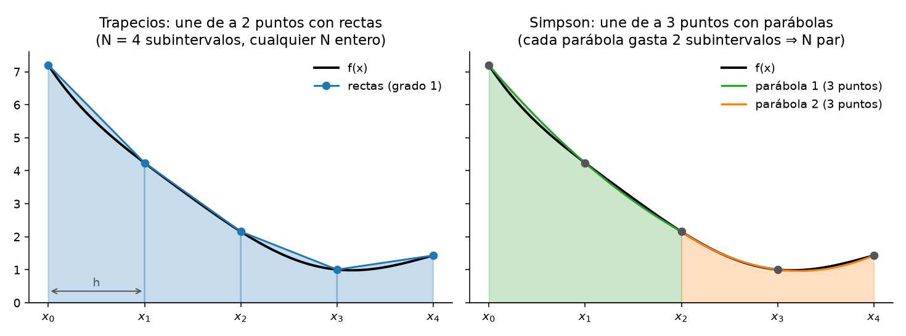
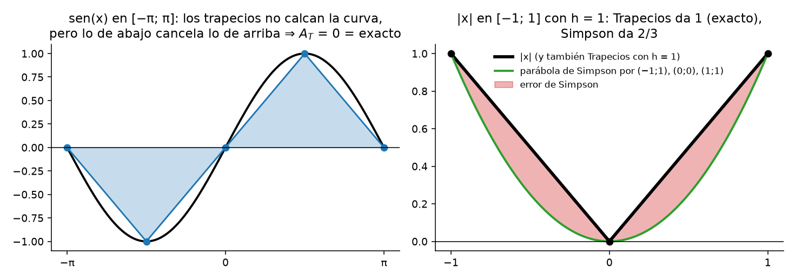
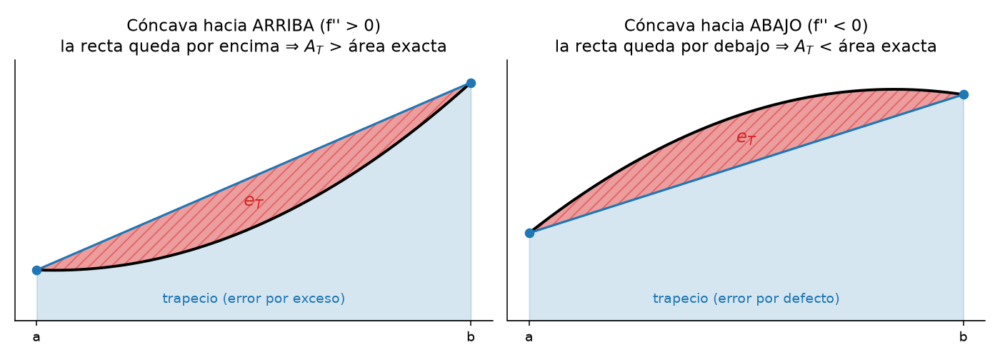
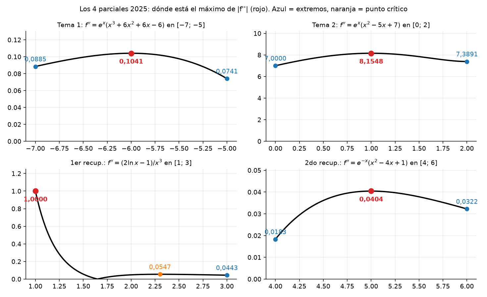
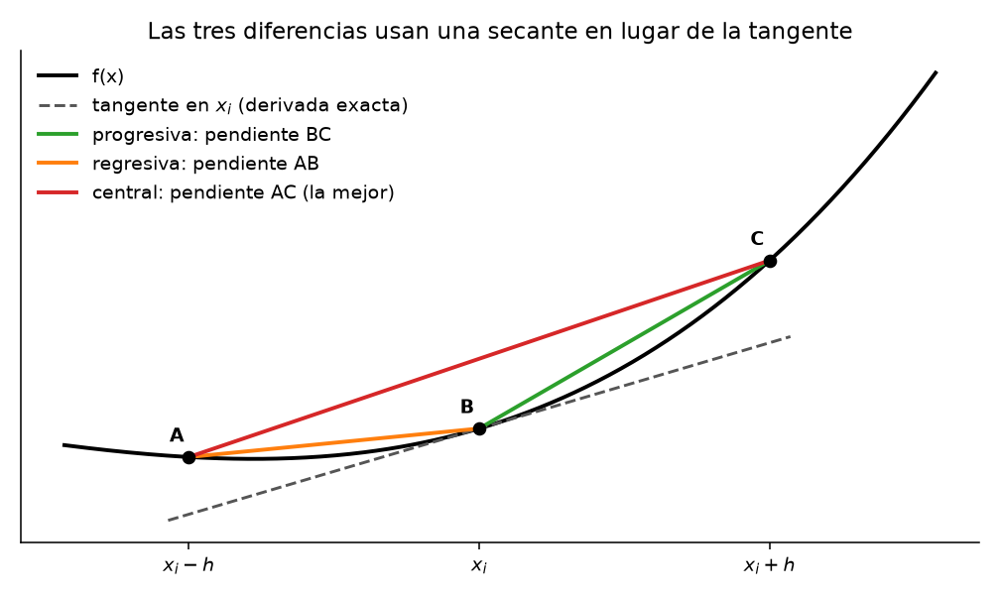

# Diferenciación e integración numérica desde cero

> Fuentes: `fuentes/clases/Integracion Numerica/Clase - Diferenciacion e integracion numerica.pdf` (PDF de clase, 21 p.), `Clase - Exactitud del metodo de Simpson.pdf` (3 p.), `Teorico catedra 2.5 - Integracion.pdf` (teórico de cátedra, 33 p., con su apéndice de acotación), `OneNote - Derivacion e Integracion Numerica.pdf` (práctica manuscrita del profesor, 15 p.), transcripts `14-video-teorica-diferenciacion-integracion.json` (teórica, 1 h 33) y `15-video-practica-diferenciacion-integracion.json` (práctica, 1 h 36), `examenes/INDICE.md` y `examenes/resueltos/RESOLUCIONES-2025.md` (Ej4 de las 4 hojas 2025), apunte `08-practica-repaso-segundo-parcial.md` (ej. 7b, 8, 9, 10 y 11), `fuentes/Guia-ejercicios-parte-2-calculo-numerico.pdf` (ej. 1 a 32 de diferenciación e integración, con sus respuestas) y `fuentes/AYUDAMEMORIA-OFICIAL.pdf` (pág. 4). Todos los números verificados con Python. Generado 2026-11-18.
>
> **Cómo usarla:** leé de arriba abajo. Si estás muy corto de tiempo, el orden de prioridad es **§6 (elegir h para Trapecios: cayó en las 4 hojas)** → §4 (Simpson y "N par") → §5 (preguntas conceptuales del error) → §3 → §7 → §8. Los **Ejemplos guiados** están resueltos a la vista: rehacé cada cuenta con la calculadora. Los **Tu turno** se hacen en papel y **sin mirar**; la corrección está plegada (el enunciado va en texto plano en el título desplegable porque ahí no se renderizan fórmulas; si tiene integrales se repite en LaTeX adentro). Las notas **En clase** son lo que dijo el profesor en los videos, con el minuto real del transcript (`teórica [mm:ss]` = video 14, `práctica [mm:ss]` = video 15). Tiempo total: ≈ 4 h con pausas.
>
> **Qué es de la cátedra y qué es mío:** métodos, fórmulas, criterios y ejemplos salen de las fuentes. Son agregados míos las explicaciones "en criollo", las cuentas intermedias que las fuentes hacen "en Excel", los gráficos, el atajo "para intervalos de longitud 2, $N$ solo con factores 2 y 5" y el reparto de puntaje del **Checkpoint** (las hojas dicen "2 puntos" sin desglosar). El Checkpoint está armado con la función del ej. 27 de la guía y el formato del 2do recuperatorio.

---

## 0. Qué te toman: el Ej4 vale 2 puntos

El Ej4 del 2do parcial es **siempre** integración numérica, y en las 4 hojas de 2025 fue **el mismo ejercicio con otra función**: te dan una integral y un error tolerado $\varepsilon$, y tenés que decir **qué $h$ (o cuántos subintervalos $N$) usar en Trapecios** para garantizar ese error. No se calcula la integral (salvo en el 2do recuperatorio).

| Ítem | Qué te piden | Hojas 2025 | Frecuencia | Sección |
|---|---|---|---|---|
| **Elegir $h$ (o $N$) para Trapecios** | "Mayor $h$ racional no periódico y conveniente" o "número conveniente de subintervalos" para que el error sea menor que $\varepsilon$ | T1 (único ítem), T2 (único ítem, "completar"), R1 (único ítem, 2 puntos), R2 a | **4/4** | §6 |
| **¿Se puede usar Simpson con ese $h$?** | Chequear que $N=(b-a)/h$ sea entero **y par** | R2 b | 1/4 (+ repaso 2026, ej. 10b) | §4 |
| **Calcular la integral con un $h$ dado** | "Resolver con $h=0{,}5$ usando el método más conveniente" (Simpson, con tabla) | R2 c | 1/4 | §3 y §4 |
| Preguntas conceptuales del error | ¿Cuándo Simpson da exacto? ¿Trapecios da de más o de menos? (verdadero/falso, multiple choice) | Repaso 2026 (ej. 9 y 10a) | 0/4 en 2025, 2 en el repaso | §5 |
| Elegir $h$ para Simpson | La misma receta con $f^{IV}$ y $h^4$ | Repaso 2026 (extra del ej. 11) | 0/4 en 2025 | §7 |
| Diferenciación numérica | Derivada primera/segunda desde una tabla; qué fórmula se puede usar | Repaso 2026 (ej. 7b y 8) | 0/4 en 2025, 2 en el repaso | §8 |

T1/T2 = parcial Tema 1/2 · R1/R2 = 1er/2do recuperatorio.

Las 4 integrales que se tomaron (las vas a resolver todas en §6):

| Hoja | Integral | $\varepsilon$ | Respuesta oficial |
|---|---|---|---|
| T1 | $\int_{-7}^{-5} e^{x}(x^{3}-6)\,dx$ | $<10^{-3}$ | $h=0{,}2$ |
| T2 | $\int_{0}^{2} e^{x}(x^{2}-9x+23)\,dx$ | $<10^{-2}$ | $h=0{,}08$ |
| R1 | $\int_{1}^{3} \frac{\ln(x)+1}{x}\,dx$ | $<10^{-2}$ | $h=0{,}2$ |
| R2 | $\int_{4}^{6} e^{-x}(x^{2}-1)\,dx$ | $\le 10^{-3}$ | $N=8$ ($h=0{,}25$) |

**Lectura rápida:** tres de las cuatro son "exponencial por polinomio" y **los cuatro intervalos miden 2**. La receta es siempre: derivar hasta $f''$ → hallar el máximo de $\lvert f''\rvert$ (con $f'''=0$, comparando extremos contra puntos críticos) → despejar $h$ de la cota → elegir un $h$ "lindo" que entre una cantidad entera de veces en el intervalo. Si dominás §6, el Ej4 es tuyo.

> **En clase:** "la dificultad no viene por el lado de la aplicación de los métodos […] la complicación de estos ejercicios viene más por [el análisis del error]" (teórica [44:19]). Y sobre las fórmulas del error: "de acá van a venir muchas preguntas de examen o parcial o final" (teórica [1:05:25]).

## 1. La idea en criollo

Una integral definida $\int_a^b f(x)\,dx$ es **el área bajo la curva** entre $a$ y $b$. A veces no se puede (o no conviene) calcularla con Barrow: no hay primitiva, o solo tenés una tabla de valores. La integración numérica la **aproxima** así:

1. Partís $[a,b]$ en $N$ **subintervalos iguales** de ancho $h$ (el "tamaño de paso").
2. En cada pedacito reemplazás la curva por algo fácil de integrar: una **recta** (Trapecios) o una **parábola** (Simpson).
3. Sumás las áreas.

$$
N=\frac{b-a}{h}\qquad\Longleftrightarrow\qquad h=\frac{b-a}{N}
$$

$N$ y $h$ "son hermanitos, si sé uno sé el otro" (práctica [1:08:46]). $N$ **tiene que ser entero** (no existe 1,5 subintervalo).

Dos ideas que se repiten en todo el tema:

- **A menor $h$, mejor aproximación** (los trapecios son más finitos y la curva se parece más a una recta).
- El método tiene un **error**; no lo conocés exacto, pero lo podés **acotar** con una fórmula. Con esa cota elegís el $h$: eso es el Ej4.

> **En clase:** si $N$ no te da entero "lo que hiciste ahí es elegir mal un $h$ […] lo que tenés que cambiar en ese caso es el $h$" (teórica [44:50]–[45:20]). Nunca se sacan puntos de la tabla: los límites de la integral vienen dados, "el único parámetro con el que podés jugar es con el $h$" (teórica [1:00:42]).

La **diferenciación numérica** (derivar desde una tabla) va al final, en §8: "no es que no pueda haber ningún ejercicio, pero es mucho más corto" (práctica [00:00]).

## 2. Qué tenés en el ayudamemoria y qué va de memoria

En la pág. 4 del ayudamemoria oficial hay dos bloques de este tema:

- 📄 **"Integración numérica"**: solo las **dos fórmulas del error**, escritas así:

$$
E_T=\frac{(a-b)}{12}\,h^{2}\,f''(\varphi)\qquad\qquad E_S=\frac{(a-b)}{180}\,h^{4}\,f^{(4)}(\varphi)\qquad\text{con }\varphi\in[a,b]
$$

- 📄 **"Diferencias finitas"**: $\Delta f_i=f_{i+1}-f_i$, $\Delta^2 f_i=f_{i+2}-2f_{i+1}+f_i$ (progresivas) y $\nabla f_i=f_i-f_{i-1}$, $\nabla^2 f_i=f_i-2f_{i-1}+f_{i-2}$ (regresivas). Son los **numeradores** de las fórmulas de derivadas de §8.

Todo lo demás **va de memoria**:

- 🧠 $N=\dfrac{b-a}{h}$, entero para Trapecios, **entero y par** para Simpson.
- 🧠 **Trapecios compuesto:** $A_T=\dfrac h2\,(E+2M)$.
- 🧠 **Simpson compuesto:** $A_S=\dfrac h3\,(E+4I+2P)$.
- 🧠 Que el error se usa **como cota**: módulo, y $f''(\varphi)$ se cambia por el **máximo de $\lvert f''\rvert$** en $[a,b]$ (para Simpson, de $\lvert f^{IV}\rvert$).
- 🧠 Cómo se halla ese máximo: **extremos del intervalo contra puntos críticos** ($f'''=0$).
- 🧠 Exactitud: Trapecios exacto para polinomios de grado $\le1$; Simpson, de grado $\le3$. Función impar en intervalo simétrico: exacto con los dos.
- 🧠 Concavidad: $f''>0$ ⇒ Trapecios da **de más**; $f''<0$ ⇒ da **de menos**.
- 🧠 Derivadas: dividir por $h$ (primera) o $h^2$ (segunda); la **central** no está en el ayudamemoria: $\dfrac{f_{i+1}-f_{i-1}}{2h}$ y $\dfrac{f_{i+1}-2f_i+f_{i-1}}{h^2}$.

> **En clase:** el profesor dice dos veces que las fórmulas "seguramente están en la hoja de fórmulas" (teórica [1:05:25], práctica [10:03]). Es cierto para las del **error**; las de Trapecios, Simpson y las diferencias centrales **no están**: aprendelas.

---

## 3. Trapecios compuesto: la mecánica con tabla

### 3.1 La idea

En cada subintervalo unís los dos puntos con una recta. Lo que queda abajo es un trapecio de "altura" $h$ y bases $y_{i}$, $y_{i+1}$: área $\frac h2(y_i+y_{i+1})$. Al sumar todos, **cada punto interior aparece dos veces** (es base de dos trapecios) y los extremos una sola:

$$
A_T=\frac h2\,\big[\,y_0+y_N+2\,(y_1+y_2+\dots+y_{N-1})\,\big]=\frac h2\,(E+2M)
$$

$E=y_0+y_N$ (suma de los **e**xtremos) y $M=y_1+\dots+y_{N-1}$ (suma de los del **m**edio).

### 3.2 Receta

1. Calculá $N=\dfrac{b-a}{h}$ y verificá que sea **entero**.
2. Armá la tabla: $x$ desde $a$ hasta $b$ saltando de $h$ en $h$ ($N+1$ puntos), y al lado $y=f(x)$.
3. Sumá $E$ (primero + último) y $M$ (todos los demás).
4. $A_T=\dfrac h2\,(E+2M)$.

### Ejemplo guiado 1: $\int_1^3 \ln(x)\,dx$ con $h=0{,}5$ (PDF de clase)

Valor exacto (para comparar): $3\ln3-2=1{,}2958368$.

**Paso 1.** $N=\dfrac{3-1}{0{,}5}=4$, entero ✓.

**Paso 2.**

| $i$ | $x_i$ | $y_i=\ln(x_i)$ | va a |
|---|---|---|---|
| 0 | 1 | 0 | $E$ |
| 1 | 1,5 | 0,40546511 | $M$ |
| 2 | 2 | 0,69314718 | $M$ |
| 3 | 2,5 | 0,91629073 | $M$ |
| 4 | 3 | 1,09861229 | $E$ |

**Paso 3.** $E=0+1{,}09861229=1{,}09861229$; $M=0{,}40546511+0{,}69314718+0{,}91629073=2{,}01490302$.

**Paso 4.**

$$
A_T=\frac{0{,}5}{2}\,\big(1{,}09861229+2\cdot2{,}01490302\big)=0{,}25\cdot5{,}12841833=1{,}28210458
$$

Error real: $1{,}29584-1{,}28210=0{,}0137$. Con $h=0{,}25$ ($N=8$) el PDF da $A_T=1{,}29237491$ (error $0{,}0035$): achicar $h$ mejora.

> **En clase:** "a menor $h$, más precisión para Trapecios" (teórica [43:47]). Comparado con las derivadas numéricas, que daban errores del 100 %, "por lo menos ahora estamos hablando de métodos más serios" (teórica [42:10]).
>
> **En clase (práctica [27:55]–[28:25]):** error **absoluto** = exacto − aproximado (en módulo); **relativo** = absoluto dividido el exacto. La cota de §6 es del error absoluto. Si el integrando tiene una constante multiplicando, "dejás afuera la constante y después la volvés a agregar al final" (práctica [26:51]).

### Tu turno 3

<strong>3.A (guía ej. 6 a y b; OneNote y práctica)</strong> — Dada f(x) = 1 + x³ en [0, 2], calcular la integral: a) en forma analítica; b) por Trapecios con h = 1 y con h = 0,5.

<strong>Resolución</strong>

**a)**

$$
\int_0^2(1+x^3)\,dx=\left[x+\frac{x^4}{4}\right]_0^2=2+4=6
$$

**b) $h=1$:** $N=2$. Tabla: $(0;1)$, $(1;2)$, $(2;9)$. $E=1+9=10$, $M=2$.

$$
A_T=\frac12\,(10+2\cdot2)=7
$$

**$h=0{,}5$:** $N=4$.

| $x$ | 0 | 0,5 | 1 | 1,5 | 2 |
|---|---|---|---|---|---|
| $y$ | 1 | 1,125 | 2 | 4,375 | 9 |

$E=10$, $M=1{,}125+2+4{,}375=7{,}5$.

$$
A_T=\frac{0{,}5}{2}\,(10+2\cdot7{,}5)=6{,}25
$$

Con $h=0{,}2$ (lo hace en Excel) da $6{,}04$. **Conclusión:** $7\to6{,}25\to6{,}04$: a menor $h$, más cerca del $6$ exacto (práctica [19:02]). Y siempre da **de más**: en §5 vas a ver por qué ($f''=6x>0$).

## 4. Simpson compuesto: parábolas de a tres puntos y "N par"

### 4.1 La idea

En vez de rectas, Simpson pasa una **parábola por cada 3 puntos** consecutivos (polinomio interpolante de grado 2). Cada parábola ocupa **2 subintervalos**, y su área es $\frac h3(y_0+4y_1+y_2)$ (fórmula simple; el PDF la deduce interpolando con Newton-Gregory en $-h$, $0$, $h$ e integrando). Al sumar todas las parábolas:

$$
A_S=\frac h3\,\big[\,y_0+y_N+4\,(y_1+y_3+y_5+\dots)+2\,(y_2+y_4+\dots)\,\big]=\frac h3\,(E+4I+2P)
$$

$E$ = extremos, $I$ = suma de los de subíndice **i**mpar, $P$ = suma de los de subíndice **p**ar (sin contar los extremos).

**El requisito:** como cada parábola gasta 2 subintervalos, **$N$ tiene que ser par** (cantidad impar de puntos). Mínimo $N=2$.

### 4.2 Receta

1. $N=\dfrac{b-a}{h}$: ¿entero **y par**? Si no, Simpson no se puede usar con ese $h$.
2. Tabla con **tres columnas**: $i$ (contador desde 0), $x_i$, $y_i$.
3. $E=y_0+y_N$; $I$ = los $y$ de $i$ impar; $P$ = los $y$ de $i$ par **que no sean extremos**.
4. $A_S=\dfrac h3\,(E+4I+2P)$.

> **En clase:** "conviene agregar una columna […] que sea como un contador, un subíndice" para marcar los impares (teórica [56:57]). "Los puntos que son extremos no los consideramos par ni impar" (teórica [57:30]; práctica [22:41]).
>
> **En clase:** las preguntas vienen por este lado: "¿puedo usar un $h$ igual a 0,3 y usar Simpson? Agarrás los extremos del intervalo, lo dividís por el $h$ que te dan, y te fijás si es un número entero, si es un número par" (teórica [1:00:11]). "Cuando les pregunten si se puede o no se puede usar Simpson tienen que enfocarse automáticamente en la cantidad par de subintervalos" (práctica [57:08]).

### Ejemplo guiado 2: $\int_1^3\ln(x)\,dx$ con $h=0{,}5$ por Simpson (PDF de clase)

**Paso 1.** $N=4$: entero y par ✓.

**Paso 2.** Misma tabla del Ejemplo guiado 1, ahora clasificada:

| $i$ | $x_i$ | $y_i$ | va a |
|---|---|---|---|
| 0 | 1 | 0 | $E$ |
| 1 | 1,5 | 0,40546511 | $I$ (×4) |
| 2 | 2 | 0,69314718 | $P$ (×2) |
| 3 | 2,5 | 0,91629073 | $I$ (×4) |
| 4 | 3 | 1,09861229 | $E$ |

**Paso 3.** $E=1{,}09861229$; $I=0{,}40546511+0{,}91629073=1{,}32175584$; $P=0{,}69314718$.

**Paso 4.**

$$
A_S=\frac{0{,}5}{3}\,\big(1{,}09861229+4\cdot1{,}32175584+2\cdot0{,}69314718\big)=\frac{0{,}5}{3}\cdot7{,}77193001=1{,}29532167
$$

Exacto: $1{,}29583687$. Error $0{,}0005$, contra $0{,}0137$ de Trapecios con la misma tabla. Con $h=0{,}25$: $A_S=1{,}29579835$.

> **En clase:** "es una aproximación muy buena para muy poco esfuerzo" (teórica [58:03]). Existen fórmulas con polinomios de grado 3 ("regla de 3/8", $N$ múltiplo de 3) y 4, pero son solo informativas: "los métodos que vamos a usar en la materia van a ser estos dos, Simpson y Trapecios" (teórica [1:03:53]).

### Tu turno 4

<strong>4.A (parcial 2025, 2do recuperatorio, ítems b y c)</strong> — Para la integral entre 4 y 6 de e⁻ˣ(x² − 1): b) con h = 0,25 (N = 8, hallado en el ítem a), ¿se podría usar el método de Simpson? c) Resolver la integral con h = 0,5 usando el método más conveniente.

$$
\int_{4}^{6} e^{-x}(x^{2}-1)\,dx
$$

<strong>Resolución</strong>

**b)** $N=\dfrac{6-4}{0{,}25}=8$. **Sí, porque $N$ es par** (respuesta oficial textual).

**c)** $N=\dfrac{6-4}{0{,}5}=4$: entero y par ⇒ el más conveniente es **Simpson** (más preciso con la misma tabla).

| $i$ | $x_i$ | $y_i=e^{-x_i}(x_i^2-1)$ | va a |
|---|---|---|---|
| 0 | 4 | 0,27473458 | $E$ |
| 1 | 4,5 | 0,21384818 | $I$ |
| 2 | 5 | 0,16171073 | $P$ |
| 3 | 5,5 | 0,11953806 | $I$ |
| 4 | 6 | 0,08675633 | $E$ |

$E=0{,}36149091$; $I=0{,}33338624$; $P=0{,}16171073$.

$$
A_S=\frac{0{,}5}{3}\,\big(0{,}36149091+4\cdot0{,}33338624+2\cdot0{,}16171073\big)=\frac{0{,}5}{3}\cdot2{,}01845733=0{,}33640956
$$

Coincide con la hoja oficial ($AS=0{,}33640956$; la hoja solo muestra la tabla y el resultado). Verificado: la integral exacta es $\big[-e^{-x}(x+1)^2\big]_4^6=0{,}33643212$; Trapecios con la misma tabla daría $0{,}33792$.

**Cómo calcular $y$ en la calculadora:** cuidado con el signo del exponente: $e^{-4}\cdot(16-1)=0{,}018316\cdot15$.

<strong>4.B (guía ej. 6 c y d; OneNote y práctica)</strong> — Para f(x) = 1 + x³ en [0, 2], aproximar por Simpson con h = 1 y sacar conclusiones comparando con Trapecios (3.A).

<strong>Resolución</strong>

$N=2$, par ✓. Tabla: $i=0$: $(0;1)$ → $E$; $i=1$: $(1;2)$ → $I$; $i=2$: $(2;9)$ → $E$. No hay puntos pares interiores: $P=0$.

$$
A_S=\frac13\,(10+4\cdot2+0)=\frac{18}{3}=6
$$

**Dio exacto** con el $h$ más grande posible. ¿Por qué? Porque $f$ es un polinomio de grado 3: $f^{IV}(x)=0$ y el error de Simpson se anula (§5). Conclusiones del profesor: en Trapecios, a menor $h$ mayor precisión; Simpson dio el resultado exacto con el $h$ "grande" porque $f^{IV}=0$.

<strong>4.C (guía ej. 9; OneNote y práctica)</strong> — Hallar el volumen del cuerpo de revolución V = ∫ f(x)² dx entre a y b, siendo x² + y²/9 = 1: a) por Trapecios con h = 1; b) por Simpson con h = 1.

<strong>Resolución</strong>

**Planteo (lo difícil del ejercicio).** Necesito $f(x)^2=y^2$: despejo $y^2=9\,(1-x^2)$ y **no** saco raíz. ¿Entre qué límites? La ecuación es una elipse que en $x$ va de $-1$ a $1$: integro en $[-1;1]$.

Con $h=1$: $N=2$. Tabla de $y^2$: $(-1;0)$, $(0;9)$, $(1;0)$.

$$
A_T=\frac12\,(0+0+2\cdot9)=9\qquad\qquad A_S=\frac13\,(0+0+4\cdot9)=12
$$

Exacto: $\int_{-1}^{1}9(1-x^2)\,dx=9\left[x-\frac{x^3}{3}\right]_{-1}^{1}=12$. **Simpson dio exacto** (el integrando es un polinomio de grado 2 ≤ 3); Trapecios quedó lejos porque usa "el peor $h$ posible" (práctica [33:08]). El profesor (práctica [29:28]): "la parte más pesada del ejercicio viene por el lado del planteo y no de la aplicación de la fórmula".

<strong>4.D (guía ej. 13, 7 y 32 f: funciones dadas por tabla)</strong> — a) Tabla x = 1, 2, 3, 4, 5; y = 21, 38, 62, 104, 175: hallar la integral entre 1 y 5 usando si es posible Simpson, si no Trapecios, e indicar si se puede estimar el error. b) Tabla x = 1,0; 1,1; 1,2; 1,3; 1,4; y = 0,010; 0,252; 0,586; 1,024; 1,578: estimar la integral entre 1 y 1,4 por Trapecios y por Simpson. c) Tabla x = −3, −1, 1, 3, 5, 7; y = 77, 47, 43, −31, −175, −293: integral en [−3, 7] con algún método adecuado.

<strong>Resolución</strong>

**a)** 5 puntos ⇒ $N=4$, par ⇒ **Simpson**, $h=1$. $E=21+175=196$; $I=38+104=142$; $P=62$.

$$
A_S=\frac13\,(196+4\cdot142+2\cdot62)=\frac{888}{3}=296
$$

**No se puede estimar el error** porque no se conoce $f(x)$ (no hay derivada cuarta que acotar). Coincide con la guía.

**b)** $h=0{,}1$, $N=4$ (par: sirven los dos). $E=0{,}010+1{,}578=1{,}588$; $M=0{,}252+0{,}586+1{,}024=1{,}862$; $I=0{,}252+1{,}024=1{,}276$; $P=0{,}586$.

$$
A_T=\frac{0{,}1}{2}\,(1{,}588+2\cdot1{,}862)=0{,}2656\qquad A_S=\frac{0{,}1}{3}\,(1{,}588+4\cdot1{,}276+2\cdot0{,}586)=0{,}26213
$$

**c)** 6 puntos ⇒ $N=5$, **impar** ⇒ Simpson no se puede: **Trapecios**, $h=2$. $E=77-293=-216$; $M=47+43-31-175=-116$.

$$
A_T=\frac22\,(-216+2\cdot(-116))=-448
$$

Coincide con la guía ("por Trapecios, ya que hay 5 subintervalos").

<strong>4.E (verdadero/falso de "¿se puede usar Simpson?": guía ej. 14 e, 14 h, 17 d, 19 b y 25 d; repaso 2026 ej. 10 b)</strong> — a) Para todo a entero es posible resolver una integral en (a; 16a) por Simpson con h = 0,15. b) No es posible calcular la integral entre 0 y 2 de x²eˣ por Simpson con h = 0,4. c) Es posible calcular la integral entre 1 y 4 de e²ˣcos(x) por Simpson con h = 0,04. d) La integral entre −15 y 15 de f(x) se puede resolver por Simpson con h = 0,6. e) No es posible tomar h = 0,8 para aproximar la integral entre 1 y 5 por Simpson. f) La integral entre 1 y 3 de sen(x) + ln(x) se puede resolver por Simpson con h = 0,08.

<strong>Resolución</strong>

En todos: $N=\dfrac{b-a}{h}$ y mirar si es **entero y par**.

- **a)** $N=\dfrac{16a-a}{0{,}15}=100\,a$. Con $a$ entero, $100a=2\cdot50a$ es par ⇒ **Verdadero** (práctica [57:40]).
- **b)** $N=\dfrac{2}{0{,}4}=5$, impar ⇒ no se puede ⇒ la frase es **Verdadera**.
- **c)** $N=\dfrac{3}{0{,}04}=75$, impar ⇒ **Falso**.
- **d)** $N=\dfrac{30}{0{,}6}=50$, par ⇒ **Verdadero**.
- **e)** $N=\dfrac{4}{0{,}8}=5$, impar ⇒ no es posible ⇒ **Verdadero**.
- **f)** $N=\dfrac{2}{0{,}08}=25$, impar ⇒ **Falso** (repaso 2026).

Ojo con la doble negación de b) y e): "no es posible" + $N$ impar = verdadero.

## 5. Las fórmulas del error y las preguntas conceptuales que salen de ahí

Del desarrollo de Taylor salen (PDF de clase; son las del ayudamemoria con el signo acomodado):

$$
e_T=-\frac{b-a}{12}\,h^{2}\,f''(\varphi)\qquad\qquad e_S=-\frac{b-a}{180}\,h^{4}\,f^{IV}(\varphi)\qquad a\le\varphi\le b
$$

$\varphi$ es un punto del intervalo que **nadie conoce**. Aun así, de las fórmulas salen cuatro conclusiones que se toman como verdadero/falso o multiple choice.

### 5.1 ¿Cuándo da exacto?

En $e_T$, ni $b-a$ ni $h$ pueden ser cero; lo único que se puede anular es $f''$.

- **Trapecios es exacto si $f''=0$ en todo el intervalo**: polinomios de grado $\le1$ (rectas). Lógico: une con rectas.
- **Simpson es exacto si $f^{IV}=0$ en todo el intervalo**: polinomios de grado $\le3$. Esto es contraintuitivo (interpola con parábolas de grado 2 y aun así integra exacto las cúbicas): en una cúbica, lo que la parábola calcula de más de un lado del punto medio lo calcula de menos del otro, y se compensa. El apunte "Exactitud del método de Simpson" lo demuestra integrando $a_3x^3$ entre $k-h$ y $k+h$: analíticamente da $a_3(2k^3h+2kh^3)$ y por Simpson, $a_3\frac h3\big[(k+h)^3+(k-h)^3+4k^3\big]$, que es lo mismo.

> **En clase:** "si yo le doy a Trapecios un polinomio de grado 1 o 0, me va a dar el resultado exacto. Si le doy a Simpson un polinomio de grado 3 o menos, también" (teórica [1:10:14]).

### 5.2 El recíproco es falso: funciones impares en intervalos simétricos

Que dé exacto **no** implica que $f''=0$ (ni que sea un polinomio de grado $\le3$).

**Contraejemplo de la cátedra:** $f(x)=\operatorname{sen}(x)$ en $[-\pi;\pi]$ (o cualquier **función impar en un intervalo simétrico** $[-a;a]$). El área exacta es $0$ porque la panza de arriba cancela la de abajo; a los trapecios (o a las parábolas) les pasa lo mismo: no calcan la curva, pero se cancelan entre sí. $A_T=0=$ exacto, y $f''(x)=-\operatorname{sen}(x)\ne0$.

> **En clase:** "a mí me gusta pensar que en esta materia los recíprocos nunca se cumplen" (práctica [45:38]). "Esto es algo que gusta tomar" (práctica [48:47]).
>
> **En clase:** "exacto" no es lo mismo que "cero": $\int_{-4}^{4}(\operatorname{sen}x+3{,}34)\,dx$ por Trapecios da exactamente $26{,}72=3{,}34\cdot8$ con cualquier $N$, porque el seno se cancela y la constante es un polinomio de grado 0 (práctica [50:51]–[52:25]).
>
> **En clase:** la cota del error es una **desigualdad**: que el error real sea 0 no contradice que la cota dé un número positivo (práctica [49:19]).

Para reconocer paridad: par × impar = impar; impar × impar = par; suma de impares = impar. Un módulo adentro "en general genera simetría" (práctica [1:00:51]): $e^{\lvert x\rvert}$ es par.

### 5.3 Trapecios: ¿da de más o de menos? Concavidad

- $f''>0$ en todo $[a,b]$ (cóncava hacia **arriba**) ⇒ $A_T>$ área exacta (error por **exceso**).
- $f''<0$ en todo $[a,b]$ (cóncava hacia **abajo**) ⇒ $A_T<$ área exacta (error por **defecto**).

**Receta para justificar:** (1) derivá dos veces; (2) mostrá que $f''$ **no cambia de signo en todo el intervalo** (no alcanza con evaluarla en un punto); (3) concluí con el dibujito.

**No depende de $h$**: si la función es cóncava hacia abajo, ningún $h$ hace que Trapecios dé de más.

> **En clase:** "yo sinceramente no me acuerdo de memoria, porque es un grafiquito súper fácil de hacer" (teórica [1:10:49]); "me hago ese dibujito que son dos segundos y lo contesto" (práctica [40:27]). "Siempre hablamos de funciones positivas porque si no cambia el análisis, pero creo que nunca lo tomaron" (práctica [39:57]).
>
> **En clase:** si $f''$ **cambia de signo** dentro del intervalo (hay un punto de inflexión), no se puede concluir: "en un examen no les debería pasar esto, y si les llega a pasar me dicen: no puedo concluir nada porque hay un punto de inflexión en el medio" (práctica [1:22:19]).

### 5.4 ¿Simpson siempre le gana a Trapecios?

Casi siempre, pero no: $f(x)=\lvert x\rvert$ en $[-1;1]$ con $h=1$ (figura de arriba, derecha). Trapecios une de a dos puntos y calca la V: $A_T=\frac12(2+2\cdot0)=1$, exacto. Simpson pasa una parábola por los tres puntos: $A_S=\frac13(2+4\cdot0)=\frac23$. El profesor lo vio preguntar en un coloquio de final (práctica [1:31:18]).

### Tu turno 5

<strong>5.A (repaso 2026, ejercicio 9)</strong> — Al resolver la integral entre −3 y 3 de (x³cos x + x) por Simpson tomando n subintervalos se obtiene el valor exacto si: a) n es par · b) n es mayor que 3 · c) n es par y mayor que 6 · d) nunca es posible · e) n es impar · f) n.a.

$$
\int_{-3}^{3}\left(x^{3}\cos x+x\right)dx
$$

<strong>Resolución</strong>

**Paso 1 — paridad.** $x^3$ impar × $\cos x$ par = impar; más $x$ (impar) = **impar**.

**Paso 2.** Intervalo $[-3;3]$ simétrico ⇒ la integral vale $0$ y Simpson (o Trapecios) también da $0$: exacto.

**Paso 3.** Para poder usar Simpson, $n$ tiene que ser **par**.

**Respuesta: a)** y también **c)** (par y mayor que 6 también es par): el profesor marca las dos. No hay que acotar ninguna derivada.

<strong>5.B (repaso 2026, ejercicio 10 a)</strong> — Dada la integral entre 1 y 3 de (sen(x) + ln(x)), ¿verdadero o falso? «Trapecios devuelve un valor menor al exacto».

<strong>Resolución</strong>

$$
f'(x)=\cos x+\frac1x\qquad f''(x)=-\operatorname{sen}x-\frac1{x^2}
$$

En $[1;3]$: $\operatorname{sen}x>0$ (1 y 3 radianes están entre $0$ y $\pi$) y $\frac{1}{x^2}>0$. Con el signo menos adelante, $f''<0$ **en todo el intervalo** ⇒ cóncava hacia abajo ⇒ $A_T<\int$ ⇒ **Verdadero**.

(Verificado: $f''(1)=-1{,}84$, $f''(3)=-0{,}25$; con $h=0{,}5$ Trapecios da $2{,}780$ y la exacta es $2{,}826$.)

<strong>5.C (guía ej. 14 a, b, c, d, f y g; OneNote y práctica)</strong> — Verdadero o falso, justificando: a) f positiva y cóncava hacia abajo en [a, b] ⇒ el valor A por Trapecios cumple A &lt; ∫f. b) Si por Trapecios se obtiene el valor exacto ⇒ f''(x) = 0 en todo (a, b). c) Si por Simpson se obtiene error cero ⇒ f es polinómica de grado ≤ 3. d) El error por Simpson de f(x) = ax³ + bx² + 10 en (0; p) depende exclusivamente de p. f) La integral de e^|x|·sen(x) entre −a y a por Trapecios con una cantidad par de subintervalos da siempre exacta. g) Existe h real tal que la integral entre −1 y 1 de sen(πx)/(πx) por Trapecios dé mayor que la exacta.

<strong>Resolución</strong>

- **a) Verdadero.** Cóncava hacia abajo: los trapecios quedan por debajo de la curva.
- **b) Falso.** Contraejemplo: $f(x)=\operatorname{sen}x$ en un intervalo simétrico: $A_T=A=0$ y $f''=-\operatorname{sen}x\ne0$.
- **c) Falso.** Mismo contraejemplo (impar en intervalo simétrico, Simpson da $0$ y no es un polinomio).
- **d) Falso.** Es un polinomio de grado $\le3$ ⇒ $f^{IV}(x)=0\ \forall x$ ⇒ $e_S=0$ sin importar el intervalo.
- **f) Verdadero.** $e^{\lvert x\rvert}$ par × $\operatorname{sen}x$ impar = impar, en intervalo simétrico ⇒ $A_T=A=0$. Lo de "cantidad par" está de más: "no le importa a nadie" (práctica [59:51]).
- **g) Falso.** No depende de $h$ sino de la concavidad: la panza central de esa función queda por encima de los trapecios, $A_T<A$ para todo $h$ (justificación gráfica del profesor, práctica [1:05:06]). Verificado: exacta $1{,}1790$; Trapecios con $N=2,\ 4,\ 10$ da $1;\ 1{,}137;\ 1{,}172$.

<strong>5.D (guía ej. 17 a y c, ej. 24; OneNote y práctica)</strong> — Verdadero o falso: a) Al calcular por Trapecios la integral de ln(x)·x³ entre 1 y 2 se obtiene un valor mayor que el exacto. c) Al calcular por Trapecios la integral entre 1 y 4 de e²ˣcos(x) con h = 0,1 se obtiene un valor mayor al exacto. Y el ej. 24: ¿es posible resolver la integral entre −0,5 y 0,5 de e^(−x²) por Trapecios con h = 0,04 y asegurar que el valor obtenido es menor que el exacto?

<strong>Resolución</strong>

**a)** $f'(x)=x^2+3x^2\ln x$; $f''(x)=2x+3x+6x\ln x=5x+6x\ln x$. En $[1;2]$ todo es positivo ($\ln x\ge0$) ⇒ $f''>0$ ⇒ cóncava hacia arriba ⇒ $A_T>A$ ⇒ **Verdadero**.

**c)** $f''(x)=e^{2x}(3\cos x-4\operatorname{sen}x)$. Se anula cuando $\tan x=\frac34$, es decir en $x\approx3{,}79$, que está dentro de $[1;4]$: **$f''$ cambia de signo** ⇒ con la regla de la concavidad **no se puede concluir**. El profesor lo resuelve en Excel y concluye **Falso** (la guía también): Trapecios da $-1234{,}8$ y la exacta es $-1233{,}4$. En un examen: "no puedo concluir porque hay un punto de inflexión en el intervalo".

**Ej. 24.** (1) ¿Se puede usar $h=0{,}04$? $N=\dfrac{1}{0{,}04}=25$, entero ✓ (Trapecios no pide par). (2) $f''(x)=e^{-x^2}(4x^2-2)$; en $[-0{,}5;0{,}5]$, $4x^2\le1<2$ ⇒ $f''<0$ ⇒ cóncava hacia abajo ⇒ $A_T<A$. **Verdadero.**

<strong>5.E (guía ej. 21 y 25 c/e)</strong> — a) La mínima cantidad de subintervalos para calcular el valor exacto de la integral entre 1 y 2 de (3x³ − 2x² + 5) por Simpson es: 1, 2, 3 o 4. b) Para I = integral entre 1 y 5 de f: «si f es polinómica de grado 5, Trapecios no puede dar exacto». c) «Una cota del error de Trapecios con h = 1 es (1/3)·f''(5)».

<strong>Resolución</strong>

- **a)** Polinomio de grado 3 ⇒ Simpson da exacto con cualquier $N$ par; el mínimo par es **2** (opción b de la guía).
- **b) Falso.** Puede dar exacto por simetría (por ejemplo $f(x)=(x-3)^5$ es "impar" respecto del centro del intervalo $[1;5]$ y da $0$): los recíprocos no se cumplen.
- **c) Falso.** El coeficiente está bien, $\frac{b-a}{12}h^2=\frac{4}{12}=\frac13$, pero la cota lleva el **máximo de $\lvert f''\rvert$ en $[1;5]$**, que no tiene por qué estar en $x=5$ (y va en módulo).

---

## 6. La receta estrella: elegir $h$ (o $N$) para Trapecios con error menor que $\varepsilon$ (4/4)

### 6.1 La idea

No sabés cuánto vale $\varphi$, así que no podés calcular el error. Pero podés ponerte **en el peor caso**: tomar módulo y reemplazar $\lvert f''(\varphi)\rvert$ por el valor más grande que puede tomar en $[a,b]$. Si aun en el peor caso el error es menor que $\varepsilon$, estás cubierto:

$$
\lvert e_T\rvert\le\left\lvert\frac{b-a}{12}\right\rvert\,h^{2}\,\max_{a\le\varphi\le b}\lvert f''(\varphi)\rvert<\varepsilon
$$

Ahí la única incógnita es $h$. "$n$ cifras decimales correctas" significa $\varepsilon<10^{-n}$ (teórica [1:15:37]).

### 6.2 Receta (así resuelven las 4 hojas oficiales)

1. **Planteá la cota** con los datos. Si el intervalo mide 2 (los 4 parciales): $\dfrac{2}{12}=\dfrac16$ y queda $\dfrac{h^2}{6}\cdot\max\lvert f''\rvert<\varepsilon$.
2. **Derivá** hasta $f''$ y dejala factorizada.
3. **Hallá $K=\max\lvert f''\rvert$ en $[a,b]$**:
   - Si se ve que $f''$ es **monótona** (siempre crece o siempre decrece) en el intervalo, el máximo de $\lvert f''\rvert$ está en un **extremo**: evaluá en $a$ y en $b$ y quedate con el mayor en módulo. Hay que **decir** por qué es monótona ("es decreciente en el intervalo").
   - Si no se ve (el caso de los 4 parciales), escribí la frase de la cátedra: **"no veo a ojo que sea creciente o decreciente en el intervalo"**, derivá una vez más, resolvé $f'''(x)=0$ y quedate con los **puntos críticos que caen dentro de $[a,b]$**. Evaluá $f''$ en **los dos extremos y en esos puntos críticos**. $K$ es el mayor **en módulo**.
4. **Despejá $h$**: $h<\sqrt{\dfrac{12\,\varepsilon}{(b-a)\,K}}$.
5. **Pasá a $N$**: $N>\dfrac{b-a}{h_{\text{cota}}}$, y $N$ es entero ⇒ empezás por el entero siguiente.
6. **Elegí el $h$ "lindo"**: recorré $N$, $N+1$, $N+2$… calculando $h=\dfrac{b-a}{N}$ y quedate con el **primero** que dé un decimal finito y corto. Ese es "el mayor $h$ racional no periódico y conveniente".
7. **Respuesta** con $h$ y $N$: "con $h=\ldots$ ($N=\ldots$ subintervalos) se asegura $\varepsilon<\ldots$".

**Atajo mío para el paso 6:** $h=\frac{2}{N}$ es un decimal finito solo si $N$ no tiene factores primos distintos de 2 y 5. Candidatos: $N=4,\ 5,\ 8,\ 10,\ 16,\ 20,\ 25,\ 32,\ 40,\ 50,\ 64,\ 80,\ 100\ldots$ → $h=0{,}5;\ 0{,}4;\ 0{,}25;\ 0{,}2;\ 0{,}125;\ 0{,}1;\ 0{,}08;\ 0{,}0625;\ 0{,}05;\ 0{,}04;\ 0{,}03125;\ 0{,}025;\ 0{,}02$. Elegís el primero de la lista que supere tu cota de $N$.

> **En clase:** ¿por qué "no periódico"? "Porque los números periódicos me van a introducir mucho error de cálculo […] siempre trabajamos con $h$ más redonditos" (teórica [1:20:51]–[1:21:26]). Un $h$ no periódico pero con muchos decimales tampoco sirve: "introducir errores de redondeo por usar un $h$ muy largo y muy feo tampoco está bueno" (teórica [1:25:04]).
>
> **En clase (práctica [1:11:23]–[1:13:59]):** hay "dos formas de hallar $h$" y las dos valen. (1) **A ojo**: el primer $h$ redondo menor que la cota (con $h<0{,}2449$, pensás $0{,}2$ y verificás que $N$ dé entero). (2) **Formal**: $N=(b-a)/h_{\text{cota}}=4{,}08$ ⇒ el próximo entero es $5$ ⇒ $h=0{,}2$. Lo que **no** vale: "tenés $h<0{,}24$ y me ponés $0{,}05$; no, pará, te salteaste el $0{,}1$, el $0{,}2$". Si a ojo se te pasa uno poco obvio, no pasa nada.
>
> **En clase (teórica [1:31:26]–[1:31:56]):** en el ejemplo del parcial, con $N\ge23$: "más correcto, la verdad, hay que tomar 24 [$h=0{,}125$]; pero si alguno me pone 25 y $0{,}12$ también va bien. Lo importante es que no me pongan [el 23], porque el $h$ es horrible, [ni] uno más adelante, porque había opciones más lindas antes".

### 6.3 Dónde estuvo el máximo en los 4 parciales

En tres hojas el máximo estuvo en el **punto crítico**; en el 1er recuperatorio, en el **extremo izquierdo** (y ahí además manda el módulo: $f''(1)=-1$). Moraleja: se evalúan **siempre los tres** (o cuatro) candidatos y se compara en módulo.

> **En clase:** "a veces está en los puntos críticos, a veces está en los extremos" (práctica [1:29:09]). "Lo importante es que sepan que tienen que comparar puntos críticos con extremos del intervalo, para la derivada segunda en Trapecios, para la derivada cuarta en Simpson" (práctica [1:29:40]). Saber si el punto crítico es máximo o mínimo (con $f^{IV}$) es "dato de color": no hace falta.
>
> **En clase:** un punto crítico fuera del intervalo se descarta: "$f''$ en 3 no hace falta porque no está dentro del intervalo […] solo trabajo con los puntos que estén adentro" (teórica [1:29:54]).

### Ejemplo guiado 3 (el caso fácil): $\int_1^2\frac1x\,dx$ con dos cifras decimales correctas (guía ej. 15 a; PDF de clase, OneNote, teórica y práctica)

**Paso 1.** $\varepsilon<10^{-2}$, $b-a=1$:

$$
\frac{1}{12}\,h^{2}\,\max_{1\le\varphi\le2}\lvert f''(\varphi)\rvert<10^{-2}
$$

**Paso 2.** $f(x)=\dfrac1x$, $f'(x)=-\dfrac{1}{x^2}$, $f''(x)=\dfrac{2}{x^3}$.

**Paso 3.** $\dfrac{2}{x^3}$ es positiva y **decreciente** en $[1;2]$ ⇒ el máximo está en el extremo izquierdo: $K=f''(1)=2$.

**Paso 4.**

$$
\frac1{12}\,h^2\cdot2<10^{-2}\ \Rightarrow\ h^2<0{,}06\ \Rightarrow\ h<0{,}2449
$$

**Pasos 5 y 6.** $N>\dfrac{1}{0{,}2449}=4{,}08$ ⇒ $N=5$ ⇒ $h=\dfrac15=0{,}2$ ✓ (decimal finito).

**Respuesta:** con $N=5$ subintervalos ($h=0{,}2$) se asegura un error menor que $10^{-2}$.

### Ejemplo guiado 4 (el caso de parcial): $\int_{-3}^{0}e^{x}(x^{2}-8x+15)\,dx$ con $\varepsilon<10^{-2}$ (PDF de clase: "tomado en un parcial")

"Indicar la subdivisión necesaria del intervalo $[-3;0]$ usando un $h$ conveniente, por Trapecios."

**Paso 1.** $b-a=3$:

$$
\frac{3}{12}\,h^{2}\,K<10^{-2}\qquad K=\max_{-3\le\varphi\le0}\lvert f''(\varphi)\rvert
$$

**Paso 2.** Regla del producto, sacando $e^x$ factor común cada vez (**truco:** la derivada de $e^x\cdot p(x)$ es $e^x\cdot\big(p(x)+p'(x)\big)$):

$$
f'(x)=e^{x}(x^{2}-8x+15)+e^{x}(2x-8)=e^{x}(x^{2}-6x+7)
$$

$$
f''(x)=e^{x}(x^{2}-6x+7)+e^{x}(2x-6)=e^{x}(x^{2}-4x+1)
$$

**Paso 3.** No se ve si $f''$ crece o decrece en $[-3;0]$ ⇒ derivo otra vez y busco puntos críticos:

$$
f'''(x)=e^{x}(x^{2}-4x+1)+e^{x}(2x-4)=e^{x}(x^{2}-2x-3)=e^{x}(x+1)(x-3)
$$

$e^x$ nunca se anula ⇒ $f'''=0$ en $x=-1$ y $x=3$. Solo $x=-1$ pertenece a $[-3;0]$. Comparo extremos contra el punto crítico:

| $x$ | −3 (extremo) | **−1 (punto crítico)** | 0 (extremo) |
|---|---|---|---|
| $f''(x)=e^{x}(x^2-4x+1)$ | $22e^{-3}=1{,}0953$ | $6e^{-1}=\mathbf{2{,}2073}$ | $1$ |

$K=2{,}207276$.

**Paso 4.**

$$
\frac{3}{12}\,h^2\cdot2{,}207276<10^{-2}\ \Rightarrow\ h^2<0{,}018122\ \Rightarrow\ h<0{,}134617
$$

**Paso 5.** $N>\dfrac{3}{0{,}134617}=22{,}29$ ⇒ $N\ge23$.

**Paso 6.**

| $N$ | 23 | **24** | 25 |
|---|---|---|---|
| $h=3/N$ | 0,13043478… ✗ incómodo | **0,125** ✓ | 0,12 ✓ |

**Respuesta:** $N=24$ subintervalos, $h=0{,}125$ (también se acepta $N=25$, $h=0{,}12$).

### Tu turno 6

<strong>6.A (parcial 2025, Tema 1, Ej4 completo)</strong> — Encontrar el mayor h racional no periódico y conveniente para obtener una aproximación de la integral entre −7 y −5 de eˣ(x³ − 6) con ε &lt; 10⁻³ usando el método de Trapecios.

$$
\int_{-7}^{-5} e^{x}(x^{3}-6)\,dx
$$

<strong>Resolución</strong>

**Paso 1.** Intervalo de longitud 2:

$$
\frac{2}{12}\,h^{2}\,\max_{-7\le\alpha\le-5}\lvert f''(\alpha)\rvert<10^{-3}
$$

**Paso 2.**

$$
f'(x)=e^{x}(x^{3}-6)+e^{x}(3x^{2})=e^{x}(x^{3}+3x^{2}-6)
$$

$$
f''(x)=e^{x}(x^{3}+3x^{2}-6)+e^{x}(3x^{2}+6x)=e^{x}(x^{3}+6x^{2}+6x-6)
$$

**Paso 3.** "No veo a ojo que sea creciente o decreciente en el intervalo" ⇒

$$
f'''(x)=e^{x}(x^{3}+6x^{2}+6x-6)+e^{x}(3x^{2}+12x+6)=e^{x}(x^{3}+9x^{2}+18x)=e^{x}\,x\,(x^{2}+9x+18)
$$

$f'''=0$ en $x=0$ y en $x=\dfrac{-9\pm\sqrt{81-72}}{2}$, o sea $x=-3$ y $x=-6$. Dentro de $[-7;-5]$: solo $x=-6$.

| $x$ | −7 (extremo) | **−6 (punto crítico)** | −5 (extremo) |
|---|---|---|---|
| $f''(x)$ | $-97e^{-7}=-0{,}0885$ | $-42e^{-6}=\mathbf{-0{,}1041}$ | $-11e^{-5}=-0{,}0741$ |

En módulo, el mayor es $K=0{,}1041$.

**Paso 4.**

$$
\frac{h^{2}}{6}\cdot0{,}1041<10^{-3}\ \Rightarrow\ h^2<0{,}05764\ \Rightarrow\ h<0{,}24007
$$

**Pasos 5 y 6.** $N>\dfrac{2}{0{,}24007}=8{,}33$. $N=9\Rightarrow h=0{,}222\ldots$ ✗ periódico; $N=10\Rightarrow h=0{,}2$ ✓.

**Respuesta:** $h=0{,}2$ ($N=10$). Coincide con la oficial ("podemos tomar $h=0{,}2$").

<strong>6.B (parcial 2025, Tema 2, Ej4 completo)</strong> — El mayor h racional no periódico y más conveniente para obtener una aproximación de la integral entre 0 y 2 de eˣ(x² − 9x + 23) usando Trapecios con un error ε &lt; 10⁻² es …… (completar).

$$
\int_{0}^{2} e^{x}(x^{2}-9x+23)\,dx
$$

<strong>Resolución</strong>

**Paso 1.** $\dfrac{2}{12}\,h^{2}\,\max\limits_{0\le\alpha\le2}\lvert f''(\alpha)\rvert<10^{-2}$.

**Paso 2.**

$$
f'(x)=e^{x}(x^{2}-9x+23)+e^{x}(2x-9)=e^{x}(x^{2}-7x+14)
$$

$$
f''(x)=e^{x}(x^{2}-7x+14)+e^{x}(2x-7)=e^{x}(x^{2}-5x+7)
$$

**Paso 3.** "No puedo decir a ojo que sea creciente o decreciente en el intervalo" ⇒

$$
f'''(x)=e^{x}(x^{2}-5x+7)+e^{x}(2x-5)=e^{x}(x^{2}-3x+2)=e^{x}(x-1)(x-2)
$$

Puntos críticos: $x=1$ (adentro) y $x=2$ (coincide con un extremo).

| $x$ | 0 (extremo) | **1 (punto crítico)** | 2 (extremo y crítico) |
|---|---|---|---|
| $\lvert f''(x)\rvert$ | $7$ | $3e=\mathbf{8{,}15}$ | $e^{2}=7{,}39$ |

$K=8{,}15$.

**Paso 4.**

$$
\frac{h^{2}}{6}\cdot8{,}15<10^{-2}\ \Rightarrow\ h^2<0{,}007362\ \Rightarrow\ h<0{,}0858
$$

(La hoja oficial escribe $h<0{,}086$.)

**Pasos 5 y 6.** $N>\dfrac{2}{0{,}0858}=23{,}3$. $N=24\Rightarrow h=0{,}08333\ldots$ ✗ periódico; $N=25\Rightarrow h=0{,}08$ ✓.

**Respuesta:** $h=0{,}08$ ($N=25$). Coincide con la oficial. Como es "completar", lo que se corrige es el número: no redondees $0{,}0858$ a $0{,}09$ (se pasa de la cota) ni a $0{,}085$ ($2/0{,}085$ no es entero).

<strong>6.C (1er recuperatorio 2025, Ej4 completo, 2 puntos; es el ej. 16 h de la guía, resuelto en el OneNote y en la práctica)</strong> — Hallar un h racional no periódico para poder resolver la integral entre 1 y 3 de (ln(x) + 1)/x por Trapecios con ε &lt; 10⁻².

$$
\int_{1}^{3}\frac{\ln(x)+1}{x}\,dx
$$

<strong>Resolución</strong>

**Paso 1.**

$$
\varepsilon_T=\left\lvert\frac{b-a}{12}\right\rvert h^{2}\max_{a\le\alpha\le b}\lvert f''(\alpha)\rvert=\frac16\,h^{2}\max\lvert f''\rvert<10^{-2}
$$

**Paso 2.** Regla del cociente:

$$
f'(x)=\frac{\frac1x\cdot x-(\ln x+1)\cdot1}{x^{2}}=\frac{-\ln x}{x^{2}}
$$

$$
f''(x)=\frac{-\frac1x\cdot x^{2}+\ln x\cdot2x}{x^{4}}=\frac{-x+2x\ln x}{x^{4}}=\frac{-1+2\ln x}{x^{3}}
$$

**Paso 3.** "No es creciente/decreciente en el intervalo. Para calcular el máximo hay que comparar extremos del intervalo vs. máximos y mínimos relativos."

Extremos: $f''(1)=-1$; $f''(3)=\dfrac{-1+2\ln3}{27}=0{,}0443$.

$$
f'''(x)=\frac{\frac2x\cdot x^{3}-3x^{2}(-1+2\ln x)}{x^{6}}=\frac{2x^{2}+3x^{2}-6x^{2}\ln x}{x^{6}}=\frac{5-6\ln x}{x^{4}}
$$

$f'''=0\Rightarrow\ln x=\dfrac56\Rightarrow x=e^{5/6}=2{,}30097$ (dentro de $[1;3]$). $f''(2{,}30097)=0{,}0547$.

Comparo en módulo: $1$ contra $0{,}0443$ contra $0{,}0547$ ⇒ **el máximo está en el extremo izquierdo**: $K=1$.

**Paso 4.**

$$
\frac16\,h^{2}\cdot1<10^{-2}\ \Rightarrow\ h<\sqrt{0{,}06}=0{,}2449
$$

**Pasos 5 y 6.** $N>8{,}16$: $N=9$ ✗ periódico; $N=10\Rightarrow h=0{,}2$ ✓.

**Respuesta:** "se puede usar $h=0{,}2$ y ya tendremos un $\varepsilon<10^{-2}$". **Trampa:** si no tomás módulo, $f''(1)=-1$ parece "el más chico" y elegís $0{,}0547$: te da $h<1{,}05$, mal.

<strong>6.D (2do recuperatorio 2025, Ej4 ítem a)</strong> — Hallar un número conveniente de subintervalos para poder resolver la integral entre 4 y 6 de e⁻ˣ(x² − 1) con un error ε ≤ 10⁻³ usando el método de Trapecios.

$$
\int_{4}^{6} e^{-x}(x^{2}-1)\,dx
$$

<strong>Resolución</strong>

**Paso 1.** $\dfrac{2}{12}\,h^{2}\,\max\limits_{4\le\alpha\le6}\lvert f''(\alpha)\rvert\le10^{-3}$.

**Paso 2.** Ojo: ahora es $e^{-x}$, y su derivada es $-e^{-x}$ (la derivada de $e^{-x}p(x)$ es $e^{-x}\big(p'(x)-p(x)\big)$):

$$
f'(x)=-e^{-x}(x^{2}-1)+e^{-x}\cdot2x=e^{-x}(-x^{2}+2x+1)
$$

$$
f''(x)=-e^{-x}(-x^{2}+2x+1)+e^{-x}(-2x+2)=e^{-x}(x^{2}-4x+1)
$$

**Paso 3.** "No es creciente/decreciente en el intervalo. Analizo máx/mín locales":

$$
f'''(x)=-e^{-x}(x^{2}-4x+1)+e^{-x}(2x-4)=e^{-x}(-x^{2}+6x-5)
$$

$f'''=0\Rightarrow x^{2}-6x+5=0\Rightarrow x=1$ y $x=5$. Dentro de $[4;6]$: $x=5$.

| $x$ | 4 (extremo) | **5 (punto crítico)** | 6 (extremo) |
|---|---|---|---|
| $f''(x)$ | $e^{-4}=0{,}0183$ | $6e^{-5}=\mathbf{0{,}0404}$ | $13e^{-6}=0{,}0322$ |

**Paso 4.**

$$
\frac16\,h^{2}\cdot0{,}0404\le10^{-3}\ \Rightarrow\ h\le0{,}3854
$$

**Paso 5.** $N\ge\dfrac{2}{0{,}3854}=5{,}19$.

**Paso 6** (así lo escribe la hoja oficial):

- $N=6\to h=\frac13$ ✗ periódico
- $N=7\to h=\frac27$ ✗ muchos decimales
- $N=8\to h=0{,}25$ ✓

**Respuesta:** $N=8$ subintervalos ($h=0{,}25$). Los ítems b y c de esta hoja están en 4.A.

<strong>6.E (repaso 2026, ejercicio 11)</strong> — Hallar el mayor h racional no periódico para asegurar un error menor a 10⁻² con el método de Trapecios en la integral entre 1 y 3 de ln(3x)·x³.

$$
\int_{1}^{3}\ln(3x)\,x^{3}\,dx
$$

<strong>Resolución</strong>

**Paso 1.** $\dfrac{3-1}{12}\,h^{2}\max\lvert f''\rvert<10^{-2}$.

**Paso 2.** $f'(x)=\dfrac1x\,x^{3}+3x^{2}\ln(3x)=x^{2}+3x^{2}\ln(3x)$;

$$
f''(x)=2x+3x+6x\ln(3x)=5x+6x\ln(3x)
$$

**Paso 3.** $f''$ **crece** en $[1;3]$ (suma de términos positivos y crecientes; o $f'''=11+6\ln(3x)>0$) ⇒ el máximo está en $x=3$: $K=f''(3)=15+18\ln9=54{,}55$.

**Paso 4.**

$$
\frac16\,h^{2}\cdot54{,}55<10^{-2}\ \Rightarrow\ h<\sqrt{\frac{6}{5455}}=0{,}0332
$$

**Paso 5.** $N>\dfrac{2}{0{,}0332}=60{,}3$ ⇒ $N\ge61$.

**Paso 6.** De $N=61$ a $N=63$ todos los $h=2/N$ son periódicos o feos ($0{,}03278\ldots$; $0{,}03225\ldots$; $0{,}03174\ldots$). $N=64\Rightarrow h=0{,}03125$ ✓ (el siguiente lindo recién es $N=80$, $h=0{,}025$).

**Respuesta:** $h=0{,}03125$ ($N=64$). **No** es "redondear $0{,}0332$ a $0{,}03$": $2/0{,}03$ no es entero.

<strong>6.F (verificar un h dado: guía ej. 17 b y 26 b; teórico ej. 3)</strong> — Verdadero o falso: a) Si la integral de ln(x)·x³ entre 1 y 2 se resuelve por Trapecios con h = 0,1, el error será menor que 0,0001. b) Si se calcula la integral entre 1,7 y 4,7 de (ln(x) + 1)/x por Trapecios con h = 0,125, el error es menor que 10⁻⁴.

<strong>Resolución</strong>

Acá $h$ es dato: se calcula la cota y se compara.

**a)** De 5.D: $f''(x)=5x+6x\ln x$, creciente en $[1;2]$ ⇒ $K=f''(2)=10+12\ln2=18{,}32$.

$$
\frac{1}{12}\cdot0{,}1^{2}\cdot18{,}32=0{,}01526\not<0{,}0001\ \Rightarrow\ \textbf{Falso}
$$

**b)** Es la función de 6.C: $f''(x)=\dfrac{2\ln x-1}{x^{3}}$, con punto crítico en $x=2{,}30097$, que está dentro de $[1{,}7;4{,}7]$. Comparo: $\lvert f''(1{,}7)\rvert=0{,}0125$; $\lvert f''(2{,}30097)\rvert=0{,}0547$; $\lvert f''(4{,}7)\rvert=0{,}0202$ ⇒ $K=0{,}0547233$ (ahora el máximo **sí** está en el punto crítico: cambió el intervalo, cambió la respuesta).

$$
\frac{3}{12}\cdot0{,}125^{2}\cdot0{,}0547233=0{,}000214\not<0{,}0001
$$

**No se puede asegurar** ⇒ **Falso**. (El teórico lo confirma calculando: Trapecios da $2{,}073774$, la exacta $2{,}073626$, error real $0{,}000148>0{,}0001$.)

## 7. Lo mismo con Simpson: derivada cuarta, $h^4$ y $N$ par

La receta de §6 con tres cambios:

$$
\lvert e_S\rvert\le\left\lvert\frac{b-a}{180}\right\rvert\,h^{4}\,\max_{a\le\varphi\le b}\lvert f^{IV}(\varphi)\rvert<\varepsilon
$$

1. Se deriva hasta la **cuarta** (y si no es monótona, se buscan puntos críticos con la **quinta**).
2. Se despeja con raíz **cuarta**: $h<\sqrt[4]{\dfrac{180\,\varepsilon}{(b-a)\,K}}$.
3. Al elegir $N$, además de dar un $h$ lindo tiene que ser **par**.

### Ejemplo guiado 5: $\int_1^5x^{2}\ln(x)\,dx$ por Simpson con $\varepsilon<10^{-5}$ (guía ej. 16 a; PDF de clase y teórica)

**Paso 1.** $\left\lvert\dfrac{5-1}{180}\right\rvert h^{4}K<10^{-5}$.

**Paso 2.** $f'=2x\ln x+x$; $f''=2\ln x+3$; $f'''=\dfrac2x$; $f^{IV}=-\dfrac{2}{x^{2}}$.

**Paso 3.** $\lvert f^{IV}\rvert=\dfrac{2}{x^{2}}$ decrece en $[1;5]$ ⇒ el máximo en módulo está en $x=1$: $K=2$. (El PDF dice "función creciente": $f^{IV}$ crece de $-2$ a $-0{,}08$, y en módulo el mayor es el de $x=1$.)

**Paso 4.**

$$
\frac{4}{180}\,h^{4}\cdot2<10^{-5}\ \Rightarrow\ h^{4}<0{,}000225\ \Rightarrow\ h<0{,}1225
$$

**Paso 5.** $N>\dfrac{4}{0{,}1225}=32{,}7$ ⇒ $N\ge33$, y **par** ⇒ arranco en $34$ (el PDF: "$N>33$ intervalos").

**Paso 6.**

| $N$ (pares) | 34 | 36 | 38 | **40** |
|---|---|---|---|---|
| $h=4/N$ | 0,11764706 ✗ | 0,1111… ✗ periódico | 0,10526316 ✗ | **0,1** ✓ |

**Respuesta:** $h=0{,}1$ ($N=40$, par).

Si en vez del $h$ más lindo te piden "la **menor cantidad** de subintervalos", se responde el primer $N$ válido aunque su $h$ sea feo (guía ej. 26 a: $\int_1^5x^3\ln x\,dx$ por Simpson con $\varepsilon<10^{-5}$: $f^{IV}=\frac6x$, $K=6$, $h<0{,}0931$, $N>42{,}98$ ⇒ **44**, el primer par).

> **En clase:** "hay que encontrar el mejor $h$ para que $N$ sea par, porque estamos usando Simpson" (teórica [1:24:04]). En el ejercicio de Trapecios, "si fuera Simpson podría saltar a 6, porque ahí me exigiría un número par" (práctica [1:12:56]).

### Tu turno 7

<strong>7.A (guía ej. 15 a pero con Simpson; OneNote y práctica)</strong> — ¿Qué h y cuántos subintervalos hay que tomar para aproximar la integral entre 1 y 2 de 1/x por Simpson con dos cifras decimales correctas?

<strong>Resolución</strong>

$f''=\dfrac{2}{x^{3}}$, $f'''=-\dfrac{6}{x^{4}}$, $f^{IV}=\dfrac{24}{x^{5}}$: decreciente en $[1;2]$ ⇒ $K=f^{IV}(1)=24$.

$$
\frac{1}{180}\,h^{4}\cdot24<10^{-2}\ \Rightarrow\ h^{4}<0{,}075\ \Rightarrow\ h<0{,}5233
$$

$N>1{,}91$ ⇒ $N=2$ (par ✓) ⇒ $h=0{,}5$. Con solo 2 subintervalos Simpson asegura lo que a Trapecios le costó 5 (práctica [1:15:34]).

<strong>7.B (repaso 2026, extra del ejercicio 11)</strong> — Para la integral entre 1 y 3 de ln(3x)·x³ y un error menor a 10⁻², ¿qué h habría que tomar si fuera con Simpson?

<strong>Resolución</strong>

De 6.E: $f''=5x+6x\ln(3x)$. Sigo: $f'''=5+6\ln(3x)+6=11+6\ln(3x)$; $f^{IV}=\dfrac6x$, decreciente ⇒ $K=f^{IV}(1)=6$.

$$
\frac{2}{180}\,h^{4}\cdot6<10^{-2}\ \Rightarrow\ \frac{h^{4}}{15}<10^{-2}\ \Rightarrow\ h<\sqrt[4]{0{,}15}=0{,}6223
$$

$N>\dfrac{2}{0{,}6223}=3{,}21$ ⇒ $N=4$ (par ✓) ⇒ $h=0{,}5$. Contra $N=64$ de Trapecios.

---

## 8. Diferenciación numérica: derivar desde una tabla

### 8.1 La idea

La derivada es el límite del cociente incremental. Si solo tenés una tabla **equiespaciada** (paso $h$ fijo), no podés tomar el límite: usás el cociente con el $h$ que hay. Geométricamente, cambiás la tangente por una **secante**.

### 8.2 Las seis fórmulas

| | Derivada primera $f'(x_i)$ | Derivada segunda $f''(x_i)$ | Puntos que usa |
|---|---|---|---|
| **Progresiva** (mira para adelante) | $\dfrac{f_{i+1}-f_i}{h}$ | $\dfrac{f_{i+2}-2f_{i+1}+f_i}{h^{2}}$ | $x_i$ y los siguientes |
| **Regresiva** (mira para atrás) | $\dfrac{f_i-f_{i-1}}{h}$ | $\dfrac{f_i-2f_{i-1}+f_{i-2}}{h^{2}}$ | $x_i$ y los anteriores |
| **Central** | $\dfrac{f_{i+1}-f_{i-1}}{2h}$ | $\dfrac{f_{i+1}-2f_i+f_{i-1}}{h^{2}}$ | los vecinos de los dos lados |

Para acordarte: los numeradores de las progresivas y regresivas son los $\Delta$ y $\nabla$ del ayudamemoria; la primera derivada divide por $h$ y la segunda por $h^2$. La central de la primera es el **promedio** de la progresiva y la regresiva (por eso el $2h$) y **no usa $f_i$**. La central de la segunda sí usa $f_i$ (con el $-2$).

**Orden del error:** el teórico agrupa estas seis como "diferenciación lineal, $O(h)$" y da aparte fórmulas "mejoradas" $O(h^2)$ (por ejemplo $f'(x_i)\approx\frac{-f_{i+2}+4f_{i+1}-3f_i}{2h}$), que salen de usar un término más de Taylor.

> **En clase:** las mejoradas "no se las toman nunca" (teórica [13:48]). Y las básicas "son bastante malas": con $h=0{,}5$ la progresiva dio 94 % de error, "un papelón" (teórica [08:05]).

### 8.3 Cuál usar ("alguna fórmula conveniente")

1. **Si se puede, la central**: es la más precisa de las tres.
2. Si faltan datos: en el **primer** punto de la tabla solo se puede la **progresiva**; en el **último**, solo la **regresiva**.
3. Si te piden la derivada en un punto que **no está en la tabla** pero cae justo en el medio de dos que sí están: **central** con esos dos vecinos y $h'$ = la mitad del paso de la tabla.

> **En clase:** "conveniente se refiere a dos cosas: primero, si la pueden hacer o no […]; ahora, si tienen libertad para elegir, la conveniente es la central" (teórica [25:49]–[26:20]). "Si te piden una fórmula conveniente y vos pudiendo usar la central usás otra, bueno, no" (práctica [01:33]).
>
> **En clase:** "es importante siempre que haya un $h$ fijo" (teórica [07:34]). "La única que tiene $2h$ para la derivada primera es la central" (práctica [09:31]).

### Ejemplo guiado 6: $f(x)=x^{3}+x+6x^{4}+2$, $f'(1)$ y $f''(1)$ con $h=0{,}1$ (PDF de clase)

Valores exactos: $f'(1)=28$, $f''(1)=78$.

| $x$ | 0,8 | 0,9 | 1 | 1,1 | 1,2 |
|---|---|---|---|---|---|
| $y$ | 5,7696 | 7,5656 | 10 | 13,2156 | 17,3696 |

| | $f'(1)$ | error | $f''(1)$ | error |
|---|---|---|---|---|
| Progresiva | $\dfrac{13{,}2156-10}{0{,}1}=32{,}156$ | 14,8 % | $\dfrac{17{,}3696-2\cdot13{,}2156+10}{0{,}1^{2}}=93{,}84$ | 20,3 % |
| Regresiva | $\dfrac{10-7{,}5656}{0{,}1}=24{,}344$ | 13,1 % | $\dfrac{10-2\cdot7{,}5656+5{,}7696}{0{,}1^{2}}=63{,}84$ | 18,2 % |
| **Central** | $\dfrac{13{,}2156-7{,}5656}{0{,}2}=28{,}25$ | **0,9 %** | $\dfrac{13{,}2156-2\cdot10+7{,}5656}{0{,}1^{2}}=78{,}12$ | **0,15 %** |

(Los errores relativos de las regresivas son míos, sobre el valor exacto; el PDF anota 15,02 % y 22,18 % porque ahí divide por el valor aproximado.) En el video el mismo ejemplo está hecho con $h=0{,}5$: $54{,}5$; $14$; $34{,}25$ para $f'$ y $174$; $24$; $81$ para $f''$ (teórica [08:05]–[09:09], [25:15]).

### Ejemplo guiado 7: un punto que no está en la tabla (guía ej. 2; OneNote, teórica y práctica)

Aproximar $f'(150)$ y $f''(180)$:

| $x_i$ | 0 | 60 | 120 | 180 | 240 | 300 |
|---|---|---|---|---|---|---|
| $f(x_i)$ | 0 | 0,0824 | 0,2747 | 0,6502 | 1,3851 | 3,2229 |

**$f'(150)$.** No tengo $f(150)$: las fórmulas progresiva y regresiva lo necesitan, la central no. $150$ está justo en el medio de $120$ y $180$ ⇒ central con $h'=30$ (no $60$):

$$
f'(150)\approx\frac{f(180)-f(120)}{2\cdot30}=\frac{0{,}6502-0{,}2747}{60}=0{,}0062583
$$

**$f''(180)$.** $180$ sí está en la tabla, con vecinos $120$ y $240$: central con el $h=60$ original.

$$
f''(180)\approx\frac{0{,}2747-2\cdot0{,}6502+1{,}3851}{60^{2}}=\frac{0{,}3594}{3600}=0{,}0000998
$$

> **En clase:** "ya tu $h$ no es el $h$ original que era de 60, ahora tu $h$ es como un $h'$ de 30" (teórica [29:28]); si usás el de 60 "me va a dar la mitad" (práctica [06:55]). "Es el gran misterio que les puede llegar a tocar en un ejercicio de derivación numérica" (práctica [07:26]).

⚠ **Discrepancia:** el OneNote escribe $f'_c(150)=0{,}062583$ (un cero de menos). La cuenta da $0{,}0062583$, que es lo que dice la respuesta de la guía ($0{,}006258$).

### Tu turno 8

<strong>8.A (guía ej. 1 y 3; PDF de clase, OneNote y práctica)</strong> — a) Con la tabla x = 0,349; 0,436; 0,523 e y = 0,34202; 0,42262; 0,5: estimar f'(0,436) con las diferencias progresiva, regresiva y central, y f''(0,436). b) Con la tabla x = −2, 0, 2, 4, 6, 8, 10 e y = 20, 20, 18, 15, 12, 10, 10: hallar f''(6) con alguna fórmula conveniente.

<strong>Resolución</strong>

**a)** $h=0{,}436-0{,}349=0{,}087$.

$$
f'_p=\frac{0{,}5-0{,}42262}{0{,}087}=0{,}889425\qquad f'_r=\frac{0{,}42262-0{,}34202}{0{,}087}=0{,}926437\qquad f'_c=\frac{0{,}5-0{,}34202}{2\cdot0{,}087}=0{,}907931
$$

Para $f''$ solo hay 3 puntos y me piden el del medio ⇒ **solo se puede la central**:

$$
f''(0{,}436)\approx\frac{0{,}5-2\cdot0{,}42262+0{,}34202}{0{,}087^{2}}=\frac{-0{,}00322}{0{,}007569}=-0{,}42542
$$

**b)** $h=2$. Conveniente = central (tengo los vecinos $4$ y $8$):

$$
f''(6)\approx\frac{f(8)-2f(6)+f(4)}{2^{2}}=\frac{10-2\cdot12+15}{4}=0{,}25
$$

<strong>8.B (guía ej. 4; OneNote y práctica)</strong> — Verdadero o falso: a) No es posible calcular una aproximación de f'(xᵢ) si no se conoce el valor de f(xᵢ). b) Si se dispone de una tabla con valores f₀, f₁, …, fₙ (n ≥ 4), entonces se puede calcular aproximadamente la derivada segunda en x₂ usando diferencias progresivas.

<strong>Resolución</strong>

- **a) Falso.** Se puede con la central, que no usa $f(x_i)$ (contraejemplo: el $f'(150)$ del Ejemplo guiado 7).
- **b) Verdadero.** La progresiva de la segunda en $x_2$ necesita $f_2$, $f_3$ y $f_4$, y están. (Con $f_0\ldots f_4$ también se podrían la central, con $f_1,f_2,f_3$, y la regresiva, con $f_0,f_1,f_2$.)

<strong>8.C (repaso 2026, ejercicios 7 b y 8 ii)</strong> — a) Con la tabla x = 1, 3, 4, 5, 7 e y = −1,5; −4,5; 0; 12,5; 73,5, hallar f''(4) usando la fórmula central. b) Tabla de consumo acumulado de energía con t = 0, 1, 2, 3, 6, 8 días: para estimar el consumo puntual del octavo día, ¿qué fórmula de diferenciación se puede usar: progresiva, regresiva, central o ninguna?

<strong>Resolución</strong>

**a)** La tabla **no** es equiespaciada ($1,3,4,5,7$), pero alrededor de $x=4$ los puntos $3,4,5$ sí lo son, con $h=1$:

$$
f''(4)\approx\frac{f(3)-2f(4)+f(5)}{1^{2}}=\frac{-4{,}5-0+12{,}5}{1}=8
$$

**b) Regresiva.** $t=8$ es el último dato: no hay nada a la derecha, así que ni la progresiva ni la central se pueden armar. "Solo cuento con los datos para calcular la fórmula regresiva."

<strong>8.D (ejemplo del teórico de cátedra y guía ej. 31 c y 32 e)</strong> — a) Posición de un móvil: t = 0, 2, 4, 6, 8, 10, 12 s; posición = 4; 5,5; 8; 13,5; 22; 31,5; 38 m. Estimar la velocidad inicial, la velocidad a los 5 s y a los 8 s, y la aceleración a los 6 s. b) Tabla x = −3, −1, 1, 3, 5, 7, 9; f = 39, 19, −21, −57, −65, −21, 99: f''(5). c) Tabla x = −3, −1, 1, 3, 5, 7; f = 77, 47, 43, −31, −175, −293: f'(4).

<strong>Resolución</strong>

**a)** $h=2$.

- Velocidad inicial: $t=0$ es el primer punto ⇒ progresiva: $f'(0)\approx\dfrac{5{,}5-4}{2}=0{,}75$ m/s.
- A los 5 s: no está en la tabla, queda entre 4 y 6 ⇒ central con $h'=1$: $f'(5)\approx\dfrac{13{,}5-8}{2\cdot1}=2{,}75$ m/s.
- A los 8 s: central $\dfrac{f(10)-f(6)}{2\cdot2}=\dfrac{31{,}5-13{,}5}{4}=4{,}5$ m/s (el teórico también da la progresiva, $4{,}75$, y la regresiva, $4{,}25$; la central es su promedio).
- Aceleración a los 6 s: $f''(6)\approx\dfrac{22-2\cdot13{,}5+8}{2^{2}}=0{,}75$ m/s².

**b)** $h=2$, central: $f''(5)\approx\dfrac{f(7)-2f(5)+f(3)}{4}=\dfrac{-21+130-57}{4}=13$.

**c)** $x=4$ no está en la tabla, queda entre 3 y 5 ⇒ central con $h'=1$: $f'(4)\approx\dfrac{-175-(-31)}{2}=-72$.

Coinciden con las respuestas de la guía.

---

## Resumen en una página

**Antes de todo:** $N=\dfrac{b-a}{h}$. Trapecios: $N$ entero. Simpson: $N$ entero **y par**.

**Calcular (tabla con $i$, $x_i$, $y_i$):**

$$
A_T=\frac h2\,(E+2M)\qquad\qquad A_S=\frac h3\,(E+4I+2P)
$$

$E$ = primero + último · $M$ = todos los del medio · $I$ = subíndices impares · $P$ = subíndices pares que no son extremos.

**Cotas del error (📄 ayudamemoria, con módulo y máximo):**

$$
\frac{b-a}{12}\,h^{2}\max_{[a,b]}\lvert f''\rvert<\varepsilon\qquad\qquad\frac{b-a}{180}\,h^{4}\max_{[a,b]}\lvert f^{IV}\rvert<\varepsilon
$$

**Receta del Ej4 (elegir $h$ para Trapecios):**

1. Plantear la cota (intervalo de longitud 2 ⇒ $\frac{h^2}{6}K<\varepsilon$).
2. Derivar hasta $f''$ (en $e^{x}p(x)$: $e^{x}(p+p')$; en $e^{-x}p(x)$: $e^{-x}(p'-p)$).
3. $K=\max\lvert f''\rvert$: si es monótona, un extremo (decirlo). Si no: "no veo a ojo que sea creciente o decreciente" ⇒ $f'''=0$ ⇒ puntos críticos **dentro** del intervalo ⇒ evaluar $f''$ en extremos y críticos ⇒ el mayor **en módulo**.
4. Despejar $h<\sqrt{12\varepsilon/((b-a)K)}$.
5. $N>(b-a)/h$ ⇒ entero siguiente.
6. Subir $N$ hasta que $h=(b-a)/N$ sea decimal finito y corto (descartar periódicos y "muchos decimales"). Simpson: además par.
7. Responder con $h$ y $N$.

**Conceptuales:**

| Pregunta | Respuesta |
|---|---|
| ¿Trapecios exacto? | Polinomio de grado $\le1$ ($f''=0$) |
| ¿Simpson exacto? | Polinomio de grado $\le3$ ($f^{IV}=0$), con cualquier $N$ par (mínimo 2) |
| Impar en $[-a;a]$ | Exacto con los dos (da 0). Los recíprocos son falsos |
| $f''>0$ en todo $[a,b]$ | $A_T>$ exacta (exceso) |
| $f''<0$ en todo $[a,b]$ | $A_T<$ exacta (defecto) |
| $f''$ cambia de signo | No se puede concluir |
| ¿Se puede Simpson con $h$? | $N=(b-a)/h$ entero y par |
| ¿Trapecios mejor que Simpson? | Sí, p. ej. $\lvert x\rvert$ en $[-1;1]$ con $h=1$ |

**Derivadas desde tabla ($h$ fijo):** primera: $\dfrac{f_{i+1}-f_i}{h}$, $\dfrac{f_i-f_{i-1}}{h}$, $\dfrac{f_{i+1}-f_{i-1}}{2h}$. Segunda: $\dfrac{f_{i+2}-2f_{i+1}+f_i}{h^2}$, $\dfrac{f_i-2f_{i-1}+f_{i-2}}{h^2}$, $\dfrac{f_{i+1}-2f_i+f_{i-1}}{h^2}$. Central siempre que se pueda; primer punto ⇒ progresiva; último ⇒ regresiva; punto intermedio que no está ⇒ central con $h'$ = mitad del paso.

## Errores típicos

1. **Elegir el $h$ redondeando la cota** ($0{,}0858\to0{,}085$ o $0{,}09$). El $h$ tiene que ser **menor** que la cota **y** dar $N=(b-a)/h$ entero. Siempre verificá $N$.
2. **Irse demasiado abajo** ($h<0{,}24$ y poner $0{,}05$ o $0{,}1$): piden el **mayor** $h$ conveniente. O quedarse con el primer $N$ aunque dé un $h$ periódico ($N=9\Rightarrow0{,}222\ldots$).
3. **Evaluar $f''$ solo en los extremos** sin justificar que es monótona. En 3 de las 4 hojas el máximo estaba en el punto crítico.
4. **Olvidarse del módulo** al comparar (1er recuperatorio: $f''(1)=-1$ es el máximo en módulo).
5. **Usar un punto crítico que está fuera del intervalo** (en T1, $x=0$ y $x=-3$ no cuentan).
6. **Resolver $f''=0$ en lugar de $f'''=0$**: los puntos críticos de $f''$ salen de su derivada.
7. **Signos al derivar $e^{-x}$** (2do recuperatorio): $(e^{-x})'=-e^{-x}$.
8. **Poner $\frac{1}{12}$ fijo**: el coeficiente es $\frac{b-a}{12}$ ($\frac16$ si el intervalo mide 2, $\frac14$ si mide 3).
9. **Simpson con $N$ impar**, o clasificar los extremos como par/impar, o invertir el 4 y el 2 (4 a los **impares**).
10. **Usar $h$ en vez de $h/2$ o $h/3$** adelante de la fórmula.
11. **Concavidad evaluando en un solo punto**: hay que mostrar que $f''$ no cambia de signo en todo el intervalo.
12. **Afirmar el recíproco** ("dio exacto ⇒ es un polinomio"): falso por las impares en intervalos simétricos.
13. **Derivadas:** usar $h=60$ cuando la subtabla tiene $h'=30$; dividir por $h$ la central (es $2h$); usar la central en el último punto de la tabla.
14. **Calculadora en grados** cuando el integrando tiene senos o cosenos: siempre radianes.

## Checkpoint (≈ 25 min, 2 puntos)

Solo ayudamemoria (pág. 4) y calculadora. Formato del 2do recuperatorio 2025, con la función del ej. 27 de la guía.

<strong>Enunciado</strong> — Dada la integral entre −2,5 y −0,5 de x²·eˣ: a) Hallar el mayor h racional no periódico y conveniente para aproximarla por Trapecios con un error ε &lt; 10⁻³. b) Con el h hallado, ¿se podría usar el método de Simpson? c) Resolver la integral con h = 0,5 usando el método más conveniente. d) (guía ej. 27) Sin resolver la integral: tomando h = 0,05, ¿se puede asegurar que el error por Trapecios es menor que 0,0001?

$$
\int_{-2{,}5}^{-0{,}5}x^{2}e^{x}\,dx
$$

<strong>Resolución y puntaje</strong>

**a) (1,25 puntos)**

**Paso 1.** Intervalo de longitud 2:

$$
\frac{2}{12}\,h^{2}\max_{-2{,}5\le\alpha\le-0{,}5}\lvert f''(\alpha)\rvert<10^{-3}
$$

**Paso 2.**

$$
f'(x)=e^{x}(x^{2}+2x)\qquad f''(x)=e^{x}(x^{2}+2x)+e^{x}(2x+2)=e^{x}(x^{2}+4x+2)
$$

**Paso 3.** No veo a ojo que sea creciente o decreciente en el intervalo:

$$
f'''(x)=e^{x}(x^{2}+4x+2)+e^{x}(2x+4)=e^{x}(x^{2}+6x+6)
$$

$f'''=0\Rightarrow x=\dfrac{-6\pm\sqrt{36-24}}{2}=-3\pm\sqrt3$, o sea $x=-1{,}268$ (dentro del intervalo) y $x=-4{,}732$ (fuera).

| $x$ | −2,5 (extremo) | **−1,268 (punto crítico)** | −0,5 (extremo) |
|---|---|---|---|
| $f''(x)$ | $-0{,}1436$ | $\mathbf{-0{,}4120}$ | $0{,}1516$ |

$K=0{,}4120$.

**Paso 4.**

$$
\frac{h^{2}}{6}\cdot0{,}4120<10^{-3}\ \Rightarrow\ h^{2}<0{,}014563\ \Rightarrow\ h<0{,}1207
$$

**Pasos 5 y 6.** $N>\dfrac{2}{0{,}1207}=16{,}57$. $N=17\Rightarrow0{,}1176\ldots$ ✗; $N=18\Rightarrow0{,}111\ldots$ ✗ periódico; $N=19\Rightarrow0{,}1052\ldots$ ✗; $N=20\Rightarrow h=0{,}1$ ✓.

**Respuesta:** $h=0{,}1$ ($N=20$).

*Puntaje propuesto: 0,25 cota planteada; 0,25 $f''$ bien derivada; 0,5 máximo justificado ($f'''=0$, punto crítico dentro del intervalo, comparación en módulo con los extremos); 0,25 despeje y elección de $h$ con $N$ entero.*

**b) (0,25 puntos)** $N=\dfrac{2}{0{,}1}=20$, entero y **par** ⇒ **sí**, se puede usar Simpson.

**c) (0,5 puntos)** $N=\dfrac{2}{0{,}5}=4$, par ⇒ el más conveniente es **Simpson**.

| $i$ | $x_i$ | $y_i=x_i^{2}e^{x_i}$ | va a |
|---|---|---|---|
| 0 | −2,5 | 0,51303124 | $E$ |
| 1 | −2 | 0,54134113 | $I$ |
| 2 | −1,5 | 0,50204286 | $P$ |
| 3 | −1 | 0,36787944 | $I$ |
| 4 | −0,5 | 0,15163266 | $E$ |

$E=0{,}66466390$; $I=0{,}90922057$; $P=0{,}50204286$.

$$
A_S=\frac{0{,}5}{3}\,\big(0{,}66466390+4\cdot0{,}90922057+2\cdot0{,}50204286\big)=\frac{0{,}5}{3}\cdot5{,}30563190=0{,}88427
$$

Verificado: la exacta es $\big[e^{x}(x^{2}-2x+2)\big]_{-2{,}5}^{-0{,}5}=0{,}88360$ (Trapecios con la misma tabla da $0{,}87180$).

*Puntaje propuesto: 0,25 elegir Simpson justificando $N$ par y armar la tabla; 0,25 fórmula bien aplicada y resultado.*

**d) (yapa)** Con el mismo $K$:

$$
\frac{2}{12}\cdot0{,}05^{2}\cdot0{,}4120=0{,}000172\not<0{,}0001
$$

**No se puede asegurar** (coincide con la guía). Para asegurarlo haría falta $h<0{,}0382$, es decir $N>52{,}4$; el primer $N$ que da un $h$ lindo es $N=64$ ($h=0{,}03125$).

Si te sobra tiempo, rehacé de corrido las hojas reales sin mirar: **Tema 1** = 6.A, **Tema 2** = 6.B, **1er recuperatorio** = 6.C, **2do recuperatorio** = 6.D + 4.A.

---

*Guía generada el 2026-11-18. Fuentes: PDF de clase "Diferenciación e integración numérica" y "Exactitud del método de Simpson", teórico de cátedra 2.5 (con su apéndice de acotación de funciones), OneNote de la práctica de derivación e integración, transcripciones de la clase teórica y de la práctica (videos 14 y 15), Ej4 de las 4 hojas del 2do parcial 2025 con sus resoluciones oficiales, ejercicios 7b, 8, 9, 10 y 11 del repaso 2026, guía de ejercicios parte 2 (diferenciación e integración, ej. 1 a 32) y ayudamemoria oficial pág. 4. Figuras: `apuntes/img/06-figuras.py`.*
