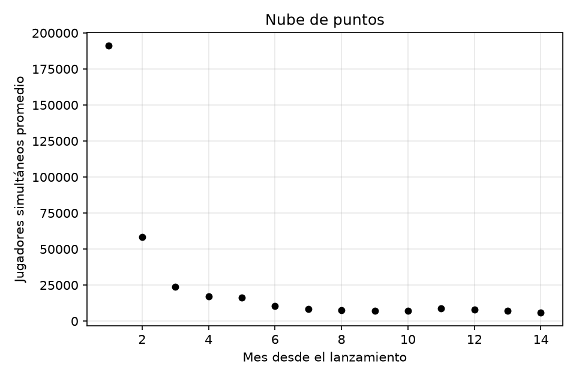
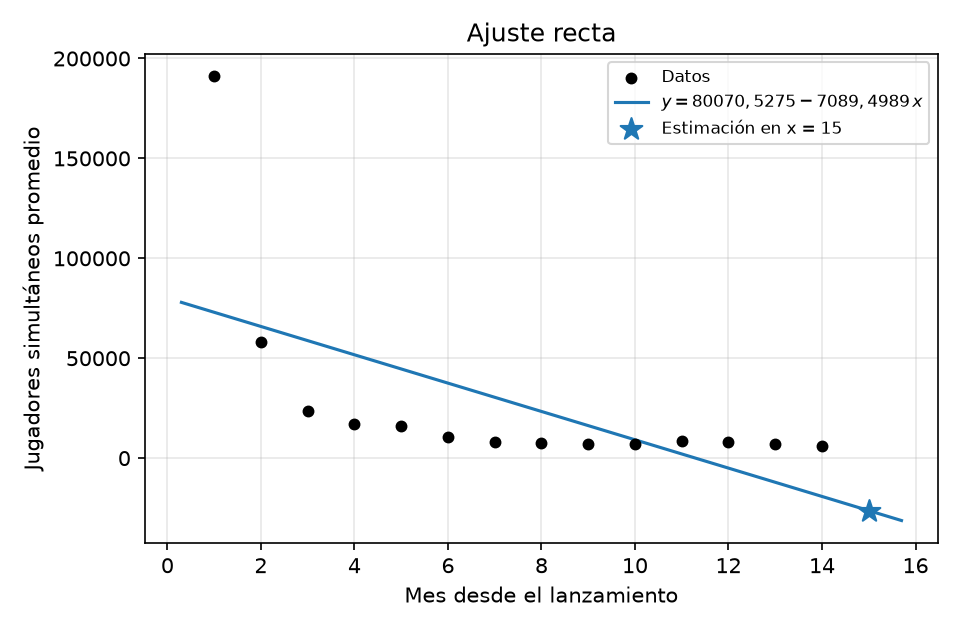
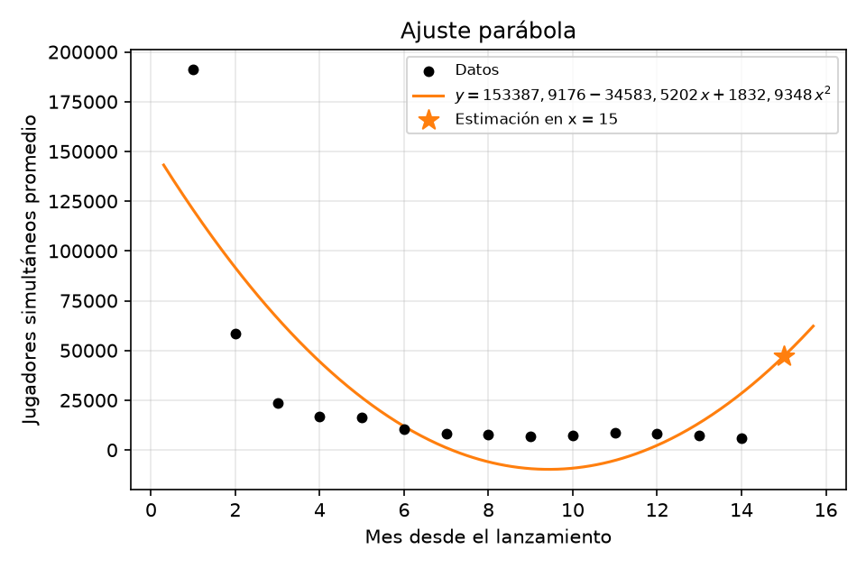
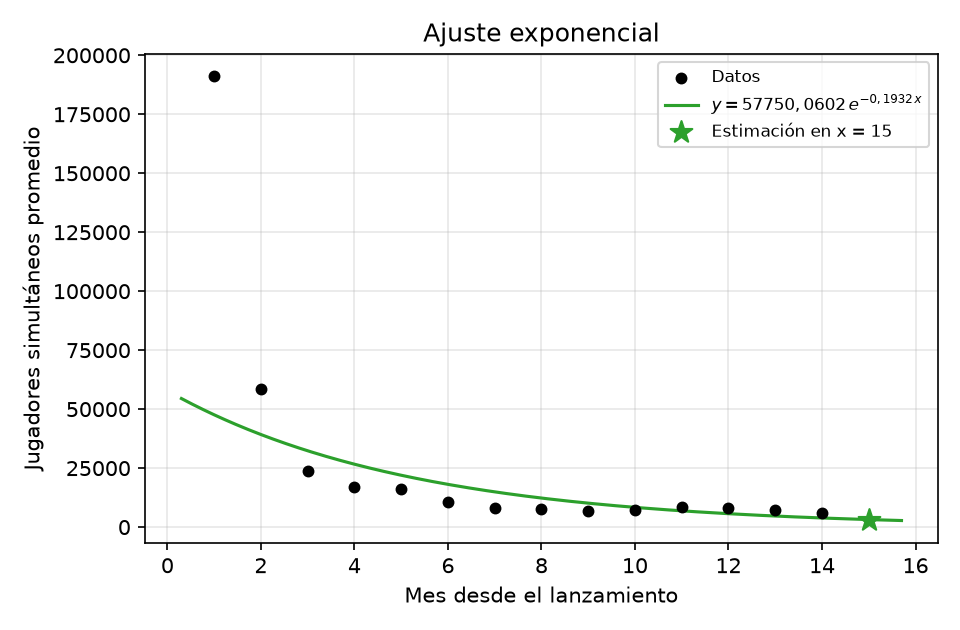
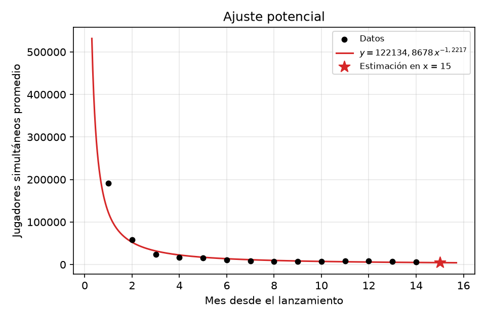
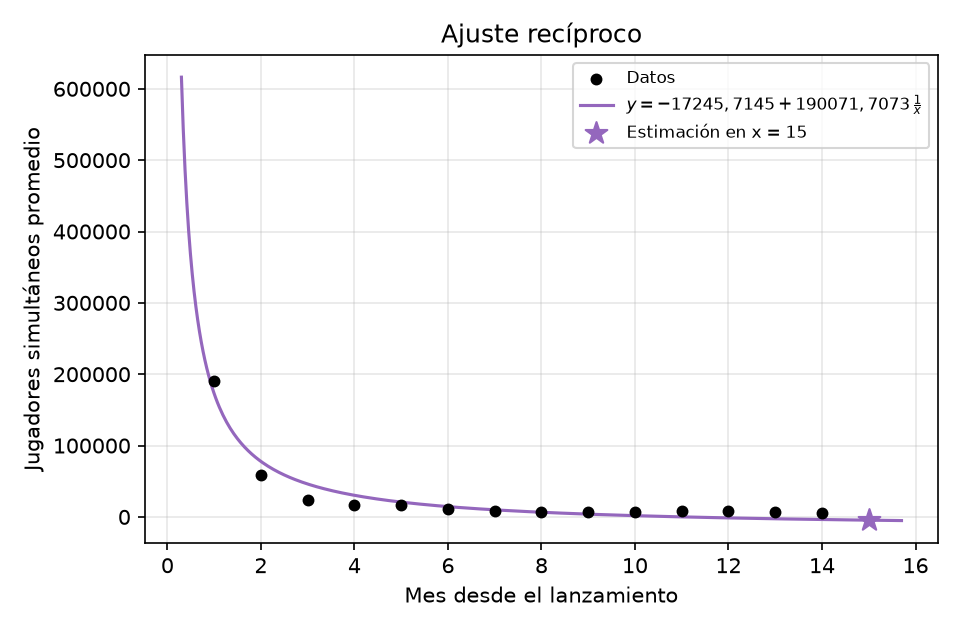
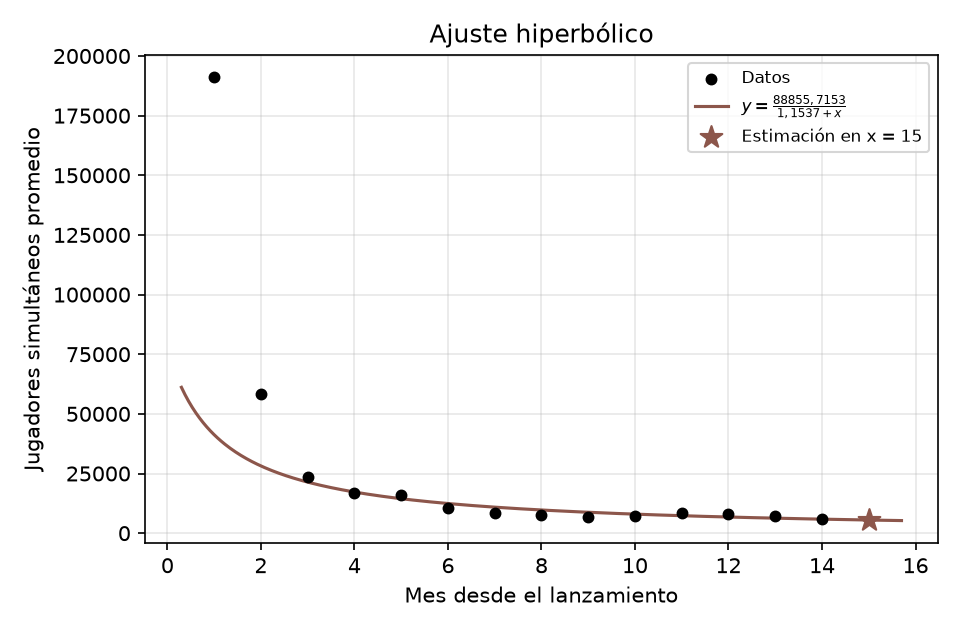
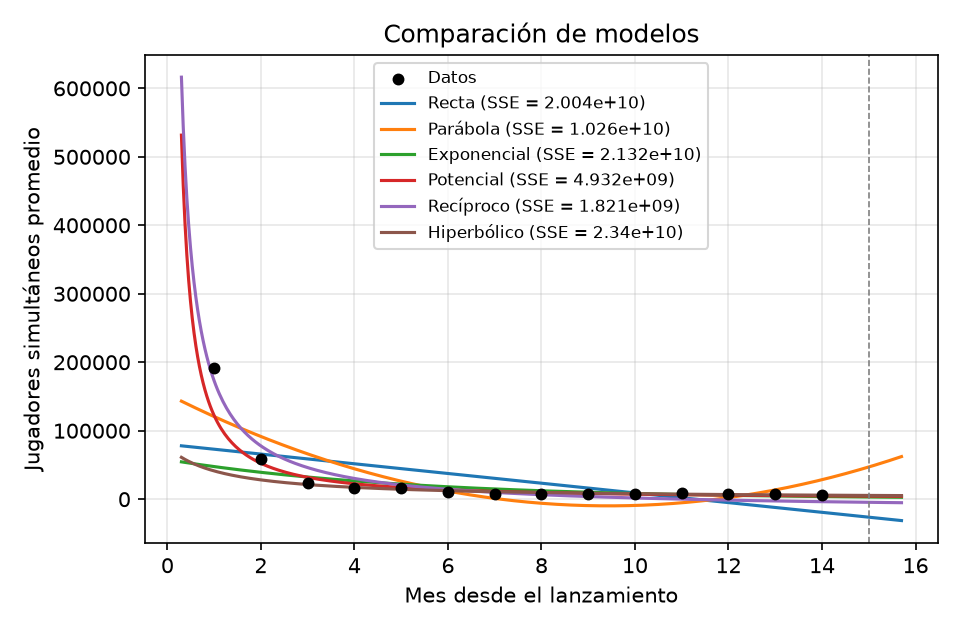

# Ajuste por mínimos cuadrados — Jugadores simultáneos promedio en función de Mes desde el lanzamiento

Datos: $m = 14$ puntos; $x$ = «Mes desde el lanzamiento», $y$ = «Jugadores simultáneos promedio».

## 1. Modelo recta: $y = a_0 + a_1\,x$

**Paso 1 — cambio de variables.** No hace falta: el modelo ya es lineal en sus parámetros.

**Paso 2 — sistema de ecuaciones normales** (forma general, $m$ = cantidad de puntos):

$$
\left\{\begin{aligned}
m\;a_0 + \sum x\;a_1 &= \sum y \\
\sum x\;a_0 + \sum x^2\;a_1 &= \sum x\,y
\end{aligned}\right.
$$

**Paso 3 — tabla de sumatorias:**

| $i$ | $x$ | $y$ | $x^2$ | $x\,y$ |
|:---:|:---:|:---:|:---:|:---:|
| 1 | $1{,}0000$ | $191124{,}0000$ | $1{,}0000$ | $191124{,}0000$ |
| 2 | $2{,}0000$ | $58328{,}0000$ | $4{,}0000$ | $116656{,}0000$ |
| 3 | $3{,}0000$ | $23721{,}0000$ | $9{,}0000$ | $71163{,}0000$ |
| 4 | $4{,}0000$ | $17001{,}0000$ | $16{,}0000$ | $68004{,}0000$ |
| 5 | $5{,}0000$ | $16126{,}0000$ | $25{,}0000$ | $80630{,}0000$ |
| 6 | $6{,}0000$ | $10613{,}0000$ | $36{,}0000$ | $63678{,}0000$ |
| 7 | $7{,}0000$ | $8269{,}0000$ | $49{,}0000$ | $57883{,}0000$ |
| 8 | $8{,}0000$ | $7515{,}0000$ | $64{,}0000$ | $60120{,}0000$ |
| 9 | $9{,}0000$ | $6967{,}0000$ | $81{,}0000$ | $62703{,}0000$ |
| 10 | $10{,}0000$ | $7111{,}0000$ | $100{,}0000$ | $71110{,}0000$ |
| 11 | $11{,}0000$ | $8619{,}0000$ | $121{,}0000$ | $94809{,}0000$ |
| 12 | $12{,}0000$ | $7972{,}0000$ | $144{,}0000$ | $95664{,}0000$ |
| 13 | $13{,}0000$ | $7116{,}0000$ | $169{,}0000$ | $92508{,}0000$ |
| 14 | $14{,}0000$ | $6108{,}0000$ | $196{,}0000$ | $85512{,}0000$ |
| $\Sigma$ | $\mathbf{105{,}0000}$ | $\mathbf{376590{,}0000}$ | $\mathbf{1015{,}0000}$ | $\mathbf{1211564{,}0000}$ |

**Paso 4 — sistema con los valores** ($m = 14$):

$$
\left\{\begin{aligned}
14{,}0000\;a_0 + 105{,}0000\;a_1 &= 376590{,}0000 \\
105{,}0000\;a_0 + 1015{,}0000\;a_1 &= 1211564{,}0000
\end{aligned}\right.
$$

**Paso 5 — solución del sistema:**

$$
a_0 = 80070{,}5275,\qquad a_1 = -7089{,}4989
$$

**Paso 6 — función aproximante:**

$$
y = 80070{,}5275 - 7089{,}4989\,x
$$

**Paso 7 — residuos en las variables originales:**

| $i$ | $x_i$ | $y_i$ | $\hat y_i$ | $y_i - \hat y_i$ | $(y_i - \hat y_i)^2$ |
|:---:|:---:|:---:|:---:|:---:|:---:|
| 1 | $1{,}0000$ | $191124{,}0000$ | $72981{,}0286$ | $118142{,}9714$ | $13957761697{,}9723$ |
| 2 | $2{,}0000$ | $58328{,}0000$ | $65891{,}5297$ | $-7563{,}5297$ | $57206981{,}0740$ |
| 3 | $3{,}0000$ | $23721{,}0000$ | $58802{,}0308$ | $-35081{,}0308$ | $1230678719{,}8317$ |
| 4 | $4{,}0000$ | $17001{,}0000$ | $51712{,}5319$ | $-34711{,}5319$ | $1204890444{,}6323$ |
| 5 | $5{,}0000$ | $16126{,}0000$ | $44623{,}0330$ | $-28497{,}0330$ | $812080887{,}9242$ |
| 6 | $6{,}0000$ | $10613{,}0000$ | $37533{,}5341$ | $-26920{,}5341$ | $724715154{,}3951$ |
| 7 | $7{,}0000$ | $8269{,}0000$ | $30444{,}0352$ | $-22175{,}0352$ | $491732184{,}5617$ |
| 8 | $8{,}0000$ | $7515{,}0000$ | $23354{,}5363$ | $-15839{,}5363$ | $250890909{,}0502$ |
| 9 | $9{,}0000$ | $6967{,}0000$ | $16265{,}0374$ | $-9298{,}0374$ | $86453498{,}7970$ |
| 10 | $10{,}0000$ | $7111{,}0000$ | $9175{,}5385$ | $-2064{,}5385$ | $4262319{,}0592$ |
| 11 | $11{,}0000$ | $8619{,}0000$ | $2086{,}0396$ | $6532{,}9604$ | $42679572{,}1049$ |
| 12 | $12{,}0000$ | $7972{,}0000$ | $-5003{,}4593$ | $12975{,}4593$ | $168362545{,}1011$ |
| 13 | $13{,}0000$ | $7116{,}0000$ | $-12092{,}9582$ | $19208{,}9582$ | $368984076{,}7336$ |
| 14 | $14{,}0000$ | $6108{,}0000$ | $-19182{,}4571$ | $25290{,}4571$ | $639607222{,}4947$ |
| $\Sigma$ | | | | | $\mathbf{20040306213{,}7319}$ |

Error cuadrático (suma de residuos al cuadrado): $\sum (y_i - \hat y_i)^2 = 20040306213{,}7319$ · coeficiente de determinación $R^2 = 0{,}3633$.

## 2. Modelo parábola: $y = a_0 + a_1\,x + a_2\,x^2$

**Paso 1 — cambio de variables.** No hace falta: el modelo ya es lineal en sus parámetros.

**Paso 2 — sistema de ecuaciones normales** (forma general, $m$ = cantidad de puntos):

$$
\left\{\begin{aligned}
m\;a_0 + \sum x\;a_1 + \sum x^2\;a_2 &= \sum y \\
\sum x\;a_0 + \sum x^2\;a_1 + \sum x^3\;a_2 &= \sum x\,y \\
\sum x^2\;a_0 + \sum x^3\;a_1 + \sum x^4\;a_2 &= \sum x^2\,y
\end{aligned}\right.
$$

**Paso 3 — tabla de sumatorias:**

| $i$ | $x$ | $y$ | $x^2$ | $x^3$ | $x^4$ | $x\,y$ | $x^2\,y$ |
|:---:|:---:|:---:|:---:|:---:|:---:|:---:|:---:|
| 1 | $1{,}0000$ | $191124{,}0000$ | $1{,}0000$ | $1{,}0000$ | $1{,}0000$ | $191124{,}0000$ | $191124{,}0000$ |
| 2 | $2{,}0000$ | $58328{,}0000$ | $4{,}0000$ | $8{,}0000$ | $16{,}0000$ | $116656{,}0000$ | $233312{,}0000$ |
| 3 | $3{,}0000$ | $23721{,}0000$ | $9{,}0000$ | $27{,}0000$ | $81{,}0000$ | $71163{,}0000$ | $213489{,}0000$ |
| 4 | $4{,}0000$ | $17001{,}0000$ | $16{,}0000$ | $64{,}0000$ | $256{,}0000$ | $68004{,}0000$ | $272016{,}0000$ |
| 5 | $5{,}0000$ | $16126{,}0000$ | $25{,}0000$ | $125{,}0000$ | $625{,}0000$ | $80630{,}0000$ | $403150{,}0000$ |
| 6 | $6{,}0000$ | $10613{,}0000$ | $36{,}0000$ | $216{,}0000$ | $1296{,}0000$ | $63678{,}0000$ | $382068{,}0000$ |
| 7 | $7{,}0000$ | $8269{,}0000$ | $49{,}0000$ | $343{,}0000$ | $2401{,}0000$ | $57883{,}0000$ | $405181{,}0000$ |
| 8 | $8{,}0000$ | $7515{,}0000$ | $64{,}0000$ | $512{,}0000$ | $4096{,}0000$ | $60120{,}0000$ | $480960{,}0000$ |
| 9 | $9{,}0000$ | $6967{,}0000$ | $81{,}0000$ | $729{,}0000$ | $6561{,}0000$ | $62703{,}0000$ | $564327{,}0000$ |
| 10 | $10{,}0000$ | $7111{,}0000$ | $100{,}0000$ | $1000{,}0000$ | $10000{,}0000$ | $71110{,}0000$ | $711100{,}0000$ |
| 11 | $11{,}0000$ | $8619{,}0000$ | $121{,}0000$ | $1331{,}0000$ | $14641{,}0000$ | $94809{,}0000$ | $1042899{,}0000$ |
| 12 | $12{,}0000$ | $7972{,}0000$ | $144{,}0000$ | $1728{,}0000$ | $20736{,}0000$ | $95664{,}0000$ | $1147968{,}0000$ |
| 13 | $13{,}0000$ | $7116{,}0000$ | $169{,}0000$ | $2197{,}0000$ | $28561{,}0000$ | $92508{,}0000$ | $1202604{,}0000$ |
| 14 | $14{,}0000$ | $6108{,}0000$ | $196{,}0000$ | $2744{,}0000$ | $38416{,}0000$ | $85512{,}0000$ | $1197168{,}0000$ |
| $\Sigma$ | $\mathbf{105{,}0000}$ | $\mathbf{376590{,}0000}$ | $\mathbf{1015{,}0000}$ | $\mathbf{11025{,}0000}$ | $\mathbf{127687{,}0000}$ | $\mathbf{1211564{,}0000}$ | $\mathbf{8447366{,}0000}$ |

**Paso 4 — sistema con los valores** ($m = 14$):

$$
\left\{\begin{aligned}
14{,}0000\;a_0 + 105{,}0000\;a_1 + 1015{,}0000\;a_2 &= 376590{,}0000 \\
105{,}0000\;a_0 + 1015{,}0000\;a_1 + 11025{,}0000\;a_2 &= 1211564{,}0000 \\
1015{,}0000\;a_0 + 11025{,}0000\;a_1 + 127687{,}0000\;a_2 &= 8447366{,}0000
\end{aligned}\right.
$$

**Paso 5 — solución del sistema:**

$$
a_0 = 153387{,}9176,\qquad a_1 = -34583{,}5202,\qquad a_2 = 1832{,}9348
$$

**Paso 6 — función aproximante:**

$$
y = 153387{,}9176 - 34583{,}5202\,x + 1832{,}9348\,x^2
$$

**Paso 7 — residuos en las variables originales:**

| $i$ | $x_i$ | $y_i$ | $\hat y_i$ | $y_i - \hat y_i$ | $(y_i - \hat y_i)^2$ |
|:---:|:---:|:---:|:---:|:---:|:---:|
| 1 | $1{,}0000$ | $191124{,}0000$ | $120637{,}3321$ | $70486{,}6679$ | $4968370345{,}6032$ |
| 2 | $2{,}0000$ | $58328{,}0000$ | $91552{,}6162$ | $-33224{,}6162$ | $1103875122{,}2215$ |
| 3 | $3{,}0000$ | $23721{,}0000$ | $66133{,}7698$ | $-42412{,}7698$ | $1798843040{,}4299$ |
| 4 | $4{,}0000$ | $17001{,}0000$ | $44380{,}7929$ | $-27379{,}7929$ | $749653056{,}9001$ |
| 5 | $5{,}0000$ | $16126{,}0000$ | $26293{,}6854$ | $-10167{,}6854$ | $103381827{,}1979$ |
| 6 | $6{,}0000$ | $10613{,}0000$ | $11872{,}4475$ | $-1259{,}4475$ | $1586208{,}0745$ |
| 7 | $7{,}0000$ | $8269{,}0000$ | $1117{,}0791$ | $7151{,}9209$ | $51149972{,}2612$ |
| 8 | $8{,}0000$ | $7515{,}0000$ | $-5972{,}4198$ | $13487{,}4198$ | $181910492{,}3279$ |
| 9 | $9{,}0000$ | $6967{,}0000$ | $-9396{,}0492$ | $16363{,}0492$ | $267749378{,}3304$ |
| 10 | $10{,}0000$ | $7111{,}0000$ | $-9153{,}8091$ | $16264{,}8091$ | $264544013{,}9513$ |
| 11 | $11{,}0000$ | $8619{,}0000$ | $-5245{,}6995$ | $13864{,}6995$ | $192229890{,}8541$ |
| 12 | $12{,}0000$ | $7972{,}0000$ | $2328{,}2797$ | $5643{,}7203$ | $31851579{,}1595$ |
| 13 | $13{,}0000$ | $7116{,}0000$ | $13568{,}1283$ | $-6452{,}1283$ | $41629959{,}5571$ |
| 14 | $14{,}0000$ | $6108{,}0000$ | $28473{,}8464$ | $-22365{,}8464$ | $500231086{,}4664$ |
| $\Sigma$ | | | | | $\mathbf{10257005973{,}3349}$ |

Error cuadrático (suma de residuos al cuadrado): $\sum (y_i - \hat y_i)^2 = 10257005973{,}3349$ · coeficiente de determinación $R^2 = 0{,}6741$.

## 3. Modelo exponencial: $y = a_0\,e^{a_1 x}$

**Paso 1 — cambio de variables.** El modelo no es lineal en sus parámetros; lo llevamos a una forma aparentemente lineal:

$$
y = a_0\,e^{a_1 x}
$$

$$
\ln y = \ln a_0 + a_1\,x
$$

$$
\underbrace{\ln y}_{Y} = \underbrace{\ln a_0}_{A_0} + a_1\,\underbrace{x}_{X}
$$

Queda una recta $Y = A_0 + a_1\,X$ en las variables $X = x$, $Y = \ln y$.

**Paso 2 — sistema de ecuaciones normales** (forma general, $m$ = cantidad de puntos):

$$
\left\{\begin{aligned}
m\;A_0 + \sum x\;a_1 &= \sum Y \\
\sum x\;A_0 + \sum x^2\;a_1 &= \sum x\,Y
\end{aligned}\right.
$$

**Paso 3 — tabla de sumatorias:**

| $i$ | $x$ | $y$ | $Y = \ln y$ | $x^2$ | $x\,Y$ |
|:---:|:---:|:---:|:---:|:---:|:---:|
| 1 | $1{,}0000$ | $191124{,}0000$ | $12{,}1607$ | $1{,}0000$ | $12{,}1607$ |
| 2 | $2{,}0000$ | $58328{,}0000$ | $10{,}9738$ | $4{,}0000$ | $21{,}9477$ |
| 3 | $3{,}0000$ | $23721{,}0000$ | $10{,}0741$ | $9{,}0000$ | $30{,}2223$ |
| 4 | $4{,}0000$ | $17001{,}0000$ | $9{,}7410$ | $16{,}0000$ | $38{,}9641$ |
| 5 | $5{,}0000$ | $16126{,}0000$ | $9{,}6882$ | $25{,}0000$ | $48{,}4409$ |
| 6 | $6{,}0000$ | $10613{,}0000$ | $9{,}2698$ | $36{,}0000$ | $55{,}6190$ |
| 7 | $7{,}0000$ | $8269{,}0000$ | $9{,}0203$ | $49{,}0000$ | $63{,}1419$ |
| 8 | $8{,}0000$ | $7515{,}0000$ | $8{,}9247$ | $64{,}0000$ | $71{,}3973$ |
| 9 | $9{,}0000$ | $6967{,}0000$ | $8{,}8489$ | $81{,}0000$ | $79{,}6405$ |
| 10 | $10{,}0000$ | $7111{,}0000$ | $8{,}8694$ | $100{,}0000$ | $88{,}6940$ |
| 11 | $11{,}0000$ | $8619{,}0000$ | $9{,}0617$ | $121{,}0000$ | $99{,}6790$ |
| 12 | $12{,}0000$ | $7972{,}0000$ | $8{,}9837$ | $144{,}0000$ | $107{,}8043$ |
| 13 | $13{,}0000$ | $7116{,}0000$ | $8{,}8701$ | $169{,}0000$ | $115{,}3113$ |
| 14 | $14{,}0000$ | $6108{,}0000$ | $8{,}7174$ | $196{,}0000$ | $122{,}0430$ |
| $\Sigma$ | $\mathbf{105{,}0000}$ | $\mathbf{376590{,}0000}$ | $\mathbf{133{,}2038}$ | $\mathbf{1015{,}0000}$ | $\mathbf{955{,}0659}$ |

**Paso 4 — sistema con los valores** ($m = 14$):

$$
\left\{\begin{aligned}
14{,}0000\;A_0 + 105{,}0000\;a_1 &= 133{,}2038 \\
105{,}0000\;A_0 + 1015{,}0000\;a_1 &= 955{,}0659
\end{aligned}\right.
$$

**Paso 5 — solución del sistema:**

$$
A_0 = 10{,}9639,\qquad a_1 = -0{,}1932
$$

Volvemos a los parámetros del modelo original:

$$
a_0 = e^{A_0}
$$

$$
a_0 = 57750{,}0602,\qquad a_1 = -0{,}1932
$$

**Paso 6 — función aproximante:**

$$
y = 57750{,}0602\,e^{-0{,}1932\,x}
$$

**Paso 7 — residuos en las variables originales:**

| $i$ | $x_i$ | $y_i$ | $\hat y_i$ | $y_i - \hat y_i$ | $(y_i - \hat y_i)^2$ |
|:---:|:---:|:---:|:---:|:---:|:---:|
| 1 | $1{,}0000$ | $191124{,}0000$ | $47602{,}3219$ | $143521{,}6781$ | $20598472098{,}7684$ |
| 2 | $2{,}0000$ | $58328{,}0000$ | $39237{,}7262$ | $19090{,}2738$ | $364438555{,}5373$ |
| 3 | $3{,}0000$ | $23721{,}0000$ | $32342{,}9424$ | $-8621{,}9424$ | $74337890{,}7362$ |
| 4 | $4{,}0000$ | $17001{,}0000$ | $26659{,}6978$ | $-9658{,}6978$ | $93290443{,}8971$ |
| 5 | $5{,}0000$ | $16126{,}0000$ | $21975{,}1029$ | $-5849{,}1029$ | $34212005{,}2490$ |
| 6 | $6{,}0000$ | $10613{,}0000$ | $18113{,}6768$ | $-7500{,}6768$ | $56260152{,}0085$ |
| 7 | $7{,}0000$ | $8269{,}0000$ | $14930{,}7736$ | $-6661{,}7736$ | $44379227{,}0347$ |
| 8 | $8{,}0000$ | $7515{,}0000$ | $12307{,}1645$ | $-4792{,}1645$ | $22964840{,}3560$ |
| 9 | $9{,}0000$ | $6967{,}0000$ | $10144{,}5713$ | $-3177{,}5713$ | $10096959{,}5450$ |
| 10 | $10{,}0000$ | $7111{,}0000$ | $8361{,}9852$ | $-1250{,}9852$ | $1564964{,}0186$ |
| 11 | $11{,}0000$ | $8619{,}0000$ | $6892{,}6320$ | $1726{,}3680$ | $2980346{,}5246$ |
| 12 | $12{,}0000$ | $7972{,}0000$ | $5681{,}4709$ | $2290{,}5291$ | $5246523{,}5657$ |
| 13 | $13{,}0000$ | $7116{,}0000$ | $4683{,}1329$ | $2432{,}8671$ | $5918842{,}3589$ |
| 14 | $14{,}0000$ | $6108{,}0000$ | $3860{,}2211$ | $2247{,}7789$ | $5052510{,}0976$ |
| $\Sigma$ | | | | | $\mathbf{21319215359{,}6975}$ |

Error cuadrático (suma de residuos al cuadrado): $\sum (y_i - \hat y_i)^2 = 21319215359{,}6975$ · coeficiente de determinación $R^2 = 0{,}3227$.

## 4. Modelo potencial: $y = a_0\,x^{a_1}$

**Paso 1 — cambio de variables.** El modelo no es lineal en sus parámetros; lo llevamos a una forma aparentemente lineal:

$$
y = a_0\,x^{a_1}
$$

$$
\ln y = \ln a_0 + a_1 \ln x
$$

$$
\underbrace{\ln y}_{Y} = \underbrace{\ln a_0}_{A_0} + a_1\,\underbrace{\ln x}_{X}
$$

Queda una recta $Y = A_0 + a_1\,X$ en las variables $X = \ln x$, $Y = \ln y$.

**Paso 2 — sistema de ecuaciones normales** (forma general, $m$ = cantidad de puntos):

$$
\left\{\begin{aligned}
m\;A_0 + \sum X\;a_1 &= \sum Y \\
\sum X\;A_0 + \sum X^2\;a_1 &= \sum X\,Y
\end{aligned}\right.
$$

**Paso 3 — tabla de sumatorias:**

| $i$ | $x$ | $y$ | $X = \ln x$ | $Y = \ln y$ | $X^2$ | $X\,Y$ |
|:---:|:---:|:---:|:---:|:---:|:---:|:---:|
| 1 | $1{,}0000$ | $191124{,}0000$ | $0{,}0000$ | $12{,}1607$ | $0{,}0000$ | $0{,}0000$ |
| 2 | $2{,}0000$ | $58328{,}0000$ | $0{,}6931$ | $10{,}9738$ | $0{,}4805$ | $7{,}6065$ |
| 3 | $3{,}0000$ | $23721{,}0000$ | $1{,}0986$ | $10{,}0741$ | $1{,}2069$ | $11{,}0675$ |
| 4 | $4{,}0000$ | $17001{,}0000$ | $1{,}3863$ | $9{,}7410$ | $1{,}9218$ | $13{,}5039$ |
| 5 | $5{,}0000$ | $16126{,}0000$ | $1{,}6094$ | $9{,}6882$ | $2{,}5903$ | $15{,}5925$ |
| 6 | $6{,}0000$ | $10613{,}0000$ | $1{,}7918$ | $9{,}2698$ | $3{,}2104$ | $16{,}6093$ |
| 7 | $7{,}0000$ | $8269{,}0000$ | $1{,}9459$ | $9{,}0203$ | $3{,}7866$ | $17{,}5526$ |
| 8 | $8{,}0000$ | $7515{,}0000$ | $2{,}0794$ | $8{,}9247$ | $4{,}3241$ | $18{,}5583$ |
| 9 | $9{,}0000$ | $6967{,}0000$ | $2{,}1972$ | $8{,}8489$ | $4{,}8278$ | $19{,}4431$ |
| 10 | $10{,}0000$ | $7111{,}0000$ | $2{,}3026$ | $8{,}8694$ | $5{,}3019$ | $20{,}4225$ |
| 11 | $11{,}0000$ | $8619{,}0000$ | $2{,}3979$ | $9{,}0617$ | $5{,}7499$ | $21{,}7291$ |
| 12 | $12{,}0000$ | $7972{,}0000$ | $2{,}4849$ | $8{,}9837$ | $6{,}1748$ | $22{,}3236$ |
| 13 | $13{,}0000$ | $7116{,}0000$ | $2{,}5649$ | $8{,}8701$ | $6{,}5790$ | $22{,}7514$ |
| 14 | $14{,}0000$ | $6108{,}0000$ | $2{,}6391$ | $8{,}7174$ | $6{,}9646$ | $23{,}0056$ |
| $\Sigma$ | $\mathbf{105{,}0000}$ | $\mathbf{376590{,}0000}$ | $\mathbf{25{,}1912}$ | $\mathbf{133{,}2038}$ | $\mathbf{53{,}1185}$ | $\mathbf{230{,}1661}$ |

**Paso 4 — sistema con los valores** ($m = 14$):

$$
\left\{\begin{aligned}
14{,}0000\;A_0 + 25{,}1912\;a_1 &= 133{,}2038 \\
25{,}1912\;A_0 + 53{,}1185\;a_1 &= 230{,}1661
\end{aligned}\right.
$$

**Paso 5 — solución del sistema:**

$$
A_0 = 11{,}7129,\qquad a_1 = -1{,}2217
$$

Volvemos a los parámetros del modelo original:

$$
a_0 = e^{A_0}
$$

$$
a_0 = 122134{,}8678,\qquad a_1 = -1{,}2217
$$

**Paso 6 — función aproximante:**

$$
y = 122134{,}8678\,x^{-1{,}2217}
$$

**Paso 7 — residuos en las variables originales:**

| $i$ | $x_i$ | $y_i$ | $\hat y_i$ | $y_i - \hat y_i$ | $(y_i - \hat y_i)^2$ |
|:---:|:---:|:---:|:---:|:---:|:---:|
| 1 | $1{,}0000$ | $191124{,}0000$ | $122134{,}8678$ | $68989{,}1322$ | $4759500368{,}0799$ |
| 2 | $2{,}0000$ | $58328{,}0000$ | $52368{,}0583$ | $5959{,}9417$ | $35520905{,}4626$ |
| 3 | $3{,}0000$ | $23721{,}0000$ | $31910{,}4511$ | $-8189{,}4511$ | $67067108{,}7597$ |
| 4 | $4{,}0000$ | $17001{,}0000$ | $22453{,}9771$ | $-5452{,}9771$ | $29734959{,}5196$ |
| 5 | $5{,}0000$ | $16126{,}0000$ | $17096{,}0883$ | $-970{,}0883$ | $941071{,}2703$ |
| 6 | $6{,}0000$ | $10613{,}0000$ | $13682{,}3201$ | $-3069{,}3201$ | $9420726{,}1154$ |
| 7 | $7{,}0000$ | $8269{,}0000$ | $11333{,}6495$ | $-3064{,}6495$ | $9392076{,}3546$ |
| 8 | $8{,}0000$ | $7515{,}0000$ | $9627{,}6453$ | $-2112{,}6453$ | $4463270{,}0556$ |
| 9 | $9{,}0000$ | $6967{,}0000$ | $8337{,}3152$ | $-1370{,}3152$ | $1877763{,}6991$ |
| 10 | $10{,}0000$ | $7111{,}0000$ | $7330{,}3305$ | $-219{,}3305$ | $48105{,}8717$ |
| 11 | $11{,}0000$ | $8619{,}0000$ | $6524{,}5933$ | $2094{,}4067$ | $4386539{,}4048$ |
| 12 | $12{,}0000$ | $7972{,}0000$ | $5866{,}6010$ | $2105{,}3990$ | $4432704{,}9160$ |
| 13 | $13{,}0000$ | $7116{,}0000$ | $5320{,}0673$ | $1795{,}9327$ | $3225374{,}2177$ |
| 14 | $14{,}0000$ | $6108{,}0000$ | $4859{,}5559$ | $1248{,}4441$ | $1558612{,}7022$ |
| $\Sigma$ | | | | | $\mathbf{4931569586{,}4291}$ |

Error cuadrático (suma de residuos al cuadrado): $\sum (y_i - \hat y_i)^2 = 4931569586{,}4291$ · coeficiente de determinación $R^2 = 0{,}8433$.

## 5. Modelo recíproco: $y = a_0 + a_1\,\frac{1}{x}$

**Paso 1 — cambio de variables.** El modelo no es lineal en sus parámetros; lo llevamos a una forma aparentemente lineal:

$$
y = a_0 + a_1\,\underbrace{\frac{1}{x}}_{X}
$$

Queda una recta $Y = a_0 + a_1\,X$ en las variables $X = \tfrac{1}{x}$, $Y = y$.

**Paso 2 — sistema de ecuaciones normales** (forma general, $m$ = cantidad de puntos):

$$
\left\{\begin{aligned}
m\;a_0 + \sum X\;a_1 &= \sum y \\
\sum X\;a_0 + \sum X^2\;a_1 &= \sum X\,y
\end{aligned}\right.
$$

**Paso 3 — tabla de sumatorias:**

| $i$ | $x$ | $y$ | $X = \tfrac{1}{x}$ | $X^2$ | $X\,y$ |
|:---:|:---:|:---:|:---:|:---:|:---:|
| 1 | $1{,}0000$ | $191124{,}0000$ | $1{,}0000$ | $1{,}0000$ | $191124{,}0000$ |
| 2 | $2{,}0000$ | $58328{,}0000$ | $0{,}5000$ | $0{,}2500$ | $29164{,}0000$ |
| 3 | $3{,}0000$ | $23721{,}0000$ | $0{,}3333$ | $0{,}1111$ | $7907{,}0000$ |
| 4 | $4{,}0000$ | $17001{,}0000$ | $0{,}2500$ | $0{,}0625$ | $4250{,}2500$ |
| 5 | $5{,}0000$ | $16126{,}0000$ | $0{,}2000$ | $0{,}0400$ | $3225{,}2000$ |
| 6 | $6{,}0000$ | $10613{,}0000$ | $0{,}1667$ | $0{,}0278$ | $1768{,}8333$ |
| 7 | $7{,}0000$ | $8269{,}0000$ | $0{,}1429$ | $0{,}0204$ | $1181{,}2857$ |
| 8 | $8{,}0000$ | $7515{,}0000$ | $0{,}1250$ | $0{,}0156$ | $939{,}3750$ |
| 9 | $9{,}0000$ | $6967{,}0000$ | $0{,}1111$ | $0{,}0123$ | $774{,}1111$ |
| 10 | $10{,}0000$ | $7111{,}0000$ | $0{,}1000$ | $0{,}0100$ | $711{,}1000$ |
| 11 | $11{,}0000$ | $8619{,}0000$ | $0{,}0909$ | $0{,}0083$ | $783{,}5455$ |
| 12 | $12{,}0000$ | $7972{,}0000$ | $0{,}0833$ | $0{,}0069$ | $664{,}3333$ |
| 13 | $13{,}0000$ | $7116{,}0000$ | $0{,}0769$ | $0{,}0059$ | $547{,}3846$ |
| 14 | $14{,}0000$ | $6108{,}0000$ | $0{,}0714$ | $0{,}0051$ | $436{,}2857$ |
| $\Sigma$ | $\mathbf{105{,}0000}$ | $\mathbf{376590{,}0000}$ | $\mathbf{3{,}2516}$ | $\mathbf{1{,}5760}$ | $\mathbf{243476{,}7043}$ |

**Paso 4 — sistema con los valores** ($m = 14$):

$$
\left\{\begin{aligned}
14{,}0000\;a_0 + 3{,}2516\;a_1 &= 376590{,}0000 \\
3{,}2516\;a_0 + 1{,}5760\;a_1 &= 243476{,}7043
\end{aligned}\right.
$$

**Paso 5 — solución del sistema:**

$$
a_0 = -17245{,}7145,\qquad a_1 = 190071{,}7073
$$

**Paso 6 — función aproximante:**

$$
y = -17245{,}7145 + 190071{,}7073\,\frac{1}{x}
$$

**Paso 7 — residuos en las variables originales:**

| $i$ | $x_i$ | $y_i$ | $\hat y_i$ | $y_i - \hat y_i$ | $(y_i - \hat y_i)^2$ |
|:---:|:---:|:---:|:---:|:---:|:---:|
| 1 | $1{,}0000$ | $191124{,}0000$ | $172825{,}9928$ | $18298{,}0072$ | $334817067{,}7739$ |
| 2 | $2{,}0000$ | $58328{,}0000$ | $77790{,}1392$ | $-19462{,}1392$ | $378774860{,}5475$ |
| 3 | $3{,}0000$ | $23721{,}0000$ | $46111{,}5213$ | $-22390{,}5213$ | $501335443{,}0973$ |
| 4 | $4{,}0000$ | $17001{,}0000$ | $30272{,}2123$ | $-13271{,}2123$ | $176125076{,}9371$ |
| 5 | $5{,}0000$ | $16126{,}0000$ | $20768{,}6270$ | $-4642{,}6270$ | $21553985{,}2295$ |
| 6 | $6{,}0000$ | $10613{,}0000$ | $14432{,}9034$ | $-3819{,}9034$ | $14591661{,}9803$ |
| 7 | $7{,}0000$ | $8269{,}0000$ | $9907{,}3866$ | $-1638{,}3866$ | $2684310{,}5185$ |
| 8 | $8{,}0000$ | $7515{,}0000$ | $6513{,}2489$ | $1001{,}7511$ | $1003505{,}2069$ |
| 9 | $9{,}0000$ | $6967{,}0000$ | $3873{,}3641$ | $3093{,}6359$ | $9570583{,}0417$ |
| 10 | $10{,}0000$ | $7111{,}0000$ | $1761{,}4562$ | $5349{,}5438$ | $28617618{,}3556$ |
| 11 | $11{,}0000$ | $8619{,}0000$ | $33{,}5316$ | $8585{,}4684$ | $73710267{,}0233$ |
| 12 | $12{,}0000$ | $7972{,}0000$ | $-1406{,}4055$ | $9378{,}4055$ | $87954490{,}4718$ |
| 13 | $13{,}0000$ | $7116{,}0000$ | $-2624{,}8139$ | $9740{,}8139$ | $94883455{,}8221$ |
| 14 | $14{,}0000$ | $6108{,}0000$ | $-3669{,}1640$ | $9777{,}1640$ | $95592935{,}0979$ |
| $\Sigma$ | | | | | $\mathbf{1821215261{,}1034}$ |

Error cuadrático (suma de residuos al cuadrado): $\sum (y_i - \hat y_i)^2 = 1821215261{,}1034$ · coeficiente de determinación $R^2 = 0{,}9421$.

## 6. Modelo hiperbólico: $y = \frac{a_1}{a_0 + x}$

**Paso 1 — cambio de variables.** El modelo no es lineal en sus parámetros; lo llevamos a una forma aparentemente lineal:

$$
y = \frac{a_1}{a_0 + x}
$$

$$
\frac{1}{y} = \frac{a_0 + x}{a_1} = \frac{a_0}{a_1} + \frac{1}{a_1}\,x
$$

$$
\underbrace{\frac{1}{y}}_{Y} = \underbrace{\frac{a_0}{a_1}}_{A_0} + \underbrace{\frac{1}{a_1}}_{A_1}\,x
$$

Queda una recta $Y = A_0 + A_1\,X$ en las variables $X = x$, $Y = \tfrac{1}{y}$.

**Paso 2 — sistema de ecuaciones normales** (forma general, $m$ = cantidad de puntos):

$$
\left\{\begin{aligned}
m\;A_0 + \sum x\;A_1 &= \sum Y \\
\sum x\;A_0 + \sum x^2\;A_1 &= \sum x\,Y
\end{aligned}\right.
$$

**Paso 3 — tabla de sumatorias:**

| $i$ | $x$ | $y$ | $Y = \tfrac{1}{y}$ | $x^2$ | $x\,Y$ |
|:---:|:---:|:---:|:---:|:---:|:---:|
| 1 | $1{,}0000$ | $191124{,}0000$ | $0{,}0000$ | $1{,}0000$ | $0{,}0000$ |
| 2 | $2{,}0000$ | $58328{,}0000$ | $0{,}0000$ | $4{,}0000$ | $0{,}0000$ |
| 3 | $3{,}0000$ | $23721{,}0000$ | $0{,}0000$ | $9{,}0000$ | $0{,}0001$ |
| 4 | $4{,}0000$ | $17001{,}0000$ | $0{,}0001$ | $16{,}0000$ | $0{,}0002$ |
| 5 | $5{,}0000$ | $16126{,}0000$ | $0{,}0001$ | $25{,}0000$ | $0{,}0003$ |
| 6 | $6{,}0000$ | $10613{,}0000$ | $0{,}0001$ | $36{,}0000$ | $0{,}0006$ |
| 7 | $7{,}0000$ | $8269{,}0000$ | $0{,}0001$ | $49{,}0000$ | $0{,}0008$ |
| 8 | $8{,}0000$ | $7515{,}0000$ | $0{,}0001$ | $64{,}0000$ | $0{,}0011$ |
| 9 | $9{,}0000$ | $6967{,}0000$ | $0{,}0001$ | $81{,}0000$ | $0{,}0013$ |
| 10 | $10{,}0000$ | $7111{,}0000$ | $0{,}0001$ | $100{,}0000$ | $0{,}0014$ |
| 11 | $11{,}0000$ | $8619{,}0000$ | $0{,}0001$ | $121{,}0000$ | $0{,}0013$ |
| 12 | $12{,}0000$ | $7972{,}0000$ | $0{,}0001$ | $144{,}0000$ | $0{,}0015$ |
| 13 | $13{,}0000$ | $7116{,}0000$ | $0{,}0001$ | $169{,}0000$ | $0{,}0018$ |
| 14 | $14{,}0000$ | $6108{,}0000$ | $0{,}0002$ | $196{,}0000$ | $0{,}0023$ |
| $\Sigma$ | $\mathbf{105{,}0000}$ | $\mathbf{376590{,}0000}$ | $\mathbf{0{,}0014}$ | $\mathbf{1015{,}0000}$ | $\mathbf{0{,}0128}$ |

**Paso 4 — sistema con los valores** ($m = 14$):

$$
\left\{\begin{aligned}
14{,}0000\;A_0 + 105{,}0000\;A_1 &= 0{,}0014 \\
105{,}0000\;A_0 + 1015{,}0000\;A_1 &= 0{,}0128
\end{aligned}\right.
$$

**Paso 5 — solución del sistema:**

$$
A_0 = 0{,}0000,\qquad A_1 = 0{,}0000
$$

Volvemos a los parámetros del modelo original:

$$
a_1 = \frac{1}{A_1},\qquad a_0 = A_0 \cdot a_1
$$

$$
a_0 = 1{,}1537,\qquad a_1 = 88855{,}7153
$$

**Paso 6 — función aproximante:**

$$
y = \frac{88855{,}7153}{1{,}1537 + x}
$$

**Paso 7 — residuos en las variables originales:**

| $i$ | $x_i$ | $y_i$ | $\hat y_i$ | $y_i - \hat y_i$ | $(y_i - \hat y_i)^2$ |
|:---:|:---:|:---:|:---:|:---:|:---:|
| 1 | $1{,}0000$ | $191124{,}0000$ | $41257{,}9388$ | $149866{,}0612$ | $22459836291{,}9499$ |
| 2 | $2{,}0000$ | $58328{,}0000$ | $28175{,}3955$ | $30152{,}6045$ | $909179557{,}6424$ |
| 3 | $3{,}0000$ | $23721{,}0000$ | $21392{,}1316$ | $2328{,}8684$ | $5423628{,}1058$ |
| 4 | $4{,}0000$ | $17001{,}0000$ | $17241{,}2723$ | $-240{,}2723$ | $57730{,}7996$ |
| 5 | $5{,}0000$ | $16126{,}0000$ | $14439{,}4824$ | $1686{,}5176$ | $2844341{,}5819$ |
| 6 | $6{,}0000$ | $10613{,}0000$ | $12421{,}0086$ | $-1808{,}0086$ | $3268895{,}0617$ |
| 7 | $7{,}0000$ | $8269{,}0000$ | $10897{,}6432$ | $-2628{,}6432$ | $6909765{,}1550$ |
| 8 | $8{,}0000$ | $7515{,}0000$ | $9707{,}1206$ | $-2192{,}1206$ | $4805392{,}7965$ |
| 9 | $9{,}0000$ | $6967{,}0000$ | $8751{,}0991$ | $-1784{,}0991$ | $3183009{,}6411$ |
| 10 | $10{,}0000$ | $7111{,}0000$ | $7966{,}5050$ | $-855{,}5050$ | $731888{,}7383$ |
| 11 | $11{,}0000$ | $8619{,}0000$ | $7311{,}0232$ | $1307{,}9768$ | $1710803{,}3596$ |
| 12 | $12{,}0000$ | $7972{,}0000$ | $6755{,}2067$ | $1216{,}7933$ | $1480585{,}9806$ |
| 13 | $13{,}0000$ | $7116{,}0000$ | $6277{,}9305$ | $838{,}0695$ | $702360{,}5146$ |
| 14 | $14{,}0000$ | $6108{,}0000$ | $5863{,}6458$ | $244{,}3542$ | $59708{,}9691$ |
| $\Sigma$ | | | | | $\mathbf{23400193960{,}2961}$ |

Error cuadrático (suma de residuos al cuadrado): $\sum (y_i - \hat y_i)^2 = 23400193960{,}2961$ · coeficiente de determinación $R^2 = 0{,}2565$.

## Comparación

| Modelo | Función aproximante | $\sum (y_i-\hat y_i)^2$ | $R^2$ | $\hat y(15)$ |
|---|---|:---:|:---:|:---:|
| Recíproco | $y = -17245{,}7145 + 190071{,}7073\,\frac{1}{x}$ | $1821215261{,}1034$ | $0{,}9421$ | $-4574{,}2673$ |
| Potencial | $y = 122134{,}8678\,x^{-1{,}2217}$ | $4931569586{,}4291$ | $0{,}8433$ | $4466{,}7334$ |
| Parábola | $y = 153387{,}9176 - 34583{,}5202\,x + 1832{,}9348\,x^2$ | $10257005973{,}3349$ | $0{,}6741$ | $47045{,}4341$ |
| Recta | $y = 80070{,}5275 - 7089{,}4989\,x$ | $20040306213{,}7319$ | $0{,}3633$ | $-26271{,}9560$ |
| Exponencial | $y = 57750{,}0602\,e^{-0{,}1932\,x}$ | $21319215359{,}6975$ | $0{,}3227$ | $3181{,}9099$ |
| Hiperbólico | $y = \frac{88855{,}7153}{1{,}1537 + x}$ | $23400193960{,}2961$ | $0{,}2565$ | $5500{,}6541$ |

