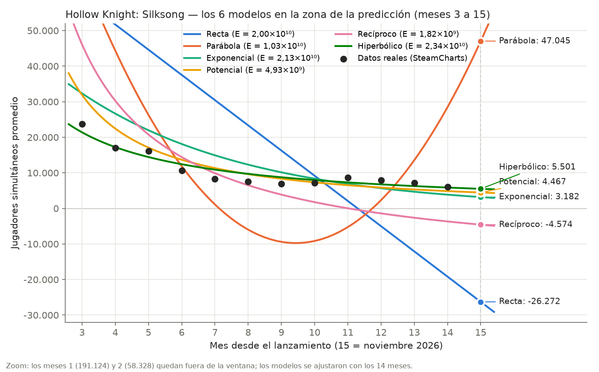

# Borrador del punto d) — Comparación, elección y estimación

> Fuente: `ajuste/resultados.json` (meses 1–14) y `validacion/resultados.json` (ajuste con los meses 1–11); criterios de la teórica y la práctica de ajuste (apuntes 01 y 02 de `segundo-parcial/`).

---

> **Notas para el grupo (no van al PDF).** Este texto entra al TP con `armar_tp.py`. Lo
> marcado `[a completar]` depende de algo que todavía no sabemos. Los números salen de
> `ajuste_mc.py` y se pueden verificar en `ajuste/reporte.md`.

## d.1 Comparación de los tres modelos

Para comparar usamos el **error cuadrático** de cada función final, calculado en las
variables originales (jugadores, no logaritmos ni inversas):

$$
E = \sum_{i=1}^{14} \left( y_i - \hat y_i \right)^2
$$

| Modelo | Función aproximante | $E$ | $\hat y(15)$ |
|---|---|---:|---:|
| Recíproco | $y = -17245{,}71 + \dfrac{190071{,}71}{x}$ | $1{,}82 \times 10^{9}$ | $-4.574$ |
| Potencial | $y = 122134{,}87\,x^{-1{,}22172}$ | $4{,}93 \times 10^{9}$ | $4.467$ |
| Exponencial | $y = 57750{,}06\,e^{-0{,}193243\,x}$ | $2{,}13 \times 10^{10}$ | $3.182$ |

## d.2 Criterio de elección

Si miráramos solo el error, el mejor sería el **recíproco**. Pero el ajuste no se hace para
pasar lo más cerca posible de los puntos: se hace para **predecir valores e interpretar
tendencias**. Por eso un polinomio interpolante, que tiene error cero, no es el mejor
ajuste. Además, si se sabe cómo se comporta el fenómeno, conviene usar un modelo de ese
tipo.

Elegimos en dos pasos:

1. **Descartar los modelos que contradicen el fenómeno.** La cantidad de jugadores no puede
   ser negativa.
2. **Entre los que quedan, elegir el de menor error cuadrático.**

## d.3 Modelo descartado: el recíproco

El recíproco tiene el menor error, pero su curva corta el eje en $x \approx 11{,}02$: desde
el mes 12 predice jugadores **negativos**, cuando el dato real del mes 12 es de 7.972
jugadores. Para noviembre da $-4.574$. Su error es bajo porque copia muy bien el pico del
lanzamiento, pero describe mal justo la zona que queremos predecir.

## d.4 Elección: el modelo potencial

Quedan dos modelos que tienen sentido (siempre positivos y siempre decrecientes):
exponencial y potencial. El **potencial** tiene un error unas **cuatro veces menor**:

| Modelo | $E$ |
|---|---:|
| **Potencial** | $\mathbf{4{,}93 \times 10^{9}}$ |
| Exponencial | $2{,}13 \times 10^{10}$ |

La forma también acompaña. Los datos muestran que el porcentaje de jugadores que se pierde
cada mes es **cada vez menor**: del mes 1 al 2 se fue el 69 %, del 3 al 4 el 28 % y del 8
al 9 solo el 7 %. Eso es justo lo que supone el potencial. El exponencial, en cambio,
supone que cada mes se pierde **el mismo porcentaje** (con $e^{-0{,}193243} \approx 0{,}82$,
un 18 % por mes), así que se acerca a cero demasiado rápido.

## d.5 Estimación para noviembre de 2026

Noviembre de 2026 es el mes $x = 15$:

$$
\hat y(15) = 122134{,}87 \cdot 15^{-1{,}22172} \approx 4.467
$$

**El modelo estima unos 4.467 jugadores simultáneos promedio en noviembre de 2026.**

## d.6 ¿Es confiable?

**A favor:**

- **Extrapolamos un solo mes.** Predecimos fuera del rango de los datos, pero muy cerca
  del último mes (14). Cuanto más lejos, menos confiable sería.
- **Los dos modelos razonables coinciden en el orden de magnitud.** El exponencial da 3.182
  y el potencial 4.467: ninguno da 500 ni 50.000.

**En contra (por qué esperamos que el valor real sea mayor):**

- **Los residuos tienen un patrón.** En los meses 3 a 10 el modelo queda **por encima** de
  los datos, y en los meses 11 a 14 queda **por debajo**:

  | Mes | Real $y$ | Potencial $\hat y$ | $\dfrac{y - \hat y}{y}$ |
  |---:|---:|---:|---:|
  | 11 | 8.619 | 6.525 | 24 % |
  | 12 | 7.972 | 5.867 | 26 % |
  | 13 | 7.116 | 5.320 | 25 % |
  | 14 | 6.108 | 4.860 | 20 % |

  Si el patrón sigue y en noviembre el modelo vuelve a quedar entre un 20 % y un 26 % por
  debajo, el valor real sería

  $$
  \frac{4.467}{1 - 0{,}20} \approx 5.583 \qquad \text{a} \qquad \frac{4.467}{1 - 0{,}26} \approx 6.036
  $$

  es decir, entre unos **5.600 y 6.000 jugadores**. El modelo **subestima la cola**: la
  comunidad que se queda jugando es más grande de lo que la curva supone.
- **Lo comprobamos con datos que ya conocíamos.** Ajustamos el potencial solo con los meses
  1 a 11 y predijimos los meses 12 a 14:

  | Mes | Real | Predicción | Error |
  |---:|---:|---:|---:|
  | 12 | 7.972 | 4.787 | −40 % |
  | 13 | 7.116 | 4.291 | −40 % |
  | 14 | 6.108 | 3.878 | −37 % |

  En los tres meses se quedó corto, siempre del mismo lado. Eso confirma que el modelo
  tiende a subestimar.
- **El mes 1 domina el error.** El lanzamiento (191.124 jugadores) es casi treinta veces
  más grande que los últimos meses. Un error chico en ese punto pesa más que todos los
  demás juntos, por eso el ajuste "prioriza" el lanzamiento sobre la cola. Por eso el
  recíproco tiene el menor error y aun así predice mal.
- **El modelo supone que no pasa nada nuevo.** En julio de 2026 (mes 11) los jugadores
  subieron de 7.111 a 8.619 sin que la curva lo explique. Coincide con la oferta de verano
  de Steam (del 25 de junio al 9 de julio de 2026), en la que Silksong bajó de USD 19,99 a
  USD 14,99, y en ese período no hubo una actualización importante del juego (Team Cherry
  había presentado en marzo el último parche grande). No podemos probar que esa sea la
  causa, pero es la explicación más probable. Además, Team Cherry anunció para 2026 la
  expansión gratuita *Sea of Sorrow*: al día de hoy no tiene fecha confirmada, y el manual
  de la edición física la anuncia solo como "próximamente". Si saliera en noviembre, la
  predicción dejaría de valer.
- **Vale solo para este juego.** Otro juego, con otra reputación, precio y comunidad,
  tendría otros coeficientes. Lo que sí suele repetirse es la forma de la curva.

## d.7 Conclusión del punto d)

El modelo potencial estima **4.467 jugadores simultáneos promedio** para noviembre de 2026.
Lo tomamos como un **piso** más que como un valor exacto: por el patrón de los residuos y
por la prueba con los meses 12 a 14, esperamos que el valor real sea mayor, del orden de
5.600 a 6.000 jugadores, siempre que no salga la expansión ni haya un evento que reactive el
juego.

Como contraste con un dato real parcial: al 11 de noviembre de 2026, SteamCharts informaba
un promedio de **5.702 jugadores en los últimos 30 días** (del 12 de octubre al 11 de
noviembre). No es exactamente el mes de noviembre, pero sirve de referencia: el modelo
quedó por debajo y el valor cae dentro del rango que anticipamos a partir de los residuos.

El promedio real de noviembre va a estar disponible en SteamCharts a partir del **1 de
diciembre de 2026**: ese día se podrá comparar con nuestra estimación.

---

_Generado el 2026-11-12. Fuentes: `ajuste/resultados.json` (tools/ajuste_mc.py sobre
`datos/datos.csv`), `validacion/resultados.json` (meses 1–11), SteamCharts
(app 1030300), KeenGamer (oferta de verano de Steam 2026), GamesRadar (parche 5, 18/03/2026),
GameLuster (manual de la edición física, 09/11/2026), criterios de
`segundo-parcial/apuntes/md/01-…` (§4, comparación de errores) y `02-…` (§3)._
