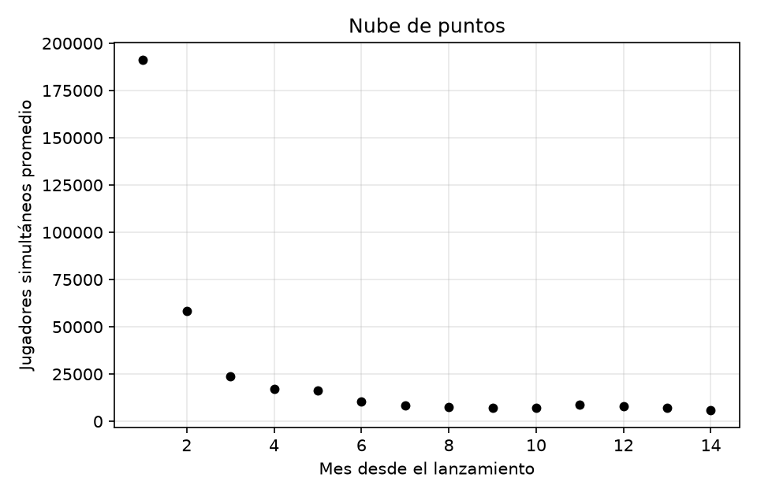
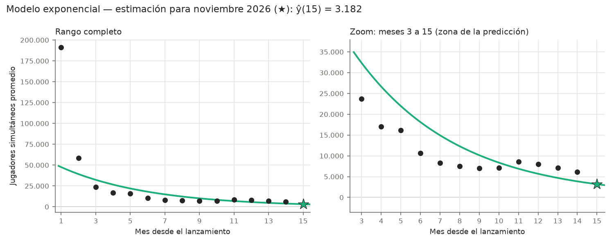
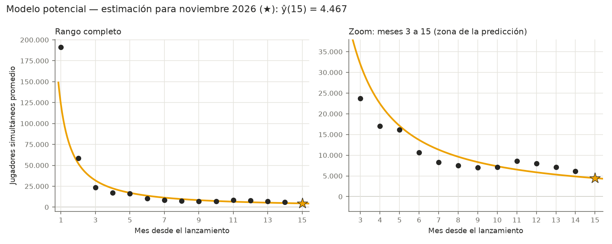
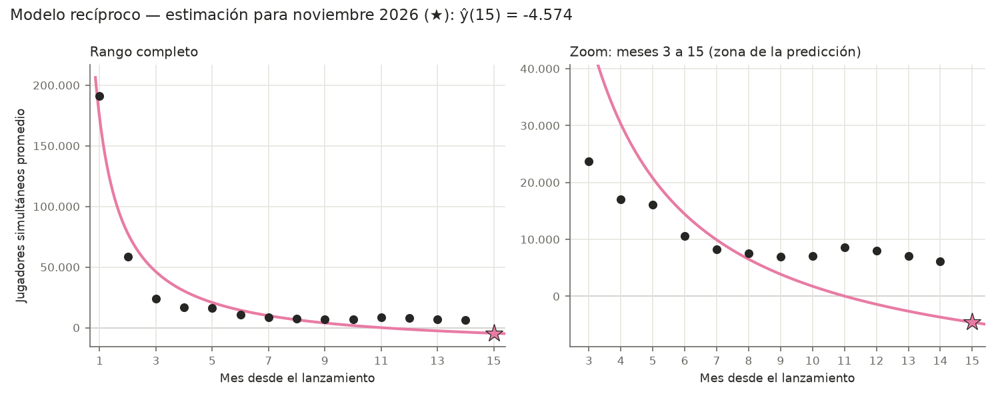
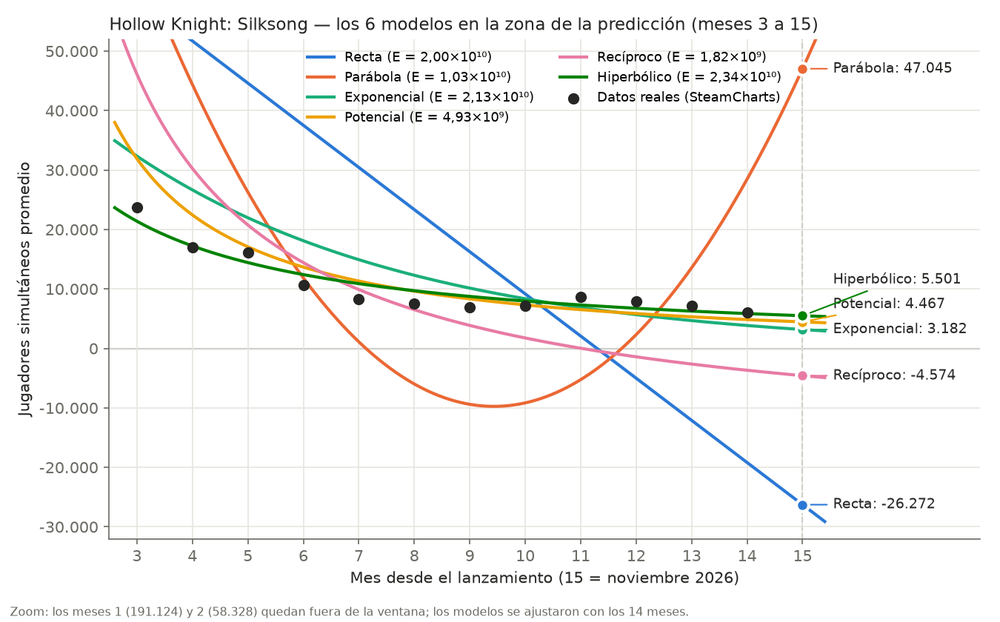
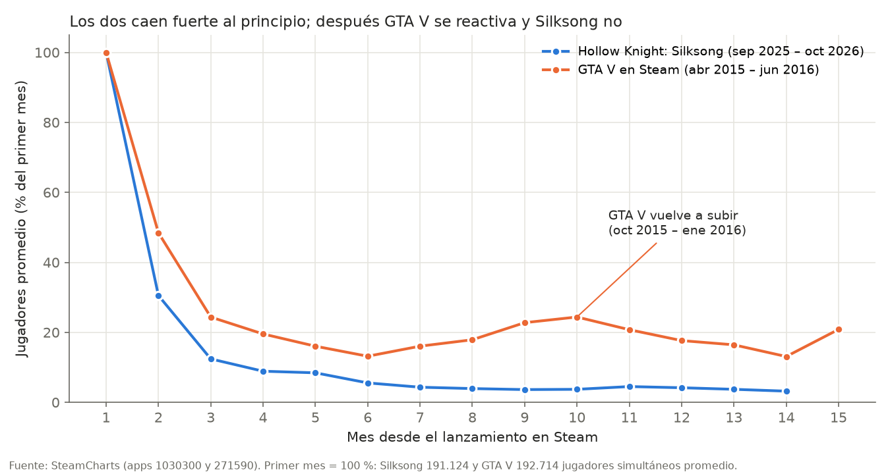

<!-- GENERADO por armar_tp.py el 2026-11-12 — no editar a mano. Fuentes: tp-fuente.md, ajuste/reporte.md, borrador-d.md. -->

# ¿Cuántos jugadores le quedan a Hollow Knight: Silksong?

## Aproximación discreta por mínimos cuadrados

<table>
<tr><td><strong>Universidad</strong></td><td>Universidad Tecnológica Nacional — Facultad Regional Buenos Aires</td></tr>
<tr><td><strong>Materia</strong></td><td>Análisis Numérico</td></tr>
<tr><td><strong>Trabajo</strong></td><td>Trabajo Práctico — 2.º cuatrimestre 2026</td></tr>
<tr><td><strong>Curso</strong></td><td>K3572</td></tr>
<tr><td><strong>Profesor</strong></td><td>Ing. Luciano Garofalo</td></tr>
<tr><td><strong>Ayudante</strong></td><td>Ing. Juan Francisco Paoli</td></tr>
<tr><td><strong>Integrantes</strong></td><td>Marotti, Juan Cruz Iglesias Basso, Bautista Juliano, Tomás Rubén Gallegos, Agustin Schirripa, Luciano</td></tr>
<tr><td><strong>Fecha de entrega</strong></td><td>Noviembre de 2026</td></tr>
</table>

---

## a) El problema

### Contexto

*Hollow Knight: Silksong*, del estudio australiano Team Cherry, es la secuela de *Hollow
Knight* y uno de los juegos independientes más esperados de los últimos años: se anunció en
2019 y salió recién el **4 de septiembre de 2025**. En sus primeros tres meses vendió más de
7 millones de copias.

Como pasa con casi todos los lanzamientos grandes, la cantidad de gente jugando al mismo
tiempo explota el primer mes y después baja: los jugadores lo terminan, lo dejan o pasan a
otro juego. Esa caída no es pareja: es muy fuerte al principio y cada vez más lenta.

### ¿Para qué sirve predecirlo?

Para un estudio, saber **cuántos jugadores va a tener si no hace nada** sirve para decidir
**cuándo** conviene sacar una oferta, una actualización o una expansión que reactive el
juego, y para dimensionar servidores, soporte y comunidad. No es un caso hipotético: Team
Cherry anunció para 2026 *Sea of Sorrow*, una expansión gratuita de Silksong.

### Los datos

Usamos los datos públicos de **SteamCharts**, que registra cuántos jugadores tiene abierto
cada juego en Steam en todo momento. Para cada mes tomamos el **promedio de jugadores
simultáneos** (*Avg. Players*): no es la cantidad total de personas que jugaron, sino
cuántas, en promedio, estaban jugando al mismo tiempo. Datos descargados el 11 de noviembre
de 2026.

- $x$ = mes desde el lanzamiento (1 = septiembre 2025, …, 14 = octubre 2026). Empezamos en
  1 y no en 0 porque los modelos potencial y recíproco usan $\ln x$ y $1/x$.
- $y$ = jugadores simultáneos promedio en ese mes (redondeado al entero).

| Mes | $x$ | $y$ |
|---|:---:|---:|
| Septiembre 2025 | 1 | 191.124 |
| Octubre 2025 | 2 | 58.328 |
| Noviembre 2025 | 3 | 23.721 |
| Diciembre 2025 | 4 | 17.001 |
| Enero 2026 | 5 | 16.126 |
| Febrero 2026 | 6 | 10.613 |
| Marzo 2026 | 7 | 8.269 |
| Abril 2026 | 8 | 7.515 |
| Mayo 2026 | 9 | 6.967 |
| Junio 2026 | 10 | 7.111 |
| Julio 2026 | 11 | 8.619 |
| Agosto 2026 | 12 | 7.972 |
| Septiembre 2026 | 13 | 7.116 |
| Octubre 2026 | 14 | 6.108 |

### Lo que queremos saber

**¿Cuántos jugadores simultáneos promedio va a tener Silksong en noviembre de 2026**, es
decir, en $x = 15$? Es un valor que todavía no existe: el mes está en curso.

## b) Nube de puntos

Lo que se ve:

- **Caída muy fuerte al principio:** del mes 1 al 2 se fue el 69 % de los jugadores, y del 2
  al 3 otro 59 %.
- **Después se frena:** del mes 7 en adelante los valores quedan entre 6.000 y 9.000
  jugadores, con una cola que baja muy despacio.
- **Un salto en julio de 2026** (mes 11), que sube de 7.111 a 8.619 sin que la tendencia lo
  explique. Coincide con la oferta de verano de Steam (del 25 de junio al 9 de julio de
  2026), en la que Silksong bajó de USD 19,99 a USD 14,99; ese mes no hubo una actualización
  importante del juego. No podemos probar que sea la causa, pero es la explicación más
  probable.

La forma (decreciente, cada vez más lenta y siempre positiva) sugiere que una recta no va a
alcanzar y que conviene probar modelos no lineales.

## c) Ajuste de los modelos

Ajustamos **tres modelos no polinómicos** a los mismos 14 puntos: **exponencial,
potencial y recíproco**. Los elegimos porque los tres describen caídas que se van frenando,
que es la forma de la nube. En los tres, primero llevamos el modelo a una **forma
aparentemente lineal** con un cambio de variables, armamos el sistema de ecuaciones
normales de esa recta, lo resolvemos y después volvemos a los parámetros originales.

En cada modelo seguimos los mismos pasos: cambio de variables, sistema de ecuaciones
normales, tabla de sumatorias, sistema con los valores, resolución del sistema (regla de
Cramer), función aproximante con su gráfico y tabla de residuos con el error cuadrático en
las variables originales. Todos los cálculos se hicieron con las sumatorias sin redondear;
en las tablas y en las cuentas los valores se muestran redondeados.

### c.1 Modelo exponencial: $y = a_0\,e^{a_1 x}$

**¿Por qué lo probamos?** Es el modelo típico de las caídas en las que **cada mes se pierde el mismo porcentaje** de jugadores.

**Paso 1 — cambio de variables.** El modelo no es lineal en sus parámetros; lo llevamos a una forma aparentemente lineal:

$$
y = a_0\,e^{a_1 x}
$$

$$
\ln y = \ln a_0 + a_1\,x
$$

$$
\underbrace{\ln y}_{Y} = \underbrace{\ln a_0}_{A_0} + a_1\,\underbrace{x}_{X}
$$

Queda una recta $Y = A_0 + a_1\,X$ en las variables $X = x$, $Y = \ln y$.

**Paso 2 — sistema de ecuaciones normales** (forma general, $m$ = cantidad de puntos):

$$
\left\{\begin{aligned}
m\;A_0 + \sum x\;a_1 &= \sum Y \\
\sum x\;A_0 + \sum x^2\;a_1 &= \sum x\,Y
\end{aligned}\right.
$$

**Paso 3 — tabla de sumatorias:**

| $i$ | $x$ | $y$ | $Y = \ln y$ | $x^2$ | $x\,Y$ |
|:---:|:---:|:---:|:---:|:---:|:---:|
| 1 | $1$ | $191124$ | $12{,}1607$ | $1$ | $12{,}1607$ |
| 2 | $2$ | $58328$ | $10{,}9738$ | $4$ | $21{,}9477$ |
| 3 | $3$ | $23721$ | $10{,}0741$ | $9$ | $30{,}2223$ |
| 4 | $4$ | $17001$ | $9{,}7410$ | $16$ | $38{,}9641$ |
| 5 | $5$ | $16126$ | $9{,}6882$ | $25$ | $48{,}4409$ |
| 6 | $6$ | $10613$ | $9{,}2698$ | $36$ | $55{,}6190$ |
| 7 | $7$ | $8269$ | $9{,}0203$ | $49$ | $63{,}1419$ |
| 8 | $8$ | $7515$ | $8{,}9247$ | $64$ | $71{,}3973$ |
| 9 | $9$ | $6967$ | $8{,}8489$ | $81$ | $79{,}6405$ |
| 10 | $10$ | $7111$ | $8{,}8694$ | $100$ | $88{,}6940$ |
| 11 | $11$ | $8619$ | $9{,}0617$ | $121$ | $99{,}6790$ |
| 12 | $12$ | $7972$ | $8{,}9837$ | $144$ | $107{,}8043$ |
| 13 | $13$ | $7116$ | $8{,}8701$ | $169$ | $115{,}3113$ |
| 14 | $14$ | $6108$ | $8{,}7174$ | $196$ | $122{,}0430$ |
| $\Sigma$ | $\mathbf{105}$ | $\mathbf{376590}$ | $\mathbf{133{,}2038}$ | $\mathbf{1015}$ | $\mathbf{955{,}0659}$ |

**Paso 4 — sistema con los valores** ($m = 14$):

$$
\left\{\begin{aligned}
14\;A_0 + 105\;a_1 &= 133{,}2038 \\
105\;A_0 + 1015\;a_1 &= 955{,}0659
\end{aligned}\right.
$$

**Paso 5 — resolución del sistema** (regla de Cramer):

$$
\Delta = \begin{vmatrix} 14 & 105 \\ 105 & 1015 \end{vmatrix} = 14 \cdot 1015 - 105 \cdot 105 = 3185
$$

$$
\Delta_{A_0} = \begin{vmatrix} 133{,}20381586 & 105 \\ 955{,}06586999 & 1015 \end{vmatrix} = 133{,}20381586 \cdot 1015 - 105 \cdot 955{,}06586999 = 34919{,}9567
$$

$$
\Delta_{a_1} = \begin{vmatrix} 14 & 133{,}20381586 \\ 105 & 955{,}06586999 \end{vmatrix} = 14 \cdot 955{,}06586999 - 133{,}20381586 \cdot 105 = -615{,}478485
$$

$$
A_0 = \frac{\Delta_{A_0}}{\Delta} = 10{,}9639,\qquad a_1 = \frac{\Delta_{a_1}}{\Delta} = -0{,}193243
$$

Volvemos a los parámetros del modelo original:

$$
a_0 = e^{A_0}
$$

$$
a_0 = 57750{,}0602,\qquad a_1 = -0{,}193243
$$

**Paso 6 — función aproximante:**

$$
y = 57750{,}0602\,e^{-0{,}193243\,x}
$$

**Paso 7 — residuos en las variables originales:**

| $i$ | $x_i$ | $y_i$ | $\hat y_i$ | $y_i - \hat y_i$ | $(y_i - \hat y_i)^2$ |
|:---:|:---:|:---:|:---:|:---:|:---:|
| 1 | $1$ | $191124$ | $47602{,}3219$ | $143521{,}6781$ | $20598472099$ |
| 2 | $2$ | $58328$ | $39237{,}7262$ | $19090{,}2738$ | $364438555{,}5373$ |
| 3 | $3$ | $23721$ | $32342{,}9424$ | $-8621{,}9424$ | $74337890{,}7362$ |
| 4 | $4$ | $17001$ | $26659{,}6978$ | $-9658{,}6978$ | $93290443{,}8971$ |
| 5 | $5$ | $16126$ | $21975{,}1029$ | $-5849{,}1029$ | $34212005{,}2490$ |
| 6 | $6$ | $10613$ | $18113{,}6768$ | $-7500{,}6768$ | $56260152$ |
| 7 | $7$ | $8269$ | $14930{,}7736$ | $-6661{,}7736$ | $44379227$ |
| 8 | $8$ | $7515$ | $12307{,}1645$ | $-4792{,}1645$ | $22964840{,}3560$ |
| 9 | $9$ | $6967$ | $10144{,}5713$ | $-3177{,}5713$ | $10096959{,}5450$ |
| 10 | $10$ | $7111$ | $8361{,}9852$ | $-1250{,}9852$ | $1564964{,}0186$ |
| 11 | $11$ | $8619$ | $6892{,}6320$ | $1726{,}3680$ | $2980346{,}5246$ |
| 12 | $12$ | $7972$ | $5681{,}4709$ | $2290{,}5291$ | $5246523{,}5657$ |
| 13 | $13$ | $7116$ | $4683{,}1329$ | $2432{,}8671$ | $5918842{,}3589$ |
| 14 | $14$ | $6108$ | $3860{,}2211$ | $2247{,}7789$ | $5052510{,}0976$ |
| $\Sigma$ | | | | | $\mathbf{21319215360}$ |

Error cuadrático (suma de residuos al cuadrado): $\sum (y_i - \hat y_i)^2 = 21319215360$.

### c.2 Modelo potencial: $y = a_0\,x^{a_1}$

**¿Por qué lo probamos?** Modela caídas en las que el porcentaje que se pierde **es cada vez menor**: muy fuerte al principio y con una cola que baja despacio.

**Paso 1 — cambio de variables.** El modelo no es lineal en sus parámetros; lo llevamos a una forma aparentemente lineal:

$$
y = a_0\,x^{a_1}
$$

$$
\ln y = \ln a_0 + a_1 \ln x
$$

$$
\underbrace{\ln y}_{Y} = \underbrace{\ln a_0}_{A_0} + a_1\,\underbrace{\ln x}_{X}
$$

Queda una recta $Y = A_0 + a_1\,X$ en las variables $X = \ln x$, $Y = \ln y$.

**Paso 2 — sistema de ecuaciones normales** (forma general, $m$ = cantidad de puntos):

$$
\left\{\begin{aligned}
m\;A_0 + \sum X\;a_1 &= \sum Y \\
\sum X\;A_0 + \sum X^2\;a_1 &= \sum X\,Y
\end{aligned}\right.
$$

**Paso 3 — tabla de sumatorias:**

| $i$ | $x$ | $y$ | $X = \ln x$ | $Y = \ln y$ | $X^2$ | $X\,Y$ |
|:---:|:---:|:---:|:---:|:---:|:---:|:---:|
| 1 | $1$ | $191124$ | $0$ | $12{,}1607$ | $0$ | $0$ |
| 2 | $2$ | $58328$ | $0{,}693147$ | $10{,}9738$ | $0{,}480453$ | $7{,}6065$ |
| 3 | $3$ | $23721$ | $1{,}0986$ | $10{,}0741$ | $1{,}2069$ | $11{,}0675$ |
| 4 | $4$ | $17001$ | $1{,}3863$ | $9{,}7410$ | $1{,}9218$ | $13{,}5039$ |
| 5 | $5$ | $16126$ | $1{,}6094$ | $9{,}6882$ | $2{,}5903$ | $15{,}5925$ |
| 6 | $6$ | $10613$ | $1{,}7918$ | $9{,}2698$ | $3{,}2104$ | $16{,}6093$ |
| 7 | $7$ | $8269$ | $1{,}9459$ | $9{,}0203$ | $3{,}7866$ | $17{,}5526$ |
| 8 | $8$ | $7515$ | $2{,}0794$ | $8{,}9247$ | $4{,}3241$ | $18{,}5583$ |
| 9 | $9$ | $6967$ | $2{,}1972$ | $8{,}8489$ | $4{,}8278$ | $19{,}4431$ |
| 10 | $10$ | $7111$ | $2{,}3026$ | $8{,}8694$ | $5{,}3019$ | $20{,}4225$ |
| 11 | $11$ | $8619$ | $2{,}3979$ | $9{,}0617$ | $5{,}7499$ | $21{,}7291$ |
| 12 | $12$ | $7972$ | $2{,}4849$ | $8{,}9837$ | $6{,}1748$ | $22{,}3236$ |
| 13 | $13$ | $7116$ | $2{,}5649$ | $8{,}8701$ | $6{,}5790$ | $22{,}7514$ |
| 14 | $14$ | $6108$ | $2{,}6391$ | $8{,}7174$ | $6{,}9646$ | $23{,}0056$ |
| $\Sigma$ | $\mathbf{105}$ | $\mathbf{376590}$ | $\mathbf{25{,}1912}$ | $\mathbf{133{,}2038}$ | $\mathbf{53{,}1185}$ | $\mathbf{230{,}1661}$ |

**Paso 4 — sistema con los valores** ($m = 14$):

$$
\left\{\begin{aligned}
14\;A_0 + 25{,}1912\;a_1 &= 133{,}2038 \\
25{,}1912\;A_0 + 53{,}1185\;a_1 &= 230{,}1661
\end{aligned}\right.
$$

**Paso 5 — resolución del sistema** (regla de Cramer):

$$
\Delta = \begin{vmatrix} 14 & 25{,}19122118 \\ 25{,}19122118 & 53{,}11849540 \end{vmatrix} = 14 \cdot 53{,}11849540 - 25{,}19122118 \cdot 25{,}19122118 = 109{,}061311
$$

$$
\Delta_{A_0} = \begin{vmatrix} 133{,}20381586 & 25{,}19122118 \\ 230{,}16605908 & 53{,}11849540 \end{vmatrix} = 133{,}20381586 \cdot 53{,}11849540 - 25{,}19122118 \cdot 230{,}16605908 = 1277{,}4222
$$

$$
\Delta_{a_1} = \begin{vmatrix} 14 & 133{,}20381586 \\ 25{,}19122118 & 230{,}16605908 \end{vmatrix} = 14 \cdot 230{,}16605908 - 133{,}20381586 \cdot 25{,}19122118 = -133{,}241961
$$

$$
A_0 = \frac{\Delta_{A_0}}{\Delta} = 11{,}7129,\qquad a_1 = \frac{\Delta_{a_1}}{\Delta} = -1{,}2217
$$

Volvemos a los parámetros del modelo original:

$$
a_0 = e^{A_0}
$$

$$
a_0 = 122134{,}8678,\qquad a_1 = -1{,}2217
$$

**Paso 6 — función aproximante:**

$$
y = 122134{,}8678\,x^{-1{,}2217}
$$

**Paso 7 — residuos en las variables originales:**

| $i$ | $x_i$ | $y_i$ | $\hat y_i$ | $y_i - \hat y_i$ | $(y_i - \hat y_i)^2$ |
|:---:|:---:|:---:|:---:|:---:|:---:|
| 1 | $1$ | $191124$ | $122134{,}8678$ | $68989{,}1322$ | $4759500368$ |
| 2 | $2$ | $58328$ | $52368{,}0583$ | $5959{,}9417$ | $35520905{,}4626$ |
| 3 | $3$ | $23721$ | $31910{,}4511$ | $-8189{,}4511$ | $67067108{,}7597$ |
| 4 | $4$ | $17001$ | $22453{,}9771$ | $-5452{,}9771$ | $29734959{,}5196$ |
| 5 | $5$ | $16126$ | $17096{,}0883$ | $-970{,}0883$ | $941071{,}2703$ |
| 6 | $6$ | $10613$ | $13682{,}3201$ | $-3069{,}3201$ | $9420726{,}1154$ |
| 7 | $7$ | $8269$ | $11333{,}6495$ | $-3064{,}6495$ | $9392076{,}3546$ |
| 8 | $8$ | $7515$ | $9627{,}6453$ | $-2112{,}6453$ | $4463270{,}0556$ |
| 9 | $9$ | $6967$ | $8337{,}3152$ | $-1370{,}3152$ | $1877763{,}6991$ |
| 10 | $10$ | $7111$ | $7330{,}3305$ | $-219{,}3305$ | $48105{,}8717$ |
| 11 | $11$ | $8619$ | $6524{,}5933$ | $2094{,}4067$ | $4386539{,}4048$ |
| 12 | $12$ | $7972$ | $5866{,}6010$ | $2105{,}3990$ | $4432704{,}9160$ |
| 13 | $13$ | $7116$ | $5320{,}0673$ | $1795{,}9327$ | $3225374{,}2177$ |
| 14 | $14$ | $6108$ | $4859{,}5559$ | $1248{,}4441$ | $1558612{,}7022$ |
| $\Sigma$ | | | | | $\mathbf{4931569586}$ |

Error cuadrático (suma de residuos al cuadrado): $\sum (y_i - \hat y_i)^2 = 4931569586$.

### c.3 Modelo recíproco: $y = a_0 + a_1\,\frac{1}{x}$

**¿Por qué lo probamos?** Baja como $1/x$ y se acerca a un piso $a_0$: podría representar a los jugadores "fieles" que siguen jugando.

**Paso 1 — cambio de variables.** El modelo no es lineal en sus parámetros; lo llevamos a una forma aparentemente lineal:

$$
y = a_0 + a_1\,\underbrace{\frac{1}{x}}_{X}
$$

Queda una recta $Y = a_0 + a_1\,X$ en las variables $X = \tfrac{1}{x}$, $Y = y$.

**Paso 2 — sistema de ecuaciones normales** (forma general, $m$ = cantidad de puntos):

$$
\left\{\begin{aligned}
m\;a_0 + \sum X\;a_1 &= \sum y \\
\sum X\;a_0 + \sum X^2\;a_1 &= \sum X\,y
\end{aligned}\right.
$$

**Paso 3 — tabla de sumatorias:**

| $i$ | $x$ | $y$ | $X = \tfrac{1}{x}$ | $X^2$ | $X\,y$ |
|:---:|:---:|:---:|:---:|:---:|:---:|
| 1 | $1$ | $191124$ | $1$ | $1$ | $191124$ |
| 2 | $2$ | $58328$ | $0{,}500000$ | $0{,}250000$ | $29164$ |
| 3 | $3$ | $23721$ | $0{,}333333$ | $0{,}111111$ | $7907$ |
| 4 | $4$ | $17001$ | $0{,}250000$ | $0{,}0625000$ | $4250{,}2500$ |
| 5 | $5$ | $16126$ | $0{,}200000$ | $0{,}0400000$ | $3225{,}2000$ |
| 6 | $6$ | $10613$ | $0{,}166667$ | $0{,}0277778$ | $1768{,}8333$ |
| 7 | $7$ | $8269$ | $0{,}142857$ | $0{,}0204082$ | $1181{,}2857$ |
| 8 | $8$ | $7515$ | $0{,}125000$ | $0{,}0156250$ | $939{,}3750$ |
| 9 | $9$ | $6967$ | $0{,}111111$ | $0{,}0123457$ | $774{,}1111$ |
| 10 | $10$ | $7111$ | $0{,}100000$ | $0{,}0100000$ | $711{,}1000$ |
| 11 | $11$ | $8619$ | $0{,}0909091$ | $0{,}00826446$ | $783{,}5455$ |
| 12 | $12$ | $7972$ | $0{,}0833333$ | $0{,}00694444$ | $664{,}3333$ |
| 13 | $13$ | $7116$ | $0{,}0769231$ | $0{,}00591716$ | $547{,}3846$ |
| 14 | $14$ | $6108$ | $0{,}0714286$ | $0{,}00510204$ | $436{,}2857$ |
| $\Sigma$ | $\mathbf{105}$ | $\mathbf{376590}$ | $\mathbf{3{,}2516}$ | $\mathbf{1{,}5760}$ | $\mathbf{243476{,}7043}$ |

**Paso 4 — sistema con los valores** ($m = 14$):

$$
\left\{\begin{aligned}
14\;a_0 + 3{,}2516\;a_1 &= 376590 \\
3{,}2516\;a_0 + 1{,}5760\;a_1 &= 243476{,}7043
\end{aligned}\right.
$$

**Paso 5 — resolución del sistema** (regla de Cramer):

$$
\Delta = \begin{vmatrix} 14 & 3{,}25156233 \\ 3{,}25156233 & 1{,}57599584 \end{vmatrix} = 14 \cdot 1{,}57599584 - 3{,}25156233 \cdot 3{,}25156233 = 11{,}491284
$$

$$
\Delta_{a_0} = \begin{vmatrix} 376590 & 3{,}25156233 \\ 243476{,}70427628 & 1{,}57599584 \end{vmatrix} = 376590 \cdot 1{,}57599584 - 3{,}25156233 \cdot 243476{,}70427628 = -198175{,}4060
$$

$$
\Delta_{a_1} = \begin{vmatrix} 14 & 376590 \\ 3{,}25156233 & 243476{,}70427628 \end{vmatrix} = 14 \cdot 243476{,}70427628 - 376590 \cdot 3{,}25156233 = 2184168{,}0033
$$

$$
a_0 = \frac{\Delta_{a_0}}{\Delta} = -17245{,}7145,\qquad a_1 = \frac{\Delta_{a_1}}{\Delta} = 190071{,}7073
$$

**Paso 6 — función aproximante:**

$$
y = -17245{,}7145 + 190071{,}7073\,\frac{1}{x}
$$

**Paso 7 — residuos en las variables originales:**

| $i$ | $x_i$ | $y_i$ | $\hat y_i$ | $y_i - \hat y_i$ | $(y_i - \hat y_i)^2$ |
|:---:|:---:|:---:|:---:|:---:|:---:|
| 1 | $1$ | $191124$ | $172825{,}9928$ | $18298{,}0072$ | $334817068$ |
| 2 | $2$ | $58328$ | $77790{,}1392$ | $-19462{,}1392$ | $378774860{,}5475$ |
| 3 | $3$ | $23721$ | $46111{,}5213$ | $-22390{,}5213$ | $501335443$ |
| 4 | $4$ | $17001$ | $30272{,}2123$ | $-13271{,}2123$ | $176125077$ |
| 5 | $5$ | $16126$ | $20768{,}6270$ | $-4642{,}6270$ | $21553985{,}2295$ |
| 6 | $6$ | $10613$ | $14432{,}9034$ | $-3819{,}9034$ | $14591661{,}9803$ |
| 7 | $7$ | $8269$ | $9907{,}3866$ | $-1638{,}3866$ | $2684310{,}5185$ |
| 8 | $8$ | $7515$ | $6513{,}2489$ | $1001{,}7511$ | $1003505{,}2069$ |
| 9 | $9$ | $6967$ | $3873{,}3641$ | $3093{,}6359$ | $9570583{,}0417$ |
| 10 | $10$ | $7111$ | $1761{,}4562$ | $5349{,}5438$ | $28617618{,}3556$ |
| 11 | $11$ | $8619$ | $33{,}5316$ | $8585{,}4684$ | $73710267$ |
| 12 | $12$ | $7972$ | $-1406{,}4055$ | $9378{,}4055$ | $87954490{,}4718$ |
| 13 | $13$ | $7116$ | $-2624{,}8139$ | $9740{,}8139$ | $94883455{,}8221$ |
| 14 | $14$ | $6108$ | $-3669{,}1640$ | $9777{,}1640$ | $95592935{,}0979$ |
| $\Sigma$ | | | | | $\mathbf{1821215261}$ |

Error cuadrático (suma de residuos al cuadrado): $\sum (y_i - \hat y_i)^2 = 1821215261$.

## d) Comparación, elección y estimación

### d.1 Comparación de los tres modelos

Para comparar usamos el **error cuadrático** de cada función final, calculado en las
variables originales (jugadores, no logaritmos ni inversas):

$$
E = \sum_{i=1}^{14} \left( y_i - \hat y_i \right)^2
$$

| Modelo | Función aproximante | $E$ | $\hat y(15)$ |
|---|---|---:|---:|
| Recíproco | $y = -17245{,}71 + \dfrac{190071{,}71}{x}$ | $1{,}82 \times 10^{9}$ | $-4.574$ |
| Potencial | $y = 122134{,}87\,x^{-1{,}22172}$ | $4{,}93 \times 10^{9}$ | $4.467$ |
| Exponencial | $y = 57750{,}06\,e^{-0{,}193243\,x}$ | $2{,}13 \times 10^{10}$ | $3.182$ |

### d.2 Criterio de elección

Si miráramos solo el error, el mejor sería el **recíproco**. Pero el ajuste no se hace para
pasar lo más cerca posible de los puntos: se hace para **predecir valores e interpretar
tendencias**. Por eso un polinomio interpolante, que tiene error cero, no es el mejor
ajuste. Además, si se sabe cómo se comporta el fenómeno, conviene usar un modelo de ese
tipo.

Elegimos en dos pasos:

1. **Descartar los modelos que contradicen el fenómeno.** La cantidad de jugadores no puede
   ser negativa.
2. **Entre los que quedan, elegir el de menor error cuadrático.**

### d.3 Modelo descartado: el recíproco

El recíproco tiene el menor error, pero su curva corta el eje en $x \approx 11{,}02$: desde
el mes 12 predice jugadores **negativos**, cuando el dato real del mes 12 es de 7.972
jugadores. Para noviembre da $-4.574$. Su error es bajo porque copia muy bien el pico del
lanzamiento, pero describe mal justo la zona que queremos predecir.

### d.4 Elección: el modelo potencial

Quedan dos modelos que tienen sentido (siempre positivos y siempre decrecientes):
exponencial y potencial. El **potencial** tiene un error unas **cuatro veces menor**:

| Modelo | $E$ |
|---|---:|
| **Potencial** | $\mathbf{4{,}93 \times 10^{9}}$ |
| Exponencial | $2{,}13 \times 10^{10}$ |

La forma también acompaña. Los datos muestran que el porcentaje de jugadores que se pierde
cada mes es **cada vez menor**: del mes 1 al 2 se fue el 69 %, del 3 al 4 el 28 % y del 8
al 9 solo el 7 %. Eso es justo lo que supone el potencial. El exponencial, en cambio,
supone que cada mes se pierde **el mismo porcentaje** (con $e^{-0{,}193243} \approx 0{,}82$,
un 18 % por mes), así que se acerca a cero demasiado rápido.

### d.5 Estimación para noviembre de 2026

Noviembre de 2026 es el mes $x = 15$:

$$
\hat y(15) = 122134{,}87 \cdot 15^{-1{,}22172} \approx 4.467
$$

**El modelo estima unos 4.467 jugadores simultáneos promedio en noviembre de 2026.**

### d.6 ¿Es confiable?

**A favor:**

- **Extrapolamos un solo mes.** Predecimos fuera del rango de los datos, pero muy cerca
  del último mes (14). Cuanto más lejos, menos confiable sería.
- **Los dos modelos razonables coinciden en el orden de magnitud.** El exponencial da 3.182
  y el potencial 4.467: ninguno da 500 ni 50.000.

**En contra (por qué esperamos que el valor real sea mayor):**

- **Los residuos tienen un patrón.** En los meses 3 a 10 el modelo queda **por encima** de
  los datos, y en los meses 11 a 14 queda **por debajo**:

  | Mes | Real $y$ | Potencial $\hat y$ | $\dfrac{y - \hat y}{y}$ |
  |---:|---:|---:|---:|
  | 11 | 8.619 | 6.525 | 24 % |
  | 12 | 7.972 | 5.867 | 26 % |
  | 13 | 7.116 | 5.320 | 25 % |
  | 14 | 6.108 | 4.860 | 20 % |

  Si el patrón sigue y en noviembre el modelo vuelve a quedar entre un 20 % y un 26 % por
  debajo, el valor real sería

  $$
  \frac{4.467}{1 - 0{,}20} \approx 5.583 \qquad \text{a} \qquad \frac{4.467}{1 - 0{,}26} \approx 6.036
  $$

  es decir, entre unos **5.600 y 6.000 jugadores**. El modelo **subestima la cola**: la
  comunidad que se queda jugando es más grande de lo que la curva supone.
- **Lo comprobamos con datos que ya conocíamos.** Ajustamos el potencial solo con los meses
  1 a 11 y predijimos los meses 12 a 14:

  | Mes | Real | Predicción | Error |
  |---:|---:|---:|---:|
  | 12 | 7.972 | 4.787 | −40 % |
  | 13 | 7.116 | 4.291 | −40 % |
  | 14 | 6.108 | 3.878 | −37 % |

  En los tres meses se quedó corto, siempre del mismo lado. Eso confirma que el modelo
  tiende a subestimar.
- **El mes 1 domina el error.** El lanzamiento (191.124 jugadores) es casi treinta veces
  más grande que los últimos meses. Un error chico en ese punto pesa más que todos los
  demás juntos, por eso el ajuste "prioriza" el lanzamiento sobre la cola. Por eso el
  recíproco tiene el menor error y aun así predice mal.
- **El modelo supone que no pasa nada nuevo.** En julio de 2026 (mes 11) los jugadores
  subieron de 7.111 a 8.619 sin que la curva lo explique. Coincide con la oferta de verano
  de Steam (del 25 de junio al 9 de julio de 2026), en la que Silksong bajó de USD 19,99 a
  USD 14,99, y en ese período no hubo una actualización importante del juego (Team Cherry
  había presentado en marzo el último parche grande). No podemos probar que esa sea la
  causa, pero es la explicación más probable. Además, Team Cherry anunció para 2026 la
  expansión gratuita *Sea of Sorrow*: al día de hoy no tiene fecha confirmada, y el manual
  de la edición física la anuncia solo como "próximamente". Si saliera en noviembre, la
  predicción dejaría de valer.
- **Vale solo para este juego.** Otro juego, con otra reputación, precio y comunidad,
  tendría otros coeficientes. Lo que sí suele repetirse es la forma de la curva.

### d.7 Conclusión del punto d)

El modelo potencial estima **4.467 jugadores simultáneos promedio** para noviembre de 2026.
Lo tomamos como un **piso** más que como un valor exacto: por el patrón de los residuos y
por la prueba con los meses 12 a 14, esperamos que el valor real sea mayor, del orden de
5.600 a 6.000 jugadores, siempre que no salga la expansión ni haya un evento que reactive el
juego.

Como contraste con un dato real parcial: al 11 de noviembre de 2026, SteamCharts informaba
un promedio de **5.702 jugadores en los últimos 30 días** (del 12 de octubre al 11 de
noviembre). No es exactamente el mes de noviembre, pero sirve de referencia: el modelo
quedó por debajo y el valor cae dentro del rango que anticipamos a partir de los residuos.

El promedio real de noviembre va a estar disponible en SteamCharts a partir del **1 de
diciembre de 2026**: ese día se podrá comparar con nuestra estimación.

## Aplicaciones: ¿qué le espera a GTA VI?

El 19 de noviembre de 2026 sale *Grand Theft Auto VI*, por ahora solo en PlayStation 5 y
Xbox Series: como no sale en PC, no va a tener datos en Steam. Pero su antecesor, *GTA V*,
salió en Steam en abril de 2015, y sus datos públicos muestran lo que nuestro modelo **no**
puede prever:

- Los primeros meses, GTA V cayó igual que Silksong: de 192.714 jugadores promedio en abril
  de 2015 a 25.388 en septiembre (−87 %).
- **Desde octubre de 2015 volvió a subir**, hasta 46.993 en enero de 2016. En ese período
  Rockstar lanzó actualizaciones gratuitas del modo online, como *Lowriders* (20 de octubre
  de 2015) y *Executives and Other Criminals* (15 de diciembre de 2015).
- Cualquiera de nuestros modelos, ajustado con los primeros seis meses de GTA V, habría
  predicho que seguía bajando (las tres funciones son siempre decrecientes), y se habría
  equivocado.

**Lo que esto enseña:** el ajuste predice qué pasa **si nada cambia**. Por eso le sirve al
estudio: le muestra la tendencia "natural" del juego para decidir cuándo intervenir. Si
GTA VI recibe actualizaciones como su antecesor, su curva no va a seguir un modelo de
caída; si Team Cherry lanza *Sea of Sorrow*, tampoco la de Silksong.

## Conclusiones

El método de mínimos cuadrados nos permitió estimar que Silksong tendrá unos **4.467
jugadores simultáneos promedio** en noviembre de 2026, usando el modelo potencial. El
trabajo también mostró que **el modelo de menor error no siempre es el mejor para
predecir**: el recíproco tenía el menor error pero daba jugadores negativos, así que antes
de elegir hay que mirar si el modelo tiene sentido con el fenómeno.

El valor estimado debe tomarse como un **piso** más que como un valor exacto: por el patrón
de los residuos y por la prueba con los meses 12 a 14, esperamos que el valor real sea
mayor, del orden de 5.600 a 6.000 jugadores. El dato parcial de SteamCharts (5.702
jugadores en los 30 días previos al 11 de noviembre) cae dentro de ese rango, y el valor
real de noviembre se va a poder comparar con nuestra estimación a partir del 1 de diciembre
de 2026. Y, como
muestra GTA V, el modelo solo vale mientras no pase nada nuevo.

## Video

[a completar: link de YouTube o Google Drive]

## Fuentes

- SteamCharts, *Hollow Knight: Silksong* (app 1030300): <https://steamcharts.com/app/1030300>
  (consultado el 2026-11-11).
- SteamCharts, *Grand Theft Auto V Legacy* (app 271590):
  <https://steamcharts.com/app/271590> (consultado el 2026-11-11).
- Gematsu, "Hollow Knight: Silksong sales top seven million; free expansion Sea of Sorrow
  announced" (diciembre 2025).
- KeenGamer, "10 best indie game deals in the Steam Summer Sale 2026" (junio 2026): fechas
  de la oferta y precio de Silksong.
  <https://www.keengamer.com/articles/guides/10-best-indie-game-deals-in-the-steam-summer-sale-2026/>
- GamesRadar, "Hollow Knight: Silksong patch 5 is here, and Team Cherry says it's 'the last
  significant update' before the Sea of Sorrow DLC drops" (18/03/2026).
  <https://www.gamesradar.com/games/action/hollow-knight-silksong-patch-5-is-here-and-team-cherry-says-its-the-last-significant-update-before-the-sea-of-sorrow-dlc-drops/>
- GameLuster, "Silksong physical edition booklet teases more free DLC beyond Sea of Sorrow"
  (09/11/2026). <https://gameluster.com/?p=169500>
- Gematsu, "Grand Theft Auto VI delayed to November 19, 2026" (noviembre 2025), sobre el
  anuncio oficial de Rockstar Games.
  <https://www.gematsu.com/2025/11/grand-theft-auto-vi-delayed-to-november-19-2026>
- GTA Wiki, "2015" (cronología de actualizaciones de GTA Online). <https://gta.wiki/w/2015>
- Cátedra de Análisis Numérico, clases teórica y práctica de aproximación discreta por
  mínimos cuadrados (2.º cuatrimestre 2026).

