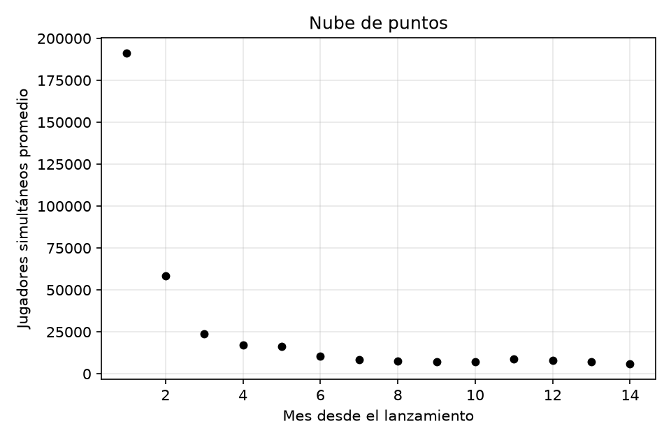
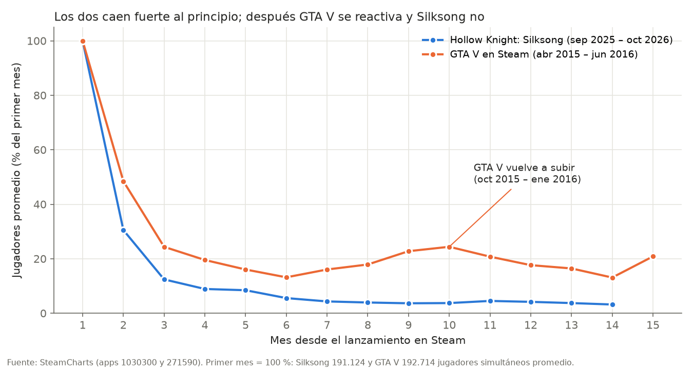

<!--
Fuente del TP. NO es el entregable: `armar_tp.py` lo combina con ajuste/reporte.md (punto c)
y borrador-d.md (punto d) y genera exports/tp-silksong.md + .html + .pdf.
Marcadores: {{MODELOS}} y {{PUNTO_D}}. Lo marcado [a completar] lo completa el grupo.
-->

# ¿Cuántos jugadores le quedan a Hollow Knight: Silksong?

## Aproximación discreta por mínimos cuadrados

<table>
<tr><td><strong>Universidad</strong></td><td>Universidad Tecnológica Nacional — Facultad Regional Buenos Aires</td></tr>
<tr><td><strong>Materia</strong></td><td>Análisis Numérico</td></tr>
<tr><td><strong>Trabajo</strong></td><td>Trabajo Práctico — 2.º cuatrimestre 2026</td></tr>
<tr><td><strong>Curso</strong></td><td>K3572</td></tr>
<tr><td><strong>Profesor</strong></td><td>Ing. Luciano Garofalo</td></tr>
<tr><td><strong>Ayudante</strong></td><td>Ing. Juan Francisco Paoli</td></tr>
<tr><td><strong>Integrantes</strong></td><td>Marotti, Juan Cruz Iglesias Basso, Bautista Juliano, Tomás Rubén Gallegos, Agustin Schirripa, Luciano</td></tr>
<tr><td><strong>Fecha de entrega</strong></td><td>Noviembre de 2026</td></tr>
</table>

---

## a) El problema

### Contexto

*Hollow Knight: Silksong*, del estudio australiano Team Cherry, es la secuela de *Hollow
Knight* y uno de los juegos independientes más esperados de los últimos años: se anunció en
2019 y salió recién el **4 de septiembre de 2025**. En sus primeros tres meses vendió más de
7 millones de copias.

Como pasa con casi todos los lanzamientos grandes, la cantidad de gente jugando al mismo
tiempo explota el primer mes y después baja: los jugadores lo terminan, lo dejan o pasan a
otro juego. Esa caída no es pareja: es muy fuerte al principio y cada vez más lenta.

### ¿Para qué sirve predecirlo?

Para un estudio, saber **cuántos jugadores va a tener si no hace nada** sirve para decidir
**cuándo** conviene sacar una oferta, una actualización o una expansión que reactive el
juego, y para dimensionar servidores, soporte y comunidad. No es un caso hipotético: Team
Cherry anunció para 2026 *Sea of Sorrow*, una expansión gratuita de Silksong.

### Los datos

Usamos los datos públicos de **SteamCharts**, que registra cuántos jugadores tiene abierto
cada juego en Steam en todo momento. Para cada mes tomamos el **promedio de jugadores
simultáneos** (*Avg. Players*): no es la cantidad total de personas que jugaron, sino
cuántas, en promedio, estaban jugando al mismo tiempo. Datos descargados el 11 de noviembre
de 2026.

- $x$ = mes desde el lanzamiento (1 = septiembre 2025, …, 14 = octubre 2026). Empezamos en
  1 y no en 0 porque los modelos potencial y recíproco usan $\ln x$ y $1/x$.
- $y$ = jugadores simultáneos promedio en ese mes (redondeado al entero).

| Mes | $x$ | $y$ |
|---|:---:|---:|
| Septiembre 2025 | 1 | 191.124 |
| Octubre 2025 | 2 | 58.328 |
| Noviembre 2025 | 3 | 23.721 |
| Diciembre 2025 | 4 | 17.001 |
| Enero 2026 | 5 | 16.126 |
| Febrero 2026 | 6 | 10.613 |
| Marzo 2026 | 7 | 8.269 |
| Abril 2026 | 8 | 7.515 |
| Mayo 2026 | 9 | 6.967 |
| Junio 2026 | 10 | 7.111 |
| Julio 2026 | 11 | 8.619 |
| Agosto 2026 | 12 | 7.972 |
| Septiembre 2026 | 13 | 7.116 |
| Octubre 2026 | 14 | 6.108 |

### Lo que queremos saber

**¿Cuántos jugadores simultáneos promedio va a tener Silksong en noviembre de 2026**, es
decir, en $x = 15$? Es un valor que todavía no existe: el mes está en curso.

## b) Nube de puntos

Lo que se ve:

- **Caída muy fuerte al principio:** del mes 1 al 2 se fue el 69 % de los jugadores, y del 2
  al 3 otro 59 %.
- **Después se frena:** del mes 7 en adelante los valores quedan entre 6.000 y 9.000
  jugadores, con una cola que baja muy despacio.
- **Un salto en julio de 2026** (mes 11), que sube de 7.111 a 8.619 sin que la tendencia lo
  explique. Coincide con la oferta de verano de Steam (del 25 de junio al 9 de julio de
  2026), en la que Silksong bajó de USD 19,99 a USD 14,99; ese mes no hubo una actualización
  importante del juego. No podemos probar que sea la causa, pero es la explicación más
  probable.

La forma (decreciente, cada vez más lenta y siempre positiva) sugiere que una recta no va a
alcanzar y que conviene probar modelos no lineales.

## c) Ajuste de los modelos

Ajustamos **tres modelos no polinómicos** a los mismos 14 puntos: **exponencial,
potencial y recíproco**. Los elegimos porque los tres describen caídas que se van frenando,
que es la forma de la nube. En los tres, primero llevamos el modelo a una **forma
aparentemente lineal** con un cambio de variables, armamos el sistema de ecuaciones
normales de esa recta, lo resolvemos y después volvemos a los parámetros originales.

En cada modelo seguimos los mismos pasos: cambio de variables, sistema de ecuaciones
normales, tabla de sumatorias, sistema con los valores, solución (los sistemas se
resolvieron con calculadora), función aproximante con su gráfico y tabla de residuos con el
error cuadrático en las variables originales. Todos los cálculos se hicieron sin redondear;
en las tablas los valores se muestran redondeados.

{{MODELOS}}

## d) Comparación, elección y estimación

{{PUNTO_D}}

## Aplicaciones: ¿qué le espera a GTA VI?

El 19 de noviembre de 2026 sale *Grand Theft Auto VI*, por ahora solo en PlayStation 5 y
Xbox Series: como no sale en PC, no va a tener datos en Steam. Pero su antecesor, *GTA V*,
salió en Steam en abril de 2015, y sus datos públicos muestran lo que nuestro modelo **no**
puede prever:

- Los primeros meses, GTA V cayó igual que Silksong: de 192.714 jugadores promedio en abril
  de 2015 a 25.388 en septiembre (−87 %).
- **Desde octubre de 2015 volvió a subir**, hasta 46.993 en enero de 2016. En ese período
  Rockstar lanzó actualizaciones gratuitas del modo online, como *Lowriders* (20 de octubre
  de 2015) y *Executives and Other Criminals* (15 de diciembre de 2015).
- Cualquiera de nuestros modelos, ajustado con los primeros seis meses de GTA V, habría
  predicho que seguía bajando (las tres funciones son siempre decrecientes), y se habría
  equivocado.

**Lo que esto enseña:** el ajuste predice qué pasa **si nada cambia**. Por eso le sirve al
estudio: le muestra la tendencia "natural" del juego para decidir cuándo intervenir. Si
GTA VI recibe actualizaciones como su antecesor, su curva no va a seguir un modelo de
caída; si Team Cherry lanza *Sea of Sorrow*, tampoco la de Silksong.

## Conclusiones

El método de mínimos cuadrados nos permitió estimar que Silksong tendrá unos **4.467
jugadores simultáneos promedio** en noviembre de 2026, usando el modelo potencial. El
trabajo también mostró que **el modelo de menor error no siempre es el mejor para
predecir**: el recíproco tenía el menor error pero daba jugadores negativos, así que antes
de elegir hay que mirar si el modelo tiene sentido con el fenómeno.

El valor estimado debe tomarse como un **piso** más que como un valor exacto: por el patrón
de los residuos y por la prueba con los meses 12 a 14, esperamos que el valor real sea
mayor, del orden de 5.600 a 6.000 jugadores. El dato parcial de SteamCharts (5.702
jugadores en los 30 días previos al 11 de noviembre) cae dentro de ese rango, y el valor
real de noviembre se va a poder comparar con nuestra estimación a partir del 1 de diciembre
de 2026. Y, como
muestra GTA V, el modelo solo vale mientras no pase nada nuevo.

## Video

[a completar: link de YouTube o Google Drive]

## Fuentes

- SteamCharts, *Hollow Knight: Silksong* (app 1030300): <https://steamcharts.com/app/1030300>
  (consultado el 2026-11-11).
- SteamCharts, *Grand Theft Auto V Legacy* (app 271590):
  <https://steamcharts.com/app/271590> (consultado el 2026-11-11).
- Gematsu, "Hollow Knight: Silksong sales top seven million; free expansion Sea of Sorrow
  announced" (diciembre 2025).
- KeenGamer, "10 best indie game deals in the Steam Summer Sale 2026" (junio 2026): fechas
  de la oferta y precio de Silksong.
  <https://www.keengamer.com/articles/guides/10-best-indie-game-deals-in-the-steam-summer-sale-2026/>
- GamesRadar, "Hollow Knight: Silksong patch 5 is here, and Team Cherry says it's 'the last
  significant update' before the Sea of Sorrow DLC drops" (18/03/2026).
  <https://www.gamesradar.com/games/action/hollow-knight-silksong-patch-5-is-here-and-team-cherry-says-its-the-last-significant-update-before-the-sea-of-sorrow-dlc-drops/>
- GameLuster, "Silksong physical edition booklet teases more free DLC beyond Sea of Sorrow"
  (09/11/2026). <https://gameluster.com/?p=169500>
- Gematsu, "Grand Theft Auto VI delayed to November 19, 2026" (noviembre 2025), sobre el
  anuncio oficial de Rockstar Games.
  <https://www.gematsu.com/2025/11/grand-theft-auto-vi-delayed-to-november-19-2026>
- GTA Wiki, "2015" (cronología de actualizaciones de GTA Online). <https://gta.wiki/w/2015>
- Cátedra de Análisis Numérico, clases teórica y práctica de aproximación discreta por
  mínimos cuadrados (2.º cuatrimestre 2026).
